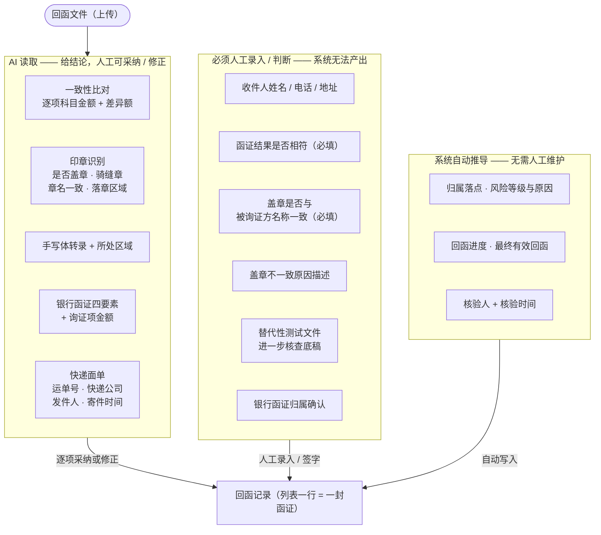
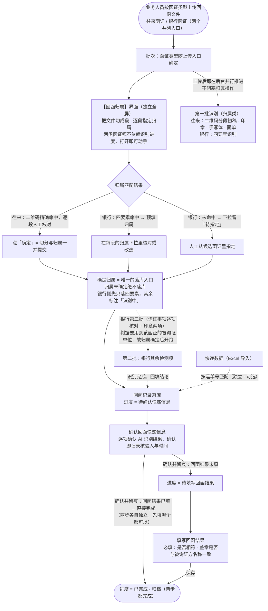
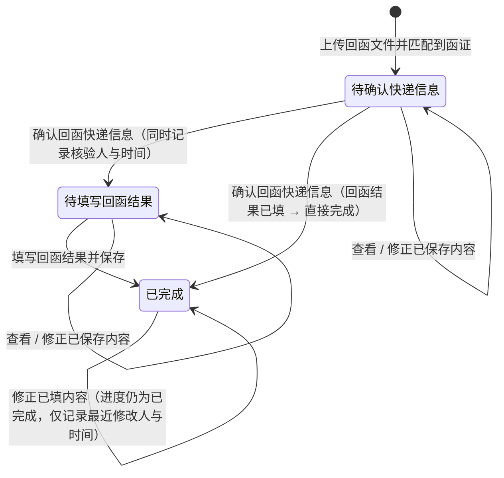
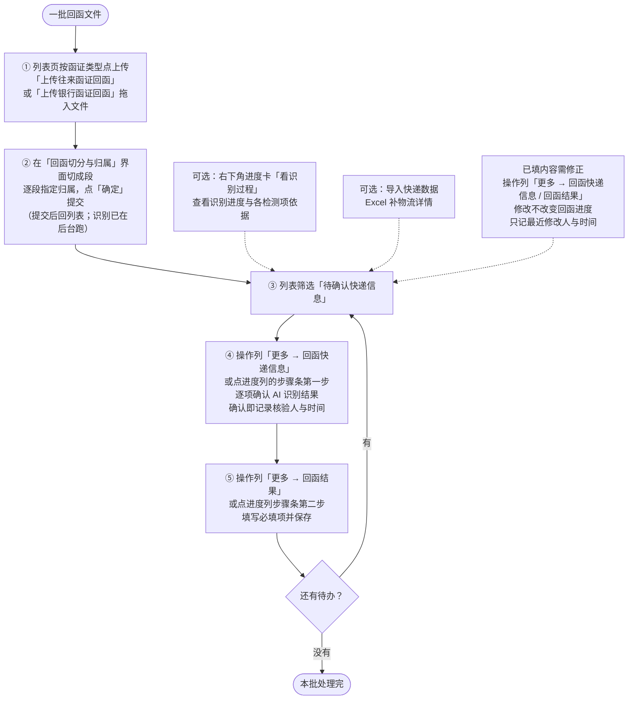

# Word 需求规格说明书的图源（对外版）

> **这份文件只为 Word 交付物服务** —— `docs/需求文档.md` 是内部主文档，它里面的 ```mermaid 图
> 带着**内部口径标注**（`v2.27 拆分`、`v2.33 闸门`）与**实现术语**（`finalizeTask`、
> `recognitionPending`、`auto / confirm / manual`）。那些对内部读者有意义，放进给客户的
> 《需求规格说明书》里就是噪音。
>
> 所以这里放一套**对外表述**的图：**业务语言、不出现内部版本号与代码标识**。
>
> **注意两处口径修正**（源图落后于正文，正文才是准的）：
> 1. **不再"识别等切分确认才启动"**（那是 v2.33 的闸门，v2.62 已推翻）：识别在上传后即后台并行推进；
>    **例外只有银行第二批**（询证事项逐项核对 + 印章两项）—— 它们的判据要拿"系统内那封函证的被询证单位"，
>    归属未定无从比对，故仍在归属确定后开跑（见 `需求文档.md` 4.2 的 v2.62 修正）；
> 2. **列表操作列是「查看 + 更多」**（v2.52 起"下一步"主按钮已移除），不再是"点同一行的主按钮"；
>    「回函切分与归属」与「智能识别」是两个独立全屏界面（v2.57），「数据核对」弹窗已删除（v2.60）。
>
> **v3.18 又按当前实现校对了一遍**（用户：「业务流程章节的流程图，和当前的设计逻辑相匹配么？」），改三处：
> ① **银行归属不再有"建议归属 ≥65%"这一档** —— v2.62 起归属由**用户自己选**（每段一个归属下拉），
>    打分与三档算法只在逻辑内部保留、**界面上不出现**（候选表、确认归属按钮均已移除）；图里只剩
>    "四要素命中 → 预填归属"与"未命中 → 下拉留待指定"两条；
> ② **归档条件**：两步（确认快递信息 / 填写回函结果）**各自独立**（v3.12），
>    "先填结果、后确认快递信息"的行在确认那一刻**直接到已完成**，不是一条单向流水线；
> ③ **进入两个处理弹窗的方式**是「更多 → 回函快递信息 / 回函结果」**或点进度列的步骤条**，
>    并补了两条可选通道（右下角进度卡「看识别过程」、已填内容修正走 R-07）。
>
> 渲染：`render_mermaid.py docs/figures/word_figures.md --out docs/figures/word --format png --scale 3`
> （输出按下面出现顺序命名 `mermaid_0/1/2/3`）
>
> **⚠️ 子图（`subgraph`）标题不要用 `<br/>` 折行** —— mermaid 只给子图标题留**一行**的高度，
> 折成两行时标题下半行会压住该子图的**第一个节点**（2026-10-09 实测：图 1 的「AI 读取」「必须人工录入」
> 两处标题都压住了下方节点，客户文档里一眼可见）。标题过长就改成单行、用「——」连接，
> 或把说明文字挪到节点里 —— **别在标题里换行**。节点标签（`A1["…<br/>…"]`）不受此限。

## 1. 业务数据分工（谁产出什么）



## 2. 数据流转路径



## 3. 回函进度状态机



## 4. 业务人员的操作路径


