# 函证系统（回函管理智能化）

| 版本 | 编制单位 | 日期 |
|---|---|---|
| 需求说明书v1.0 | 西安西点信息技术有限公司 | 2026年10月 |

## 菜单目录

| 一级菜单 | 二级菜单 | 三级菜单 |
|---|---|---|
| 回函管理 | 回函列表 |  |
| 回函管理 | 回函上传－往来函证 |  |
| 回函管理 | 回函上传－银行函证 |  |
| 回函管理 | 回函切分与归属 |  |
| 回函管理 | AI 智能核验 | 发函回函一致性检测 |
| 回函管理 | AI 智能核验 | 印章核查 |
| 回函管理 | AI 智能核验 | 手写体识别 |
| 回函管理 | 回函快递信息 |  |
| 回函管理 | 回函结果填写 |  |
| 回函管理 | 函证查看与文件预览 |  |
| 回函管理 | 快递数据导入 |  |

# 函证系统标准产品需求

## 回函管理

### 回函列表

#### 业务说明

系统提供回函管理列表，以便于业务人员统一查看、筛选和处理全部已回函记录。

列表以「一封函证一行」展示，并给出该封回函当前所处的处理进度，业务人员据此判断下一步动作。

业务人员可通过列表上的入口进入各处理环节，无需在多处菜单间切换。

#### 业务规则

- 列表排序规则为「回函时间倒序」，不因处理动作重排行序。
- 同一函证多次回函时以最新一次为最终有效回函；历史回函标「已被覆盖，可不处理」，保留留痕但不参与风险提示与统计。
- 回函结果完成 = 表单里所有必填字段都有值（无论值是从本页填的，还是从核查页采纳带出的）；AI 核查项表没表态不影响完成。三个进度只回答「下一步做什么」，不代表数据被锁定。
- 回函结果保存后，仍未表态的核查项自动按「采纳」记一条留痕（把结果带出、列表「核查事项复核」随即变「已复核」）；人已经表过态的项不动，自动带出不覆盖人的判断。
- 快递信息与回函结果是两个独立步骤、没有先后：先填结果、后确认快递信息也可以，两个勾各自独立。
- 全部检测项「尘埃落定」才写入本列表（失败也算落定：那封照样入表、不给结论、可「重新识别」）；未提交切分归属的一批一律不写库。
- 核验事项不含快递面单检测；银行函证没有发函件可对照，故不设「发函回函一致性检测」，其相符性由「回函是否相符检测」给出。
- 识别结论只作为建议：业务人员不修改识别结果本身，只决定是否采用；识别过程显示在「智能核查状态」（这一封整体核到哪一步）与「智能核查进度」（逐项核完没有）两列，各检测项的依据明细在「核查事项复核」列点开的核验页里看。
- 核验人与核验时间不单设列，下沉到展开行的留痕信息中展示。

#### 使用角色

- 业务人员
- 复核人员。

#### 权限说明

- 菜单权限：业务人员、复核人员均拥有回函管理菜单权限。
- 功能权限：
- 维护－包括：按类型上传回函文件、导入快递数据、查看函证、回函快递信息、回函结果、核查事项复核的采纳与不采纳。可支持按照系统角色进行授权。
- 查看－包括：查看函证、回函快递信息、回函结果、核查事项复核详情。支持给到菜单权限的人员可查看回函记录信息，通过查询条件进行查询。
- 列表数据权限：业务人员可查看本人负责的函证回函记录；复核人员可查看全部回函记录。

#### 功能说明

本页面是回函管理的总览页：以「一封函证一行」汇总已回函记录，给出每封回函的相符性结论与处理进度，业务人员据此在页面上完成从「确认回函快递信息」到「填写回函结果」的全部处理。

| 名称 | 类型 | 规则/说明 |
|---|---|---|
| 采纳 / 不采纳识别数据 | 按钮 | 在核验页页脚表态：采纳 = 采用 AI 结论并代入人工确认列；不采纳 = 只标记「已看过、不采用」，须填一句原因（仅该项确有结论时要求）。表态后自动跳转下一个未表态事项，全部办完落到第 4 项「回函结果补充」 |
| 上传往来函证回函 | 按钮 | 往来页（本类页）上的上传入口；选择往来函证回函文件后进入识别流程，识别完成后回列表查看结果 |
| 上传银行函证回函 | 按钮 | 银行页（本类页）上的上传入口；选择银行函证回函文件后进入识别流程，识别完成后回列表查看结果 |
| 导入快递数据 | 按钮 | 导入快递数据文件，解析后与回函记录匹配代入快递单号等信息 |
| 查询 | 输入框 | 支持按被询证单位、函证编号、回函信息录入进度等条件查询 |
| 重置 | 按钮 | 清空当前查询条件 |
| 页面标题 | 标签 | 标题为本类名称（往来函证回函 / 银行函证回函）；右侧只给总数「共 N 封函证」，不提供视图切换 |
| 展开／收起 | 按钮 | 展开行查看该函证的历次回函明细与留痕信息；多次回函时「回函次序」列另有「重新发函」标签 |
| 查看 | 按钮 | 打开函证查看界签，只读查看函证基础信息与原件 |
| 核查事项复核 | 勾选框 | 该封回函的核验待办状态：待复核 / 已复核（勾选框 + 状态词）；点它进核验页，落在第一个未完成事项上，页脚给「采纳识别数据 / 不采纳识别数据」 |

**往来函证回函列表（页面一：列表只含本类函证，主操作行只有本类上传入口）：**

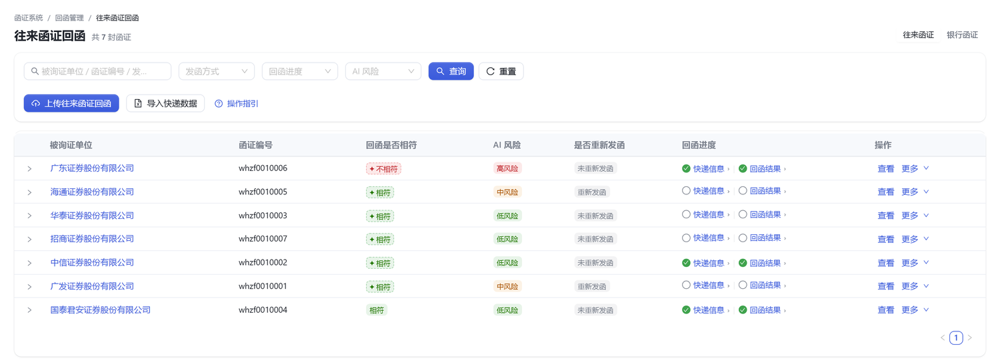

**银行函证回函列表（页面二：表头写明「被询证单位（银行）」）：**

**展开行：回函记录表 + 核验 / 修改留痕：**

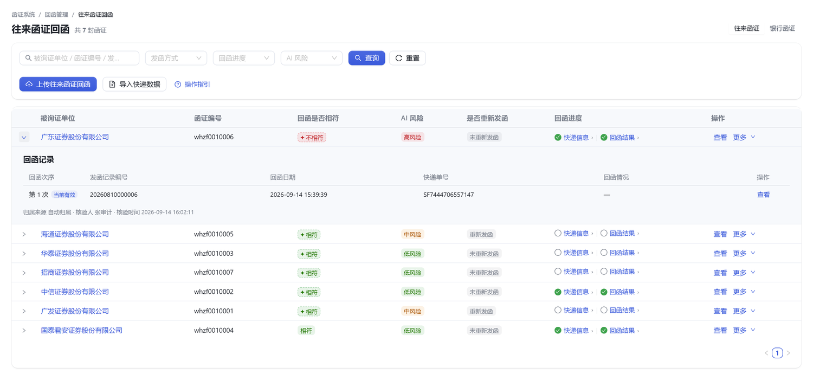

**「查看函证」弹窗 · 原始文件视图：**

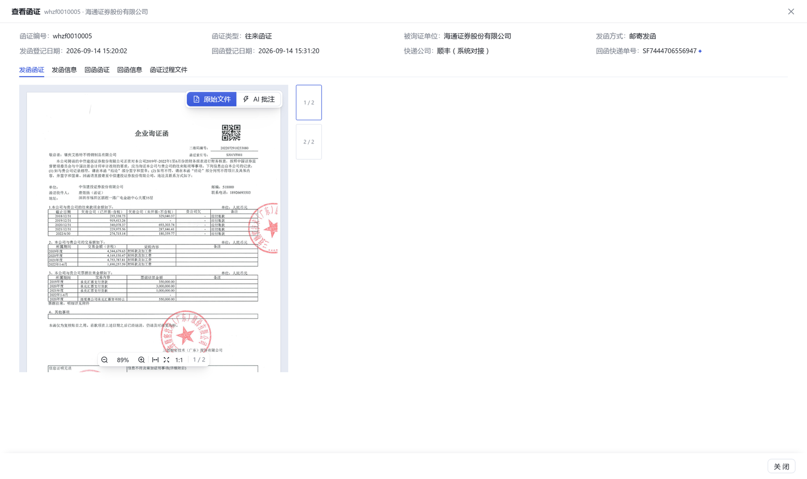

#### 页面字段说明

- 被询证单位：该封函证的被询证方 —— 往来函证为往来单位、银行函证为银行（本页表头随之标注「（银行）」）。数据来自函证系统、随回函记录带入；关键字查询也按它匹配。
- 函证编号：函证系统在发函登记时产生的编号，唯一标识一封函证，等宽字体展示。一封函证可多次回函，每次回函各自成行、共用同一编号，以「回函次序」区分；关键字查询也按它匹配。
- 智能核查状态：这一行的机器核查跑到哪了 —— 未开始 / 正在核查（标签带扫光动效）/ 已核查 / 核查失败 四态，与站内风险、相符性同一套配色语义。它是后面结论的前置条件：核查没跑完时「回函是否相符」还没有可显示的结论；没有核查任务的行（演示种子 / 历史回函）直接视为已核查。
- 智能核查进度：本类函证的全部智能核查项逐个给状态标识 —— 浅灰短横（未核查）· 在跑的像素网格（正在核查）· 对勾 / 叉（完成 / 失败），随真实核查进度动态联动；悬停看每项此刻的情况，失败项提示可在「操作」列点「重新识别」重跑。它与右边「核查事项复核」共用同一份事项清单，但那格只报人的复核状态（待复核 / 已复核），逐项细节只在本列。
- 回函是否相符：该封回函的相符性结论；往来取自「印章核查」的落章区域判定、银行取自「回函是否相符检测」，也可在「回函结果填写」页直接填写。
- 核查事项复核：该封回函的核验待办；随核验页里的逐项表态更新 —— 还有事项没表态显示「待复核」，全部表态后显示「已复核」，点它进核验页。
- 回函信息录入进度：快递信息 / 回函结果两步的可点步骤条；快递信息一步按该行是否确认过快递信息打勾，回函结果一步按该行是否填过回函结果打勾。
- 快递单号：该回函的快递单号；银行函证同一包裹的多封回函共用同一单号。
- 回函记录表（展开行，8 列）：回函次序 · 发函记录编号 · 发函方式 · 回函快递公司 · 快递单号 · 回函数据登记时间 · 回函情况 · 操作。发函记录编号与发函方式来自函证系统，回函快递公司由「导入快递数据」代入，回函数据登记时间是录入函证系统的时刻。

#### 输入、输出

**输入：**

| 数据项 | 来源 | 说明 |
|---|---|---|
| 回函记录 | 系统内生成 | 上传回函文件并完成识别、归属后自动生成 |
| 函证基础信息 | 函证系统对接 | 函证编号、被询证单位、发函记录编号等 |
| 快递数据 | 人工导入（Excel） | 按快递单号匹配，补全快递公司、地址、收件人等信息 |
| 查询条件 | 人工录入 | 关键字（被询证单位 / 函证编号 / 发函记录编号）、发函方式、回函信息录入进度 |

**输出：**

| 数据项 | 去向 | 说明 |
|---|---|---|
| 回函列表数据 | 页面展示 | 一封函证一行；排序为「回函时间倒序」，不因处理动作重排 |
| 处理进度 | 页面展示 | 待确认快递信息 / 待填写回函结果 / 已完成（只表达"下一步做什么"；两个步骤的完成态各自独立展示） |
| 展开行明细 | 页面展示 | 历次回函记录 + 归属来源 / 核验 / 最近修改留痕 |

### 回函上传－往来函证

#### 业务说明

业务人员收到被询证单位寄回的往来函证回函，按快递件扫描成 PDF 后上传系统。

系统识别回函件中的二维码与文本信息，自动判断这份回函归属哪一封函证。

#### 业务规则

- 往来函证与银行函证的识别流程一致，差异在于归属匹配方式与面单处理方式。
- 往来函证的面单页是每段自己的尾页（一封函证对一张面单），不单独切分成段。

#### 使用角色

- 业务人员。

#### 权限说明

- 菜单权限：业务人员拥有回函管理菜单权限。
- 功能权限：上传－包括上传往来函证回函文件、填写上传信息、提交识别。
- 列表数据权限：不涉及。

#### 功能说明

本功能接收往来函证的回函件：业务人员把按快递件扫描出的 PDF（拼接件）上传，系统据此创建识别任务，随后在「回函切分与归属」界面把文件切成段、逐段归属到函证。

| 名称 | 类型 | 规则/说明 |
|---|---|---|
| 上传往来函证回函 | 按钮 | 打开上传弹窗，选择回函文件（支持多份） |
| 上传文件 | 上传 | 支持 PDF 格式，单份文件对应一个快递件 |
| 最后页是否快递面单 | 单选 | 选择「是」时，识别与切分时按「每段尾页为快递面单」处理，并识别面单上的快递单号 |
| 下一步 | 按钮 | 提交上传，系统进入识别流程并关闭弹窗 |
| 取消 | 按钮 | 关闭弹窗，不上传 |

**「上传往来函证回函」弹窗（文件识别录入：面单口径 + 上传拼接件）：**

#### 页面字段说明

- 最后页是否快递面单：上传时声明文件尾部是否还有一页快递面单；默认「是」（往来回函件通常把面单拼在末尾）。

#### 输入、输出

**输入：**

| 数据项 | 来源 | 说明 |
|---|---|---|
| 往来函证回函文件 | 人工上传（PDF） | 按快递件扫描的拼接件，可多份 |
| 最后页是否快递面单 | 人工录入（单选） | 决定切分边界：尾页是面单还是函证页 |

**输出：**

| 数据项 | 去向 | 说明 |
|---|---|---|
| 识别任务 | 回函列表（智能核查状态 / 智能核查进度两列） | 一份文件一个任务；往来函证按右上角二维码预切分 |
| 上传批次 | 回函切分与归属 | 进入归属界面，等待人工切分与指定归属 |

### 回函上传－银行函证

#### 业务说明

银行按年度回函，同一家银行的多个年度函证装在一个快递里寄回，业务人员扫描后上传。

系统识别回函件内容，并对文件中的快递面单页识别条形码，得到快递单号。

#### 业务规则

- 银行函证常见「多封函证 + 一张面单」——同一快递件内的多封回函共用同一个快递单号，故归属环节需支持一张面单管辖多个函证段。
- 面单识别采用两级处理以控制成本：先做廉价的版面／条码存在性判定筛掉正文页，再对候选页做条码定位解码；识别结果异步回填，不阻塞业务人员进入切分环节。

#### 使用角色

- 业务人员。

#### 权限说明

- 菜单权限：业务人员拥有回函管理菜单权限。
- 功能权限：上传－包括上传银行函证回函文件、填写上传信息、提交识别。
- 列表数据权限：不涉及。

#### 功能说明

本功能接收银行函证的回函件：只需上传回函件（格式一 / 格式二数据已存于函证系统），系统创建识别任务并给出四要素识别结果，供业务人员在「回函切分与归属」界面手工切分与指定归属。

| 名称 | 类型 | 规则/说明 |
|---|---|---|
| 上传银行函证回函 | 按钮 | 打开上传弹窗，选择回函文件 |
| 上传文件 | 上传 | 支持 PDF 格式，一份文件可含同一被询证单位的多个函证 |
| 最后页是否快递面单 | 单选 | 选择「是」时，按识别出的面单页预切出独立的快递面单段（同一份文件可含多个包裹、多张面单，各管辖它前面的函证段）；默认「是」 |
| 智能识别 | 按钮 | 一次把切分、归属、快递单号识别好，进切分页直接确认（识别结果全部可改）；与手动路（走「下一步」）并存，未启用时去掉该入口即可，手动路不受影响 |
| 下一步 | 按钮 | 提交上传，系统进入识别流程并关闭弹窗（手动路：进切分页后自己切分与指定归属） |
| 取消 | 按钮 | 关闭弹窗，不上传 |

**「上传银行函证回函」弹窗（面单口径 + 拖拽上传）：**

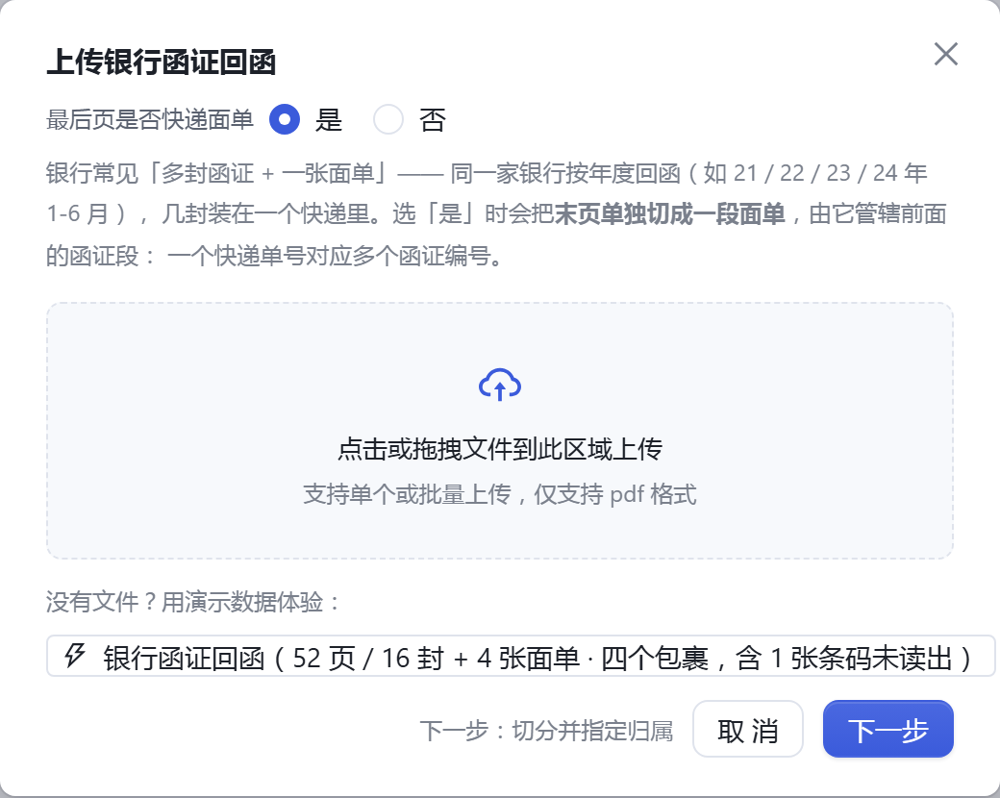

#### 页面字段说明

- 快递面单识别：上传后系统逐页判断是否为快递面单，命中即解码条形码取单号。

#### 输入、输出

**输入：**

| 数据项 | 来源 | 说明 |
|---|---|---|
| 银行函证回函文件 | 人工上传（PDF） | 一份文件可含同一被询证单位的多个函证 |
| 最后页是否快递面单 | 人工录入（单选） | 为「是」时按识别出的面单页预切出独立的快递面单段（一份文件可含多个包裹、多张面单） |

**输出：**

| 数据项 | 去向 | 说明 |
|---|---|---|
| 识别任务 | 回函列表（智能核查状态 / 智能核查进度两列） | 银行函证按四要素识别，识别结果分两批返回 |
| 上传批次 | 回函切分与归属 | 进入归属界面，等待人工切分与指定归属 |

### 回函切分与归属

#### 业务说明

一份扫描件里常常装着多封回函，需要人工把文件切成几段、并把每段归到对应的函证上。

银行函证还会出现「多封函证 + 一张面单」：面单页需要单独切成一段，由它管辖前面的几个函证段。

#### 业务规则

- 未点「确定」（未提交）时，本批一律不写入回函列表：识别照跑，但落库、启动阶段二、回填核验都不发生；提交后仍要等该段全部检测项尘埃落定才写库（失败也算落定）。
- 初稿按类型分：往来 = 二维码已切好的分段（可微调）；银行 = 整份一段、由用户自己切。每段一个归属下拉。
- 同包裹的段用包裹标签区分（8 档固定色板循环），包裹号才是主标识，不在段与段之间画竖线。
- 银行侧「快递面单识别」与切分并行：面单页是识别结果，到达后系统才把它预切成独立段；用户已切分处理过的不再另切，一律以人工切分为准（界面不提供任何“系统改切分”的入口）。
- 快递单号只在面单段校验一次（银行侧不校验重复 —— 多段共用同一单号是正常形态）；人工填写的单号按“页”记录，用户改切分后值仍留在含该页的那一段上。
- 人工单号与系统识别不一致时，在该行人工值后挂一枚「系统识别 …」标签作提醒：不改人工值，也不提供“采用识别值”的动作。
- 银行侧切分有「手动 / 智能」两条路，默认手动；智能为可选增强（点一次把切分 / 归属 / 单号认好）。已动过切分时必须先确认「将用识别结果替换你当前的切分」。
- 识别切分是异步能力，效率须在实施前实测；本界面不得把切分绑死在识别结果上 —— 没有识别结果时，切分、归属、单号录入三件事照常可做。

#### 使用角色

- 业务人员。

#### 权限说明

- 菜单权限：业务人员拥有回函管理菜单权限。
- 功能权限：维护－包括按固定页数拆分、按自定义页范围拆分、按份数拆分、设置切点、指定归属、修改快递单号。
- 列表数据权限：不涉及。

#### 功能说明

本界面把一份回函文件切成若干段并逐段指定归属：段是「一件可辨认的东西」——一封函证或一张快递面单；归属确定后，系统才把该回函写入回函列表。

| 名称 | 类型 | 规则/说明 |
|---|---|---|
| 按固定页数拆分 | 单选 | 输入每封页数后点击应用，按固定页数自动切分 |
| 每封页数 | 输入框 | 正整数，选择「按固定页数拆分」时可填 |
| 按自定义页范围拆分 | 单选 | 手工填写页区间进行切分 |
| 按份数拆分 | 单选 | 按份数均分文件页数 |
| 应用 | 按钮 | 按当前拆分方式生成切分结果 |
| 页间剪刀 | 按钮 | 点击在指定页之间设置／取消切点，切点用虚线标出 |
| 段缩略图 | 按钮 | 点击某页选中其所属的段 |
| 查看原件 | 按钮 | 用浏览器直接打开该页原件 |
| 放大预览 | 弹窗 | 悬停缩略图弹出局部放大预览；点缩略图可固定预览，固定后按住拖动查看其它位置、可顺时针旋转 90°（仅预览，不改原文件） |
| 归属 | 下拉选择 | 为每一段指定归属的函证（展示被询证单位·函证编号），或指定为「快递面单（本文件共用）」 |
| 快递单号－改 | 按钮 | 当该段快递单号为「未识别到 / 异常」时可就地修改；人工填写过的单号始终保留「改」入口，并标注「人工填写」 |
| 包裹标签 | 标签 | 同一包裹的每一段都展示「包裹 N」标签，同一包裹同色，用于识别哪些段是同一个快递件 |
| 初稿来源一行 | 标签 | 仅银行侧显示，常驻界面顶部：手动态写「当前为手动切分（初稿：整份一段）—— 也可由系统先认一遍」，智能态写「智能识别已应用 —— 已切好 N 封函证 + P 段快递面单，归属与快递单号已带入」 |
| 智能识别 / 重新智能识别 | 按钮 | 跑一段识别过程（原型约 5 秒，一行进度文字），跑完把初稿换成识别结果（切分 / 归属 / 快递单号一次到位）；已动过切分时先确认「将用识别结果替换你当前的切分」 |
| 快递面单识别状态行 | 标签 | 仅银行侧显示，常驻界面顶部（智能模式下不显示，见业务规则第 11 条）：识别中／已识别 N 张（已切成独立段 · 归入 P 个包裹）／未识别到／失败（可手工标为面单） |
| 面单页角标 | 标签 | 缩略图中被识别为快递面单的页，左下角带「面单」小标（识别结果到达时出现） |
| 确定 | 按钮 | 提交切分与归属结果，生成／重建该文件的识别任务并关闭界面 |

**回函切分与归属 · 往来侧初稿：按二维码切分成段 → 逐段核对归属（确认后才进入识别）：**

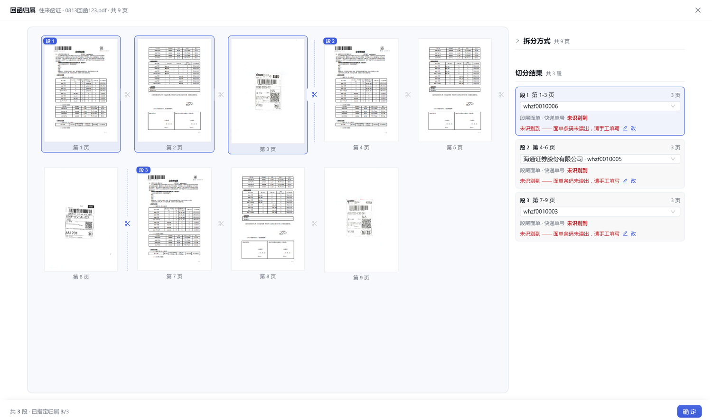

**回函切分与归属 · 银行侧初稿：识别出的面单页已预切成独立面单段（一份文件可含多个包裹），函证段仍由用户自己切：**

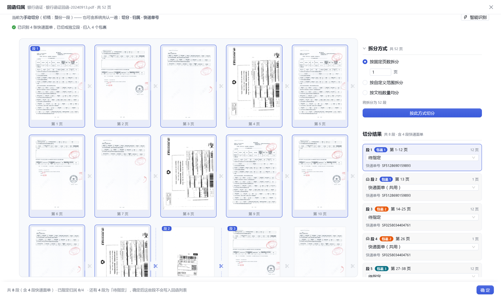

**回函切分与归属 · 银行侧「智能识别」初稿态：初稿即识别结果（已切好 20 段 = 16 封函证 + 4 张面单 / 4 个包裹，归属与快递单号已带入）：**

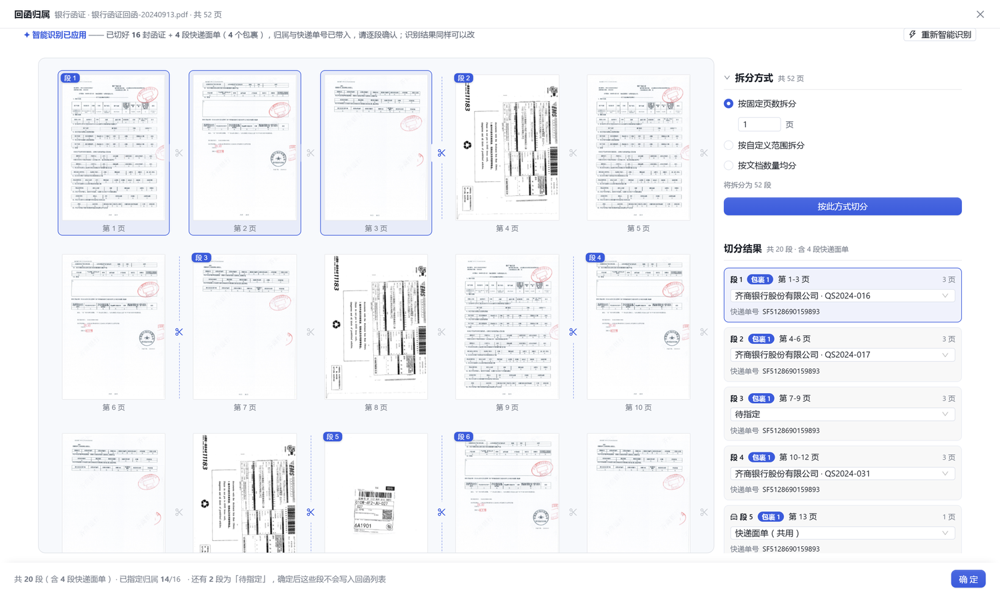

#### 页面字段说明

- 段：由切点划分的连续页区间；一个段就是一件可辨认的东西 —— 一封函证或一张快递面单。
- 快递面单段：全部页都是面单页的段；它只给前面的函证段提供快递单号，归属恒为「待指定」，因此不写入回函列表。
- 管辖规则：面单段管辖它前面的段，直到上一个面单段为止（一次扫描多个包裹同样成立）。
- 快递单号取值：被面单段管辖的函证段继承该面单段的单号，改一处全改。

#### 输入、输出

**输入：**

| 数据项 | 来源 | 说明 |
|---|---|---|
| 回函文件各页 | 系统内生成 | 按原件逐页渲染为页缩略图墙 |
| 切点与拆分方式 | 人工录入 | 页间剪刀 / 按固定页数 / 按自定义页范围 / 按份数拆分 |
| 归属选择 | 人工录入 | 每段指定函证，或指定为「快递面单（本文件共用）」 |
| 快递单号 | 人工录入 | 面单段识别不到可就地修改；人工填写后保留「改」入口 |

**输出：**

| 数据项 | 去向 | 说明 |
|---|---|---|
| 切分与归属结果 | 回函列表 | 生成 / 重建识别任务；归属确定后写入列表 |
| 快递单号 | 回函快递信息 | 被面单段管辖的函证段继承该单号 |
| 面单段管辖关系 | 系统内保存 | 决定同一包裹内哪些函证共用同一单号 |

### AI 智能核验－发函回函一致性检测

#### 业务说明

业务人员需要把回函件上的数据与发函底稿逐格核对，确认被询证单位填写的内容与发函是否一致。

系统把发函件中的每张数据表格识别出来展示，回函中与发函不一致的地方就地标红，业务人员只看差异即可。

#### 业务规则

- 不再左右并排：右栏宽度有限，两表并排会让金额列换行、同一行要左右来回看；发函 × 回函的正反对照在左侧预览里完成。
- 四个比对结论的口径：一致（两侧取值相同）／不一致（取值不同，单元格标红、悬停看差异额）／未列示（发函有、回函未列示）／新增（回函多出）。
- 左侧预览默认取景：本项＝双栏均分（两件对照）；印章核查 / 手写体识别＝回函件放大、发函用印件折叠。
- 本页签不设「人工确认」列：差异属客观事实、不需要逐行采纳，「回函结果不相符处的描述」的出处是「手写体识别」页（银行侧是「回函是否相符检测」页）；本页签的进入与页脚「采纳 / 不采纳」口径见「回函列表」。

#### 使用角色

- 业务人员
- 复核人员。

#### 权限说明

- 菜单权限：业务人员、复核人员均拥有回函管理菜单权限。
- 功能权限：查看－包括查看发函／回函原件、查看逐表对比结果、查看差异明细。
- 列表数据权限：不涉及。

#### 功能说明

本页面把发函件中的每张数据表格识别出来逐表展示，回函中与发函不一致的单元格就地标红，业务人员只看差异即可完成核对。

| 名称 | 类型 | 规则/说明 |
|---|---|---|
| 全部数据表格 | 单选 | 展示识别出的全部表格 |
| 只看有差异的表 | 单选 | 仅展示存在差异的表格 |
| 查看原件 | 按钮 | 把左侧两件原件同时定位到该表格所在页 |
| 差异单元格 | 标签 | 红框标注；鼠标悬停显示回函取值与差额 |
| 表格控件 | 标签 | 每张表按发函侧识别结果渲染：表头带底色、全部左对齐、带框线，差异单元格标红 |
| 采纳识别数据 / 不采纳识别数据 | 按钮 | 页脚动作：采纳＝采用 AI 结论并自动带出到「回函结果填写」页的差异说明；不采纳＝只标记已处理、不带入值；本项无 AI 结论时「采纳」禁用 |

**AI 智能核验 · 发函回函一致性检测（逐表对照，差异标红）：**

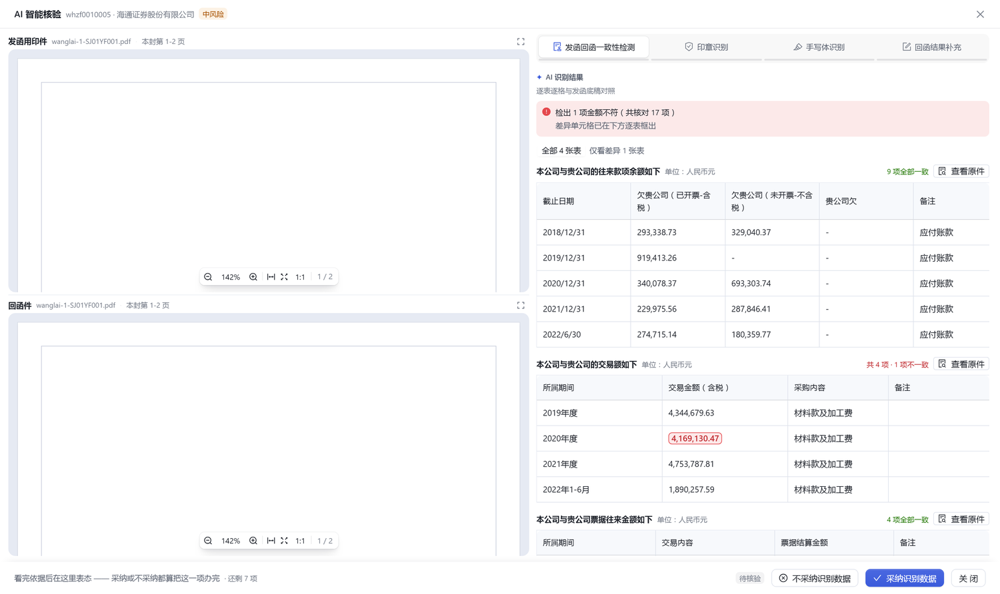

#### 页面字段说明

- 比对表：表数、每张表的列数与行数全部按识别结果渲染。
- 识别结果需按「表格 → 列 → 行单元格」的层级给出，并标明哪些列参与比对、按哪些列把发函行与回函行配对。

#### 输入、输出

**输入：**

| 数据项 | 来源 | 说明 |
|---|---|---|
| 发函用印件识别结果 | 识别服务 | 表格标题、列名、逐行单元格 |
| 回函件识别结果 | 识别服务 | 按同样表格与列对齐后的单元格 |
| 比对口径 | 系统内配置 | 哪些列参与比对、按哪些列把发函行与回函行配对 |

**输出：**

| 数据项 | 去向 | 说明 |
|---|---|---|
| 逐表比对结果 | 页面展示 | 每张表按发函侧识别结果渲染，差异单元格标红 |
| 差异明细 | 回函结果填写 | 差异项数与明细，供填写差异说明 |
| 结论摘要 | 回函列表（回函是否相符） | 一致 / 不一致 / 未列示 / 新增 |

### AI 智能核验－印章核查

#### 业务说明

业务人员需要确认回函件上是否加盖了被询证单位印章、印章是否落于有效区域，以判断该回函是否可信。

系统在原件上叠加批注框标出印章位置与落章区域，业务人员直接对着原件核对。

#### 业务规则

- 印章定位框是语义性描边，不是装饰性边框。
- 印章与相符性的关系按类型分流：往来 —— 印章是相符性的判据（落「信息证明无误」区→相符，落「信息不符」区→不相符）；银行 —— 印章不参与相符性判定（相符性只看询证事项逐项核对）。
- 骑缝章仅往来函证检测，银行侧不渲染该行。
- 本页签的进入与页脚「采纳 / 不采纳」口径见「回函列表」；采纳即代入本页「人工确认」列 —— 名称是否一致 · 盖章不一致处原因描述 · 是否为公章 · 是否有骑缝章，往来另有「函证结果是否相符」（往来相符性由落章区域判定；银行不给这一格，印章只作风险提示）。

#### 使用角色

- 业务人员
- 复核人员。

#### 权限说明

- 菜单权限：业务人员、复核人员均拥有回函管理菜单权限。
- 功能权限：查看－包括查看印章检测结论、查看印章定位框与落章区域高亮。
- 列表数据权限：不涉及。

#### 功能说明

本页面在回函原件上叠加印章定位框与落章区域高亮，给出是否盖章、印章名称是否与被询证单位一致等结论，业务人员直接对着原件核对。

| 名称 | 类型 | 规则/说明 |
|---|---|---|
| 是否盖章 | 标签 | 展示是否检出印章及置信度 |
| 印章数量 | 标签 | 展示检出印章数量 |
| 骑缝章 | 标签 | 展示是否检出骑缝章；未检出时提示建议加盖骑缝章 |
| 印章类型 | 标签 | 展示印章类型（如财务章、公章等） |
| 印章名称 | 标签 | 展示印章文字内容 |
| 与被询证单位一致 | 标签 | 展示印章名称与被询证单位名称是否一致 |
| 落章区域 | 标签 | 展示印章落于「信息证明无误」还是「信息不符」区域 |
| 印章核查 | 页签 | 在左侧原件上叠加印章定位框与落章区域高亮；切到本页签时左侧预览默认为回函件放大、发函用印件折叠 |
| 采纳识别数据 / 不采纳识别数据 | 按钮 | 页脚动作：采纳＝采用 AI 结论（往来还带出相符性、盖章一致性、是否为公章、是否有骑缝章）；不采纳＝只标记已处理、不带入值；本项无 AI 结论时「采纳」禁用 |

**AI 智能核验 · 印章核查（落章区域标出 + 检测项结论）：**

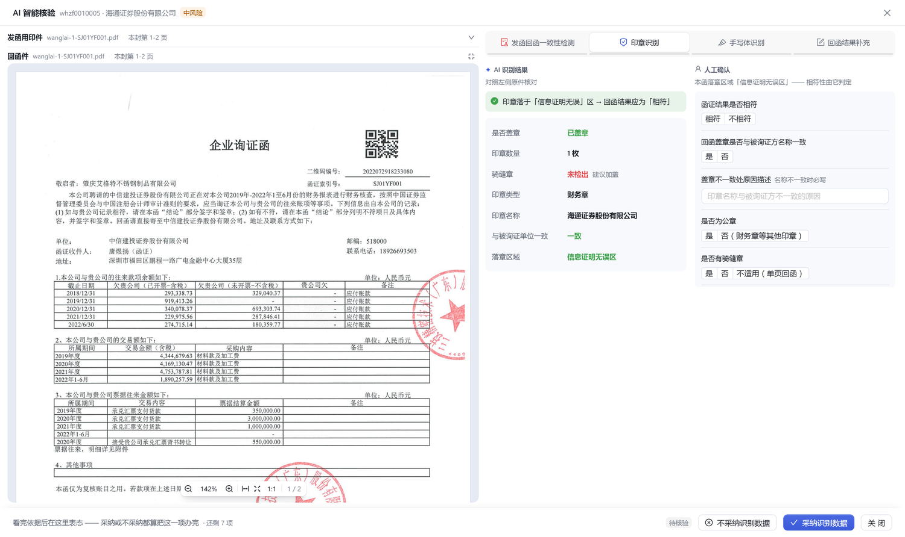

**AI 核验详情：从列表「核查事项复核」点本项打开（页签落在本项）+ 页脚「不采纳识别数据 / 采纳识别数据」（点完自动关闭回到列表），图为已采纳后的留痕态：**

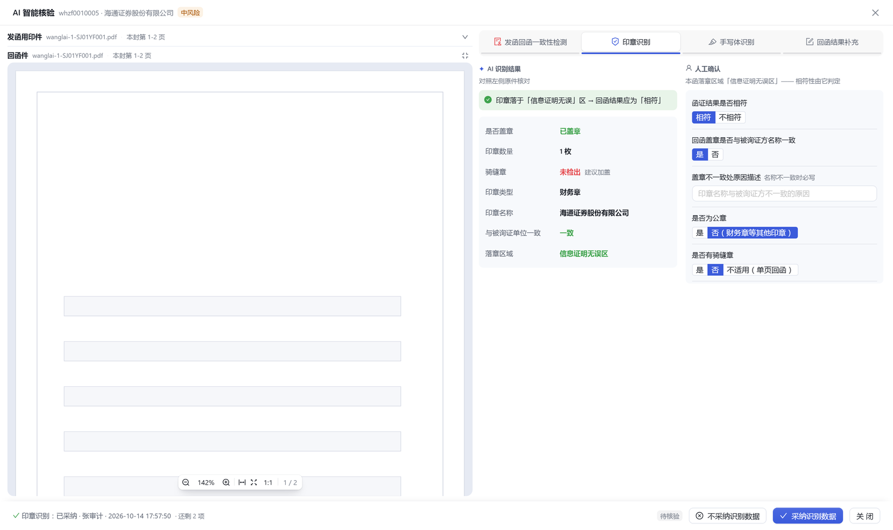

#### 页面字段说明

- 相符性口径：印章落「信息证明无误」区＝相符，落「信息不符」区＝不相符；未检出印章不改变结论，只在本页提示。

#### 输入、输出

**输入：**

| 数据项 | 来源 | 说明 |
|---|---|---|
| 回函件原件 | 系统内生成 | 按原件渲染并叠加 AI 批注层 |
| 印章检测结果 | 识别服务 | 是否盖章、印章数量、印章类型、印章名称、落章区域 |

**输出：**

| 数据项 | 去向 | 说明 |
|---|---|---|
| 印章检测结论 | 页面展示 | 是否盖章 / 骑缝章 / 印章类型 / 印章名称 / 与被询证单位是否一致 / 落章区域 |
| 落章区域结论 | 回函列表（回函是否相符） | 往来函证据此判定相符性：落在「信息证明无误」区为相符 |
| 印章结论 | 回函列表 | 印章结论只在本页展示，不进入列表的相符性判定 |

### AI 智能核验－手写体识别

#### 业务说明

被询证单位常以手写方式填写回函内容，业务人员需要把手写内容与发函底稿核对。

系统框出手写体区域并转写文字，业务人员可据此快速核对。

#### 业务规则

- 银行函证不检测手写体，故银行函证无本页签。
- 本页签的进入与页脚「采纳 / 不采纳」口径见「回函列表」；采纳即把转录文字追加进「回函结果不相符处的描述」（人工确认列），不覆盖人工已写下的内容 —— 该字段在核验动线里的唯一出处就是本页（银行侧在「回函是否相符检测」页）。

#### 使用角色

- 业务人员
- 复核人员。

#### 权限说明

- 菜单权限：业务人员、复核人员均拥有回函管理菜单权限。
- 功能权限：查看－包括查看手写体识别区与转写文字。
- 列表数据权限：不涉及。

#### 功能说明

本页面框出回函件上的手写体区域并给出转写文字，业务人员据此与发函底稿核对，并可把转写内容带入回函结果的不符项说明。

| 名称 | 类型 | 规则/说明 |
|---|---|---|
| 手写体识别区 | 标签 | 在原件上以虚线框标出手写体区域 |
| 转写文字 | 标签 | 展示手写体转写结果，供人工与发函底稿核对 |
| 手写体识别 | 页签 | 切到本页签时左侧预览默认为回函件放大、发函用印件折叠，回函栏视图为「AI 批注」 |
| 采纳识别数据 / 不采纳识别数据 | 按钮 | 页脚动作：采纳＝采用 AI 结论并自动带出到「回函结果填写」页的不相符处描述；不采纳＝只标记已处理、不带入值；本项无 AI 结论时「采纳」禁用 |

**AI 智能核验 · 手写体识别（转录结果与所处区域）：**

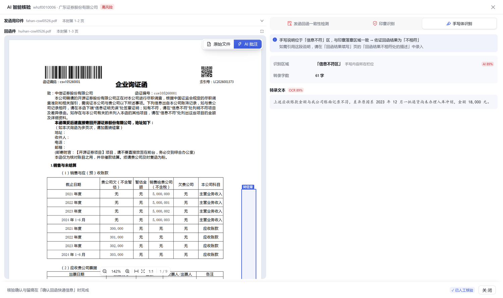

#### 页面字段说明

- 不涉及

#### 输入、输出

**输入：**

| 数据项 | 来源 | 说明 |
|---|---|---|
| 回函件原件 | 系统内生成 | 按原件渲染并叠加 AI 批注层 |
| 手写体检测与转写结果 | 识别服务 | 手写区域位置 + 转写文字 |

**输出：**

| 数据项 | 去向 | 说明 |
|---|---|---|
| 手写体转写结果 | 页面展示 | 在原件上以虚线框标出区域，并展示转写文字 |
| 不一致处描述草稿 | 回函结果填写 | 可一键带入「回函结果不相符处的描述」 |

### 回函快递信息

#### 业务说明

业务人员收到回函后，需要确认该回函对应的快递信息；本次确认同时是全流程唯一的人工核验留痕动作。

系统根据快递面单识别结果预填快递单号与快递公司，业务人员确认或修正后保存。

#### 业务规则

- 本环节确认后直接衔接「回函结果填写」，两者共用同一个弹窗互斥状态。
- 关闭入口保留三处：右上角关闭、Esc、底栏按钮。

#### 使用角色

- 业务人员。

#### 权限说明

- 菜单权限：业务人员拥有回函管理菜单权限。
- 功能权限：维护－包括确认快递信息、修改快递单号与快递公司、保存。
- 列表数据权限：不涉及。

#### 功能说明

本界面用于确认回函对应的快递信息：系统按快递面单识别结果预填单号与快递公司，业务人员确认或修正后保存 ——这次确认同时是全流程唯一的人工核验留痕动作。

| 名称 | 类型 | 规则/说明 |
|---|---|---|
| 快递单号 | 输入框 | 默认带入 AI 识别值，可人工修正 |
| 快递公司 | 输入框 | 默认带入 AI 识别值，可人工修正 |
| 一键应用 | 按钮 | 将 AI 识别值应用到对应字段 |
| 确定 | 按钮 | 保存快递信息并完成核验留痕，进度推进到「待填写回函结果」 |
| 关闭 | 按钮 | 关闭界面，未保存的修改不生效 |

**「回函快递信息」弹窗（左侧函面原件 + 右侧逐项确认）：**

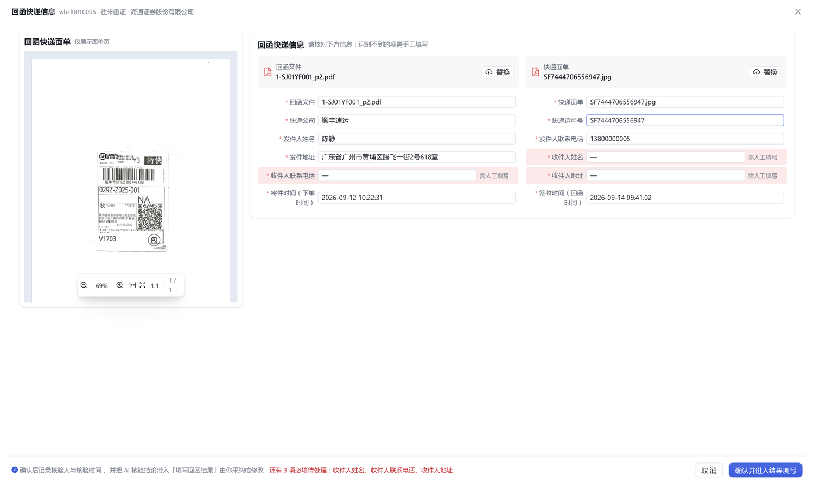

**快递数据导入结果：**

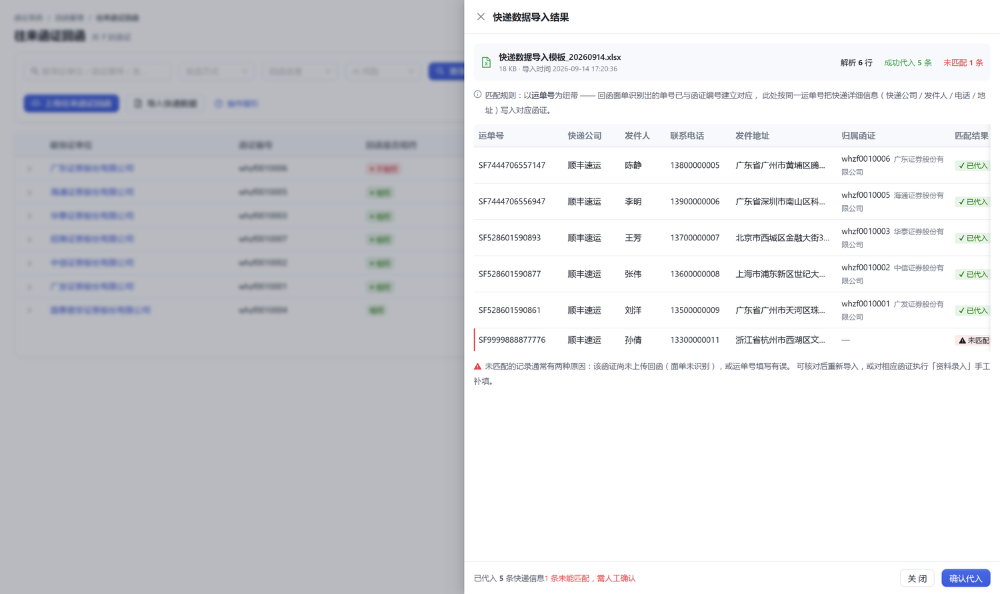

#### 页面字段说明

- 字段来源标识：AI 带入的值标「AI 建议」，人工保存过的值标「已人工确认」。

#### 输入、输出

**输入：**

| 数据项 | 来源 | 说明 |
|---|---|---|
| 快递单号 / 快递公司 | 识别服务（AI 建议） | 来自快递面单识别，带「AI 建议」标识 |
| 人工确认值 | 人工录入 | 修改后保存；再次打开时回显并标注来源为「人工确认值」 |
| 函面原件 | 系统内生成 | 左侧预览，供对照函面核对 |

**输出：**

| 数据项 | 去向 | 说明 |
|---|---|---|
| 快递信息 | 回函记录 | 快递单号、快递公司写入该回函记录 |
| 核验留痕 | 回函列表（展开行） | 核验人 + 核验时间 —— 全流程唯一留痕入口 |
| 处理进度 | 回函列表 | 推进到「待填写回函结果」 |

### 回函结果填写

#### 业务说明

业务人员确认快递信息后，需要依据回函内容填写最终的回函结果并归档。

系统把 AI 识别结论带入表单，业务人员采纳或修改后保存，保存即归档。

#### 业务规则

- 归档后再次修改属于补正：保持「已完成」并记录最近修改人与时间；修改与核验留痕在列表展开行以一行小字展示，不单设列。
- 表单初值优先级：已保存过的人工值 → 已采纳事项带出的值 → 空；第三层一律留空，不默认等于 AI 建议。
- 采纳事项的带出映射：印章核查→相符性 / 名称是否一致 / 是否为公章 / 是否有骑缝章（往来）；一致性检测→回函结果不相符处的描述（差异清单）；手写体识别→把转录追加进同一字段；银行由「回函是否相符检测」带相符性、印章核查带印章两项。标记不采纳的一律不带值。
- 核验页各页签的「人工确认」列与本页读写同一份回函结果：核验页改的是草稿，点核验页第 4 项「保存」或本页保存才落库。

#### 使用角色

- 业务人员。

#### 权限说明

- 菜单权限：业务人员拥有回函管理菜单权限。
- 功能权限：维护－包括填写回函结果、应用 AI 识别值、保存。
- 列表数据权限：不涉及。

#### 功能说明

本页面用于填写并归档最终回函结果：系统把 AI 识别结论带入表单，业务人员采纳或修改后保存，保存即归档并记录留痕。

| 名称 | 类型 | 规则/说明 |
|---|---|---|
| 一键采纳所有 | 按钮 | 把「AI 核验结论」栏中有建议的结论一次性带入表单；与逐条点「采纳」同效，无建议的项不采纳 |
| 来源标签 | 标签 | 在列表「核查事项复核」里采纳过的项会带出到本页对应字段，区块标题旁显示「已带出列表采纳的 N 项」，悬停说明不采纳的项不会带值、带进来的也仍可修改 |
| 一键应用 | 按钮 | 将 AI 识别值应用到对应字段 |
| 回函值 | 输入框 | 逐项填写／修正回函内容；银行函证为询证事项逐项核对表 |
| 确定 | 按钮 | 保存回函结果并归档，进度置为「已完成」 |
| 关闭 | 按钮 | 关闭界面，未保存的填写不生效 |

**「填写回函结果」页（往来：函证结果、盖章一致性、差异说明）：**

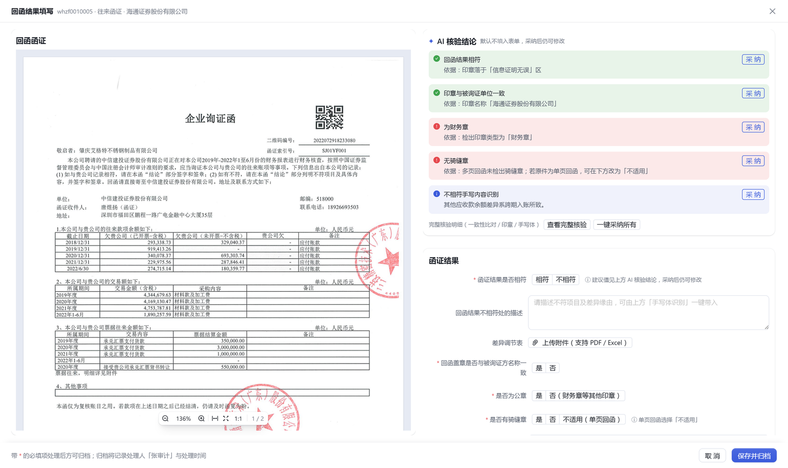

#### 页面字段说明

- 询证事项逐项核对表（银行）：14 个标准询证事项分组 + 1 个资金归集附表，可折叠，组内五列对照（系统数据 / AI 识别值 / 回函值 / 差异 / 结论）。
- 回函结果不相符处的描述、盖章不一致处原因描述：核验页的「人工确认」列也写这两格，两处是同一份数据。
- 替代性测试文件、差异调节表：附件，可传多件，不是必填。
- 拟执行的进一步核查程序及底稿指引：文本，写准备执行哪些程序、底稿怎么索引；不是必填。

#### 输入、输出

**输入：**

| 数据项 | 来源 | 说明 |
|---|---|---|
| AI 识别结论 | 识别服务 | 带「✦ AI」前缀，表示尚未人工确认 |
| 回函值 | 人工录入 | 逐项填写 / 修正；银行函证为询证事项逐项核对表 |
| 函面原件 | 系统内生成 | 左侧预览，供填写时对照 |

**输出：**

| 数据项 | 去向 | 说明 |
|---|---|---|
| 回函结果 | 回函记录 | 函证结果、盖章一致性、差异说明、科目余额分录等 |
| 处理进度 | 回函列表 | 保存后置为「已完成」 |
| 修改留痕 | 回函列表（展开行） | 最近修改人 + 修改时间 |

### AI 智能核验－回函结果补充

#### 业务说明

把不用 AI 的那些回函结果事项收进核验动线：三个 AI 检测页签看完后，直接在这里补齐附件与底稿指引并保存，不必再跳到「回函结果填写」页。

本项不是 AI 核查事项：页脚不提供「采纳 / 不采纳识别数据」，动作在本项内容里（保存 / 保存并归档）。

#### 业务规则

- 本项装两件 AI 给不了的事：两个附件（替代性测试文件 / 差异调节表）+ 一段文本（拟执行的进一步核查程序及底稿指引）；必填项不在这里问 —— 它们各有出处（见各检测页签的人工确认列）。
- 本项与「回函结果填写」页读写同一份回函结果；核验页内落库只有本项这一个出口（三个页签的人工确认列写的是一份草稿）。
- 保存时按总判定判一次：达成（核查项全表态 + 必填全有值）即保存并归档、关窗；未达成只保存字段、不推进进度，并提示还剩哪几项。

#### 使用角色

- 业务人员。

#### 权限说明

- 菜单权限：业务人员拥有回函管理菜单权限。
- 功能权限：维护－包括填写回函结果补充项、上传附件、保存并归档。
- 列表数据权限：不涉及。

#### 功能说明

核验页的第 4 个页签：左侧仍是原件预览栈，右侧为本项的填写区（附件与底稿指引），底部为保存动作与「还剩几项」的提示。

| 名称 | 类型 | 规则/说明 |
|---|---|---|
| 替代性测试文件 | 上传控件 | 上传 JPG / JPEG / PDF，可多附件；与结果页同一份数据，两处都能传 |
| 差异调节表 | 上传控件 | 上传 PDF / Excel，可多附件；与结果页同一份数据 |
| 拟执行的进一步核查程序及底稿指引 | 输入框 | 文本填写（不上传附件）：写清准备执行哪些程序、相应底稿怎么索引 |
| 保存 | 按钮 | 保存字段；若总判定已达成则同时归档并关闭核验弹窗 |

**核验页第 4 项「回函结果补充」：两个附件 + 底稿指引文本 + 保存（人工确认列的唯一落库出口）：**

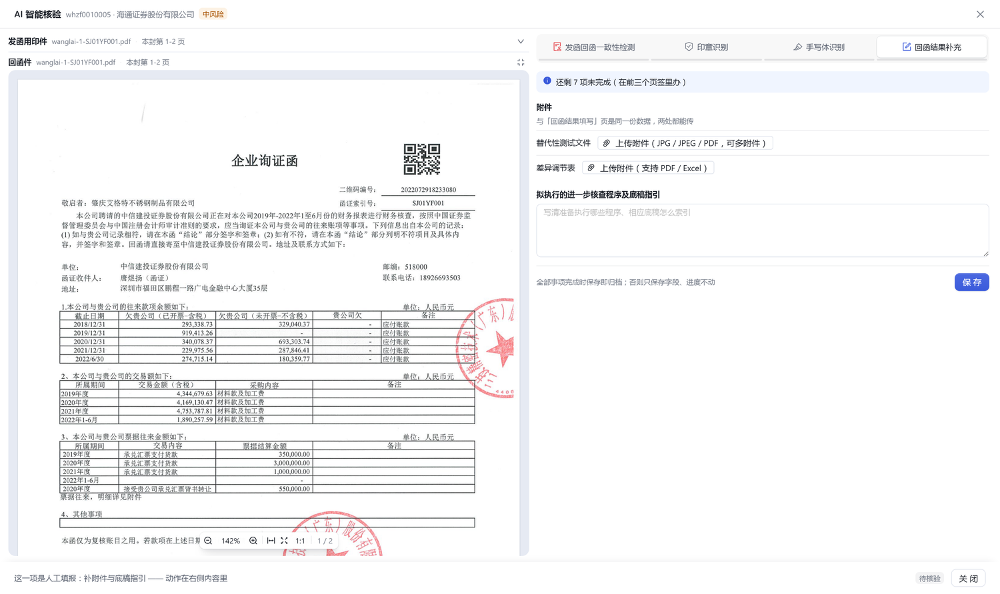

#### 页面字段说明

- 替代性测试文件、差异调节表：附件，可传多件、不是必填。
- 拟执行的进一步核查程序及底稿指引：文本，不是必填。

#### 输入、输出

**输入：**

| 数据项 | 来源 | 说明 |
|---|---|---|
| 回函结果已填值 | 回函记录 | 本项打开时回显已保存的附件与底稿指引 |
| 核验页人工确认列草稿 | 本页签内的填写 | 三个 AI 页签的人工确认列与本项共用同一份草稿 |

**输出：**

| 数据项 | 去向 | 说明 |
|---|---|---|
| 替代性测试文件 / 差异调节表 / 底稿指引 | 回函记录 | 保存后写入回函结果 |
| 处理进度 | 回函列表 | 总判定达成时归档为「已完成」 |
| 本项保存留痕 | 回函记录 | 记录本项保存时间，供页签进度条点亮最后一格 |

### 函证查看与文件预览

#### 业务说明

业务人员看完 AI 结论后要回到原文核依据 —— 印章究竟落在哪个区、金额识别对不对、手写说明写了什么，都要打开原件逐页翻看得清才行。

本功能提供「查看函证」全屏弹窗：顶部一条基础信息带，下面一排页签切换本次函证的不同文件，预览区多页连续滚动并支持缩放；历史回函也从这里看。

#### 业务规则

- 四个明细入口（查看 / AI 核验 / 回函快递信息 / 结果填写）统一为全屏弹窗，由列表页单一互斥状态驱动，同一时刻只开一个；全屏后遮罩不可见，故关闭入口保留三处：右上角 ×、Esc、底栏按钮。
- 承载形态为多页连续滚动：逐页垂直排列并懒渲染（进入视口前 400px 才绘制）；默认「适应宽度」—— 回函文字密集，适宽最易读。
- 缩放范围 25%~500%，可用底部浮动工具条（缩小 / 百分比预设 / 放大、适应宽度、适应页面、1:1、当前页 / 总页数），也支持 Ctrl + 滚轮与触控板捏合；普通滚轮只滚动、不缩放。缩放过程先用 CSS 拉伸撑住视觉，停手 260ms 后按新比例重渲染以保证清晰。
- AI 批注不绘制进原文件：采用「原件渲染层 + 批注叠加层」双层结构，原件二进制保持不可变（审计证据链要求），批注以结构化数据（页号 + 归一化坐标 + 类型 + 文案 + 置信度 + 归属来源）承载；只有导出 / 打印 / 归档这类需要固定留痕的场景，才在服务端合成为 PDF / 图片。
- 批注坐标按页面百分比记录，与显示尺寸解耦 —— 缩放、滚动、换屏时始终贴合文件内容；印章定位框的含义写在框自带的标签上，页面上没有常驻图例。
- 渲染引擎为 pdf.js，格式限制为只认 PDF —— Word / 图片需先转 PDF（第三方 iframe 无法叠加坐标标注，KKFileView 组件保留备用）。
- 历史回函的查看详情页为纯只读：底部只有「关闭」，没有任何修改 / 保存 / 确认入口；顶部标明「这是第 N 次回函。已被后续回函覆盖，仅供参考；当前有效为第 M 次。」—— 历史回函已被覆盖、不参与统计与提示，给修改入口只会让人误改到无效数据。当前有效那一行不带这句提示。

#### 使用角色

- 业务人员。

#### 权限说明

- 菜单权限：业务人员拥有回函管理菜单权限。
- 功能权限：本期不单独授权 —— 查看属只读动作，随列表权限一并开放。
- 列表数据权限：不涉及。

#### 功能说明

列表页被询证单位列或操作列「查看」打开的整屏弹窗：顶部基础信息带 + 一排文件页签，下面是连续滚动的多页预览，右下浮动工具条管缩放。

| 名称 | 类型 | 规则/说明 |
|---|---|---|
| 基础信息带 | 展示区 | 顶部一条 4 列 8 项：函证编号 / 函证类型 / 被询证单位 / 发函方式 / 发函登记日期 / 回函登记日期 / 快递公司 / 回函快递单号（单号旁带 AI 来源标注） |
| 文件页签 | 页签 | 发函函证 / 发函信息 / 回函函证 / 回函信息 / 函证过程文件，当前页签渲染下面的预览 |
| 预览区 | 展示区 | 当前文件全部页连续滚动，逐页懒渲染；批注层恒显 |
| 缩小 / 百分比 / 放大 | 按钮 | 按档位调整显示比例，范围 25%~500% |
| 适应宽度 / 适应页面 / 1:1 | 按钮 | 三种预设：进入时默认适应宽度 |
| 当前页 / 总页数 | 展示区 | 随滚动更新；仅在 PDF 全文渲染进度可判定时给出 |
| 关闭 | 按钮 | 只读语境下底栏唯一动作（右上角 × 与 Esc 同效） |

**「查看函证」弹窗 · 原始文件视图：：**

#### 页面字段说明

- 基础信息带 8 项的前 7 项均来自函证系统与回函记录，只读；回函快递单号旁给 AI 来源标注。
- 列表侧不再重复这些信息：只保留「快递单号」，以列的形式出现在展开行的「回函记录」表里。

#### 输入、输出

**输入：**

| 数据项 | 来源 | 说明 |
|---|---|---|
| 函证基础信息 | 函证系统对接 | 编号、类型、被询证单位、发函方式、发函登记日期等 |
| 回函文件原件 | 上传时存入 | PDF，按页读取用于预览 |
| AI 标注数据 | 识别阶段产生 | 页号 + 归一化坐标 + 类型 + 文案 + 置信度 + 归属来源 |

**输出：**

| 数据项 | 去向 | 说明 |
|---|---|---|
| 无数据写入 | — | 本功能为只读查看，不产生业务数据；导出 / 打印 / 归档时才在服务端合成带批注的文件 |

### 快递数据导入

#### 业务说明

往来函证的物流信息（快递公司、寄件人、地址、电话）在面单上往往不完整，需要用快递系统导出的 Excel 补齐。

业务人员要的不是再来一遍识别流程，而是「导进去、告诉我哪些对上了、哪些没对上」，确认后直接写到对应回函上。

#### 业务规则

- 匹配纽带是快递单号：回函文件里的面单给出「这封回函对应哪个函证」，导入的 Excel 给出「这一单快递的完整信息」，两者以单号合并 —— 即使面单上只有单号，也能通过导入的数据补齐收发件信息。
- 按快递单号与回函面单识别出的单号匹配，抽屉里逐行给出「配上 / 配不上」；点「确认代入」才真正写入 —— 写的是当前有效那一次回函的快递公司与运单号。
- 收件人三项（寄件人 / 联系电话 / 发件地址）不写回回函 —— AI 与快递数据都确定不了，只能在「回函快递信息」里人工补。
- 未匹配时给出原因：该函证尚未上传回函（面单未识别），或运单号填写有误；可核对后重新导入，或对相应函证执行「回函快递信息」手工补填。
- 本功能不走多阶段识别流程（不涉及切分与二维码识别），导入后直接给出匹配结果。
- 主要服务往来函证；银行函证的回函信息以四要素归属为主。
- 面单不是单独上传的文件 —— 面单页在回函拼接件里、单号由 AI 在识别阶段读出；单独导入的是快递详细信息 Excel，且这一步可选。

#### 使用角色

- 业务人员。

#### 权限说明

- 菜单权限：业务人员拥有回函管理菜单权限。
- 功能权限：维护 —— 包括导入快递数据、确认代入。
- 列表数据权限：不涉及。

#### 功能说明

列表主操作行「导入快递数据」打开的抽屉：摘要行给出文件信息与三条计数（解析 N 行 / 成功代入 M 条 / 未匹配 K 条），下面是逐行明细表；确认代入后写入对应回函。

| 名称 | 类型 | 规则/说明 |
|---|---|---|
| 导入快递数据 | 按钮 | 主操作行入口：带入内置匹配结果并直接打开抽屉（原型实现，没有真实选文件与解析过程） |
| 摘要行 | 展示区 | 文件名 + 大小 + 导入时间，以及解析 N 行 / 成功代入 M 条 / 未匹配 K 条 |
| 逐行明细表 | 表格 | 运单号 / 快递公司 / 发件人 / 联系电话 / 发件地址 / 归属函证（函证编号 + 被询证单位）/ 匹配结果 |
| 未匹配行 | 提示 | 悬停给原因（尚未上传回函 / 运单号填写有误），并说明可核对后重新导入 |
| 确认代入 | 按钮 | 确认后把快递公司与运单号写入当前有效那一次回函 |

**快递数据导入结果（含未匹配行）：：**

#### 页面字段说明

- 逐行明细的运单号、快递公司、发件人、联系电话、发件地址均来自导入的 Excel。
- 归属函证是匹配得出的：函证编号 + 被询证单位。
- 写回回函的字段只有两个 —— 快递公司与运单号，其余三项只在抽屉里核对用。

#### 输入、输出

**输入：**

| 数据项 | 来源 | 说明 |
|---|---|---|
| 快递数据 Excel | 人工导入 | 含快递单号、快递公司、地址、姓名、电话等详细信息 |
| 回函面单单号 | 识别阶段产生 | 建立「单号 ↔ 函证编号」的对应关系，供本次匹配使用 |

**输出：**

| 数据项 | 去向 | 说明 |
|---|---|---|
| 快递公司、运单号 | 回函记录 | 确认代入后写入当前有效那一次回函 |
| 匹配结果清单 | 本抽屉 | 逐行展示配上 / 配不上与未匹配原因 |
