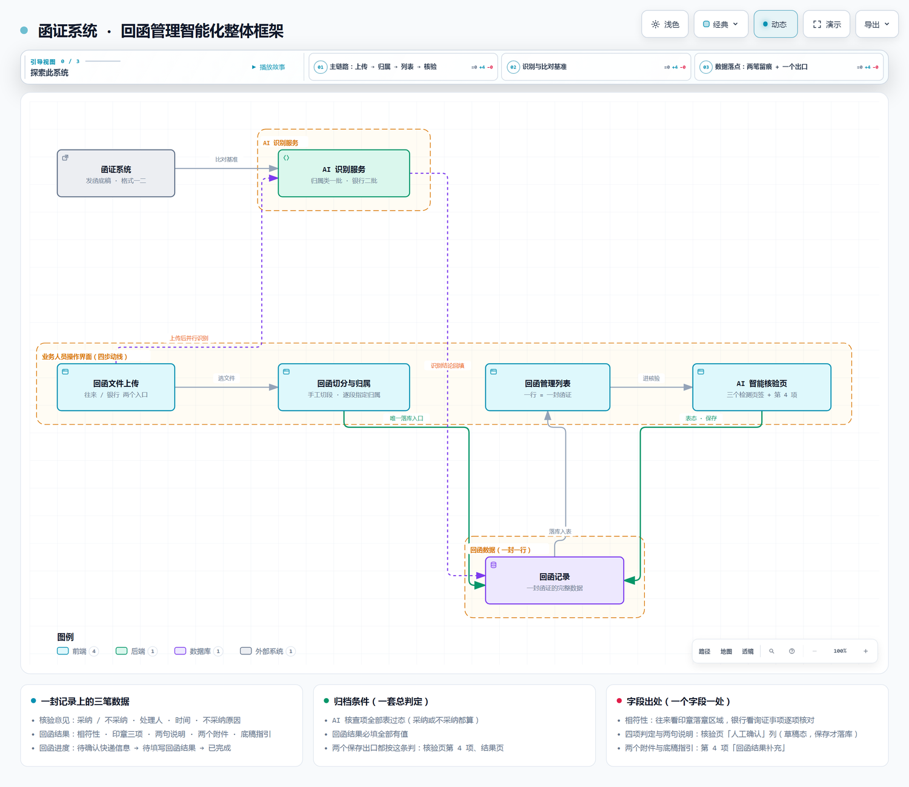
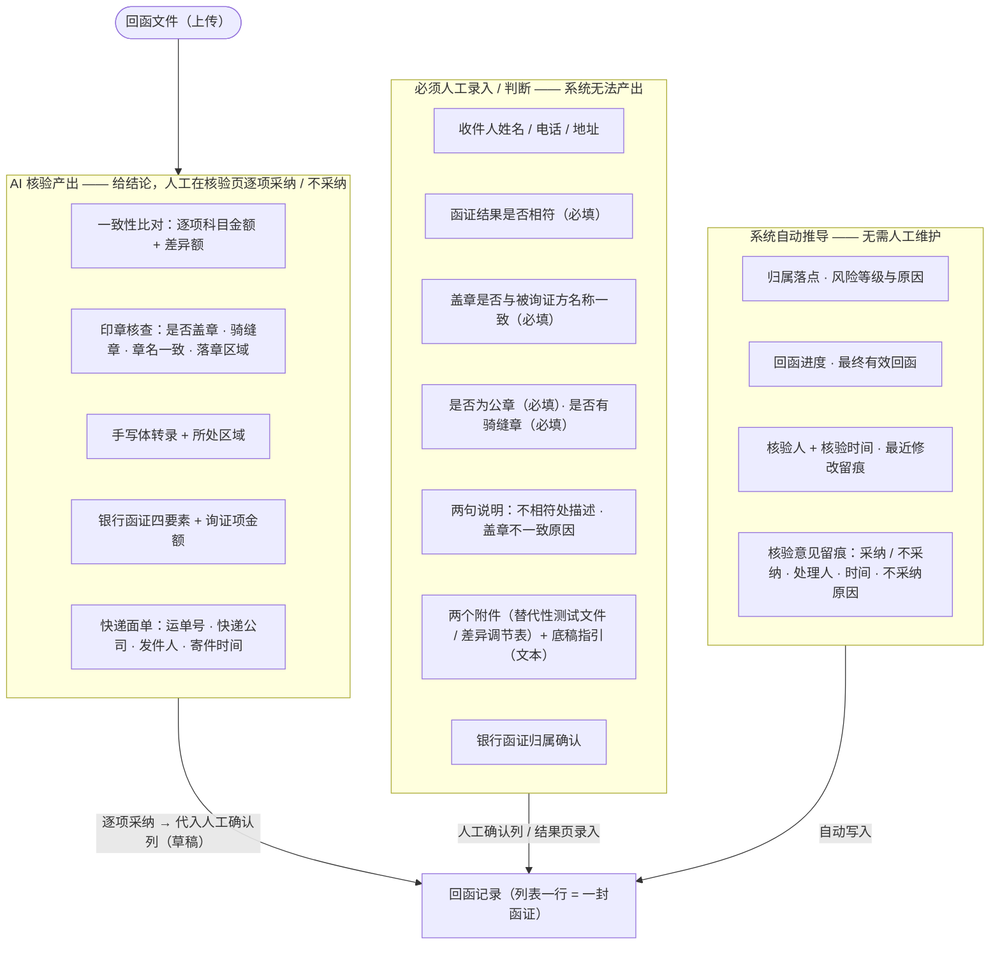
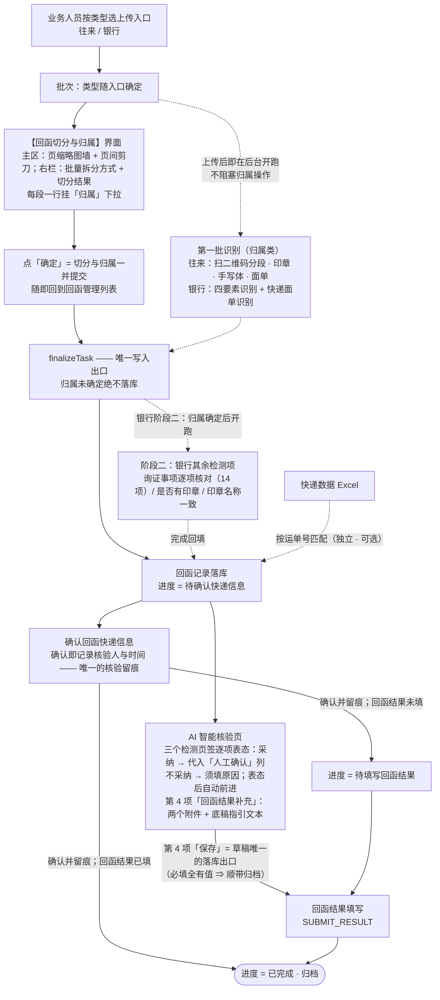
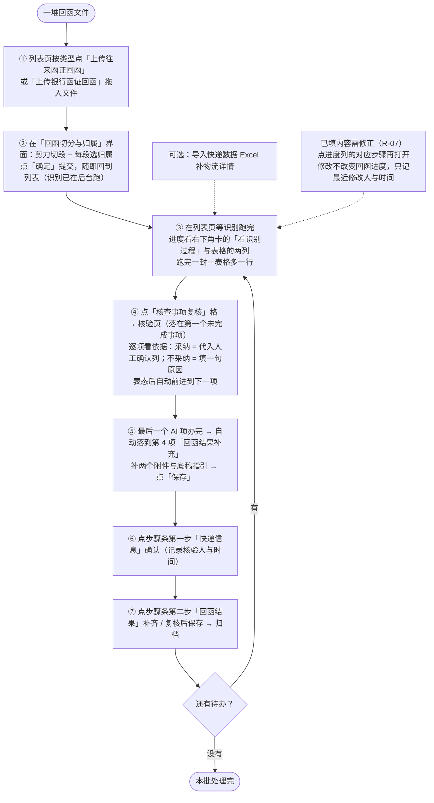

# 函证系统 · 回函管理智能化需求文档

## 1 文档信息

| 项 | 内容 |
|---|---|
| 文档名称 | 函证系统 · 回函管理智能化需求文档 |
| 版本 | v3.45 |
| 日期 | 2026-10-15 |
| 适用范围 | 函证系统「回函管理」模块的智能化改造与前端交互重构 |
| 状态 | 已评审，交互原型已验证 |
| 关联交付物 | 交互原型（本仓库 Vite 工程）、`README.md`、`docs/figures/`（文档配图） |

**文档结构**：第 1~4 章为总览（信息 / 背景 / 范围 / 业务流程）；**第 5 章为主体**，按 11 个功能块组织，每块含「用户场景 / 功能权限 / 功能描述 / 补充说明」四部分；第 6~10 章为附录（功能清单速查 / 视觉规范 / 非功能要求 / 待讨论事项 / 变更记录）。

---

> **关于本文档中的「截图位」**
>
> 凡是"看界面才说得清"的地方，都用下面这种**文字占位**标出 —— **不配图也能从这段文字读明白界面长什么样**：
>
> > **📷 图 5.6-1 ｜ 回函管理列表（总览）**
> > **应展示**：列表页整屏。
> > **重点可见**：① …；② …；③ …
> > **状态要求**：至少覆盖 ……
> > **对应正文**：§5.6「……」一节
>
> 编号规则为 `图 <章节号>-<序号>`；补图时把 `📷` 这几行换成 `` 即可，其余格式不动。

## 2 背景与目标

### 2.1 现状与痛点

| 环节 | 现状 | 痛点 |
|---|---|---|
| 录入入口 | 回函登记 / 文件识别录入 / 按文件编号上传 / 快递数据导入 **四个并列入口** | 用户需自行判断「这封是往来还是银行、该走哪个按钮」，上手成本高 |
| 识别过程 | 同步执行，无任何进度反馈 | 大批量文件时界面长时间无响应，用户不知道系统在做什么 |
| 归档方式 | 往来按二维码；银行需人工先把文件重命名为函证编号 | 人工预处理工作量大，易出错 |
| 质量把关 | 无任何自动校验 | 印章是否盖章、科目金额是否一致、手写说明内容，全部依赖人工肉眼核对 |
| 结果呈现 | 无风险提示、无来源标注 | 无法区分「哪些数据是系统识别的、哪些是人工填的」 |
| 核验留痕 | 无 | 复核责任无法追溯，不满足审计证据链要求 |
| 重复发函 | 同一函证多次发函/回函时缺乏梳理 | 用户无法判断该以哪一次回函为准，历史数据与最新数据混杂 |
| 界面密度 | 筛选区堆叠 3~4 行、表格 14 列行高 56px | 有效信息占比低，视觉噪音大 |
| 使用引导 | 无 | 新用户需培训才能上手 |

### 2.2 本次目标

1. **合并入口、按类型分开**：取消独立的「回函登记」与「文件识别录入」，统一为上传入口；往来函证与银行函证的智能检测事项差别很大，进一步拆为「**上传往来函证回函**」与「**上传银行函证回函**」两个并列入口，上传时类型即已确定，不再由系统事后判类型。
2. **精简筛选**：筛选区默认单行，高频条件外露，其余收入高级筛选。
3. **异步可视、份间并行**：上传后的**切分与识别**异步执行，前端实时展示正在处理哪一封函证。往来函证上传的是**拼接件**，系统先按二维码**切分成多份回函**，切分完成后**逐份并行开跑**检测 —— 切分是「拆任务」的前置步骤（切分前整批只是一个文件，谈不上并行），故确立「**先切分归属、再并行细查**」的节奏，**两类函证统一**。
4. **字段精简与信息分层**：列表字段精简、密度提升，并明确标注 AI 识别来源、识别结果与风险。
5. **人工核验留痕**：记录**核验人与核验时间**，在列表**展开行表下的一行留痕小字**里查看。
6. **重复发函可管理**：同一函证多次回函时，以最新一次为准，历史回函可查可不处理。
7. **界面具指引性**：首次使用即可依界面完成操作，无需额外培训。

---

## 3 业务范围与约束

### 3.1 范围

- **包含**：回函管理模块的上传、识别、归档、核验、回函快递信息、结果填写、查看与删除。
- **不包含**：发函管理、未回函管理、回函过程检查等其他一级模块（顶部导航保留但为占位）。

### 3.2 业务约束

| 编号 | 约束 | 说明 |
|---|---|---|
| C-01 | **一个函证控制表内的函证类型必须一致** | 同一张控制表要么全部是往来函证，要么全部是银行函证，不会出现两者混排 |
| C-02 | **往来函证与银行函证并重** | 银行函证的归属匹配（四要素）与专属结果字段（询证事项逐项核对）已于 v2.5 细化（见 5.2 / 5.5）；两类函证在识别、核验、归档链路上统一处理 |
| C-03 | **AI 结果不自动入库** | AI 只产出建议、风险标签与置信度，必须经人工确认才写入数据 |
| C-04 | 银行函证唯一标识为四要素 | 银行名称 + 被审计单位名称 + 函证起始日期 + 函证截止日期 |
| C-05 | 往来函证按系统二维码识别 | 往来函证为我方发出、右上角带系统二维码，部分多页函证需加盖骑缝章 |
| C-06 | **往来函证二维码编码的是函证编号** | 二维码只标识「这是哪封函证的回函」，**不标识第几次发函**。系统据此把回函归属到函证，**无需人工区分是第几次**。 |
| C-07 | 列表行粒度为**一封函证一行** | 行主体是函证，行上呈现该函证**最近一次回函**的数据；同一函证多次回函时，**该函证的全部回函**收进展开行的「回函记录」一张表 |
| C-08 | 本列表只含**已回函**的函证 | 表单初始为空，只有上传回函文件并成功匹配到函证的数据才进入；未回函的函证由「未回函管理」模块承载 |
| C-09 | 重复回函以**最新一次**为准 | 同一函证多次回函时，仅最近一次回函为「最终有效」；历史回函标为「已被覆盖，可不处理」，其回函快递信息与回函结果**非必填**、不参与风险提示与统计，但保留查看与 AI 核验留痕 |
| C-10 | **往来函证上传的是拼接件** | 页序为「某封回函页（带二维码）+ 该封自己的快递面单页」**依次成对排列**；系统按二维码逐页切分（相同函证编号归为一段），**面单页没有二维码、归入其前一段的尾部**；整批由此拆成 N 份**可并行处理**的回函任务。**这个切分结果只是归属界面的「初稿」** —— 用户可在页缩略图墙上手工微调 |
| C-13 | **识别切分的效率需实测，可降级为纯手动** | 「识别切分」（识别判定哪几页是面单页、并把面单页预切成独立段）是**异步**能力：结果到达前面单页不出现在切分里。**其效率必须在项目实施前实测**（从上传到面单识别结果可用的时延）；**若效率低，可只保留手动切分录入的功能** —— 用户按页数 / 页范围拆分、逐段指定归属、手工填快递单号，整条链路完整可用。因此归属界面**不得把切分绑死在识别结果上**，也不得用识别结果去改用户已经做过的切分 |
| C-14 | **银行侧切分有「手动 / 智能」两条路，智能为可选增强** | 银行侧切分与归属**两条路并存**：**手动**（默认）—— 初稿是**整份一段**，用户自己切、自己选；**智能** —— 用户显式点一次，系统把**切分 / 归属 / 快递单号**一次认好，进切分页即已就绪、确认即可（两处入口：上传弹窗内 / 归属界面顶部）。**智能是可选增强、不是底座**：其可用性取决于客户侧 AI 资源（识别率与速度），**未启用时把两处入口去掉即可，手动路完全不受影响**（与 C-13 / N-10 的降级预案同源）。原型把识别过程演成**固定约 5 秒**，只为让演示可预期，**不得当作实施承诺**（真实施按实测给进度）。无论走哪条路，**已切分过的按人工为准**，且识别结果**全部可改** |
| C-11 | **银行函证的分批识别** | 银行函证的识别由**两类引擎分工** —— 四要素与印章区域走 OCR / 大模型，14 项表格走 MinerU；**两条链路并行发起**、识别结果**分两批交付**（批一 = 归属类，必达且要快；批二 = 表格类，可慢）。**「先四要素、等归属、再跑表格」不采用** —— 表格识别不依赖归属，串行会让最慢的环节白等归属 |
| C-12 | **银行面单与函证是多对一** | 银行函证「一年一封」，同一被询证单位**多年多封**会**装在同一个快递袋**寄回，因此**一张面单可以对应多封函证**。面单页**就在回函件里**（上传弹窗里声明「本文件含面单页」，银行默认「是」），系统**只识别条形码**得运单号 —— 由「快递面单识别」这一检测项判定**哪几页是面单**；**归属界面在结果到达时把面单页预切成独立的「快递面单段」**，每张面单**管辖它前面的那些函证段**，于是同一个单号落到被它管辖的多封函证上。**一份文件里可以有多个包裹、多张面单**。⚠️ 「拿面单反查快递详情（快递公司 / 发件人 / 电话 / 地址）」是另一件事，其界面入口见 5.4「回函快递信息」的导入弹窗 |

---

## 4 业务流程

> **图 4-0 ｜ 回函管理智能化整体框架**（主链路 · 识别与比对基准 · 数据落点）：
> 源文件 `docs/figures/framework/overall-framework.html`（Archify 交付）、规格 `overall-framework.json`、重抓图脚本 `capture_framework_png.py`。
>
> **怎么读**：① **横向四步 = 业务人员的主链路**（上传 → 归属 → 列表 → 核验），每一步的产物都写进同一封回函记录；
> ② **上方 = 识别服务与它的比对基准**（发函底稿 / 系统内格式一二）：识别**上传后即后台并行**，而**归属确定才是唯一的落库入口**；
> ③ **下方 = 数据落点**：核验意见（采纳 / 不采纳）与回函结果都长在同一封记录上，归档按一套总判定（见 §5.3 / §5.5）。



### 4.1 改造前

```
回函登记(仅勾选登记) ┐
文件识别录入(往来:二维码切分→人工核对切分段) ┤→ 附件挂载 → 快递数据导入(Excel按单号匹配)
按文件编号上传(银行:按函证编号命名) ┘ → 回函快递信息(人工点确定) → 回函结果填写
```

> **改造前的往来链路**：上传拼接件 → 后端读右上角二维码切分 → 弹出「**数据核对**」让人工逐段核对（切分页数 / 函证编号 / 关联发函记录编号 / **快递单号需手填**）→ 点「确定」后才归档。
>
> 其中**两处要被新版继承或修正**：① 「**先切分、后确认**」这个顺序是对的，必须**保留**（切分是「拆任务」的前提）；② 而切分与智能识别**串行**、快递单号要在切分步骤**手填**，这两点在新版中改掉 —— 前者改为份间并行，后者交给「回函快递信息」的面单识别。

### 4.2 改造后（按类型两个入口 + 引导流水线）

```
① 按类型上传
 往来函证 / 银行函证 两个并列入口，类型随入口确定，不再由系统事后判类型；
 往来上传的是「拼接件」：某封回函页（带二维码）+ 该封自己的快递面单页，依次成对排列
 │ 各自打开一个小弹窗——
 │ 往来：「最后页是否快递面单」（**必选**，指"每一段尾部各有一页"）+ 拖拽上传；
 │ 银行：同样有「最后页是否快递面单」（**默认「是」**，指"整份文件末尾一张、管辖它前面的多个函证段"）+ 拖拽上传
 │ 两类弹窗都带「没有文件？用演示数据体验」入口
 ▼
② 回函归属（**独立全屏界面**；两类函证的**同一件事**：把这份文件切成几段、每段归到哪封函证）
 界面构成：主区 = **页缩略图墙**（一页一张小图，页与页之间立着一把剪刀，点一下就在那里切一刀）；
 右栏 = **拆分方式**（按固定页数 / 按自定义范围 / 按文档数量均分）+ **切分结果**
 （每段一行：页码区间 + **归属下拉**）
 初稿按类型分：往来 = 二维码已切好的分段（可手动微调）；
 银行 = **整份一段**，由用户自己切
 两类都**不依赖任何识别进度**，打开即可动手
 │ 点「确定」= 切分与归属一并提交，随即**回到回函管理列表**
 ▼
③ 后台异步识别（识别**不打断**用户）
 **上传后即在后台开跑**；各段作为**独立任务并行推进**，
 右下角常驻进度卡，要过程时由用户**主动点入**「智能识别」界面。
 ⚠️ **但「写入回函列表」必须等②提交**：未点「确定」就退出 ⇒ **本批一个字都不落库**，
 列表里不该出现这一批的任何一行（口径见 5.2「未提交时一律不写列表」）。
 例外：**银行阶段二**（询证事项逐项核对 / 印章两项）的判据要用到"系统内那封函证的被询证单位"，
 归属未定无从比对，故仍在归属确定（= 提交）后才开跑
 │
 ▼
④ 智能识别界面（**独立全屏界面**，本界面**只做识别**，不含人工核验）
 单栏：进度区（像素网格 + 读秒）→ 计数标签 → **按函证分组的检测点卡**
 （每封一张卡，卡头写「在识别哪一封」+ 该封自己的结论 + 风险等级标签）
 → 建议卡（**只给高 / 中风险的段**，卡头带该封自己的风险标签与置信度）
 不放函面预览、不放切分清单、不承担上传、**不可最小化**（要看进度看右下角卡）
 往来：① 发函回函一致性 ② 回函文件是否印章 ③ 骑缝章 ④ 印章与被询证单位名称一致
 ⑤ 手写体 ⑥ 快递面单
 银行：① 识别四要素 ② 快递面单识别（两项都在**阶段一**，与归属并行）
 ③ 询证事项逐项核对（14 项，回函 × 系统内格式一/二）
 ④ 回函是否有印章 ⑤ 印章名称与被询证单位一致 → 输出风险等级
 │
 ▼
⑤ 人工复核确认
 在「回函快递信息」里**一次性确认**（核验人与时间在此留痕），进度推进到「待填写回函结果」
 │
 ▼
⑥ 回函结果填写与归档
 函证结果、盖章一致性、差异说明、科目余额分录
```

> **两个环节的时序**：② 归属是**快**的（秒级，但必须人工确认）、③④ 识别是**慢**的（每份数秒~数十秒）。
> 1. **切分由系统推算改为用户手工切分**（原：往来扫二维码自动分段、银行按四要素算归属三档）；
> 2. **识别不再等切分确认才启动** —— 上传后即在后台推进，用户切分的同时识别已在跑。**切分确认决定的是「什么时候写入回函管理列表」**（归属未确定绝不落库），不是「识别什么时候开始」。
> > 例外：**银行函证的阶段二**（询证事项逐项核对 / 印章两项）仍在**归属确定之后**才开跑 —— 因为「印章名称与被询证单位一致」的判据是「印章名 vs **系统内那封函证的被询证单位**」，归属未定无从比对。

### 4.3 关键判定规则

| 规则 | 内容 | 影响字段 |
|---|---|---|
| **R-01 相符性判定** | **往来函证**：印章盖在「信息证明无误」区 → **相符**；盖在「信息不符」区 → **不相符**。**银行函证**：与系统内格式一 / 格式二数据**逐项核对**，有差异即判**不相符**；印章落章区域**不参与**银行函证的相符性判定 | 回函结果是否相符 |
| R-02 印章名称一致性 | 印章内容需与被询证单位名称一致 | 回函盖章是否与被询证方名称一致 |
| R-03 骑缝章 | 多页回函建议加盖骑缝章，未检出时提示。**银行函证不检测骑缝章** | 风险标签 |
| R-04 一致性差异 | 回函金额与比对基准不一致时，标红并计算差异额（往来=发函底稿；银行=系统内询证事项） | 风险等级、差异描述 |
| R-05 手写说明区域（仅往来函证） | 手写说明所处区域应与印章落章区域一致，不一致时提示人工复核；**银行函证不检测手写体** | 风险标签 |
| **R-06 最终有效回函** | 同一函证多次回函时，**回函时间最新**的那一次为**最终有效**；其余为历史回函，标为「已被覆盖，可不处理」 | 列表主行数据、统计口径 |

> **R-06 的实现方式**：「最终有效」不由人工标记，而是系统按回函时间自动推导 —— 新回函进来后自动成为最终有效，原回函自动降级为历史。这与用户认知一致：**历史回函了几次，当前次就是第几次回函**，无需关心第几次发函。

**R-07 已填写信息的修改**

| 规则 | 内容 | 影响字段 |
|---|---|---|
| **R-07 已填写信息的修改** | 「回函快递信息」与「回函结果」两处内容，经人工确认 / 归档之后**仍可随时重新打开修改**；修改**不改变回函进度、不重复产生核验留痕**，但会记录**最近修改人与修改时间** | 回函快递信息、回函结果、修改留痕 |

> **为什么允许改**：函证在归档后被要求补正、修正的情形真实存在（复核发现录入有误、被询证方补充说明等）。若不给入口，业务人员只能绕道（找管理员改库 / 重新走一遍流程），反而破坏留痕。
> **为什么改后状态不变**：用户明确选择「已完成的行修改后**保持已完成**」—— 状态表达的是「这一步做完了没有」，修正不改变「已做完」这个事实，把进度退回「待填写」会让统计口径与业务认知都失真。
> **为什么不再留一次签字**：核验留痕（核验人 + 时间）是「**第一次人工确认**」的凭证，只在 5.4 的唯一入口打一次。修正不是第二次确认，因此不再签字；但「改过」这件事必须有痕迹，故补一条**最近修改留痕**（`lastEditedBy` / `lastEditedAt`），在列表**展开行表下的留痕一行小字**里展示—— 既守住审计可追溯，又不制造「同一件事两处签字」的困惑。
> **修改入口在「回函信息录入进度」步骤条上**：列表操作列只留「查看」（「更多」下拉连同它下面的四项一并移除）；要改已填内容，就点「回函信息录入进度」列那一步 —— 任一状态都可再打开（R-07：进度不代表数据被锁定），改后进度不变、只记最近修改人与时间（见 5.6 操作列）。


### 4.4 回函进度状态机

「回函进度」不是数据库原生字段，而是把「识别 → 资料确认 → 结果填写」串成的一条流程状态，**取值即用户视角的「下一步要做什么」**。

> **⚠️ 两个业务步骤是「两个独立的勾」，不是一条流水线** ——
> 「确认回函快递信息」与「填写回函结果」**没有必然先后**：可以先填结果、后确认快递信息，反之亦然。
> 列表步骤条因此**各按自己的事实打勾**（快递信息 = 该行确认过；回函结果 = 该行填过结果），互不牵连；
> 「回函进度」只回答**「下一步该做什么」**（第一个还没做的），不再兼任"两步都完成"的信号。
> 快递信息那一步在列表里也被打了勾（用户实测报的正是这个）。

```
【上传回函文件】→ 匹配成功 → 才进入「回函管理」列表
 │
 ① 待确认快递信息 ← 快递信息还没确认（回函结果可能已填）
 ↓ 确认 ↑ 先填结果、回头再确认也可以
 ② 待填写回函结果 ← 快递信息已确认、回函结果还没填
 ↓ 填写并保存
 ③ 已完成 ← **两步都完成了**
```

| 取值 | 业务含义 | 用户下一步动作 | 是否需人工介入 |
|---|---|---|---|
| 待确认快递信息 | 快递信息尚未确认（**不论回函结果是否已填**） | 打开「回函快递信息」逐项确认 | ✓ |
| 待填写回函结果 | 快递信息已确认，等填写回函结果 | 打开「回函结果」填写并保存 | ✓ |
| 已完成 | **两步都已完成**（回函结果已归档、且快递信息确认过） | 如需修正，随时打开「回函快递信息」或「回函结果」修改（**改后仍为已完成**，见 R-07） | ✗ |

> **两条硬约束**：
> ① **进度取值必须与"下一步"一致** —— 因此"结果填了、快递信息没确认"的行**留在「待确认快递信息」**，
> 不显示「已完成」；步骤条上「回函结果」那格照常打勾，两处不打架。
> ② **已归档的行不因一次补做动作往回退** —— 走完 ① 之后，"先填结果"的行本就不会到「已完成」；
> 而真正已完成的行走「补确认快递信息」也不会退回「待填写回函结果」。

> **进度表达的是「下一步」，不是「能不能改」** —— 三个状态都是**当前待办**的表达，不代表数据被锁定。任一状态下都可重新打开两个业务入口查看与修改已保存的内容（详见 R-07、5.4、5.5）。

> **归档的触发点有两个、条件同一个** —— 「回函结果填写」页的保存、核验页第 4 项「回函结果补充」的保存，都只在**这一步完成之后**把进度推到「已完成」。**完成与否只看这件事本身**：表单里所有必填字段都有值即完成（无论在结果页填的、还是从核查页采纳带出的）；AI 核查项表没表态不算未完成。 —— 表单初始为空，只有上传回函文件并成功匹配到函证的数据才会进入。未回函的函证由「未回函管理」模块承载。

> **回函进度只针对「最终有效回函」表达**。历史回函的进度不参与主行展示，也不计入统计。

### 4.5 数据分工与流转

#### 4.5.1 谁产出什么：AI 读取 · 人工定性 · 系统推导



**一句话**：**AI 包了「读取」，人保留「定性」与「补充」** —— 回函快递信息这一环 AI 几乎全包（人工只补收件人信息），但**「函证结果是否相符」「回函盖章是否与被询证方名称一致」「是否为公章」「是否有骑缝章」这几个必填判断永远由人签字**，这是审计留痕的底线。：AI 的结论摆左栏、人采纳即代入右栏（草稿态），点「保存」才落库。

| 分工 | 内容 |
|---|---|
| **AI 核验产出**（逐项采纳 / 不采纳；采纳即代入「人工确认」列） | 一致性比对（往来=发函×回函；银行=回函×系统内询证事项）、印章核查（是否盖章 / 骑缝章 / 章名一致 / 落章区域）、手写体转录（**仅往来函证**）、银行函证四要素与询证项金额、快递面单 |
| **人工必须录入 / 判断** | 收件人姓名·电话·地址（**全表唯一 AI 完全识别不了的字段**）、函证结果是否相符（必填）、盖章是否与被询证方名称一致（必填）、盖章不一致原因描述、回函结果不相符处的描述、是否为公章（必填）、是否有骑缝章（必填）、两个附件（替代性测试文件 / 差异调节表）、拟执行的进一步核查程序及底稿指引（**文本**）、银行函证归属确认 |
| **系统自动推导**（无需人工维护） | 归属落点、风险等级与原因、回函进度、最终有效回函、核验人与核验时间 |

#### 4.5.2 数据流转路径



**四条关键约束**：

| 约束 | 含义 |
|---|---|
| **归属未确定不落库** | 归属错了却已进列表，比晚进列表危险得多 —— 因此状态写入闸门卡在归属确认之后 |
| **唯一写入出口** | 所有回函数据只从 `finalizeTask` 进入列表，不存在多个入口各写一份的可能（确认与结果填写属于**更新已有记录**，不违反该约束） |
| **人做定性、系统做推导** | 风险等级、回函进度、最终有效回函都是推导值，不需要人工维护；人的动作只保留「确认」与「填写」 |
| **切分先于归属、归属先于落库** | 往来函证先**切分**成 N 段（拆任务），再**逐段归属**（同一界面里的两个动作，由用户手工完成）。**归属确定决定的是「什么时候写入回函管理列表」**（`finalizeTask` 是唯一写入口），**不是「识别什么时候开始」** —— 识别自上传起即在后台推进。**银行阶段二例外**：其判据要用到该函证的被询证单位，归属未定无从比对，故仍在归属确定后开跑 |

#### 4.5.3 业务人员的操作路径



**让业务用起来不费解的两处设计**（详见 5.6）：

1. **操作列结构恒定**—— 识别失败的行**多一枚「重新识别」**，那是它唯一的出路。要改已填内容，走下面那条步骤条。
2. **能做什么，由进度列的步骤条表达** —— 「回函信息录入进度」单元格是一条**可点的步骤条**（`快递信息 › | 回函结果 ›`）：**两步各自独立打勾**，**当前该做的那一步加字重**、点它即打开对应弹窗。进度**只回答「下一步该做什么」**，不代表数据被锁定（R-07：任一状态都可再打开修改）。（已完成的两步都打勾、都不可点推进，但仍可点开回看。）

---

## 5 功能块说明

> 本章按用户动线拆为 11 个功能块，每块含 **用户场景 / 功能权限 / 功能描述 / 补充说明** 四部分。
> **功能权限**部分本期留空（暂不涉及角色与权限边界，见附录 D 待讨论事项）。

### 5.1 回函文件上传与识别

#### 用户场景

业务人员手上攒了一批回函 —— 往来函证是拼接件（多封回函 + 快递面单拼在一个 PDF 里），银行函证是银行自行出具的扫描件。他要做的是把这批文件交给系统，而不想先自己分类（哪封是往来、哪封是银行）、也不想先把银行文件重命名成函证编号。上传之后，他还需要知道「系统在处理哪一封、到哪一步了」，以便判断能不能先去做别的事。

#### 功能权限

> 本期不涉及权限控制 —— 功能块暂不区分角色与操作权限边界。

#### 功能描述

**入口**

- **往来函证与银行函证各是一个独立页面（两条路由）**，每页只有**本类**的列表与**一个**上传入口 —— 依据是**两类是不同的控制表，真实系统里各是一个菜单，不会在同一个页面上混着展示**。
- 各页主操作行**只有一个上传按钮**（往来「上传往来函证回函」/ 银行「上传银行函证回函」），点开各自的**上传弹窗**；页面头写明是哪一类 + **共几封函证**。
- **银行弹窗里多一个「智能识别」入口** —— 银行侧切分有两条路，这是"系统替我切"那条：**最省一步**，上传完直接点它，进切分页时**已切好、归属已带入、快递单号已带上**，确认即可（也可像手动一样逐项改）。旁注一句「一次把**切分 · 归属 · 快递单号**都识别好，进切分页直接确认（识别结果全部可改）」。**往来弹窗没有这个入口**（往来的初稿由二维码给出，无需再认）。⚠️ 原型**不要求先选文件**（没有真实解析，未选文件时按内置样例题跑，演示用）；真实施时若不启用，把这个入口去掉即可，手动路（走底栏「下一步」）完全不受影响（见约束 C-14）。
- **两类弹窗都有「最后页是否快递面单」，但口径完全不同**：**往来为必选**，指「**每一段**尾部各有一页面单」（一对一，单号带在各段自己身上）；**银行默认「是」**，指「**这一份文件里含有面单页**」—— 识别会判定哪几页是面单，切分时把它们**预切成独立的快递面单段**，每张面单**管辖它前面的那些函证段**（一对多，一个快递单号对应多个函证编号）。**同一份银行回函里可以有多个包裹、多张面单**（演示批次是 **4 个包裹**、各 4 封：第 13 / 26 / 39 / 52 页各是一张面单，分别管辖本包那 4 封；**前三个包裹那张读得出、最后一个包裹那张未读出**，要人工照图填）。往来还多一行说明文字（「每段尾部是否还有一页没有二维码的面单页」）。
 > **字段名叫「最后页」、实际不止末页（待统一）**：开关文案沿用早期只考虑"末页一张面单"时的叫法，而实现与演示数据都按"文件里可能有多张面单页"处理（`SplitPanel` 逐张面单段挂单号）。**文案与口径不一致这件事已记下，尚未改**（改文案会影响两处弹窗与既有截图，留给产品定）。
- **弹窗内不铺上传说明文字** —— 文件形态、归属方式与检测项，统一由入口按钮的**悬停说明**表达一次；拖拽区只留「图标 + 一行标题 + 一行支持格式（仅 PDF）」，不写别的。
- 两类函证的智能检测事项差别很大：**往来函证**的一致性来自「发函件 × 回函件」比对；**银行函证**只需上传**回函件**（格式一 / 格式二数据已存于函证系统），识别回函后直接与系统数据逐项核对，且**不检测手写体**。从入口就分开，上传时类型即已确定，**不再由系统事后判类型**。
- 列表里**不再出现类型标签**：本页只有一类函证，每行再标一次「往来 / 银行」是重复信息；「被询证单位（银行）」这一写法只在银行页的表头出现。
- 原「回函登记」「文件识别录入」「按文件编号上传」三个入口**全部取消**，业务人员不需要自行判断该走哪个。

> **📷 图 5.1-1 ｜ 往来函证上传弹窗**
> **应展示**：点「上传往来函证回函」后打开的弹窗。
> **重点可见**：① 标题「文件识别录入」；② **「最后页是否快递面单：是 / 否」**（必选项）；③ 拖拽上传区；④ 已选文件的「文件名 + 大小 + 移除」；⑤ 拖拽区下方的**「没有文件？用演示数据体验」**入口；⑥ 底栏 `取消` / **`下一步`**。
> **状态要求**：截两张 —— **未选文件**（空态，**不给提示**；校验提示只在点「下一步」之后出现在底栏）与**已选文件**（可点「下一步」）。
> **对应正文**：§5.1「入口」+「往来：上传弹窗 → 回函归属界面」

> **📷 图 5.1-2 ｜ 银行函证上传弹窗**
> **应展示**：点「上传银行函证回函」后打开的弹窗（与上图同尺寸、同款按钮）。
> **重点可见**：① 标题「上传银行函证回函」；② **「最后页是否快递面单：是 / 否」**（**默认「是」** —— 与往来的「必选」不同）；③ 拖拽上传区；④ **「智能识别」入口**；⑤ 底部的**「没有文件？用演示数据体验」**入口。
> **与往来弹窗的差别**：不在有无面单项，而在**口径** —— 银行是「**本文件含面单页（可能多张）**，每张管辖它前面的函证段」（一对多），往来是「**每段尾部**各一张」（一对一）；两者的说明文字与演示数据文案也各不相同。
> **对应正文**：§5.1「入口」

**上传**

- 支持拖拽与点击上传、可一次选多份；**只收 PDF**（两个弹窗的拖拽区都写明「支持单个或批量上传，仅支持 pdf 格式」）。
- 函证类型**随入口确定**（往来 / 银行），后续界面按它渲染。
- **演示数据入口在各类型自己的弹窗里**：文案「没有文件？用演示数据体验：」+ 一个闪电图标按钮，走法与「下一步」**同路**（只是用内置批次），点它即开始识别并进归属界面。
- 演示数据按入口只给本类型那一批：往来函证拼接回函（**9 页 / 3 段**，每段尾部各带一页面单）、银行函证回函（**52 页 / 16 封 + 4 张面单**：**四家银行各一个快递包裹**，每包 = **4 封 × 3 页 + 末页一张面单**；四张面单里 **3 张读出、最后一个包裹那张条码未读出**（要人工照预览图上的运单号填）—— 每包"一张面单管 4 封"，演示「一个快递单号对应多个函证编号」）。**数字一律以 `src/mock/recognition.ts` 的 `buildBatchA` / `buildBatchB` 为准**。

**异步识别**

- 上传后立即返回，识别在后台异步执行，**界面全程可交互**。
- **切分与归属在「回函归属」界面里做**（见 5.2）—— 该界面**不依赖任何识别进度**，打开即可动手；识别同时在后台推进。
- **份间并行**：一个拼接件被切成 N 段后即成为 N 个独立任务，**各份并行推进、互不阻塞**。串行总时长是 `Σ各份检测`，并行后是 `max各份检测`。
- **两阶段节奏（仅银行函证；查类型规则表的 `twoPhase`）**：
 - **阶段一（快）**：**识别四要素**（银行名称 / 被审计单位 / 函证起止日期）。它的结论作为**归属的参考信息**出现在归属界面里（每段的归属下拉会按**页区间**预填既有结论）。**往来函证没有阶段划分**，六项检测一次性跑完。
 - **阶段二（归属确定后自动开跑）**：询证事项逐项核对（14 项）／回函是否有印章／印章名称与被询证单位一致。
 > **为什么印章两项也放阶段二**：① 「印章名称与被询证单位一致」**依赖归属** —— 判据是「印章名 vs **系统内那封函证的被询证单位**」，归属未定无从比对；② 「回函是否有印章」技术上无前提，但**刻意不提前** —— 归属未定时列表里还没有这条记录，抛出一个「这封没盖章」的风险，用户**无处处理**（延续「结论不得先于归属」）。
 - **⚠️ 识别**不**等切分确认才启动**：上传后各类检测即在后台推进，用户切分的同时识别已经在跑。**切分确认决定的是「什么时候写入回函管理列表」**（归属未确定绝不落库），而不是「识别什么时候开始」。
- **银行函证：两批交付 + 两条链路并行发起** —— 银行函证的识别由**两类引擎分工**：**四要素与印章区域**走 OCR / 大模型；**14 项表格**走 **MinerU**（表格识别模块）。据此定两条要求：
 1. **对识别服务的接口契约** —— 一份回函的识别结果**分两批返回**：**批一** = 归属类字段（四要素 + 印章区域），**必达且要快**；**批二** = 表格类字段（14 项金额），**可慢**。这条契约**不绑引擎** —— 将来后端用一个还是两个引擎、怎么排布，前端都按「两批」消费：批一先到就**先按页区间把归属预填好**（归属界面的每段下拉），批二到了走比对 —— 注意：**界面上没有独立的「确认归属」按钮**，确认落在归属界面的「确定」上；
 2. **两条链路并行发起** —— 因为**14 项表格的识别不依赖归属**（MinerU 读的是回函自己的表格，不需要知道它属于哪封函证）。时序对比：`max(t批一, t批二) + t比对`（并行）vs `t批一 + t批二 + t比对`（串行）。**「先四要素、等归属、再跑表格」不采用。**
 3. **批二未完成时，用户能看到什么** —— 批二是整个流程里**最慢**的一段（MinerU 整表识别），因此**不能让用户只看到一颗转圈**：① **回函列表的「智能核查进度」列**把「询证事项逐项核对」这一项标成"正在核查"（像素网格在跑），识别中的那一格悬停补一句"为什么会慢"；② **「回函结果填写」页的询证事项表**在识别未完成时，组标题与「AI 识别值」列显示「**正在识别…**」（见 5.5）；③ 由于**快递信息的确认不依赖表格识别**（面单是独立上传的），用户可以在批二跑完之前先去确认回函快递信息、进结果填写页等着 —— 界面需给一句引导：「归属已确认，可先核对回函快递信息；询证事项表格识别完成后这里会自动刷新」。
- **银行印章两项都放在阶段二** —— 两条理由：① **「印章名称与被询证单位一致」依赖归属** —— 判据是「印章名 vs **系统内那封函证的被询证单位**」，归属未定就无从比对；② **「回函是否有印章」技术上无前提**（与四要素同走 OCR / 大模型，批一里就有），但**刻意不提前** —— 归属未定时**列表里还没有这条记录**，抛出一个「这封没盖章」的风险，用户**无处处理**。这与 v2.33「结论不得先于归属」的既有口径一致（当时正是把五项提前起跑又撤回）。
 - **识别中态**：**归属确认不等于入表** —— 这封函证要等**全部检测项尘埃落定**才写进回函列表（见 5.6「入表时机」），在此之前它只出现在列表页的**智能识别区**里逐项交代进度。因此**列表里没有「识别中」的行**（「回函是否相符」列的 `pending` 分支保留，实际已不会被触发）。
 - **「落定」包含失败**：某项失败的封**照样入表**（它是这次识别的结果之一，不是"没有结果"），只是**不给任何核验结论** —— 「回函是否相符」写中性「识别失败」，操作列给「**重新识别**」；其余检测项**不因某一项失败而停跑**（用户：「不要阻塞，继续识别后面的内容」）。
- **往来：上传弹窗 → 回函归属界面** —— 往来函证上传之后**直接进入「回函归属」界面**，在那里把拼接件切成若干段、逐段指定归属。
 - **只有一个弹窗**：「文件识别录入」—— **最后页是否快递面单：是 / 否**（必选）+ 拖拽上传区 + `取消` / **`下一步`**。
 > 该开关是**切分边界判定的输入**（它告诉切分「每段尾部是否还有一页没有二维码的面单页」），故为必选。
 > **按钮文案口径**：一条链路里**中间步写「下一步」、最后一步写「确定」** —— ① 两个上传弹窗（往来「文件识别录入」/ 银行「上传银行函证回函」）只完成「选文件 + 声明面单口径」，点下去是**推进**；② 归属界面的「确定」才是**提交**（整条链路上唯一落库的动作）。判据是「**按钮文案必须说明点了会发生什么**」：点下去只进入下一屏却写「确定」，会让用户以为这一步就把事情定死了。银行弹窗同样为 `取消` / `下一步`。
 - **往来与银行是同一个归属界面** —— 两边的「归属」本就是同一件事（把回函文件与函证数据匹配），区别只在**初稿**：往来是二维码已切好的分段（可微调），银行是**整份一段**（自己切）。
- **检测点按类型两套**：
 - **往来函证 = 6 项**：① 发函回函一致性检测 ② 回函文件是否印章检测 ③ 骑缝章检测 ④ 印章与被询证单位名称一致检测 ⑤ 手写体检测 ⑥ 快递面单识别（往来的面单页**拼在回函件里**，故由识别阶段顺带读出）；
 - **银行函证 = 阶段一 2 项 + 阶段二 3 项（合计 5 项）**：阶段一「识别四要素」「**快递面单识别**」；阶段二「询证事项逐项核对（14 项）／回函是否有印章／印章名称与被询证单位一致」。
 - **「快递面单识别」算在哪一段：切分阶段，不算智能识别的检测内容** —— 用户原话：「**切分时候的快递面单的快递单号识别，保留。切分后的智能识别里的快递面单识别，去掉**」。识别本身照跑（结果到达后归属界面据此预切面单段、带出单号），但**列表的智能识别区不再把它当成一项检测内容展示**，面单段也不占识别区一行 —— 它的进度由归属界面顶部那行状态交代（「正在识别快递面单…／已识别 N 张」）。理由：面单识别是**切分的前置输入**，不是"这封回函查了什么"。
 - **「快递面单识别」为什么回到银行侧**：v2.39 移出它的理由是「银行面单是**独立文件**、不拼在回函件里」——**这条前提在 v2.83 已经不成立**（银行弹窗同样声明"本文件含面单页"，面单页就在回函件里）。它必须回来还有一条硬理由：**"哪几页是面单"本身就是识别结果**，归属界面据此把面单页预切成独立段（见 5.2）；不跑这一项，"把面单页切出来"就没有出处。
 - **面单页自己不成"函证"**：它在识别界面里**单独成一组**，标题「快递面单」、组内**只列 1 项**（快递面单识别），组头结论是"运单号读没读出来"（已读出运单号 / 未读出运单号 · 待人工填写），而**不给相符性结论** —— 它没有函证编号、也不参与归属。
- **智能识别界面**：
 - 自上而下 = **进度区**（像素网格加载 + 等宽读秒，完成后定格并显示已归档封数）→ **计数标签** → **按函证分组的检测点卡** → **建议卡**（卡头即带该封自己的风险等级）。
 - **「来源卡」区**：原在建议卡之后再列一摞「回函原件 · `0813回函123.pdf` · 第 1-3 页 · whzf0010006 · 广东证券股份有限公司」，用意是回答"这些结论是拿哪些材料算的"。但那些**素材与归属正是用户上一屏（归属界面）自己逐段确认过的**（每段都标了页区间与命中的函证），此处只是把同一件事重抄一遍 —— 既无新信息、也没有可动作之处，用户判为「不知道是干啥的」。而它的信息**都已在别处**：每段属于哪封、覆盖哪几页，**组头**就写着（「whzf0010006 · 广东证券股份有限公司 第 1-3 页 · 第 1 次回函」）；某项结论读了哪几页，该检测点的**依据明细**（逐项展开）里也有。组件 `SourceCards` 与样式 `.source-card*` **保留备用、当前无人挂载**。
 - **结论标签随建议卡走**：每张建议卡的**卡头右侧**是这一封自己的相符性标签（相符 / 不相符 / 待人工判定）。
 - **规则提示并未丢失**，它仍在「回函结果填写」页「函证结果是否相符」旁的 Tooltip 里。
 - **低风险段不出建议卡** —— 与"只给**需要关注**的段出卡"的既有口径一致（这类行的结论在列表「回函是否相符」列可见）。
 - **每封一张卡、默认展开**：卡头 = 函证编号 · 被询证单位 + **该封自己的结论** + 小统计（`N 项检测 · N 项需关注 · 合计耗时`）；卡内逐行列出该封的检测点，**每项用圆形状态图标表达**（待检测 ○ / 检测中 ⟳ / 已完成 ✓ / 失败 ✕），逐项可展开看**依据明细**（读了哪几页、用了什么方式、命中了什么）。
 - 卡头回答的正是「**很多重复的识别项，那具体是在识别哪个函证**」—— 一屏 18 项 = 3 封 × 每封 6 项，平铺本身没错，**错在没分段**。
 - **本界面只做识别**：不放函面预览、不放切分清单、不承担上传、**不含人工核验**（核验在「回函快递信息」里一次性完成，见 5.4）。
 - **界面本身不可最小化**（只能关闭）；进度由界面外的**右下角悬浮卡**表达（按阶段写「正在对应 N 份 / 正在细查 M 份」），点它才进来。识别中途结果自动写入列表。
 - **悬浮卡随时可收起，收起后不会自己弹回来** —— 卡片的显隐**只由一次性事件**决定：启动批次、归属确认或重切后启动阶段二、重试时置为显示；用户点 ✕（或全部跑完 2.6s 后）置为收起。**`TICK`（每 600ms 的进度推进）不得再按"还有批次在跑"把它置回显示** —— 那会让 ✕ 失效：点掉 600ms 后自己弹回来，用户看到的就是「正在识别，没法关闭」。

> **📷 图 5.1-3 ｜ 智能识别界面（进行中）**
> **应展示**：从右下角悬浮卡点进来的整屏界面。
> **重点可见**：① 顶栏「智能识别 · <类型> · N 段 · M 项检测」+ 右上角关闭 ×；② **进度区**（像素网格加载 + 等宽读秒）；③ 计数标签；④ **按函证分组的检测点卡** —— 卡头是「函证编号 · 被询证单位」+ **该封自己的结论** + `N 项检测 · N 项需关注 · 合计耗时`，卡内逐行列出检测点；⑤ 检测点行上的**圆形状态图标**（○ 待检测 / ⟳ 检测中 / ✓ 已完成 / ✕ 失败）。
> **状态要求**：截**进行中**（至少一封在跑、一封已完成）；建议再补一张**完成后**（进度区定格 + 显示已归档封数）。
> **对应正文**：§5.1「智能识别界面」

> **📷 图 5.1-4 ｜ 检测点展开「依据明细」**
> **应展示**：某一封的某个检测点**点开后**展开的依据。
> **重点可见**：逐条列出「读了哪几页、用了什么方式、命中了什么」；卡头仍写明是**哪一封**。
> **对应正文**：§5.3「四项明细统一骨架」、§5.1「AI 的核查内容必须全暴露」

> **📷 图 5.1-5 ｜ 右下角悬浮进度卡**
> **应展示**：识别进行中时，列表页右下角的那张小卡。
> **重点可见**：① 「正在识别回函」；② 阶段文案「正在对应 N 份 / 正在细查 M 份」；③ **「看识别过程」**入口（点它才进智能识别界面）；④ 关闭 ×；⑤ 它**不遮挡**列表。
> **对应正文**：§4.2「后台异步识别」、§5.1

> **📷 图 5.1-6 ｜ 识别失败态**
> **应展示**：某个检测点失败的呈现。
> **重点可见**：① 检测点行的 ✕ 图标；② **失败原因的完整文案**（如「末页面单未识别出运单号（扫描模糊），需人工核对面单」）；③ ⚠️ 当前**没有**「重新识别 / 跳过该页」按钮 —— 截图正好用来对照附录 D 待实现清单第 3 条。
> **对应正文**：§5.1「失败恢复」
- **往来侧界面不出现「阶段一 / 阶段二」字样**：往来的阶段一没有人工阻塞点，露出阶段只会制造无谓的等待感 —— 用户看到的只是「函证一份份出现、检测点逐个由待检测变检测中、再变已完成」。两阶段是**内部调度概念**，只在银行侧（阶段一有人工介入）保留阶段提示。
- **预览取景（通用约定，详见 5.7）**：回函函面是**竖版**，任何出现函面预览的地方都须按**函面自身的比例**取景（纸页按可用高度撑满、宽度按 A4 比例反推并水平居中），**不得把竖版纸页塞进横向的扁区域**。

**展示口径（重要）**

| 环节 | 原则 |
|---|---|
| **系统内部处理**（二维码识别、四要素匹配） | **不暴露内部步骤** —— 只给最终结果（归到哪封函证） |
| **页面切分与归属** | ⚠️ **上一条不适用** —— 切分已由**用户手工完成**：归属界面本身就是页缩略图墙 + 页间剪刀 + 每段归属下拉。「切分」不再是系统的内部步骤，而是这一步的**主要工作内容**，必须给全工具与全貌 |
| **AI 智能核验** | **必须把每个核查点列全**及其结论 —— 用户需要知道 AI 到底做了哪些检查，这是审计证据链的组成部分 |

一句话：**内部实现细节不暴露；但用户要亲手做的事，必须把工具与全貌给足；AI 的核查内容必须全暴露。**

**失败恢复**

- 识别失败会给出**明确原因**（如「末页面单未识别出运单号（扫描模糊），需人工核对面单」），失败**不静默丢弃** —— 该检测点在检测点卡里显示为失败并附原因。
- ⚠️ **当前只落了「原因呈现」，恢复动作尚未接入界面**：设计上要有三类动作 ——**手动指定函证 / 重新识别 / 跳过该页**，但界面**没有这三处入口**。
- **切分异常** —— 整份文件都检出不了二维码、或某几页归不进任何一段时：，用户直接用「页缩略图墙 + 剪刀」把这几页划给正确的段即可；整份只对应一封时不切分（整份一段）即可。即**归属界面本身就是「人工划段」与「整份归属」的落点**，不需要额外动作。

#### 补充说明

- 对应功能编号：F-01（统一上传）、F-02（函证类型随入口确定 —— **原「类型自动判定」已废**：类型由入口决定，上传弹窗不再让系统事后判类型）、F-03（异步识别队列）、F-05（失败恢复）。
- 原型实现：识别为**前端 Mock**（用定时器模拟异步阶段推进，支持失败注入）；生产环境需替换为真实识别服务（见附录 D）。
- 识别完成后：结果**自动写入回函管理列表**并让对应行**闪一下高亮**；右下角悬浮卡保留入口，可回看识别过程。

### 5.2 回函切分与归属

> 本节原名「归属匹配」。

#### 用户场景

一批回函进来后，最要紧的问题是「**这份回函属于哪封函证**」。往来函证是我方发出、右上角带系统二维码，可以精确命中；银行回函由银行自行制作、文件里没有系统标记。

过去这一步是「系统按内容猜 + 人来确认」，但**又慢又不好用** —— 用户原话：「**银行函证使用 ai 去识别内容、然后再切分归属，效率太低了，用户交互感也很差**」。系统把该给的线索都给出来（往来的二维码初稿、银行识别出的四要素结论），但**不替用户下结论**。

#### 功能权限

> 本期不涉及权限控制 —— 功能块暂不区分角色与操作权限边界。

#### 功能描述

**顶部：初稿来源一行**

- 银行侧切分**有两条路**，界面顶部常驻一行交代"**当前这份切分是怎么来的**"，右侧那个动作与**上传弹窗里的入口**共用同一个组件：
 - **手动模式**（默认）：`当前为手动切分（初稿：整份一段）—— 也可由系统先认一遍：切分 · 归属 · 快递单号` + 右侧「**智能识别**」按钮；
 - **智能模式**：`✦ 智能识别已应用 —— 已切好 N 封函证 + P 段快递面单（P 个包裹），归属与快递单号已带入，请逐段确认；识别结果同样可以改` + 右侧「**重新智能识别**」按钮；
- 点「智能识别」→ 跑一段可感知的识别过程（原型**固定约 5 秒**，一行进度文字；归属界面里为紧凑态、不给进度条）→ 跑完把初稿换成识别结果（**切分 / 归属 / 快递单号一次到位**）。
- **没动过切分** ⇒ 直接应用；**已经动过** ⇒ 先问一句「将用识别结果替换你当前的切分」+`确认替换` / `取消` —— 不静默冲掉用户成果。
- **智能模式下不显示那行面单识别状态**—— 那条路的初稿**已经包含**面单段与单号，再挂一行"正在识别快递面单…"与"已切好"自相矛盾；后台识别的真实进度仍可在右下角进度卡里看，信息不丢。
- **降级口径**：这条路的可用性取决于客户侧 AI 资源，**未启用时去掉两处入口即可**，手动路（整份一段 → 自己切 → 自己选 → 手动填单号）完全不受影响（见约束 C-14 与 N-10）。

**顶部：快递面单识别状态行**

- 银行批次在归属界面**顶部**常驻一行状态（圆形状态图标 + 文字），回答"系统还在不在认面单、认出了什么"：
 - 进行中：**⟳「正在识别快递面单…（已识别 N 张）」** —— 面单识别与用户的切分**并行**，这一行是"它在后台干活"的唯一可见处；
 - 完成：**✓「已识别 N 张快递面单，已切成独立段 · 归入 P 个包裹」**；
 - 认完但一张都没认出：✓「未识别到快递面单」；
 - 失败：✕「快递面单识别失败 —— 可在某段的归属下拉里手工标为「快递面单（本文件共用）」」。
 - 用户已动过切分、识别结果里有某张面单没有独立成段时，完成态改写为「已识别 N 张快递面单 —— 其中 M 张未切成独立段，**按你的切分为准**」，与下面那条只读提示衔接。
- **图标走识别界面同一套圆形状态图标**（待检测 / 检测中 / 已完成 / 失败），用户不必学第二套语言。**不用弹窗、不用 toast** —— 正在切分的人不该被打断，一行状态足够。
- 缘起（用户）：「现在这个演示数据，**并不能看到自动识别分包裹的过程**」。

**界面构成：主区 + 右栏**

- **主区 = 页缩略图墙**：整份回函**一页一张小图**铺开，**页与页之间立着一把剪刀**，点一下就在那里切一刀（再点取消）；已切下的位置显示为一条贯穿的虚线；**段首带「段 N」角标**，当前段整体描边。
 - **面单页角标** —— 被识别为快递面单的那几页，缩略图**左下角**带一枚「卡车图标 + 面单」的小标（主色浅底 + 主色文字；与「段 N」角标**同语言但更轻** —— 段首是**结构**、面单页是**属性**，一张文件里可能出现好几张面单，全都做成实心块会把画面压花）。位置放左下：右上被「查看原件」占着、左上被「段 N」占着、下方是页号。
- **缩略图墙只在「文件 / 页数 / 面单页清单」变化时重画** —— 识别期间 store 每 600ms 推进一次（`TICK`），界面会跟着重渲染，但**重渲染 ≠ 要重画**：绘制类 effect 的依赖若按"引用"比，就会每 600ms 把整面墙从头重画一遍（`canvas.width = …` 会先清空画布、再等 pdf.js 异步重绘），屏幕上就是**缩略图持续闪烁**。**判据记入约定：绘制类 effect 的依赖一律按内容比（内容指纹），不按引用比** —— 上游换引用而内容没变，就不该重画。
 - **每张卡片右上角「查看原件」**：悬停浮现的一条**普通链接** —— 交给浏览器自带的 PDF 查看器打开，并用 `#page=N` 直达该页，**不经过本站的 `fetch` / pdf.js**。它同时是最可靠的一条兜底链路：**本站取不到原件时，这条路通常仍然能用**（两者不是同一条链路）。放右上角是因为左上角被「段 N」角标占着；链接必须放在按钮**外面**（`<a>` 嵌在 `<button>` 里是非法嵌套）。
 - **悬停弹出「局部放大」预览** —— 用户最终口径：「用户鼠标放在图片上，能看见 pdf 的文字内容，所以，能不能只能局部预览，然后放大一点」。
 > **实测口径：悬停约 1 秒即弹**（`PageSplitBoard` 的 `ZOOM_DELAY = 1000`）。**待确认**：代码里那句注释写的是"用户指定 2 秒"，而常量给的是 1000ms —— 两者不一致，以哪个为准需产品定（本文按**实现**写）。
 - **为什么「把整页放大」这条路走不通**：A4 页宽在 pdf.js 的 `scale 1` 下约 **793px**，函证正文约 8pt ⇒ 1:1 时只有 ~10.7px；而整页要塞进 1000px 高的视口，最多只能到 **0.84 倍**。**在竖版页面上「整页可见」与「字能读」是互斥的**，只能取其一 —— 用户要的是后者。
 - **现口径**：窗口 **720×500**，倍率 **×2**（8pt ⇒ 约 21px，能读），因此窗口只覆盖约 **45% 页宽**（这就是"局部"）；**取景跟随光标**（以光标为中心、再夹进页面边界），移动鼠标即可扫过整页 —— 比让用户拖滚动条直接。标题行注明提示。（用户要求"固定前和固定后用一个图标标识、不要文字说明"）：常驻文案只留「第 N 页 · 局部放大 ×2（· 已旋转 90°）」+ 图钉图标 + 两个按钮，操作说明走悬停 —— 预览"跟着鼠标动"本身即是自证的（一出现就跟着走），所以不必用常驻文字解释。
 - **实现两条硬要求**：整页按 `×2 × 2(设备像素比)` 渲染成**离屏位图一次**，光标移动时**只做一次 `drawImage` 裁剪**（重跑 pdf.js 一次要几十毫秒，根本跟不上光标）；光标位置先写 **ref + rAF 节流**后才同步进 state（否则这面墙每帧重渲染）。另两条沿用：**纯展示、不接鼠标**（`pointerEvents: none`，否则弹窗接住鼠标就永远收不回去）；**portal 到 `body`**（祖先有 transform 时 `fixed` 会退化成相对祖先定位，而全屏弹窗带 transform 动画）。
 - **摆位**：**优先卡片右侧**（墙外的空白）→ 右侧不够翻左侧 → 两侧都不够才贴视口右缘。**弹窗永不覆盖光标所在的那张卡片**；覆盖到别的卡片是「720 宽的窗口 + 约 950 宽的墙」的必然代价（它不接鼠标，所以不影响操作）。
 - **预览可「固定」，钉住时避让右侧面板** —— 用户实景：「快递单号没识别出来，我要照着面单填，但鼠标一放到缩略图上，**预览就压住右侧的输入框**；鼠标去点输入框，预览又没了。」
 - **判据记入约定：凡是"由外部一次次触发"的动作（点按钮请求某件事），状态里要带一个自增序号 —— 只传目标值，会在"目标没变"时哑掉。**
 - **解法是「钉住 + 位置避让」，而不是「移动窗口」**：预览头部给 **`固定` / `✕`**；钉住后**不再随鼠标移开而收回**（`Esc` 或 `✕` 关闭），且摆到 **`面板左缘 − 间距 − 窗口宽`** 的位置 —— 即**保证不压住右侧面板**（悬停态仍按「卡片右侧 → 左侧 → 贴视口右缘」摆，因为悬停是"看一眼就走"）。
 - **交互形态：「缩略图上选位置 → 点一下缩略图固定 → 照着填；窗口内按住拖动即可挪」**。**这个平移手势改过三次，前两次都被用户否掉**，最终回到最普通的**按住拖动**。教训见下方第 4 条：
 1. **悬停缩略图**：预览跟着光标走（**选位置**的阶段）。
 2. **点一下缩略图 = 把当前这一格固定住**，取景原样保留、**画面不跳**（同时仍选中该段）。**只有"预览已弹出且正是本页"才固定** —— 否则普通的一次点击（还没等预览出来）就只是想选中这一段；两种意图靠"预览在不在"天然分开，不需要修饰键。
 3. **固定态下，鼠标在窗口内部滑动 → 画面完全不动**。这正是前两版反复栽的地方：用户在这个窗口里**多数时间是在停下来核对一个字**（面单上的单号），不是浏览。
 4. **想挪位置：在窗口里按住拖动**—— 按下去、拖着走、松手停住；方向按"抓住纸拖"的直觉（`cursor: grab` → 按下 `grabbing`，往右拖即取景左移）。
 **为什么绕了两版才回到拖动**：前两版（悬停跟随、点一下再滑动）**都在想办法"让平移不必按住"** —— 一个用悬停代按住、一个用一次点击代按住。但**"绕开按住"本身才是难受的来源**：悬停版读数时画面跟着手抖漂；点一下版多了一层看不见的模式。用户要的就是最普通的那种拖动。
 5. 头部 `✕` 收起；**Esc 不由预览接管** —— 它是 antd 全屏弹窗"退出归属界面"的语义，实测抢过来会把整屏一起关掉（**同一个键不要有两个消失层级**）。
 6. 实现要点：canvas 的 `onMouseDown` 里必须 `preventDefault` —— 否则点一下就把输入框焦点抢走，而它是**失焦即保存**，编辑当场被提交（实测：加 `preventDefault` 后，点窗口 → 滑动全程 `editing: true`、输入框仍聚焦）。
 - **可临时旋转 90°** —— 预览头部加「顺时针旋转」按钮，**只转这块预览画布**：不改原文件、不动缩略图墙、不写回任务（用户原话是"临时旋转不修改原始 PDF"）。
 1. **旋转发生在"画离屏位图"这一步**：`p.getViewport({ rotation: p.rotate + rotate })`。位图转好之后，后面那套"按归一化坐标裁剪 + 按住拖动"的取景逻辑**一行都不用改**；若改用 CSS `transform: rotate`，裁剪坐标与拖动方向映射全得跟着改。
 2. **`rotation` 是绝对角，必须写成 `p.rotate + rotate`** —— pdf.js 这个参数会**取代**`page.rotate`，只写 `rotate` 会把扫描件文件自带的 90/270 旋转**撤销掉**（"本来就竖着的"反而被转横）。
 3. **角度按页各记一份**（`zoomRotations: Record<page, 0|90|180|270>`）：同一份文件常"这几页横、那几页竖"，共用一个角度会互相打架；关掉预览再打开**同一页仍是转好的角度**（要连着核对好几个面单）。
 4. **转完接着看同一处纸面**：绕中心顺时针 90°，原在 `(fx, fy)` 的点会落到 `(1 - fy, fx)`，取景同步挪过去 —— 否则用户刚对准的单号"转没了"、还得重拖一遍（转四次正好回到原处，可逆）。
 5. **按钮的 `onMouseDown` 必须 `preventDefault`** —— 否则点它会抢走输入框焦点，而输入框是**失焦即保存**，用户"点改 → 发现是横的 → 点旋转"这条最自然的路径会在按钮上把还没敲的编辑当场提交掉。
 - **窗口可拖动 + 固定状态用图标**：
 1. **拖头部 = 移动窗口**（像拖标题栏），**拖画布 = 平移取景**—— **一个手势不干两件事**，必须分区；分给头部是桌面端通用约定，不用教第二遍。钉住态头部 `cursor: move` / 拖动中 `grabbing`，`onMouseDown` 同样 `preventDefault`（否则按下会抢走单号输入框的焦点）。
 2. **用户拖过的位置要记住**（`zoomPos` 存父组件）：否则下一次渲染又回自动位，"刚把窗口挪开"等于白做 —— 而他挪开往往正是因为自动位挡着他要看的东西。**跨「关闭 → 重新钉出」保留**，离开归属界面才重置。
 3. **夹在视口内，但只保证"头部够得着"**：左右各允许出屏（保留 160px 可见）、上边不允许出屏（头部就是拖拽把手）—— 否则窗口飞出屏幕只能刷新找回。
 4. **固定状态用图钉图标，不写文字**：空心 = 未固定、实心（主色）= 已固定，含义靠 `title`；**悬停说明不算"文字说明"**。常驻文案只留"这个窗口是什么"，**操作提示与状态一律下沉到 tooltip**。
 - **点「改」单号时自动钉住该段末页**（该段 `pageEnd` = 面单页）并与那一行纵向对齐 —— 系统知道用户要核对的是"这一段最后一页"，不必自己去找。预览的收起：编辑提交后**预览留着**（用户常要核一眼"我敲对了吗"），`Esc` / `✕` 才关；同一个段再次点「改」时**保留当前取景**，不把用户刚挪到的位置重置掉。
- **右栏 = 拆分方式 + 切分结果**：
 - 上段 **拆分方式**：三种批量方式，选一种、填参数、点「按此方式切分」一次性重切（见下）；
 - 规则落在 `TYPE_RULE.batchPanelOpenByDefault`，**组件里不写类型判断**；折叠是**正文不渲染**（不是隐藏），整条标题行可点、含键盘 Enter/Space。
 - 下段 **切分结果**：**每段一行**，显示「段 N · 页码区间 · 页数」+ **一个归属下拉**。
 - **每段带出「段尾面单 · 快递单号」** —— 当批次声明了「每段尾部是否还有一页快递面单 = 是」（往来「① 文件识别录入」里那一项，落成 `UploadBatch.faceSheetLast`）时，每段下方显示该段**最后一页**面单识别出的**快递单号**（用户要求：「对于往来函证，每次切分哪几页的最后一页，都是快递面单……我希望把快递面单的识别，放在切分的后面」）。**单号是段级数据** —— 面单页就是本段最后一页，同一封函证多次回函就有多个单号，故存在 `RecognitionTask.expressNo`，而**不是** `ReplyRecord.expressNo` 那个"最近一次回函"的值。**银行批次也是同一个开关驱动**—— 差别只在"面单段归属谁"：银行有多张面单时，各段归属固定为「**快递面单（本文件共用）**」。
 - **只有「未识别到 / 异常」的标出来并可就地改，正常的只读** —— 用户拍板：「对于异常的，或者没识别出来的，标记出来，可以改，别的就不管了」。
- **人工填过的单号，填完仍保留「改」** —— 上面那条是给**机器识别值**定的（读出来的数不该要求用户逐段核对）。但**人工填的是人的判断**：填完只要格式合法就不再触发任何校验，等于**错了没人兜底** —— 所以必须留一个能回头改的口子，并标一句「人工填写」与机器值区分（项目里 AI 产出与人工留痕一律要能分辨）。判定口径：`draft.express[i] !== undefined`（草稿表里存在人工值 ⟹ 是人填的；值可能是空串 —— 那是人主动清空的，同样要能改）。**被管辖的段仍不给「改」**：单号只有一处来源，改在面单段那一行。
- 往来的「段尾面单 · 快递单号」保留（往来没有包裹标签可依赖）。
- **银行侧：单号行只跟着面单走** —— 银行那句"本段末页是面单"的假定自 **已不成立**（面单页由识别给出，且一张面单可以管前面好几段），故：**没有可继承的面单、自己又不是面单段的段，不显示单号行** —— 它压根不属于任何包裹，写一句「快递单号 · 未识别到」等于凭空要一个值；**面单还没识别出来时整行都不显示**，用户看到的是顶部那行「正在识别快递面单…」，而不是每段下面一串空字段。同时**银行侧的标签不再写「段尾面单 · 快递单号」、只写「快递单号」**（「段尾面单」这个前缀是**往来**口径 —— 往来没有包裹标签可依赖，这个前缀还得承担说明职责）。实测对照（改前）：银行刚进界面、面单还没认出来时，整份文件那一段下面就显示着「段尾面单 · 快递单号 · 未识别到 · 面单条码未读出，请手工填写」，与新模型自相矛盾。
- **面单段照提交、但永不写进回函列表** —— `faceSheetPage` 这个标记是**"哪几页是面单"的唯一出处**，不提交就等于把识别结果扔掉（后果两处：① 列表的「智能核查进度」列的「快递面单识别」这一项拿不到结果；② 重开归属界面时 `detectedFacePages` 为空 → 面单状态行退化成"未识别到快递面单"、面单刀也预切不出来）。面单段的归属恒为「待指定」（不参与归属），**落库只认有归属的段**。
- **人工切分为准** —— 用户已经切分处理过的段，识别结果到达后**不另做切分**；界面上不留任何"系统改切分"的入口（包括一键切出），手工路径写在提示文字里。
- **人工填的单号 ≠ 系统识别的单号 → 挂标签提醒，不改人工值** —— 用户原话：「人工填写了快递单号与识别快递单号不同的，后面需要**以标签的形式，给出系统识别内容，作为提醒**。**但是不更改人手填的快递单号**」。落点：在**人真的填过**的那一行，人工值之后挂一枚 `系统识别 SF5128690159893` 的标签（全站统一件 `StatusTag` 的 `ai` 位 = 虚线 + 主色档，恰与紧邻的「人工填写」标记互为对照），悬停补一句「仅作提醒，不会改动你填写的单号」。**没有"采用识别值"按钮**（原话就是不改人工值）；被管辖的段不挂（它们是继承来的值，挂上去只会把同一件事重复 N 遍）。
 - **为什么这条提醒是必要的**：AI 读到的是**原件上的证据**、人填的是**自己的判断**，两者不一致时必须让人知道机器说了什么（否则"以人工为准"就变成了"人工蒙在鼓里")；而反过来，机器也**不得静默覆盖**已有人工值 —— 改前实测：人工填的值会被后到的识别值直接顶掉，界面上连痕迹都没有。
 - **配套的一处必要修正**：识别出的单号原先**不受"面单识别是否跑完"约束**（一进界面就有值、且只读），于是"用户在识别期间先把号填上"这条路径根本走不通 —— 而用户描述的冲突场景正是这个过程。现改为与「面单页」同一口径：**检测项没跑完 = 值还没到**，该行显示「未识别到」并给「改」入口；结果到达后人工值优先、旁边挂标签。
- **人工值按"页"锚定，不按"段序"** —— 单号物理上属于**一页**（往来的段尾面单页 / 银行的面单页），而**段序会变**：用户点一次剪刀、或用一次「按固定页数拆分」，段序整体移位，挂在段序上的值就跑到别的段上去了（改前实测：人工填了第 22 页那个号，随后在别处插一刀，号显示到了第 17 页那一段上 —— 这正是"识别完和我的不一样了"的另一半原因）。现与 `faceSheetPages` 同一套做法：草稿里按**页号**记，取用时看该段的**末页**。
- **降级预案：手动切分与录入本身是完整可用的** —— 「识别切分」是**异步**能力，其效率（面单识别与切分结果的到达时延）**必须在项目实施前实测**（见附录 C 的 N-10）：若实测很低，**可只保留手动切分录入**（用户按页数/页范围拆分 + 逐段指定归属 + 填快递单号），去掉"识别给出的面单页与预切"这一层。因此本节的实现**不得把功能绑死在识别结果上**：没有识别结果时，切分、归属、单号录入三件事都照常可做。
- **未提交（没点「确定」）时，本批一律不写列表** —— 「切分与归属决定的是**什么时候写入回函管理列表**」这句口径写在「回函切分与归属」界面的提示里（「识别是异步的……切分与归属决定的是『什么时候写入回函管理列表』，不是『识别什么时候开始』」），v2.5 也确立过「归属未确定前不写入回函列表」的写入时机约束 —— 但实现里**缺一道闸**：演示数据里任务**建批次时就带着 `assignSource`**（往来的二维码精确命中 / 银行四要素的 auto 档自动归属），于是后台 `TICK` 一跑就把它们写进了列表。**表现**：在归属界面什么都没做，列表里已冒出几行「识别中」；**点 ✕ 退出（放弃本次上传）后依然留在列表里**（`DISCARD_BATCH` 当时只丢批次、不动记录）。用户判定：「**没有切分，哪里来的数据**」。现新增批次级 `committed` 标记（只有「确定」才置真）：未提交的批次**只在后台跑阶段一**，识别照跑、进度照走，但**落库 / 启动阶段二 / 回填核验三件事都不发生**；提交后闸口打开，归属已确定的段照旧按要求写库（先「识别中」、阶段二跑完自动刷新）。放弃上传时另按 `recordId` **撤回本批已落的记录**（兜底）。
- **包裹标签配色由 4 档扩到 8 档** —— 4 档时"包裹 5"会撞回"包裹 1"的蓝，同一份件里两个包裹同色就失去了区分作用。色相按 230° / 25° / 190° / 262° / 335° / 135° / 300° / 75° 拉开，并保证"**隔着 4 个的那一档不撞色**"（1 与 5 = 蓝 / 玫红、2 与 6 = 橙 / 绿…）。**超过 8 个循环复用** —— 可接受，因为**标签上的数字才是主标识，颜色只是辅助**；真要"永不重复"就得按色相角实时生成，反而会出现难以分辨的相变色。

### 银行函证：面单识别发生在什么时机

**结论一句话：识别在「①上传后的批次识别」阶段就做完了；②归属界面只是"选用"已有的识别结果，不触发新的识别。**

| 阶段 | 做什么 | 与"把某段标成面单"的关系 |
|---|---|---|
| ① 识别（上传后） | 判定**哪些页是快递面单**并尝试解码条码；结果挂在**那一页所属的任务**上（读出的带 `expressNo`，读不出的只留一句"未读出"） | 无关 —— 识别先做完 |
| ② 归属（切分） | 用户把某段标成「快递面单（本文件共用）」→ 界面把**那一页早已存在的识别结果**搬到该行显示（实现：`expressOf` 取 `taskOfSegment(面单段).expressNo`） | 只是**选用**，不改识别结论 |

**为什么必须把时机写清楚**（用户点出的两个连带问题）：

1. **成本（效率）**：若被理解成"每一页都要检测条形码"，那是一次昂贵的全量图像处理 —— 52 页就要跑 52 次条码定位解码。**实际做法应是两级**：
 - **一级（便宜、全页跑）**：版面 / 条码**存在性**的快速判定（低分辨率特征即可，只回答"这页像不像面单"），把绝大多数函证正文页筛掉；
 - **二级（贵、只对候选页跑）**：真正的条码定位与解码。
 两级之下成本 ≈ 页数 × 一个很小的常数，而不是"每页做一次完整条码识别"。**且必须异步** —— 不能阻塞用户进入②。
2. **交互前提**：银行函证**②仍然需要人工切分与归集**（同一家银行按年度回的 4 封混在一份件里，**目前无法自动切开**）。既然②是必经的人工环节，**面单识别就绝不能成为进入②的前置条件** —— ②必须立刻可用，识别结果**异步回填**到对应行。
3. **由此推出一条措辞要求**：既然识别只对"像面单的页"跑，**用户手工标出来的页可能从未参与过识别** —— 界面就不能一律说"面单条码**未读出**"（那是"识别了但失败"的口径）。
4. **原型现状（待落地）**：演示数据已把两种结局都造出来（4 张面单里 3 张读得出、第 14 页那张读不出），但**"一级筛选"与"手工标注页的按需即时识别"尚未实现** —— 原型走的是"识别阶段已给出全部结论"的等价口径。落到工程时按本节 1 / 2 两条实现。
 > **为什么不做逐段人工核对**（用户自己也在质疑：「你觉得在这里用户会想去手动修改一个个检查么？」）：① 这一步的注意力已经被**切分与归属**占满 —— 那是只有人能做的判断；② **核对成本高、检出价值低**：单号是机器读条码出来的（置信度极高），而人要核对它得打开面单放大、逐个比一串 13 位数字 —— **对长数字串做肉眼比对反而会引入新错**；③ 该改的时机在**后果暴露处**（快递 Excel 匹配不上、快递信息与面单对不上），不在数据刚出现处。
 - 判定是纯函数 `@/utils/expressNo` 的 `checkExpressNo`，三条规则只覆盖"确定错了"或"肯定没读到"：**未识别到**（空）/ **格式异常**（`^[A-Za-z]{0,3}\d{8,20}$` 不通过 —— 中文、空格，或中间混进字母，即条码 OCR 最典型的 `O`/`0`、`I`/`1` 混淆）/ **与其他段重复**（一段面单只对应一个单号；重复时**两段都标红、两段都可改**）。
 - **刻意不按"某承运商的精确位数"校验** —— 各家位数本就不统一（演示数据里同时存在 12 位与 13 位），定死位数会误报，而**误报比漏报更伤这套机制的可信度**。
 - 编辑落在**切分草稿**里（`Draft.express`，与 `assigns` 并列），点「确定」随段提交 → `COMMIT_SPLIT` 写到该段任务的 `expressNo`（复用旧任务时**只改这一个字段**，识别进度与核验数据原样保留）。取值为「待指定」的段也可先改单号 —— **面单属于段，不属于函证**。
- 页面标题显示「函证类型 · 文件名 · 共 N 页」；底栏显示「共 N 段 · 已指定归属 X/N」，并提示还有几段是「待指定」。

> **📷 图 5.2-1 ｜ 回函归属界面（总览）**
> **应展示**：整屏。建议用**往来函证**（它有初稿，信息最全）。
> **重点可见**：① 标题「回函归属 · 往来函证 · <文件名> · 共 9 页」；② **主区 = 页缩略图墙**（一页一张小图、页码在卡片下方）；③ **页与页之间的剪刀**；④ **段首的「段 N」蓝色角标**；⑤ 右栏上半「拆分方式」（三个单选 + 参数 + 「按此方式切分」）；⑥ 右栏下半「切分结果」（每段一行：`段 N · 页码区间 · 页数` + **归属下拉**）；⑦ 底栏「共 N 段 · 已指定归属 X/N」+ 确定。
> **状态要求**：往来**进入时的初稿态**（已按二维码切成 3 段、各段归属已预填）。
> **对应正文**：§5.2「界面构成」「初稿按类型分」

> **📷 图 5.2-2 ｜ 缩略图墙的切分细节（近景放大）**
> **应展示**：缩略图墙的局部放大，看清与切分有关的四处视觉。
> **重点可见**：① **未激活的剪刀**（淡灰剪影，平时不抢注意力）；② **已激活的剪刀**（主色 + 一条**贯穿该行高度的虚线**）；③ **段首角标「段 N」**；④ **当前选中段的整体描边**（主色边框 + 浅底）。
> **状态要求**：一张图里同时出现"已切"与"未切"的剪刀，便于对照。
> **对应正文**：§5.2「界面构成 → 主区」

> **📷 图 5.2-3 ｜ 「拆分方式」的三种**
> **应展示**：右栏上半，三种方式各一张（或拼成一张）。
> **重点可见**：① **按固定页数拆分**（填「4」）+ 提示「将拆分为 3 段」；② **按自定义范围拆分**（填 `1-4, 5-8, 9-11`）+ 提示；③ **按文档数量均分**（填「3」段）+ 提示「将平均拆分为 3 段（每段约 4 页）」；④ **填错时的态** —— 自定义范围没铺满整份时，「按此方式切分」**不可点**并给提示。
> **对应正文**：§5.2「切分的三种批量方式」

> **📷 图 5.2-4 ｜ 每段一个归属下拉（展开态）**
> **应展示**：点开右栏某一段的归属下拉。
> **重点可见**：① 候选形如「**被询证单位 · 函证编号**」（浮层里再多一段被审计单位），且**只有本类型的函证**（银行批次不会出现往来函证，反之亦然）；② 顶部的「**待指定**」选项；③ 下拉**按页区间预填**的当前值（如「第 1-4 页」那段已预填 `QS2024-031`）。
> **对应正文**：§5.2「每段一个归属下拉」

> **📷 图 5.2-5 ｜ 银行侧的初稿态（面单段已预切）**
> **应展示**：**银行函证**刚进入归属界面的样子 —— 与图 5.2-1 形成对照，这张最能说明本轮改动的由来。
> **重点可见**：① 缩略图墙铺开全部页（演示批次 52 页）；② **识别出的面单页已预切成独立的快递面单段**（第 13 / 26 / 39 / 52 页各成一段，都在**各包的末页**，其归属固定为「快递面单（本文件共用）」—— 即 4 个包裹）；③ 右栏切分结果里**函证侧的段归属为「待指定」**（系统不替用户预判归属）；④ 银行默认**展开**「拆分方式」那一栏，用户接着往下切函证段；⑤ **顶部两行**：**「初稿来源一行」写手动态**（`当前为手动切分（初稿：整份一段）—— 也可由系统先认一遍：切分 · 归属 · 快递单号` + 右侧「智能识别」按钮）与**面单识别状态行**。
> **对应正文**：§5.2「初稿按类型分」「顶部：初稿来源一行」「顶部：快递面单识别状态行」。

> **📷 图 5.2-6 ｜ 银行侧的「智能识别」初稿态**
> **应展示**：从上传弹窗点「智能识别」、跑完约 5 秒后进入归属界面的样子 —— 与图 5.2-5（手动态）形成对照，这张说明"系统替我切"那条路。
> **重点可见**：① 顶部**初稿来源一行**写智能态：`✦ 智能识别已应用 —— 已切好 16 封函证 + 4 段快递面单（4 个包裹），归属与快递单号已带入，请逐段确认；识别结果同样可以改`，右侧是「**重新智能识别**」；② 初稿**已按每封的页区间切好**（演示批次 **20 段** = 16 个函证段（每封 3 页）+ 4 个面单段（第 13 / 26 / 39 / 52 页）），**包裹 1-4** 标签就位 —— 与图 5.2-5 的手动态（**8 段**：四个 12 页的函证整段 + 四个面单段）形成对照；③ 函证侧归属已按页区间**预填**到 `QS / ZX / PF / ZS2024-0xx`（演示件里 14 / 16 已指定，**落款是支行那两封仍留「待指定」**）；④ 面单段单号已带入（3 个读出、最后一个包裹那张「未识别到 · 请照预览图上的运单号填写」+「改」）；⑤ **没有**面单识别状态行（初稿已含，见 §5.2 说明）。
> **状态要求**：若不便截整屏，可只截**顶部初稿来源一行（智能态）+ 切分结果**两处近景。
> **对应正文**：§5.2「顶部：初稿来源一行」

**切分的三种批量方式**

| 方式 | 参数 | 说明 |
|---|---|---|
| **按固定页数拆分** | 每段几页 | 如 12 页填 4 → 得到 1-4 / 5-8 / 9-12 |
| **按自定义范围拆分** | 形如 `1-4, 5-8, 9-11` | 要求**完整覆盖整份**（首段从第 1 页起、末段到末页、中间无缝无重叠）；填得不对则按钮不可点并给出提示 |
| **按文档数量均分** | 切成几段 | 页数尽量平均，**余数分给靠前的段**（9 页切 4 段 → 3/2/2/2），避免出现一个明显臃肿的尾巴 |

> **为什么"选方式"与"应用"分两步**（而不是改参数就即时重切）：用户拿剪刀一页页微调完，手滑碰到某个参数，整份切分就会被批量方式覆盖。分成两步后，「批量重切」始终是一次明确的动作，**微调不会被误伤**。
> **为什么不给"拖拽切分线"**：页间位置是**离散的**（只有「页数 − 1」个切点），一个可点的按钮就能穷尽全部状态，拖拽只会引入"拖到半页算什么"的歧义。

**每段一个归属下拉**

- 候选 = **同类型下本期函证控制表里的全部函证**（`CANDIDATE_SOURCES` ∪ 已有回函记录，按函证编号去重）；**银行批次不列往来函证，反之亦然**。
 - **触发框**显示「**被询证单位 · 函证编号**」；**浮层**里再补上被审计单位（三段完整称谓）。触发框与浮层**刻意不同**（`optionLabelProp="shortLabel"`）—— 见下条判据。
 - **判据：右栏宽度固定 400px，不随数据变**。用户明确要求：「我希望宽度是固定的，不要因为被审计单位名称和被询证单位名称太长就变宽」。v2.72 曾为了把三段全称塞进触发框，把右栏放宽到 500px、字号压到 12px —— **那是本末倒置：栏宽被数据长度牵着走**，缩略图墙白白少了 140px。
 - **信息取舍（哪一段最该留在触发框）**：核对时要看的是**被询证单位**（这封回函的对家，也是拿在手里那份纸上印着的公司）与**函证编号**（精确主键）；**被审计单位在整批里是恒定的同一个值**（所有候选都一样），逐行重复等于噪音 ⇒ 只留在浮层里当"完整称谓"。实测触发框 `322/322`、最长候选（12 字单位全称）也不截断。
 - **候选取并集也不是可选项**：演示数据里候选表与批次的编号本不相交，而 antd 的 Select 找不到匹配项时会**退化成直接显示裸值** —— 界面上就只剩一个光秃秃的编号（实测踩到，用户截图正是这个现象）。真实系统里控制表本就是全量，这条并集只是把演示数据的缺口补上。
- 取值 `待指定` = 尚未归属，**该段不会写入回函管理列表**。
- 下拉**按页区间预填**：切出的段若与既有识别结果**页码区间完全吻合**，会自动预填上对应函证（是**初始选项、不是结论**，随时可改）。这条让「银行从头切」也不丢线索 —— 演示批次里函证段的既有页区间是**每封 3 页**（第 1-3 / 4-6 / 7-9 / 10-12 页……四个包裹同构），按固定页数 3 页切出的那几段即自动带上各自归属。
- 点某一段（或点缩略图墙上属于它的任一页）→ 该段在缩略图墙上整体描边，便于对照。

**初稿按类型分（两类共用同一界面，只在初稿上不同）**

| 函证类型 | 打开时的状态 | 依据 |
|---|---|---|
| **往来函证** | **已经切好的分段**（如 1-3 / 4-6 / 7-9），可手动微调 | 拼接件里每封回函右上角带系统二维码，可按编号自动分段 |
| **银行函证** | **识别出的面单页已预切成独立的「快递面单（本文件共用）」段**；函证侧的切点仍**由用户自己切**（默认展开「拆分方式」） | 银行回函无系统二维码，系统不替用户判归属；**面单页却是识别已知的**，故只把这一段切好、其余留给用户 —— 52 页演示批次进来即为 8 段：函证侧 1-12 / 14-25 / 27-38 / 40-51（四个包裹各一整段，用户再按 3 页切成 4 封），面单侧 13 / 26 / 39 / 52 |

**提交**

- 两类都是**点「确定」= 切分与归属一并提交，随即回到回函管理列表**。
- 切分草稿是**纯本地的**：中途的编辑（比如批量切了 11 段还没归完）**不写进任务列表**，否则后台识别会按一个用户并不认可的分段去跑；点「确定」才一次性提交。
- **退出（右上角 ✕ / Esc）= 放弃本次上传** —— 与「确定」相对：没点「确定」就没有提交，所以退出时**连同这一批一起丢掉**（`DISCARD_BATCH`：移除该批次与它的任务、识别随之停跑、进度卡按剩余批次重算显隐）。**判据记入约定：「退出」与「提交」必须是两个动作** —— 退出的语义是放弃，且放弃要连带清掉在后台为它开的工作。
- 提交时**按页区间复用既有任务**（区间一致 → 保留其识别进度；归属变了 → 就地改归属并重新落库；对不上 → 新建一段）。

**归属落点是「函证」，不是「第几次发函」**

- 往来函证二维码编码的是**函证编号**，只标识「这是哪封函证的回函」；系统据此把回函归属到函证，并自动记录为该函证的第 N 次回函。

**系统提供的线索（只给参考，不替用户决定）**

- **往来函证**：二维码解析出的函证编号 —— 直接成为初稿的分段与归属。
- **银行函证**：识别出的**四要素**（银行名称 / 被审计单位名称 / 函证起止日期）与按四要素算出的匹配分。加权规则：

| 要素 | 权重 | 说明 |
|---|---|---|
| 银行名称 | **50%** | 唯一性关键判据 |
| 被审计单位名称 | 20% | 辅助验证项 |
| 函证起始日期 | 15% | 辅助验证项 |
| 函证截止日期 | 15% | 辅助验证项 |

 > 打分细则（归一化规则、单要素命中三态、档位阈值、算法落点）见配套的匹配规则说明，此处不再展开。


#### 补充说明

- 对应功能编号：F-04（归属匹配）、F-05（失败恢复）。
- 现在分三层：
 ① **瞬时失败按 1.2s / 3s / 8s / 20s 退避重试四次**（约 32 秒；期间保持 loading 态并提示「读取失败，正在重试（N/4）…」，不先闪报错）—— **只试一次是不够的**：后端重启往往要几十秒，那段时间里打开界面的用户会被全部甩进错误态；
 ② 仍失败才给**错误横幅**：可读原因（区分「HTTP 4xx＝文件不存在」与「暂时读不到」）+ **「用浏览器打开原件」**（主路径，走浏览器自带查看器，与本站渲染是两条链路）+ 「重新加载」+ 小字原始报错；
 现在页面卡片与剪刀一律照常渲染，**取件失败时仍然可以切分、可以逐页打开原件**（实测：9 张卡片 / 8 把剪刀 / 9 个每页链接都在，点剪刀照常生效）。
 **判据：任何"取件型"失败态都要 ①能重试、②给出能自测的地址或按钮、③不夺走本来可用的操作。**
- **关键约束（不可违背）**：**归属未确定前，该份回函不写入回函管理列表**。写入统一收敛于状态层的 `finalizeTask`（用 `applied` 标记保证原子、不重复写入）；切分与归属的提交走单独的 `COMMIT_SPLIT` 动作（按页区间复用既有任务）。落库时只写四要素与状态，核验数据等识别完成后回填。
- **归属来源留痕（三态：自动归属 / 人工确认 / 人工指定）** ：随记录落库，展示在列表**展开行的留痕行**里（见 5.6「展开行内容 → 表下的留痕行」）。
 - 三态的含义：`自动归属` 系统自动完成（往来凭二维码、银行四要素全匹配）／`人工确认` 人工点头了系统建议／`人工指定` 人工从清单里挑的（**包括在归属界面上手工切出来的段**）。
 - 它回答的是审计复核时最常被问的那句「**这封凭什么是这家银行的**」。
- 算法落点：`src/services/bankMatch.ts` —— **纯函数、无随机数、可整体替换为真实接口**。三档判定唯一出口为 `decideLevel`，避免多处判断出现口径漂移。

### 5.3 AI 智能核验

#### 用户场景

回函进来了，业务人员要知道「**这份回函有没有问题**」—— 回函金额和发函底稿对不对得上、有没有盖章、章是不是被询证方盖的、有没有手写说明写明了差异原因。过去这些全靠肉眼逐项核对；现在 AI 先跑一遍，把每项检测的结论摆出来，人再去核对 AI 的判断依据。**核验的本质是「拿着 AI 的结论去原文上找依据」**，所以结论和原文必须同屏。

#### 功能权限

> 本期不涉及权限控制 —— 功能块暂不区分角色与操作权限边界。

#### 功能描述

> **先分清本节的「AI 智能核验」指的是哪个界面**：它是**从列表「核查事项复核」列的事项标签点开的那个核验页**（打开即定位到被点的那一项；也被「回函结果填写」页以内嵌面板复用）—— 与 5.1 的「智能识别界面」（识别进行中看进度与检测点）是**两个不同的界面**：**识别页看过程，核验页看依据**。
>

**核查事项复核（列表上的待办，名与定型）**

- **每条回函由若干待核验事项组成**，处理完全部事项即视为核验完成（用户口径：「每一条回函数据，是由多个需要用户完成的 todo 事项完成的，完成所有的核验事项，这个回函数据任务就完成」）。事项清单**按类型**给：

| 类型 | 事项（列表上依次显示） | 取值方式 |
|---|---|---|
| 往来函证 | ① **印章核查** ② **发函回函一致性检测** ③ **手写体识别** | ① 承载**「回函是否相符」**（落章区域判定，用户原话：「往来函回函是否相符，走印章核查」）；② 与印章**同级别**、单独一项（用户原话：「发函回函一致性检测，单独拉出来，和印章核查同级别」） |
| 银行函证 | ① **回函是否相符检测** ② **印章核查** | ① 取「询证事项逐项核对」（银行**没有**发函件可对照，故**不设**一致性检测 —— 用户原话：「银行函证，没有发函回函一致性检测，只有回函是否相符检测」）；② 只作风险提示、不影响相符性 |

- **不含「快递（面单）检测」** —— 用户明确要求两类都去掉（「银行函往来函，去掉快递检测」）；面单识别的实际去处见 5.1「快递面单识别算在哪一段」。
**列表上的呈现形态**：这一格**只回答"人这边还有没有要做的事"** —— 不是逐项清单，只有一个状态：

- **待复核** = 勾选框为**空方框**（主色）+ 灰字「待复核」；**已复核** = **方框加勾** + 灰字「已复核」。只一套色：**"处理过"是同一个事实，勾代表"已处理"、不代表"已采纳"**（不采纳也是处理完了），采纳与不采纳进详情看。
- **后缀 `✦`** = 全站统一的 AI 产出标记（这一格复核的正是 AI 认出来的东西）。
- **格内不显示「剩 N 项」**—— "还剩哪几件"只在**悬停**里给：待复核时列出未复核项名 + 一句"点击后逐项复核（详情里可切换核查项）"；已复核时逐项列出处置结果（`采纳 / 不采纳 · 处理人 · 时间`）。
- **逐项不在这一格**：「智能核查进度」列按机器核查顺序逐项给记号（未核查 = 浅灰短横、正在核查 = 像素网格在跑、已核查 = 主色裸勾、失败 = 红叉），同一封的整体状态在「智能核查状态」列（未开始 / 正在核查（标签扫光）/ 已核查 / 核查失败）—— 同一份清单两列各一张脸，不再相邻两格各列一遍。
- **两个动作的语义（用户拍板）**：
 - **采纳识别数据** —— 采用 AI 结论，并**自动代进人工确认列的对应字段**（映射见 5.5）：在核验页里"采纳"就是把左栏的值抄进右栏（判定类覆盖、说明类分段追加），带出到「回函结果填写」页的字段也随之有值。
 - **不采纳识别数据** —— **只标记「已看过、不采用」，不带入任何值**（用户原话：「只标记已处理，不带入值」）；但**必须填一句原因**—— 页脚点「不采纳识别数据」弹小窗填「不采纳原因描述」，**必填**、随处置留痕（处理人 · 时间 · 原因，列表悬停可见）。**只在"该项确有 AI 结论"时才要求填**（用户：「没有识别到的，就不用填不采纳原因了」——那种项本来就没结论可采）。
- **表态之后自动前进**：无论采纳还是不采纳，表完态**不关窗**，而是 —— ① 还有**未表态的 AI 项** → 跳到那一项（前进次序 = 机器核查顺序，页签栏同序，故"下一项"就是右边紧挨着的那一格）；② **刚办完的是最后一个 AI 核查项** → **一律落到最后一个页签**「回函结果补充」（用户：「手写体识别，点完采纳识别数据，或者不采纳填完不采纳说明后，需要调到最后一个 tab」）；③ 页脚常驻一句「· 还剩 N 项」/「· 全部事项已办完」。
- **两者都留痕**（处理人 + 时间，与「核验人 / 核验时间」同一套展示口径）：这一列回答的是"这个待核验项谁处理过、什么时候"。
- **承载体裁**：**同一个界面**（左栏原件预览栈 + 右栏事项页签），页脚两个动作 —— 面板本身仍只负责"看依据"，动作由弹窗承载（这样「回函结果填写」页内嵌同一面板时天然没有动作，不会出现"两处都能采纳"）。
- **「该项无 AI 结论」时**：「采纳」按钮禁用并说明原因（本次未识别到），但「不采纳」仍可点 —— 用户可能就是要**显式标记"这项我人工看过、AI 没给出东西"**。

> **📷 图 5.3-4 ｜ 核查事项复核详情 + 采纳 / 不采纳**
> **应展示**：从列表「核查事项复核」列点某一项（如「印章核查」）打开的核验页。
> **重点可见**：① 右侧页签**直接停在被点的那一项**上（本例「印章核查」高亮），不是默认第一项；② 左侧仍是原件预览栈（往来＝发函用印件 + 回函件；银行＝只有回函件），切到该项时按既有规则联动取景；③ **页脚三个动作**：左起一句当下状态（未处理时给引导语；已处理时给 `✓ 印章核查：已采纳 · 张审计 · 2026-10-13 16:07:32`）、右侧「**不采纳识别数据**」与「**采纳识别数据**」（无结论时后者禁用），最后是「关闭」；④ **点这两个动作中的任意一个不再关窗，而是自动前进到下一个未表态的核查项**；⑤ **列表那一格随之由「待复核」变「已复核」**（勾选框 + 状态词；格内不再报剩余项数）—— 建议再补一张 after 图。
> **对应正文**：§5.3「核查事项复核」

**四项检测能力**

| 检测项 | 输出 | 说明 |
|---|---|---|
| **回函一致性检测**（往来） | **逐表单独成组、表内只展示发函侧识别结果**：发函件里除签章区之外的每一张数据表格单独一组（**张数随识别结果而定**；实际函证是「**大类 → 子表**」两级，如「1. 销售与未结算（1）销售与应（预）收账款 /（2）应收贵公司票据」），**行列逐单元格照实呈现**；组内**只呈现发函侧的识别结果**；**与回函不一致的单元格打红框**，悬停给出回函值与差额；组标题＝大类 + 原件表名 + 单位 + 结论摘要（「8 项全部一致」/「共 4 项 · 1 项不一致」/「原件此项无数据」）；组标题行另有「**查看原件**」入口（见「页面结构」的「点表联动」）；顶部结论条给差异项数与整体置信度 | 识别**发函件与回函件里的表格**（按关键列配对行、按金额列比对单元格）；工具行可切「全部 N 张表 / 仅看差异 M 张表」 |
| **询证事项逐项核对**（银行） | 逐项明细：**五列对照** —— 标识列（随各组子表） + 系统数据 / AI 识别值 / 回函值 / 差异 / 结论 | 银行函证的专属检测项：识别**回函件**后与**系统内已存的格式一 / 格式二数据**逐项比对 —— 这是银行函证相符性的**唯一依据**（有差异即判不相符）。**表格数据由 MinerU 识别**，属「两批交付」里的**批二**（可慢）；**识别失败 / 超时给「重新识别」，并允许人工直接录入询证项金额**，避免该函证被卡住无法归档 |
| **印章核查**（两类通用） | 是否盖章、印章数量、是否有骑缝章及数量、印章类型（公章 / 财务章）、印章名称、与被询证单位是否一致、**落章区域** | **往来**在识别进度中拆为三个独立检测点：回函文件是否印章 / 骑缝章 / 印章与被询证单位名称一致；**银行只拆为两项**：**回函是否有印章** / **印章名称与被询证单位一致**。**印章与相符性的关系按类型分流**：**往来** —— 印章**是相符性的判据**（盖在「信息证明无误」区 → 相符；盖在「信息不符」区 → 不相符，见 R-01）；**银行** —— 印章**只作风险提示、不参与相符性判定**（银行的相符性只看询证事项逐项核对，见 R-01）。银行侧「名称一致」在逻辑上做**双向校验**：印章名 vs 回函自己识别的银行名（判断回函是否自洽）／印章名 vs 系统内那封函证的被询证单位（更强，兼验归属是否正确）；**界面目前只呈现后一项**（「与被询证单位一致」） |
| **手写体识别**（仅往来） | 转录文本 + 所处区域 + 与印章区域一致性判定 | 回函「信息不符」区域的手写说明。**本页的「人工确认」列写的就是「回函结果不相符处的描述」**（可照抄左栏转录、也可按原件改写）—— 该字段在核验动线里的**唯一出处**；没有「一键带入描述」按钮。**银行函证不检测手写体**，故银行没有这一页，其不相符描述改由「回函是否相符检测」页给 |

> **「银行函证文本识别」已不再作为独立检测点** —— 原输出为「四要素取值 + 各询证项金额」，现按用途拆归两处：**四要素 → 阶段一的「识别四要素」**（归属匹配的输入），**各询证项金额 → 并入上表的「询证事项逐项核对」**。二者本就由不同引擎产出（OCR / 大模型 vs MinerU），见 5.1「两批交付」。

> **核心输出**：相符性判定**按类型分流**（规则 R-01）—— 往来函证**由落章区域判定**；银行函证**由询证事项逐项核对判定**。该结论作为「回函结果填写」页的 AI 建议值，**人工可覆盖**。

> **核验页的「询证事项逐项核对」用同一套形态，但只给「看」的那一半**：与「回函结果填写」页一致 —— **14 个可折叠分组 + 组内标准子表 + 对照列**（见 5.5）。差异在**动作**：核验页只展示 `系统数据 → AI 识别值 → 差异 → 结论`，**不给「回函值」输入框、不给「一键应用」按钮**；识别中同显「正在识别…」、失败同显「识别失败」但**不给「重新识别」**（重试是写操作，归识别工作台与结果填写页）。**「人工确认」列给两格**：函证结果是否相符 + 回函结果不相符处的描述 —— 银行相符性只由这一项决定（R-01），且银行不做手写体识别、没有那个页签，这两格只能长在这里。一句话分工：**核验页看依据 + 表态，结果页改值。**

**页面结构：左右分栏**

- **左侧**：**原件预览栈**—— 一致性比的是「发函件 × 回函件」，只铺回函件等于**只给了一半依据**。
 - **往来函证铺上下两栏**：上「**发函用印件**」、下「**回函件**」，各占一半高度、各自独立滚动与缩放，之间只用一条发丝线分隔（不加底色块、不叠第二层边框）。
 - **银行函证只铺「回函件」一栏** —— 银行只上传回函件，发函数据（格式一 / 格式二）存于函证系统、**没有文件**；该分支查 `TYPE_RULE[type].sentFilePreview`，不写内联类型判断。
 - 每栏标题行给「**栏名 + 文件名 + 本封第 X-Y 页**」，右侧一个「**只看这一件**」按钮：点了本栏放大到整栏高度、另一栏收成一行标题（可再展开），用于 A4 竖版页面在半高里看不清时放大核对细节。
 - **回函栏恒为"原件 + AI 批注"**：批注层（印章定位框、落章区域、手写体识别区）**始终叠在原件上**，"要不要批注"由调用方传不传批注参数决定；下方**不常驻图例**；**发函栏不带批注**（印章框 / 落章区 / 手写区都在回函件上）。
- **点表联动**：右侧每张识别表的标题行有「**查看原件**」—— 点击后两栏**同时**跳到该表所在页并高亮（页边描主色 + 角标「本表 · 第 N 页」）；同一张表可反复点，切换检测项页签后高亮复位。
- **右侧**：**检测项切换（分段控件样式）+ 页签栏下方的分段进度条** → 选中项的完整明细。
 - 切换项 = **拟物图标 + 名称**（一致性 `AuditOutlined` / 印章 `SafetyCertificateOutlined` / 手写体 `HighlightOutlined` / 回函结果补充 `FormOutlined`）：浅底轨道 + 选中项白色浮起，**不设状态点、不写结果摘要**，仅把**有风险项的图标着红档色**（风险等级已由标题栏标签表达）。
 - **分段进度条**：页签行下方一条轨道，按页签数等分、每格与它上面那个页签同宽，**每办完一项推进一格**（未完成 = 浅灰轨道、已完成 = 主色实心，180ms 过渡）—— 用户口径：「这个地方有点像进度条，没完成一个进度条往前进一格」；"哪一项办完了"看它自己脚下那一格，不占页签版面。
 - **每项"办完没有"的判据**：前三个 AI 项看 `aiReview` 里有没有这一项（**采纳或不采纳都算办完**）；第 4 项「回函结果补充」不是 AI 事项，按**这次保存过**算（记录上留 `resultExtraSavedAt`，用户拍板：「加上保存」）。
- **每项明细是两栏**：左「✦ AI 识别结果」（只读：结论条 + 事实清单）、右「人工确认」（可写：**回函结果里对应的那几个字段**，同名字段、同选项、草稿态）；采纳 = 把左栏的值抄进右栏（判定类覆盖、说明类分段追加）。两侧记号只有两枚：**✦ = AI 产出**、**人形图标 = 人工填写**。

- **每个页签的「人工确认」列给哪些字段** —— 一个回函结果字段只留**一个**人工出处，不在两个页签各写一遍：

| 页签 | 人工确认列 | 为什么是它 |
|---|---|---|
| 发函回函一致性检测（往来） | **无** | 差异是客观事实、不需要逐行采纳；不相符的描述写在「手写体识别」页 |
| 回函是否相符检测（银行 · 询证事项逐项核对） | **函证结果是否相符** + **回函结果不相符处的描述** | 银行相符性只由这一项决定（R-01：印章不参与）；银行不做手写体识别、没有那个页签 |
| 印章核查 | 名称是否一致 · 盖章不一致处原因描述 · 是否为公章 · 是否有骑缝章；**往来另有「函证结果是否相符」** | 往来相符性由**落章区域**判定，故这一格只在往来侧出现；银行印章只作风险提示 |
| 手写体识别（仅往来） | **回函结果不相符处的描述** | 不符说明写的正是原件上手写的那段话 —— 该字段的唯一出处 |
| 回函结果补充（第 4 项） | 两个附件（替代性测试文件 / 差异调节表）+ 底稿指引文本 | 不是 AI 事项、页脚无表态动作；页内「保存」是人工确认列的**唯一落库出口** |
- **第 4 项「回函结果补充」**：它不是 AI 核查事项（没有 `aiReview` 状态，页脚不给采纳 / 不采纳），装两件 AI 给不了的事 —— **两个附件**（替代性测试文件 / 差异调节表）+ **一段文本**（拟执行的进一步核查程序及底稿指引），与结果页读写同一份 `resultInfo`；本项自带「保存 / 保存并归档」，**它是核验页里人工确认列的保存出口**（三个页签的人工列与这里共用一份草稿，落库只有这一个出口）。
- 页面**不重复函证基础信息**（标题栏已有函证编号与被询证单位）、**不设笼统结论 Alert**（风险等级由标题栏风险标签表达，悬停可看原因）。

> **📷 图 5.3-1 ｜ AI 智能核验页（列表入口 → 看依据 + 采纳 / 不采纳）**
> **应展示**：从列表「核查事项复核」列点某一项打开的整屏弹窗。
> **重点可见**：① 顶部函证编号 + 被询证单位 + **风险标签**（悬停可看原因；识别失败的行这一格是灰色「识别错误」）；② **左侧原件预览栈**（往来＝上「发函用印件」+ 下「回函件」，各半高、各有标题行与「只看这一件」），**回函栏恒为「原件 + AI 批注」**；③ **右侧页签栏**（拟物图标 + 名称，有风险项的图标着红档色）**下面挂一条分段进度条**（每办完一项推进一格），选中项是**两栏**（左「✦ AI 识别结果」只读、右「人工确认」可写），表组标题行带「查看原件」入口；④ 底栏 = 核验状态徽标与留痕 + 「· 还剩 N 项 / 全部事项已办完」+ 「**不采纳识别数据 / 采纳识别数据**」两个动作 + 「关闭」。
> **注意**：预览栈下方**没有常驻的「AI 批注图例」**。
> **状态要求**：至少覆盖两种状态 —— 某一项**未表态**（进度条未满、底栏显示"还剩 N 项"）与**已表态**（它脚下那一格已推进、底栏计数减少）；如能再补一张第 4 项「回函结果补充」，把"人工填报 + 保存"也交代清楚。
> **对应正文**：§5.3「页面结构：左右分栏」「本页只读」

> **📷 图 5.3-2 ｜ 检测项明细（展开某一项）**
> **应展示**：点选右侧某个检测项后的完整明细 —— 左栏 AI 识别结果、右栏人工确认，两栏并排。
> **重点可见**：按「**① AI 结论条 → ② AI 事实清单 → ③ 人工确认列（回函结果的同名字段，草稿态）**」组织。建议选**印章核查**这一项（它的批注最直观，人工确认列也最长 —— 往来侧是：函证结果是否相符 + 名称是否一致 + 盖章不一致处原因描述 + 是否为公章 + 是否有骑缝章）。
> **对应正文**：§5.3「四项明细统一骨架」

> **📷 图 5.3-3 ｜ 批注层（AI 判断依据的可视化）**
> **应展示**：左侧预览（批注层恒显）的**近景放大**。
> **重点可见**：① **印章定位框**（主色框，异常章转红）；② **落章区域高亮**（相符绿 / 不符红 + 「← 印章落于此区」指示）；③ **手写识别区**（主色虚线框）；④ 各标注的**标签错开贴在框的不同角**、互不遮挡。
> **状态要求**：用**往来函证**（它有手写区批注与落章区域，元素最全）；银行函证不检测手写体、落章区域也不参与判定，可另截一张对照。
> **对应正文**：§5.3「批注层」+「标注防遮挡约定」

**四项明细统一骨架**

**① 结论条 → ② 事实清单**（两段，本页没有第三段）

- **结论条**：状态图标 + 一句话结论；**只讲检测结果，不讲实现方式与业务规则**。
- **事实清单**：该检测的具体事实（字段行或明细表）。
- 一致性检测本就无操作列（差异属客观事实）、银行询证事项在核验页走只读形态，**四个检测项自此全部无操作按钮**。

**风险分级**

- 依据核验结果输出**高风险 / 中风险 / 低风险**（另有「未核验」态）。
- **风险标签**（**红 / 橙 / 绿三档** —— 中风险自成橙档，此前并入红档；标签文字用深档语义色以提升辨识度，见附录 B 7.1）；**悬停标签可查看具体风险原因**。
- **列表行首不再画标记条**—— 风险已由本列标签表达，行首再画一条属于**重复表达**；`row-risk-high` 只保留给明细表的「差异行 / 未匹配行」（那些表没有独立的风险列，需要左侧标记做视觉定位）。

**本页的动作边界 —— 「看依据 + 逐项表态」，核验留痕仍在快递信息那一步**

- **「已完成核验」这条留痕仍只在「确认回函快递信息」时打下**（见 5.5）—— 与本页的"逐项表态"是两件事：一个是"这条 AI 结论我看过了"，一个是"这封回函我核验过了"。
- 未打留痕的函证，回函进度停留在「待确认快递信息」；核验人与核验时间在**展开行表下的一行留痕小字**里查看。

**批注层（AI 判断依据的可视化）**

| 批注 | 形态 |
|---|---|
| 印章定位框 | **主色**框（异常章转红） |
| 落章区域高亮 | 命中项按相符性着色（相符绿 / 不符红 +「← 印章落于此区」指示）；未命中为墨灰虚线 |
| 手写识别区 | **主色**虚线框 |

- 批注按**页面百分比坐标**叠加，随缩放与滚动自动跟随。
- **标注防遮挡约定**：同页多个标注框常互相套叠（印章本就落在签章栏内），标签必须**错开贴不同的角** —— 区域类大框标签贴右上外侧、印章定位框标签贴左上外侧、手写区标签贴左上外侧、「印章落于此区」贴框下右侧。新增标注须遵循「错开贴边」原则，并用**矩形相交检测**验证零遮挡。

#### 补充说明

- 对应功能编号：F-06（AI 智能核验）、F-07（风险分级）、F-08（人工确认与留痕）。
- **AI 输出通用约束（不可违背）**：
 1. 所有 AI 输出必须携带**来源出处**与**置信度**；
 2. AI 输出均为**建议态，不写库**，须经人工「采纳」或「修正」后才写入；
 3. 人工可覆盖 AI 判定，覆盖后系统记录为「人工判定」，并保留 AI 原始结论备查；
 4. 置信度低于 90% 时，界面必须给出显式的「建议人工核对」提示。
- **一致性检测不设操作列**：差异属客观事实，无需逐行采纳；结论条补一句「差异说明在回函结果填写页填写」。
- **一致性检测：逐表单独成组；表内只展示发函侧、回函不一致处就地标红** —— v2.99 之前是**左右并排**（发函｜回函两栏），用户否掉了：「右侧不需要这样子进行对比了，只需要把发函的多个表格都识别出来进行展示，然后回函内容识别出来不一致的用红色标注就行了。**这样对比太丑了**。而且**左侧已经可以做到发回函文件进行比对了**」。并排错在两点：① 右栏本就不宽，两张表并排后**每张只剩一半宽**，金额列被挤到换行；② 同一行要在左右两处来回看才能发现差异 —— 而差异本来就该**就地标出来**。现在：**一张表 = 发函底稿的识别结果**（占满整宽），凡与回函不一致的格子**打红框**（`.cmp-cell--diff`，§7.2 的语义性描边）；**回函的值没有丢** —— 挂在差异格的悬停说明上（「回函为 X · 与发函相差 Y 元」），需要时才出现。发函/回函原件的正反对照交给**左侧预览**（那里本来就能叠着看 AI 批注）。
- **「4 个表格」只是示例不是常量** —— 用户口径是「除信息证明无误以外的所有数据表格，可能有 4 个，可能有多个」，故张数由识别结果决定，**不在代码里写死**。
- **数据形态**：`consistency.tables`（逐表，含**发函 / 回函两套行**与 `columns` / `comparedColumns` / `keyColumns` / `sentPages` / `repliedPages`）是一致性检测的**主数据**；`consistency.rows`（拍平记录）由它**派生**，供 `consistencyOf` 摘要与结果填写页的「科目余额分录」使用 —— 二者**同源**。单元格判定口径抽在 `@/utils/consistency`（`parseAmount` / `compareCell`），**拍平与红框共用**，因此「结论条说几项不符」与「表里框了几处」必然一致。红框是**语义性描边**（AI 判定结果的可视化，与印章定位框 / 落章区高亮同类），不属于「去线条化」要压掉的装饰性边框。
 - `sentPages` / `repliedPages` 存的是「**该封内的相对页号**」（1 = 该封第 1 页），**不是**文件里的绝对页号 —— 同一份 `AiVerification` 常量被**多封记录共用**（如 `VERIFY_ZX` 同时服务中信 / 华泰 / 招商），而这三封在文件里的起始页各不相同。绝对页号由界面侧叠加 `config/preview.ts` 的 `letterPagesOf` 起点算出。
- **左栏双原件**：往来函证的左栏是**上下两栏预览栈**（上发函用印件、下回函件），**银行函证只有回函件一栏**（查 `TYPE_RULE.sentFilePreview`，不写内联类型判断）。发函栏**不带 AI 批注**（印章框 / 落章区 / 手写区都在回函件上），故没有「原始文件 / AI 批注」切换；每栏可「**只看这一件**」（另一栏收成一行标题）。**为什么必须成对铺**：一致性比的是两份文件，只铺回函件等于让用户「拿一半依据去核对」。
- **点表联动**：`ConsistencyTable` 的 `sentPages` / `repliedPages` 经 `letterPagesOf` 换算成绝对页号后，由 `VerificationPanel` 以 `page` + `markRange` 传给两栏预览 —— 复用 `AnnotatedPdfPreview` 已有的「定位到指定页」与「页区间高亮」能力（角标文案用 `markLabel` 定制为「**本表**」，与归属匹配的「本段」区分开）。为此修了三处：① 定位 effect 原本 `page <= 1` 直接 return → **跳不回第 1 页**；② 只改 `page` 时 effect 不重跑 → **同一张表二次点击没反应**（引入自增的 `locateToken` 进依赖）；③ `markRange` 的角标文案原本写死「本段」。
- **演示数据按预览样例分两套表格结构**：默认记录用这对占位样例（原件含红章，已按合规要求从项目移除；页数与版式沿用原样例）—— 发函用印件 `fahan-cswl0526.pdf`（6 页 / 3 封）与回函件 `huihan-cswl0526.pdf`（9 页），表格即原件里的「**4 大类 / 6 张子表**」（逐格取自原件）；`whzf0010005` 因回函样例是**另一份**印章件（`wanglai-1-SJ01YF001.pdf`，印章批注坐标按它校准）而继续用那份的 4 张表。**真实环境不需要这套分支** —— 表格结构一律来自识别结果；换默认样例只为让演示里「左两件 + 右表格」同源（两者同为 9 页，识别批次 A 的 1-3 / 4-6 / 7-9 切分零回归）。
- 手写体识别**不展示原图裁剪**（左侧常驻预览已有手写区批注，避免同屏重复）。
- 印章核查项**不内嵌第二个 PDF 预览**（同屏两个 PDF 是反模式），改为点选该项时主视图自动切批注视图。

### 5.4 回函快递信息

#### 用户场景

AI 已经把回函文件、快递面单、快递公司、运单号、发件人信息、寄件与签收时间识别出来并**预填**进表单了（银行函证的运单号同样来自**回函件里的面单页**，见下「面单与函证的对应」），但其中有些字段它没把握，还有些字段（收件人信息）它根本识别不了。业务人员要做的是：**核对它识别对的、补上它没识别的**，然后一次性确认归档 —— 这里**没有「逐项采纳」这一步**。

#### 功能权限

> 本期不涉及权限控制 —— 功能块暂不区分角色与操作权限边界。

#### 功能描述

**字段清单**

| 字段 | 必填 | AI 预填 | 来源 |
|---|---|---|---|
| 回函文件 | 是 | 是 | 识别切分结果 |
| 快递面单 | 是 | 是 | **往来**：每段最后一页；**银行**：回函件里识别出的面单页 |
| 快递公司 | 是 | 是 | 面单承运商标识 |
| 快递运单号 | 是 | 是 | 面单条码识别 |
| 发件人姓名 / 电话 / 地址 | 是 | 是 | 面单寄件人栏 |
| **收件人姓名 / 电话 / 地址** | 是 | **否** | **人工填写**（全表唯一 AI 完全识别不了的字段） |
| 寄件时间（下单时间） | 是 | 是 | 面单时间栏 |
| 签收时间（回函时间） | 是 | 是 | 面单签收栏 |

> 上述「必填」约束仅适用于**最终有效回函**；历史回函的这些字段均为非必填。

**面单与函证的对应**

面单在两类函证里**来源不同**，这是本节的第一个前提：

| 类型 | 面单从哪来 | 识别方式 |
|---|---|---|
| **往来函证** | **拼在回函件里**（每段尾部一页，见 C-10） | 识别阶段顺带读出（往来保留「快递面单识别」检测项） |
| **银行函证** | **回函件里的面单页** | 识别阶段判定哪几页是面单并解码**条形码**得运单号 |


- **难点（C-12）**：银行函证「**一年一封**」，企业一次给同一家银行发**多年多封**，银行把**多封回函装进同一个快递袋**寄回 —— 因此**一张面单对应多封函证**。旧流程要求把面单文件**命名为函证编号**，一单多证时只能复制多份或漏掉 —— 根因是**强制「一单一证」**。
- **做法**：**一次上传 = 一个快递袋 = 一个批次**。批次内可以有多份银行回函文件 + **随批次上传的面单**（**不要求命名**）；系统只识别**条形码**得运单号，并把它**写入该批次内每一封函证**的「回函快递信息」—— 一单多证天然成立。
- **确认动作优化**：同批次同面单的多封函证，本弹窗**确认一次即带入其余**，不必逐份点 N 次。

**交叉校验（智能化的增量，共五条）**：

| 校验 | 判据 | 作用 |
|---|---|---|
| 寄件人 ↔ 被询证单位 | 面单寄件人 / 寄件网点 ↔ 批次内各函证的被询证单位 | **防混装** —— 快递袋里混进别家银行的回函时立即提示 |
| 单位聚类 | 批次内多封函证的被询证单位**相同** | 强提示「这 N 封可共用一张面单」 |
| 张数 ↔ 家数 | 面单张数 ↔ 批次内**不同银行的家数** | 不等即提示复核（如 2 家银行却只有 1 张面单） |
| 与快递 Excel 互校 | 运单号 ↔「导入快递数据」里的单号 | 命中即带出公司 / 地址 / 电话（**已有能力**） |
| 签收时间 ↔ 回函登记 | 面单签收时间应**早于**回函登记日期 | 弱校验，异常时提示复核 |

- 批次内确实混装两家银行时，给**手动拆分**兜底（把某几封改成另一张面单）；**默认走自动**。

**字段呈现**

- **字段值由识别阶段预填，直接可改** —— 本节**没有**「采纳 / ✓ 已确认」动作、置信度胶囊、低置信度提醒与「全部采纳 / 全部清除」批量操作。
 > **为什么去掉**：这一环节 AI 几乎全包（12 个字段里只有收件人三项识别不了），逐项点「采纳」是纯重复劳动；而「AI 只出建议、人工确认才写入」（约束 C-03）这条底线由**底栏那一次确认**承担 —— 一次签字足够，不必在字段级别再签一遍。需要人处理的只剩「必填项是否为空」这一件事。
- 每个字段展示为：**标签 + 输入框**；纯人工填写的字段（收件人三项）在右侧灰字标「**需人工填写**」。
- **上次人工确认过的值**仍回显并标「**人工确认**」标签（与 AI 无关，见下方「值回显」）。

> **📷 图 5.4-1 ｜ 「回函快递信息」弹窗（首次确认态）**
> **应展示**：点列表「回函信息录入进度」列步骤条第一步「快递信息」打开的整屏弹窗，处于**首次确认**（尚未打过核验留痕）。
> **重点可见**：① 标题 + 函证编号；② **左侧只渲染面单那一页**（页码恒为 `1 / 1`，不铺整份回函）；③ 右侧**字段列表**（标签 + 输入框）；④ **收件人三项**（姓名 / 电话 / 地址）右侧灰字「**需人工填写**」；⑤ 必填项为空时的**红档浅底**；⑥ 底栏「**确认并进入结果填写**」+ 必填未处理提示（如「还有 3 项必填待处理」）；⑦ **没有**逐项「采纳 / 已确认」与置信度胶囊 —— 这些。
> **对应正文**：§5.4「字段呈现」「校验」「确认与修改」

> **📷 图 5.4-2 ｜ 「回函快递信息」弹窗（修改态）**
> **应展示**：已完成归档后**再次打开**同一弹窗。
> **重点可见**：底栏按钮变为「**保存修改**」；说明文案「本次修改只更新回函快递信息 —— 不改变回函进度、不重复产生核验留痕」；已确认过的字段带「**人工确认**」标签；顶部提示「已回显 N 项上次确认值，可直接修改后保存」。
> **对应正文**：§5.4「确认与修改」（两种模式）

> **📷 图 5.4-3 ｜ 无面单时的空态（银行侧）**
> **应展示**：银行函证打开该弹窗、且这份回函**没有面单页**时的左侧空态。
> **重点可见**：说明文案「银行函证回函由银行自行出具，通常不含快递面单」；**不退回展示函证正文**；右侧字段照常可填。
> **对应正文**：§5.4「未识别到面单时给空态」

**校验**

- 底栏提示**必填未处理项**（如「还有 3 项必填待处理：收件人姓名、收件人联系电话、收件人地址」）—— **只提示、不阻断**；对应字段给**红档浅底**。

**确认与修改（两种模式）**

底栏按钮按**是否已打过核验留痕**分为两种模式 —— 判定单点来自记录的核验状态，弹窗内不自行猜测：

| 模式 | 进入条件 | 底栏按钮 | 行为 |
|---|---|---|---|
| **首次确认** | 核验状态为待确认 | 「**确认并进入结果填写**」 | 打「已人工核验」+ 记录核验人与时间，并**直接衔接「回函结果」**（无需退回列表再点一次） |
| **修改** | 已人工核验（含已完成归档） | 「**保存修改**」 | 只写回内容 + 记录**最近修改人与时间**；**不改回函进度、不重打核验留痕** |

- 「AI 核验」页只读（见 5.3），**留痕只在「首次确认」这一处产生** —— 用户不必再判断「该在哪里签字」。
- 首次确认底栏预告下一步：「确认后记录核验人『张审计』与核验时间（核验留痕的唯一入口），并把 AI 核验结论带入『填写回函结果』由你采纳或修改」。
- 修改底栏说明：「本次修改只更新回函快递信息 —— 不改变回函进度、不重复产生核验留痕；系统会记录修改人与修改时间」。
- **左侧只展示「回函快递面单」这一页**—— 本弹窗承载的是快递信息，左侧就给面单：直接渲染**面单本身**（单页文件）并**只渲染这一页**（滚不出其它页、页码指示恒为 `1 / 1`），缩放（适应宽度 / 适应页面 / 1:1 / Ctrl+滚轮）仍可用；**不展示整份回函附件**（要看函证正文从列表行操作区的「查看」入口进）。面单上没有印章 / 落章区域 / 手写区，故不提供「原始文件 / AI 批注」切换。
- **未识别到面单时给空态（按类型给不同说明）**：**往来**说明「面单随回函一并寄回、由识别阶段读出」；**银行**说明「银行函证回函由银行自行出具，通常不含快递面单」。并提示「可对照右侧『快递面单』字段核对单号」—— 不退回展示函证正文。

**值回显（重新打开时看到什么）**

- **已保存过的人工确认值优先回显**，字段右侧标「**人工确认**」标签 —— 让业务人员一眼看出「这是我上次确认的值」，而不是 AI 的原始猜测。
- 顶部提示相应变为「**已回显 N 项上次确认值，可直接修改后保存**」。
- **未识别 / 未填写的项不写入记录** —— 否则「—」会被当成一个有效的人工确认值存下来，重开弹窗又把它显示成已确认。
- 从未保存过时，表单内容就是识别阶段的预填值（未识别的为空），供人工直接核对修改。

#### 补充说明

- 对应功能编号：F-09。
- **字段底色只标「需要你处理」的项**：**必填且为空**（含识别不到时留下的「—」）→ 红档浅底 + 右侧「需人工填写」；其余一律不上色。
- **⚠️ 实现状态** —— 本节原列两块「只有规格、尚未接入界面」，现况：
 2. **「同批次同面单，确认一次即带入其余」** —— 随 ① 一并失去场景：面单不再独立上传，单号由**面单段那一处**管理、被管辖的函证段**继承同一个单号**，本就不存在"逐份重复确认"这件事。

### 5.5 回函结果填写

#### 用户场景

资料确认完了，最后一步是落结论：**这封回函到底相符还是不相符？不相符的差异写在哪、原因是什么？盖章有没有问题？** 往来函证要看科目余额对不对，银行函证则要看标准询证函上的固定询证项逐项是否一致。

#### 功能权限

> 本期不涉及权限控制 —— 功能块暂不区分角色与操作权限边界。

#### 功能描述

> **📷 图 5.5-1 ｜ 「填写回函结果」页（往来函证）**
> **应展示**：从列表「回函信息录入进度」列的步骤条点「回函结果」打开的整屏弹窗。
> **重点可见**：① **左栏 = 原始回函文件**（固定不动，只有右栏独立滚动）；② **右栏自上而下**：**AI 核验结论区块 → 结果表单 → 科目余额分录**（往来的第三块是「科目余额分录」，银行则是「询证事项逐项核对表」）；③ 表单里 **4 项必填**（函证结果是否相符 / 盖章是否与被询证方名称一致 / 是否为公章 / 是否有骑缝章）+ **两句说明**（回函结果不相符处的描述 · 盖章不一致处原因描述）+ **两个附件**（替代性测试文件 · 差异调节表）+ **一段文本**（拟执行的进一步核查程序及底稿指引，由上传改文本）；④ 「AI 核验结论」区块：**往来 5 项**，每项是**纯建议态、必须人工点「采纳」才填入表单**，区块标题旁另有一枚 `已带出列表采纳的 N 项` 的来源标签；⑤ 区块底部同行的「查看完整核验」（内嵌面板打开，不卸载本弹窗、不丢草稿）与「**一键采纳所有**」；⑥ 必填未处理时底栏**列出缺项但按钮仍可点**。
> **状态要求**：截**空白初始态**（尚未采纳任何 AI 建议）与**已带出列表采纳**两张。
> **对应正文**：§5.5「① 通用字段」「本页初值从哪来」「AI 核验结论区块」

> **📷 图 5.5-2 ｜ 「填写回函结果」页（银行函证 · 询证事项逐项核对表）**
> **应展示**：银行函证右栏最下方那一块 —— **14 个标准询证事项分组 + 1 个资金归集附表（共 15 组）**。
> **重点可见**：① 分组标题 = `序号 + 项名` + **结论摘要**（形如「共 3 笔 · 1 项不符 · 1 项待核」）+ 组级动作，**收起时也能看出结论在哪一组**；② 组内 **5 列对照**：`系统数据 → AI 识别值 → 回函值 → 差异 → 结论`；③ 「**应用 AI 识别值**」按钮挂在**组标题**上（当前**只有组级**，无整表级）；④ 差异行**整行标红**。
> **对应正文**：§5.5「③ 银行函证 —— 询证事项逐项核对表」「一键应用 AI 值」

> **📷 图 5.5-3 ｜ 询证事项表的三种特殊态**
> **应展示**：一张拼图，覆盖三种非正常态。
> **重点可见**：① **识别中** —— **组标题摘要**写「识别中…」、**「AI 识别值」列显示「…」**（该列本身只给一列宽，放不下长句），「回函值」暂禁用、占位「**识别中**」；② **识别失败** —— 组标题给「**重新识别**」，「AI 识别值」列显示「**—**」，「回函值」列**可直接手填**（失败补录就在表内完成）；③ **无数据的组** —— 收成一行灰字，不给空表。
> **对应正文**：§5.5「识别过程与失败态」

**① 通用字段（两类函证一致）**

| 字段 | 必填 | AI 建议 | 依据 |
|---|---|---|---|
| **函证结果是否相符** | 是 | 是 | 往来：**印章落章区域**；银行：**询证事项逐项核对结果**（回函 × 系统内格式一/二，存在差异即判不相符；印章落章区域不参与） |
| **回函盖章是否与被询证方名称一致** | 是 | 是 | 印章核查（印章名称 vs 被询证单位） |
| **是否为公章** | 是 | 是 | 印章核查（印章类型）：检出「公章」判「是」，财务章等其他印章判「否」；未检出印章时无法判定 |
| **是否有骑缝章** | 是 | 是 | 印章核查（骑缝章）：检出即「是」（带检出数量），未检出为「否」；**单页回函不存在该概念，人工可选「不适用」**（三态：是 / 否 / 不适用（单页回函）） |
| 回函结果不相符处的描述 | 否 | 是 | 手写体识别转录文本 |
| 盖章不一致处原因描述 | 否 | 否 | 人工填写 |
| 替代性测试文件 | 否 | 否 | 人工上传（JPG / JPEG / PDF，可多附件） |
| 差异调节表 | 否 | 否 | 人工上传（PDF / Excel，可多附件；字段，位置紧跟「不相符处的描述」） |
| 拟执行的进一步核查程序及底稿指引 | 否 | 否 | **人工填写文本** |

> **两个必填判断永远由人签字** —— AI 只给建议值（并标注来源与置信度），人工可覆盖。

**本页初值从哪来**

优先级：**已保存的 `resultInfo`（人工上次填的）→ 列表「核查事项复核」里采纳过的值 → 空**。

- **第 2 层是 的**（用户口径：「回函结果里的那些智能核验项目，如果在前面的字段中，**已经选择了采纳或者不采纳**，在回函结果字段的界面中，就**自动带出前面选择的结果**」）。它**只带"采纳"的、不带"不采纳"的** —— 不采纳的项由人工自己填（用户拍板：「只标记已处理，不带入值」）。
- **第 1 层优先于第 2 层**：已保存过的值是人工上次的判断，此时它出现在表单里是"回显"，不该被列表的采纳值覆盖。
- **第 3 层守住的底线不变**：既没保存过、也没采纳过 ⇒ **留空**，绝不默认等于 AI 建议（那等于 AI 自动写入，与约束 C-03 相悖）。**AI 建议仍照常在「AI 核验结论」区块里摆着**，用户可以就地逐条「采纳」或「一键采纳所有」。
- **带出来的项在本页有来源标注**：「AI 核验结论」区块标题旁出现一枚 `已带出列表采纳的 N 项` 的来源标签（虚线 + 主色档），悬停说明"不采纳的项不会带值，带进来的也仍可修改"。
- **映射规则（与列表事项成对实现，不另写一套）**：

| 列表事项（采纳后） | 带出到本页 |
|---|---|
| 往来 **印章核查** | 「函证结果是否相符」（用 `evaluateMatch` 的 AI 值）+「回函盖章是否与被询证方名称一致」+「是否为公章」+「是否有骑缝章」 |
| 往来 **发函回函一致性检测** | 「回函结果不相符处的描述」—— 把检出的差异项拼成清单（`· 科目（期间）：发函 X / 回函 Y`） |
| 往来 **手写体识别** | 同上那个字段 —— 手写体转录**追加**在其后（两段之间空行分隔，互不覆盖） |
| 银行 **回函是否相符检测** | 「函证结果是否相符」（询证事项逐项核对的结果） |
| 银行 **印章核查** | 「回函盖章是否与被询证方名称一致」+「是否为公章」（银行不检测骑缝章，故不带该字段） |
| 任意项 **不采纳** | **不带任何值**（该字段留空，由人工填） |

> **为什么"一致性检测"不直接改「是否相符」** —— 用户明确：往来函证的「函证是否相符」**由印章判定**（落章区域），一致性检测查的是**金额逐项对不对**，两者是两件事；采纳一致性检测只把差异写进"不相符处描述"。

**② 往来函证 —— 科目余额分录**

| 字段 | AI 建议 | 依据 |
|---|---|---|
| 截止日期 / 所属期间 | 是 | 回函正文表格 |
| 科目 | 是 | 回函正文表格 |
| 询证金额 | 是 | 发函底稿 |
| 科目金额 | 是 | 回函识别值，人工可修正 |
| 差异 | 是 | 自动带入回函识别的差异科目 |

**③ 银行函证 —— 询证事项逐项核对表**

> 银行回函是银行盖章的**格式化证明**，与我方发出的标准《银行询证函》逐项对应，因此核对对象是**固定询证项**而非往来科目余额。

**形态：14 个标准询证事项分组 + 1 个资金归集附表（共 15 组可折叠），组内是「标准子表 + 对照列」**

> **为什么不是扁平的 14 行**：每一项在标准《银行询证函（格式一）》里各是一张**列结构互不相同**的子表 —— **银行存款 11 列**（账户名称 / 银行账号 / 币种 / 利率 / 账户类型 / 账户余额 / 是否属于资金归集账户 / 起始日期 / 终止日期 / 是否存在冻结、担保或其他使用限制 / 备注），而「存放于贵行托管的证券或其他产权文件」只有 **5 列**（文件名称 / 编号 / 数量 / 币种 / 金额），**两者没有一列共通**；且**一项可能多行**（银行存款 3 个账户、向贵行已贴现而尚未到期的商业汇票 4 张、信用证 4 笔、外汇买卖合约 4 笔）。（结构依据：真实回函 LC2026006765，《银行询证函（格式一）》8 页 / 14 项 + 1 个附表。）

| 组 | 内容 |
|---|---|
| **组标题** | `序号 + 标准项名` + **该组结论摘要**（形如「共 3 笔 · 1 项不符 · 1 项待核」/「全部相符」/「识别中…」/「识别失败，待人工补录」）+ 组级动作。**收起时也能看出结论** |
| **组内列** | **标识列**（该组的天然主键，如账户名称 / 银行账号；汇票号码；合约号码）+ **5 列对照**：`系统数据 → AI 识别值 → 回函值 → 差异 → 结论`。**不另设独立「金额列」** —— 金额就落在「回函值」列里 |
| **描述性字段** | 币种 / 利率 / 账户类型 / 起止日期 / 备注等**不配对**，只作标识展示（否则银行存款会是 11 列 + 对照列 = 16 列）；完整字段在左侧回函预览里看 |
| **无数据的组** | 收成一行灰字（如「本份回函未列示这一项」），**不给空表** |

**字段与取值**

| 字段 | 来源 | 可编辑 | 说明 |
|---|---|---|---|
| 标识列 | AI 识别 | 否 | **行配对的依据** |
| **AI 识别值** | AI / MinerU | 否 | 独立成列是为了让人**看出自己改了什么**；**识别中显示「…」**（长句在组标题摘要里）、失败显示「—」 |
| **回函值** | AI 预填 → 人工确认 | **是** | 比对的实际输入。**AI 值到达即自动预填**；人工可直接改 |
| 差异 | 系统推导 | 否 | `回函值 − 系统数据`（**方向：正数表示回函报的比系统多**）。**人工改「回函值」后必须实时重算** —— 否则会出现「回函值 900 / 系统数据 1000 / 差异 0」这种自相矛盾的行，比对表自己不可信，相符性结论也就没有意义 |
| 结论 | 系统推导 | 否 | **三档：相符 / 不相符 / 待核**（尚未比对、或需人工补录） |

> **行怎么配对**：系统内的格式一 / 格式二与回函件按**每组的天然主键**对齐（银行存款 → 银行账号；票据 → 票据号码；外汇 → 合约号码；理财 → 产品名称）。
> ⚠️ **「配不上的行」目前只落到「待核」一档**：设计上要表达成「**系统有、回函没有**」与「**回函有、系统没有**」两档（沿用往来侧一致性检测的「发函缺失 / 回函新增」口径），但**尚未实现**，列为待实现。

**「一键应用 AI 值」与两条边界**

- **两级设计，当前只落了组级**：设计上是 **组级**（只应用本组）+ **整表级**（应用全部）。**当前界面只有组级**（「应用 AI 识别值」挂在组标题上），**没有「应用全部」入口**，列为待实现。无论哪一级都**不做逐行「采纳」** —— 14 项 × 多行逐行点纯属重复劳动。
- **边界一：不覆盖已人工改过的行** —— 点「一键应用」时只填「AI 有值 **且** 人工尚未改过」的行，已手填 / 改过的行**保持不动**。否则用户先确认几行、再点一键，那几行会被 AI 冲掉；这类「覆盖人工判断」只要发生一次，用户就再也不敢点这个按钮。
- **边界二：它是「恢复键」，不是唯一入口** —— 因为 AI 值到达即自动预填「回函值」，一键应用的真正用武之地是两处：① 人工改乱之后想恢复 AI 原值；② **AI 值比人工操作晚到时手动补**（批二慢于批一，用户可能已先确认快递信息进了本页）。

**识别过程与失败态**

- **识别中**：组标题与「AI 识别值」列显示「**正在识别…**」，「回函值」输入框**暂禁用**、占位「**识别中**」；组摘要写「识别中…」。**不展示「逐项进度」** —— MinerU 是**整表识别**，中间并不存在「识别到第 3 项」这个状态，硬做就是假动画（且违反「内部实现细节不暴露」的既定原则）。
- **识别失败 / 超时**：组标题给「**重新识别**」—— 这是**组级动作**（整表识别只能重跑整张表，**不存在"只重试这一行"**）；行内「AI 识别值」列显示「**—**」，「回函值」列**可直接手填** —— **失败补录就在本表内完成，不需要另开录入界面**（避免该函证被卡住无法归档）。

**交互**

- 顶部 **「AI 核验结论」区块**：把 AI 的检测结果摆出来，每项统一为「**完整结论 → 一句话依据 → 采纳动作**」骨架（与核验页明细同一套），可采纳、采纳后仍可修改。
 - 回函结果 → **回函结果相符 / 回函结果不符**（无法判定时仍为「无法判定」）
 - 印章与被询证单位 → **印章与被询证单位一致 / 印章与被询证单位不一致**
 - 财务章 → **不为财务章 / 为财务章**（未检出印章时为「无法判定（未检出印章）」）
 - 骑缝章 → **有骑缝章（N 处）/ 无骑缝章**（未检出印章时同上）
 - 第 5 项由「不相符处描述」**改名「不相符手写内容识别」** —— 它承载的是手写体转录内容、不是一个人工描述位；采纳后仍带入下方表单的「回函结果不相符处的描述」字段（**字段名不变**）。
 **项数按类型**：
 - **往来 = 5 项**：回函结果 / 印章与被询证单位 / 财务章 / 骑缝章 / 不相符手写内容识别；
 - **银行 = 3 项**：回函结果 / 印章与被询证单位 / 财务章 —— 去掉两项，各有其因：**骑缝章**（自 银行不检测骑缝章，R-03 限定仅往来）、**不相符手写内容识别**（往来侧 AI 建议值的来源是**手写体转录**的「信息不符」区手写说明，而**银行函证不检测手写体** —— 银行侧没有 AI 来源）。银行侧「回函结果不相符处的描述」**在表单里仍然必填**（由人工填写，见下方校验），只是**没有 AI 建议值**，故不进本区块。
- **默认不填入表单 —— 必须人工采纳才进入**：各项口径一致（原先相符性与盖章一致性默认已等于 AI 值，等于 AI 自动写入，与约束 C-03 相悖）。
- 区块底部提供「**查看完整核验**」：以内嵌只读面板展示四项检测明细，**不卸载本弹窗、已填草稿不丢**（无需关掉重开）。
- **同一行再给「一键采纳所有」**：把这一栏里**当前有建议**的结论**一次性**带进表单 —— 与逐条点「采纳」**完全同效**（只跳过没有建议的项，恰好就是逐条按钮里 `disabled` 的那几个；已有值会被建议值覆盖，采纳后仍可改）。依据同 v2.36 移除「回函快递信息」逐项采纳、v2.40 给询证事项表加「一键应用 AI 值」：**全采是常态、个别不采是例外，逐条点属重复劳动**。与「查看完整核验」并排、同为**默认小按钮** —— 本栏的主操作是各条结论上的「采纳」，这两个是辅助动作，用主色会把注意力从"逐条看结论"上引开。
- 差异行**整行标红**（往来与银行一致）。
- 存在差异时给出提示：「询证事项存在 N 项差异，核实后请填写『回函结果不相符处的描述』」。
- **分组与差异提示的联动**：组标题收起时也带本组结论摘要（「N 笔 · M 项存在差异」），**用户不必逐组展开就能定位差异在哪一组**；差异行在组内整行标红。
- **保存前校验**：`函证结果是否相符`、`回函盖章是否与被询证方名称一致`、`是否为公章`、`是否有骑缝章` **均为必填**；未处理时点「保存并归档」会被拦下并**列出缺哪几项**，同时把对应区块标浅红底；按钮保持可点（避免「点不动却不知道缺什么」）。
 - **骑缝章仅往来适用** —— 自 **银行函证不检测骑缝章**（R-03 限定为仅往来），因此**银行行的「是否有骑缝章」字段、以及核验明细里的对应行一并隐藏**，「保存前校验」在银行行的必填项为 **3 项**（相符 / 盖章一致 / 是否为公章）。**理由**：系统不检测的项不该要求人工填 —— 那会逼用户去猜一个系统根本没看的东西。往来侧仍为 4 项必填，**不变**。
- 保存并归档 → 回函进度置为「**已完成**」。
- **已归档的函证仍可修改**：重新打开时底栏按钮变为「**保存修改**」，并说明「该函证已归档 —— 本次修改只更新回函结果，**保持「已完成」状态**；系统会记录修改人与修改时间」；保存**不改变回函进度、不重打留痕**（见 R-07）。
- **重新打开时回显上次保存的判断**：相符性、盖章一致性、是否为公章、是否有骑缝章四项按记录中已保存的人工判断回填；**从未保存过时保持空白**，等人工采纳 AI 建议（口径与 5.4 的值回显一致）。

**布局**

- 全屏弹窗，**左函证文件 + 右表单**双栏：左侧预览为弹性主区域（约 55%），右侧表单 label 统一 200px 右对齐，AI 建议条与表单**共用同一栅格**上下对齐成一条线。
- **滚动：左栏固定、右栏独立滚动** —— **左侧原始回函文件区域固定不动**，滚动只发生在右栏内部（`overflow-y: auto`），右栏滚到底也不会把左栏带走。**理由**：这一页的动作是「**对着原件填结果**」—— 读文件与填表必须能同时看见；整页一起滚会让原件滑出视野，用户填到第 5 项时已经看不见自己正在核对的那一页了。
 > **两类一并改**：实施时核实发现，**往来侧原本也不是这个行为** —— 往来与银行共用同一套分栏实现，改动前都是整个内容区一起滚（左栏会被带走）。（用户原话是「和往来函证一样」，其意图即以此为期望行为。）
 > **窄屏退让**：断点收在 `min-width: 1100px`；1099px 以下两栏变上下堆叠、右栏拿不到确定高度时，回到「整区滚动」，不会把内容裁掉。
- **右栏内容顺序：回函结果在上、明细表在下** —— **银行行**自上而下为「**AI 核验结论区块 → 回函结果表单 → 询证事项逐项核对表（14 组 + 资金归集附表）**」；**往来行同构**（**AI 核验结论 → 结果表单 → 科目余额分录**），第三块换成本类型的明细表。**理由**：本页的主任务是**落结论**（是否相符 / 盖章是否一致 / 是否为公章），而下面那张表是**支撑这个结论的依据**（差异具体在哪几项）—— 把依据垫在结论下面，用户先看到"要填什么"，需要找理由时往下滚。
 > ⚠️ **没有独立的「核验明细摘要」块**：原设计在右栏顶端放一块核验摘要，**实际未落**；「查看完整核验」入口放在 **AI 核验结论面板的底部**，形态为**实心小按钮**，点击以**全屏弹窗**打开核验明细。**打开核验不卸载本弹窗、已填草稿不丢**，关掉回来接着填。

#### 补充说明

- 对应功能编号：F-10。
- **相符性判定依据按类型分流**：往来 = **印章落章区域**（口径不变，未识别印章仍是「无法判定」）；银行 = **询证事项逐项核对结果**（回函 × 系统内格式一 / 格式二数据，有差异即判不相符）—— 银行侧**不看**印章落章区域，印章问题（未盖章 / 名称不一致 / 缺骑缝章）只在核验页的「印章核查」里提示，与相符性分开表达。
- 附件类字段（替代性测试文件、差异调节表）按需上传、不是必填；「拟执行的进一步核查程序及底稿指引」是**文本**，同样不是必填。
- 归档后若收到新的回函，该函证按 R-06 自动切换「最终有效」，本条转为历史回函（历史回函的结果字段非必填）。

### 5.6 回函管理列表与筛选

#### 用户场景

这是业务人员的主界面。他每天打开系统，需要第一眼知道：**现在有哪些回函、哪些还没处理、哪些有风险**，然后按「待办优先」的顺序一条条清掉。他不想在筛选上做太多思考，也不想在一屏里被十几个列和一堆灰色文字淹没。

#### 功能权限

> 本期不涉及权限控制 —— 功能块暂不区分角色与操作权限边界。

#### 功能描述

> **📷 图 5.6-1 ｜ 回函管理列表（总览）** ★ 本项目**主界面**，建议同时作为文档首图
> **应展示**：列表页整屏（1680 宽）。
> **重点可见**：① **页面标题行是本类的名字**（「往来函证回函」/「银行函证回函」）+ **总数**「共 8 封函证」，右侧是同类切换器；② **主操作行两个入口**：**本类的那一个上传按钮**（往来页即 `上传往来函证回函`，银行页即 `上传银行函证回函`）｜ `导入快递数据`；③ **筛选工具栏**（关键字 / 发函方式 / 回函信息录入进度 + 查询 / 重置）；④ **表格 8 个数据列**（无函证类型标签列）：被询证单位 / 函证编号 / 回函是否相符 / **智能核查状态** / **智能核查进度** / 核查事项复核 / 回函信息录入进度 / 操作；
> **建议在图上标注**（方框 / 箭头）三处重点：
> - **「核查事项复核」列**—— **只回答"人这边还有没有要做的事"**：`☐ 待复核`（空方框 + 主色 + 灰字状态词；勾选框是"待办"最不需要解释的记号）/ `☑ 已复核`（方框加勾 + 灰字），**只一套色**（采纳与不采纳进详情看）；后缀 `✦` 是 AI 产出标记；**格内不显示「剩 N 项」**，未复核项名与逐项处置结果（谁 · 什么时候 · 采纳 / 不采纳 · 不采纳原因）在**悬停**里给；
> - **「回函信息录入进度」列的步骤条** —— `✅ 快递信息 › | ○ 回函结果 ›`，圆点绿实心打勾 / 空心灰圈，**步骤名主色可点**；
> - **操作列** —— 「查看」；**识别失败的行**另有一枚「重新识别」（该行的「回函是否相符」写「识别失败」）。
> **状态要求**：三种回函进度**各至少一行**；**另建议含一行「核查事项复核」已复核**（方框加勾 + 灰字「已复核」）。
> ⚠️ **现成截图只有 2 行** —— 演示种子收敛为**往来 2 封 / 银行 1 封**（用户要求"未识别之前表单是空的"，见「入表时机」），故凑齐三种进度与"事项全处理完"那行需要**先走一次上传、或把种子行补齐后再截**。当前 `ui_reply_list.png` 记录的是页面默认态（无面包屑、7 个数据列、事项为圆环 + 主色文字 + `✦`）。
> **对应正文**：§5.6「默认展示字段」「核查事项复核」「操作列」

> **📷 图 5.6-2 ｜ 展开行：回函记录表（8 列）**
> **应展示**：点行首 chevron 展开后的内容。
> **重点可见**：① 一张「**回函记录**」表（当前有效与历史**合成同一张**），列为 `回函次序 / 发函记录编号 / 发函方式 / 回函快递公司 / 快递单号 / 回函数据登记时间 / 回函情况 / 操作`；② **最新一次那行带「当前有效」主色标记**，历史行标「已被覆盖」；（回函次数 > 1 时显示）—— 列表上那列，这个事实下沉到这里；③ **表下没有留痕小字**（2026-10-14 去掉，用户：「去掉这部分的说明」）—— 该行原为 `归属来源 · 核验人 · 核验时间 · 最近修改`，现只在数据层留档；④ 哪怕只有 1 次回函，展开也有内容。
> **状态要求**：用一封**回函 ≥ 2 次**的函证（否则看不出「当前有效 / 已被覆盖」的对照）。
> **对应正文**：§5.6「展开行内容」「重复发函与多次回函处理规则」

> **📷 图 5.6-3 ｜ 筛选条件 chips**
> **应展示**：加了若干筛选条件之后的工具栏。
> **重点可见**：条件以 **chips** 展示、可单个 × 掉或一键清空；「查询 / 重置」为显式触发。
> **对应正文**：§5.6「筛选」

> **📷 图 5.6-4 ｜ 识别进行中的列表（原独立「正在智能识别」区 —— 该区，本图暂缓）**
> **现状（2026-10-14 起）**：识别过程**不再单开一块**，而是落在表格的**两列**里 —— 「智能核查状态」（这一封整体核到哪一步）与「智能核查进度」（逐项机器核完没有）。用户口径：「**智能核查过程的显示的位置，放在表单中**」。
> **若要补图**：截一张"批次刚提交、部分行已入表"的列表页，把**那两列**框出来即可（没有识别区那张卡片）。
> **对应正文**：§5.6「智能核查的两列」「入表时机」

**智能核查的两列（2026-10-14 起取代原「正在智能识别」区）**

- **现在由两列承担**（字段口径见「默认展示字段」的对应两行）：**「智能核查状态」**= 这一封**整体**核到哪一步（未开始 / 正在核查（主色标签 + 底色扫光）/ 已核查 / 核查失败（红档））；**「智能核查进度」**= **逐项**记号（未核查＝浅灰短横 · 正在核查＝像素网格在跑 · 已核查＝主色裸勾 · 失败＝红叉），顺序 = 机器核查顺序。
- **三列是同一份事项清单的三张脸**：前两列看**机器**（整体 + 逐项），「核查事项复核」列看**人**（要不要复核）。
- **还没入表的那封在哪儿：当前没有独立载体** —— 承载它的两个组件（右下角悬浮进度卡 `FloatingProgress`、独立识别区 `RecognitionProgressBoard`）**都、不再挂载**，仅保留代码备用。所以"批次正在跑"这件事现在只由**列表里"跑完一封＝多一行"的落位动效**表达；而那两列要**那一行已经入表**才有。⚠️ 也就是说：**入表前那段等待目前没有任何进度可视化**，若需要，得另找载体（记在附录 D）。

**入表时机**

- **一封函证的全部检测项都尘埃落定，它才写进下方表格**（往来＝一致性 / 印章 / 手写体；银行＝还要等阶段二跑完）。因此**列表里没有「识别中」的行** —— 半成品的行（结论还没出来、列上全是「识别中」）不进列表（它此刻在表格里还没有行 —— 未入表的那一封当前没有任何进度载体，见「智能核查的两列」末条）。
- **「落定」包含失败** —— 用户三条口径：「识别出错的回函数据，**也落入表单中，支持重新识别**」「不要阻塞，继续识别后面的内容」。于是：① **失败不阻塞** —— 某一项失败不再把这封钉死，其余检测项照跑（阶段一落定即自动进阶段二）；② **失败的那封照样入表** —— **失败是这次识别的结果之一，不是"没有结果"**；它只是**不给任何核验结论**（`verification` 留空、风险记 `none`），列表上「回函是否相符」写中性「识别失败」、操作列给「重新识别」；③ **重新识别** —— 那一行**当即从列表撤下**、重新逐项跑一遍，跑完作为"新的一行"再次入表（连插入动效也会重播）。
- **「跑完一封 = 表格多一行」要看得见** —— 用户：「在未识别之前，表单是空的，我**要看见，识别完成一条数据，一条函证数据加入回函表单的交互**」。因此：① 列表初始为空（演示种子只留 2 封，见「行粒度与数据范围」）；② 每封跑完入表时，那一行**从上落下 + 主色高亮一闪**（`.row-insert`）—— 它与"这一行变了"的闪烁（`.row-flash`）是两种动效：一个说"这一行**刚来**"，一个说"这一行**变了**"。
- 这**不是**推翻 v3.27 的闸，而是在其之上再加一层：① 未提交（没点「确定」）→ 一个字都不写；② 已提交但没跑完 → 继续在写列表这件事上等着（识别照跑、进度照走）。
- 连带的两处口径：**「回函是否相符」列不再出现「识别中」**（它俩的 `pending` 分支保留，但实际已不会被触发）；页面工具栏里那句「● 识别中，结果将自动写入列表」****（同一件事的第二处表达）。

**默认展示字段（9 列 = 展开列 + 8 个数据列，按用户决策动线排列）**

| 层级 | 字段 | 来源 | 说明 |
|---|---|---|---|
| — | （展开列） | — | 行首箭头，点击展开该函证的历次回函 |
| 函证级 | **被询证单位（银行）** | 系统 | 识别锚点，置于首列；点击打开「查看函证」 |
| 函证级 | 函证编号 | 系统 | 纯编号，不带函证类型标签 |
| 回函级 | **回函是否相符** | AI → 人工 | 该封回函的相符性结论；往来取自「印章核查」的落章区域判定、银行取自「回函是否相符检测」，也可在「回函结果填写」页直接填。承载项未处理写「未确认」、不采纳写「待人工判定」、识别失败写「识别失败」 |
| 回函级 | **智能核查状态** | 系统（识别任务） | 这一封整体核到哪一步：未开始 / 正在核查 / 已核查 / 核查失败；没有任务的行视为已核查 |
| 回函级 | **智能核查进度** | 系统（识别任务） | 逐项记号：未核查＝浅灰短横 · 正在核查＝像素网格在跑 · 已核查＝主色裸勾 · 失败＝红叉 |
| 回函级 | **核查事项复核** | AI → 人工 | 该封回函的核验待办；随核验页里的逐项表态更新 —— 还有事项没表态写「待复核」，全部表态后写「已复核」；回函结果保存后，仍未表态的项会自动带出结果并标记「已复核」（人已表过态的项不动）。点它进核验页 |
| 回函级 | 回函信息录入进度 | 系统 | 快递信息 / 回函结果两步的可点步骤条；两步各自打勾，点步骤名打开对应弹窗 |
| — | 操作 | — | 「查看」；识别失败的行多一枚「重新识别」 |

**操作列：查看（+ 失败行的「重新识别」）**

| 位置 | 内容 |
|---|---|
| 一 | 「**查看**」—— 只读看函证 |
| 二 | 「**重新识别**」—— 把这一封退回识别队列重跑：该行**当即从列表撤下**、回到识别区逐项再走一遍，跑完作为"新的一行"入表并播插入动效。**撤下而不是原地刷新**，是为了让"这行数据正在被重新识别"没有歧义 —— 它的结论已经作废，留在列表里只会让人以为它还有效 |

**「更多 ⊧」下拉为什么去掉、原来那四项去哪了**

用户原话：「操作界面，**去掉更多和更多下的所有操作**」。注意这**不是"功能被删掉"**，而是**同一件事没有第二处入口**：

| 原下拉项 | 现在从哪进 |
|---|---|
| AI 核验 | **列表「核查事项复核」列的事项** —— 点某一项直接落在那一项上，比"先进门、再在页签里找一项"少两步；采纳 / 不采纳也在那一屏的页脚 |
| 回函快递信息 | **「回函信息录入进度」列的步骤条**（点「快递信息」）—— 就能点，下拉里那个是它的第二处副本 |
| 回函结果 | **「回函信息录入进度」列的步骤条**（点「回函结果」）—— 同上 |
| 删除 | **一并去掉**（用户明确要求"去掉更多下的所有操作"）。动作 `REMOVE_CONFIRMATION` 在数据层**保留备用**，将来若改用别处承载（如查看详情里的次要动作），不必重写 |

> **判据仍然成立**：同一动作只给一个入口；两处入口若**职责同层**（都是"下一步"）必须删一个，**不同层**（推进 vs 补正 / 回看）可并存 —— v2.52 删主按钮用的是这条判据，v3.28 删下拉里那两个"补正"入口用的是它的**后半句**：补正可以并存，但**前提是它不与主路径的入口重复**；而「进度步骤条」已经把补正入口一并承担了（已完成的行点步骤条就是回看 / 修改），下拉那两个就成了纯副本。
> 那个**耦合本身已经拆掉**，隐藏因此失去依据；现在步骤条上两处一致：**任何阶段都可进**。

**统计（位于页面标题下，从主操作行右侧上移）**

```
共 8 封函证
```

- **只给总数**（**函证数** = 列表行数，不按回函记录数计）。
 「还有哪几封没处理」由**行内进度步骤条**表达，比一个总数更具体；
 而"已完成多少"本来就不是这一页要看的东西（这一页要解决的是"我还得做什么"）。
- 统计不包含历史回函，避免同一函证多次回函导致待办数虚高。

> 依据：① 原型顶部导航条早（集成进真实系统后由外层提供），那三截是照着 Ant Design Pro 详情页摆的**层级线索**；② 本原型只有这两页、右侧又有「往来函证 / 银行函证」切换器 —— 路径信息**三处重复**；③ 真实系统里"我在哪"由外层菜单回答，本页只需答"这是哪一类、有几封"。
> 主操作行右侧不放"识别中"这类笼统提示：识别进行中已由表格的**两列**交代（「智能核查状态」+「智能核查进度」）。

**列表排序规则**

**只按最终有效回函的时间倒序**（最新的先看）。

- 原第 1 条「待人工确认的函证排在前面」**已取消** —— 它与「处理完不重排」直接冲突：某行一旦处理完就不再"待人工确认"，会**当场跳到列表别处**（用户要求：「如果某个函证数据完成了，也不要修改整体表单数据的顺序」）。
- 「还有哪几封没处理」由**行内步骤条**表达即可，不需要靠"随时重排行序"来提示。
- **判据记入约定：列表排序键只用「不因处理动作而变」的字段。**

**筛选（单行，条件 chips 可单个移除）**

- 关键字：被询证单位 / 函证编号 / 发函记录编号
- 发函方式（邮寄发函 / 电子发函 / 跟函）
- 回函进度（三态）
- 注：**识别失败的行取值为 `none`**（识别没过、不记风险等级），因此它们出现在「未核验」这一档下；这一档的文案仍按风险列的口径写「未核验」，而该行**列内**显示的是灰色「识别错误」
- 已选条件以 chips 展示，可单个 ×掉或一键清空；「查询 / 重置」显式触发。

**展开行内容**

**展开行 = 一张「回函记录」表** —— 当前有效与历史**合成同一张**，不再分「当前有效回函 / 历史回函」两块。

| 列 | 内容 |
|---|---|
| 回函次序 | `第 N 次`；**最新一次带「当前有效」主色标记**，其余为次要色（全表恒为「已被覆盖」，故不再单列状态列） |
| 发函记录编号 | 等宽字体。**含义与由来**：本次回函对应的是**哪一次发函** —— 一封函证可以发多次函，每次发函一个编号；编号由**发函登记时产生**、回函落库时随记录带入，用来把「这次回函」对上「那次发函」（与「回函次序」是同一件事的两种表达）。列头悬停可见 |
| 发函方式 | 邮寄发函 / 跟函 / 电子邮件发函；**银行函证多一项「电子函证」**。**数据来自函证系统**（发函登记时确定），回函侧只读；列表筛选的选项也按本类取（往来 3 项 / 银行 4 项） |
| 回函快递公司 | **由「导入快递数据」代入** —— 导入的 Excel 带快递公司与运单号，按运单号匹配到这一次回函；也可在「回函快递信息」里人工确认 |
| 快递单号 | 等宽字体 —— **快递信息在这里回到表格列** |
| 回函数据登记时间 | 该次回函记录**录入函证系统**的时间（年月日时分），**落库那一刻写入、用户只读** —— 与「回函日期」（函件上 / 对方回函的日期）不是一回事 |
| 回函情况 | 历史回函给「相符 / 不相符 / 无法判定」；**当前有效那行留「—」**（行上的「回函是否相符」列已有，不重复）。**含义与由来**：这一次回函的相符性结论，与主表「回函是否相符」列**同一个出口**（往来＝印章落章区域判定；银行＝询证事项逐项核对）；识别未落定时写「识别中」。列头悬停可见 |
| 操作 | 只读「查看」，打开该次回函的完整详情 |

> **数据层一个字没删**（`assignSource` / `verifiedBy` / `verifiedAt` / `lastEditedBy` / `lastEditedAt` 仍随记录落库并可追溯），将来若改在「查看函证」的信息区或核验弹窗的页脚承载，直接取用即可。

> **列宽与布局** —— 第 1 列固定 **190px**：它要同时放得下「第 N 次 + 当前有效 + 重新发函」三样，窄了就会把三枚记号挤成三行、顺带把编号折成两截；其余列按内容给最小宽度（编号 14 位 / 日期 19 位 / 单号 17 位），窄屏放不下时**横向滚动**，不把后几列裁掉。

> **为什么合成一张表**：改造前是「当前有效回函（函件与物流 + 留痕 + AI 核验结论，三片字段网格）+ 历史回函表」，等于**把详情页的字段堆进列表** —— 网格适合看结构、适合填表，而展开行要回答的是「**这封函证有哪些回函、哪一次算数**」。换成一张表后：快递单号回到列里；「当前有效」用**行内标记**而非「上面一块 / 下面一块」的空间关系表达；**哪怕只有 1 次回函，展开也有内容**，展开箭头不会成为摆设。
>
> **移出的三片字段，去处都已另有**（沿用「同一份信息只在一个地方承载」）：
> - **函件与物流**（发函方式 / 快递公司 / 快递单号 / 发函登记 / 回函登记）→ **「查看函证」工作区顶部基础信息**（后三项那里本就有，上「发函方式」「快递公司」）；
> - **AI 核验结论** → 行内的「**核查事项复核**」列—— 核验是「拿着结论去原件上核对依据」的动作，配着 AI 批注看才是它该有的样子；识别失败态由「回函是否相符」列表达，展开行不必再给提示行；
> - **核验 / 修改留痕** → **本表下方一行 12px 次要色小字**（审计要留痕，但不该占一整块字段网格）。
>
> **表下的留痕行**：形如 `归属来源 人工指定 · 核验人 张审计 · 核验时间 2026-09-14 16:02 · 最近修改 2026-09-15 10:00（张审计）`。
> **三段按业务时序排列**：**归属来源**（识别阶段定下"归到哪封"）→ **核验**（第一次人工确认）→ **最近修改**（归档后补正）。每段都**按需出现** —— 有归属才有第一段、打过核验才有第二段、被改动过才有第三段，**全都没有则整行不渲染**。整行走等宽数字，时间戳因此天然对齐。

> **下沉原则**：**核对型信息**（物流与时间）默认不占用主表视线，需要核对时再展开；**决策型信息**（单位、进度、风险、核验）始终可见。**是否多次回函不再单列一列**，**行首展开箭头**就是入口 —— 能展开说明有历次记录。

**重复发函与多次回函处理规则**

| 场景 | 主行展示 | 展开行 |
|---|---|---|
| 发 1 次、回 1 次 | 该次回函 | 表里 **1 行**，带「当前有效」标记 |
| 发 2 次、两次都回 | **第 2 次回函**（最终有效） | 表里 **2 行**：第 1 次 + 第 2 次（后者带「当前有效」标记） |
| 发 2 次、第 1 次未回、第 2 次回 | 第 2 次回函 | 表里 **1 行**（第 1 次不在本列表，属未回函） |
| 发 2 次、第 1 次回、第 2 次未回 | **第 1 次回函**（它仍是最近一次收到回函的记录） | 表里 **1 行**（第 2 次不在本列表） |
| 发 3 次、第 1、3 次回（回函 2 次） | 第 2 次回函 | 表里 **2 行**：第 1 次（标「已被覆盖」）+ 第 2 次（带「当前有效」标记） |

> **历史回函的处理**：非必填、风险不提示、不计入统计，但**保留查看与 AI 核验详情**，满足审计留痕要求。

#### 补充说明

- 对应功能编号：F-14。
- **「最终有效回函」按回函时间自动推导**，不引入状态字段、不人工标记（见 R-06）。
- 高密度表格：行高 38px、单行表头、无组间竖分隔线；**页面不超过 2 层卡片**（筛选与操作合并为一张工具栏卡 + 表格卡）。
- **字段**：「发函登记日期」（列）、「是否已重新发函」（重复发函在列表中表现为「回函次数 > 1」，不再需要独立布尔字段）。
- 主操作行：**本类的那一个上传按钮** ｜ `导入快递数据`。）
- **两个"状态类"列的呈现方式刻意不同**：**回函信息录入进度**用**可点步骤条**（它是"下一步在哪"的动作引导），**核查事项复核**用**勾选框 + 状态词**（它是"还有没有事等你做"的待办标记）—— 前者带色块（绿勾 / 空心灰圈），后者用空方框 / 方框加勾区分未办 / 已办，**不报数、不列项**（逐项与项数都不在这一格，逐项在左边的「智能核查进度」列，项数只在悬停里）。
- **原「正在智能识别」区的位置由"因"决定**：它是**上传动作的结果**，故既不压在表单之上（顺序反了）、也不塞进表单卡里（同一块区域里的两件事），而是自成一块夹在两张卡之间。**该区块 2026-10-14 ** —— 识别过程改由表格的「智能核查状态」+「智能核查进度」两列承担（见上「智能核查的两列」）。
- **本列表不含「人工核验」列**：核验人 / 核验时间与「回函信息录入进度」列严格一一对应（核验置位的同时进度就推到「待填写回函结果」），且核验是每份回函的必经动作 —— 该列信息量低，留痕改在**展开行表下的一行小字**里看。

### 5.7 函证查看与文件预览

#### 用户场景

业务人员要核对原文：AI 说「印章落在信息证明无误区」，那到底是哪个位置？金额识别对不对？手写说明写了什么？他需要**边看结论边在原文上找依据**，所以要能随时在「原文」与「AI 批注」之间来回切，也要能缩放看清小字。

#### 功能权限

> 本期不涉及权限控制 —— 功能块暂不区分角色与操作权限边界。

#### 功能描述

> **📷 图 5.7-1 ｜ 「查看函证」弹窗（原始文件视图）**
> **应展示**：从列表的**被询证单位**或操作列「查看」打开的整屏弹窗。
> **重点可见**：① 顶部**基础信息带**（4 列 8 项：函证编号 / 函证类型 / 被询证单位 / 发函方式 / 发函登记日期 / 回函登记日期 / 快递公司 / 回函快递单号）；② **一排页签**（发函函证 / 发函信息 / 回函函证 / 回函信息 / 函证过程文件）—— 当前页签渲染下面这块预览；③ 预览区**右上角没有视图切换**；④ **多页连续滚动**；⑤ 底部**浮动工具条**：缩小 / 百分比预设 / 放大、适应宽度、适应页面、1:1、当前页 / 总页数；⑥ 底栏只有「关闭」。
> **状态要求**：批注层恒显，截一张即可；请**换一封有印章框 / 落章区的函证**，否则这一页看不到批注，看不出这项能力。
> **对应正文**：§5.7「承载形态」「基础信息」「双视图」「浏览与缩放能力」

> **📷 图 5.7-2 ｜ 批注层近景（印章定位框 / 落章区域 / 手写区）**
> **应展示**：预览区放大到能看清批注标签的近景（批注层恒显，无需切换）。
> **重点可见**：① **印章定位框**（框上带标签：印章名 / 类型）；② **落章区域**高亮（信息证明无误区 / 信息不符区）；③ **手写体识别区**；④ 底部工具条（缩小 / 百分比 / 放大、适应宽度、适应页面、1:1、页码）仍在；⑤ 标注框的含义写在**框自己的标签**上，**没有常驻图例**。
> **对应正文**：§5.7「AI 批注层」

> **📷 图 5.7-3 ｜ 历史回函的只读语境提示**
> **应展示**：从列表展开行中某条**历史回函**的「查看」打开的详情。
> **重点可见**：顶部标明「这是第 N 次回函。已被后续回函覆盖，仅供参考；当前有效为第 M 次。」；底部**只有「关闭」**，无任何修改 / 保存 / 确认入口。
> **对应正文**：§5.7「历史回函的只读查看」

**承载形态**

- 四个明细入口（查看 / AI 核验 / 回函快递信息 / 结果填写）统一为**全屏弹窗**（`FullscreenModal`，占满 100vw × 100vh），由列表页**单一互斥状态**驱动，不会同时打开。
- 全屏覆盖后遮罩不可见，因此**关闭入口必须保留三处**：右上角 `×`、`Esc`、底栏按钮。

**基础信息（顶部）**

- 「查看函证」顶部是一条 4 列的基础信息带，依次为：函证编号 / 函证类型 / 被询证单位 / **发函方式** / 发函登记日期 / 回函登记日期 / **快递公司** / 回函快递单号（单号旁带 AI 来源标注）。
- 列表侧只保留「快递单号」，以列的形式出现在展开行的「回函记录」表里。

**双视图：共用同一张画布**

- 「**原始文件**」与「**AI 批注**」**共用同一套多页画布**，切换仅显隐批注叠加层、**不重建 PDF** —— 两视图的样式、页面位置、缩放与滚动位置完全一致，切换**零闪动**。
- 切换按钮固定在**预览区右上角**，当前视图用主色实心标识。
- **印章核查面板强制批注视图**（定位框是其核心输出）。

**浏览与缩放能力**

- **多页连续滚动**：逐页垂直排列（回函常见 2~9 页），**懒渲染**（`IntersectionObserver`，进入视口前 400px 才绘制）。
- **缩放**：底部浮动工具条（缩小 / 百分比预设 / 放大、适应宽度、适应页面、1:1、当前页 / 总页数）；**Ctrl + 滚轮 / 触控板捏合**手势；**普通滚轮只滚动、不缩放**。
- **默认「适应宽度」** —— 回函文字密集，适宽最易读。
- 缩放范围 25%~500%；缩放过程先用 CSS 拉伸撑住视觉，**停手 260ms 后**按新比例重渲染以保证清晰。

**批注层**

- 印章定位框 / 落章区域高亮 / 手写识别区，坐标 = **页面百分比**，与显示尺寸解耦 —— 缩放、滚动、换屏时批注始终贴合文件内容。
- 批注形态与防遮挡约定见 5.3。

#### 补充说明

- 对应功能编号：F-11。
- **历史回函的只读查看**：列表**展开行的「回函记录」表每行末尾有「查看」**，点了打开该次回函的完整详情 —— **纯只读**，底部只有「关闭」，没有任何修改 / 保存 / 确认入口。
 - **为什么只读**：历史回函已被后续回函覆盖、不参与统计与风险提示（见 R-06），给修改入口只会让人误改到无效数据。
 - **语境提示**：**历史回函**的详情页顶部标明「这是第 N 次回函。已被后续回函覆盖，仅供参考；当前有效为第 M 次。」—— 避免业务人员误以为看的是当前有效数据。**当前有效那一行不传该提示**。
 - 实现上复用「查看函证」弹窗（本就只读、底部仅「关闭」），通过一个可选的语境提示插槽传入说明；主行与实体名点击打开时**不传该说明**，行为完全不变。
- **AI 批注不绘制进原文件**：采用「原件渲染层 + 批注叠加层」双层结构 —— 原件二进制保持**不可变**（审计证据链要求），批注以**结构化数据**（页号 + 归一化坐标 + 类型 + 文案 + 置信度 + 归属来源）承载。只有「导出 / 打印 / 归档」这类需要固定留痕的场景，才在**服务端**把两层合成为 PDF / 图片。这样批注可随时开关、可随人工复核结论更新，同一份坐标数据也能复用到多个视图。
- **渲染引擎为 pdf.js**（自研预览器 + 第三方渲染引擎）：解析走主线程，生产接入后端文件服务时应恢复真实 worker。
- **格式限制**：只认 PDF —— Word / 图片需先转 PDF；KKFileView 组件与配置**保留备用**（第三方 iframe 无法叠加坐标标注、自带工具栏与 pdf.js 观感不一致），供后续预览 Word / Excel 时启用。
- **已知取舍**：无文本层（不能选中复制金额、不能 Ctrl+F）、无旋转、无缩略图跳页；移动端双指捏合未处理。以上项见附录 D 待讨论。

### 5.8 快递数据导入

#### 用户场景

往来函证的物流信息（快递公司、寄件人、地址、电话）在面单上不完整，需要从快递系统导出的 Excel 补齐。业务人员要的是「**导进去、告诉我哪些对上了、哪些没对上**」，而不是再来一遍多阶段识别流程。

#### 功能权限

> 本期不涉及权限控制 —— 功能块暂不区分角色与操作权限边界。

#### 功能描述

> **📷 图 5.8-1 ｜ 「导入快递数据」抽屉**
> **应展示**：点主操作行「导入快递数据」打开的抽屉。
> **重点可见**：① **摘要行**：文件名 + 大小 + 导入时间，以及「解析 N 行 / 成功代入 M 条 / 未匹配 K 条」；② **逐行明细表**：运单号 / 快递公司 / **发件人** / **联系电话** / **发件地址** / **归属函证**（函证编号 + 被询证单位）/ **匹配结果**；③ **未匹配行**的原因提示（悬停）与一句「可核对后重新导入」的说明文案。
> **状态要求**：截一张**含未匹配行**的（否则看不到第 ③ 点）。
> **注意**：**抽屉里没有上传区 / 选文件的步骤** —— 点「导入快递数据」即带入内置的匹配结果并打开抽屉（原型实现，见下「输入」）。
> **对应正文**：§5.8（全节）

- **入口**：列表页主操作行「**导入快递数据**」。
- **输入**：快递数据 Excel（含快递单号、快递公司、地址、姓名、电话等详细信息）。**原型实现**：当前点按钮即带入内置的匹配结果并打开抽屉（没有真实选文件与解析过程），生产环境再接真实 Excel 解析。
- **匹配方式**：按**快递单号**与回函面单识别出的单号匹配，抽屉里逐行给出「配上 / 配不上」；点「**确认代入**」才真正写入 —— 写的是**当前有效那一次回函**的**快递公司 + 运单号**。收件人三项不写（AI 与快递数据都给不了，只能在「回函快递信息」里人工补）。
- **输出（直接给结果，不做步骤化处理）**：
 - 摘要行：文件名 + 大小 + 导入时间；**解析 N 行 / 成功代入 M 条 / 未匹配 K 条**
 - 逐行明细：运单号、快递公司、**发件人**、**联系电话**、**发件地址**、**归属函证**（函证编号 + 被询证单位）、**匹配结果**
- 未匹配时给出原因提示：**该函证尚未上传回函（面单未识别）**，或**运单号填写有误**；可核对后重新导入，或对相应函证执行「**回函快递信息**」手工补填（：界面上的弹窗标题与列表下拉项都是「**回函快递信息**」；此前那条"界面文案是『资料录入』"的更正**说反了** —— 「资料录入」只存在于代码注释里）。

#### 补充说明

- 对应功能编号：F-15。
- **快递数据的两条来源（以快递单号为纽带合并）**：

| 来源 | 提供的信息 | 说明 |
|---|---|---|
| 回函文件中的快递面单 | **快递单号**（条码识别） | 上传回函文件时识别，并把该单号与**函证编号建立对应关系** |
| 导入的快递数据 Excel | 快递公司、运单号、寄件人、寄件地址、联系电话等**详细信息** | 按**运单号匹配**上述对应关系，把详细信息写入对应函证 |

即：**面单解决「这封回函对应哪个函证」，Excel 解决「这一单快递的完整信息是什么」**。由此可保证：即使面单上只有单号、没有完整收发件信息，也能通过导入的快递数据补齐。

- 该功能**主要服务往来函证**；银行函证的回函信息以四要素归属为主。
- 与识别队列的区别：快递导入**不走多阶段识别流程**（不涉及切分与二维码识别），导入后直接给出匹配结果。
- **快递面单不是单独上传的文件**（易被误解，需对外澄清）：面单页在回函拼接件里、单号由 AI 在识别阶段读出；单独导入的是快递**详细信息 Excel**，且这一步**可选**。

### 5.9 删除

#### 用户场景

误上传、重复上传、或归属根本上错的文件，需要清掉。

#### 功能权限

> 本期不涉及权限控制 —— 功能块暂不区分角色与操作权限边界。

#### 功能描述

> ⚠️ **当前界面没有删除入口** —— 用户明确要求「操作界面，**去掉更多和更多下的所有操作**」，删除随之下线；动作 `REMOVE_CONFIRMATION` 在数据层**保留备用**。本节保留的是**这个动作本身的业务规则**（删除范围、二次确认文案、破坏性操作规范），将来若改由别处承载（例如「查看函证」里的次要动作），可直接复用、不必重写。

> **📷 图 5.9-1 ｜ 删除的二次确认（当前无入口，本图暂缓）**
> **应展示**：删除确认框 —— ，故本图暂缓（动作在数据层保留备用）。
> **对应正文**：§5.9（全节）

- **按函证删除** —— 连同该函证的**全部回函记录**一并移除（不是删单条回函）。
- **二次确认**：弹窗说明**将删除的范围**（有历史回函时说「N 次回函记录，将一并删除且不可恢复」；只有一次回函时说「发函记录 XXX，删除后不可恢复」），按钮文案明确为「删除」。

#### 补充说明

- 对应功能编号：F-12。
- 删除属破坏性操作，遵循「破坏性操作必须二次确认」的统一规范。

### 5.10 列表空状态

#### 用户场景

第一次使用系统的业务人员看到的是一个**空列表** —— 他需要知道「这里的数据从哪来」，并**就地**拿到上传入口，不必回主操作行去找。

#### 功能权限

> 本期不涉及权限控制 —— 功能块暂不区分角色与操作权限边界。

#### 功能描述

> **📷 图 5.10-2 ｜ 列表空状态**
> **应展示**：列表无任何数据时的空态。
> **重点可见**：① 文案「还没有回函数据 / 上传**往来（银行）**函证回函文件后，匹配成功的函证会自动进入本列表」（**带类型词**）；② 空态**只给本类的那一个**上传入口。
> **对应正文**：§5.10

- **只给本类的那一个入口**：往来页的空态只给「上传往来函证回函」、银行页只给「上传银行函证回函」—— 两类是两个页面，空态里也不并列。
- **文案带类型词**：写清「上传往来（银行）函证回函文件后…」，避免用户以为这一页是全量队列。
- **字段级 tooltip**：AI 字段悬停显示「来源 + 置信度 + 需人工确认」。**关键列标题没有 tooltip**。
- **关键按钮 tooltip**：「上传往来函证回函」「上传银行函证回函」（各说明本入口接收哪类回函、会检测哪几项 —— 银行侧注明只需回函件、不检测手写体）、「导入快递数据」（说明两条来源与匹配方式）。

#### 补充说明

- 对应功能编号：F-13。
---

## 6 附录 A：功能清单速查

| 编号 | 功能 | 归属功能块 | 优先级 |
|---|---|---|---|
| F-01 | 统一上传 | 5.1 | 高 |
| F-02 | **按类型分入口上传** | 5.1 | 高 |
| F-03 | 异步识别队列 | 5.1 | 高 |
| F-03b | **往来切分与归属** | 5.1 / 5.2 | 高 |
| F-04 | 归属匹配 | 5.2 | 高 |
| F-05 | 失败恢复 | 5.1 / 5.2 | 高 |
| F-03c | **银行函证两批交付** | 5.1 | 高 |
| F-03d | **银行面单随批次上传** | 5.4 | 高 |
| F-06 | AI 智能核验 | 5.3 | 高 |
| F-07 | 风险分级 | 5.3 | 高 |
| F-08 | 人工确认与留痕 | 5.3 | 高 |
| F-09 | 回函快递信息 | 5.4 | 高 |
| F-10 | 回函结果填写 | 5.5 | 高 |
| F-14 | 筛选与列表 | 5.6 | 高 |
| F-11 | 函证查看与文件预览 | 5.7 | 中 |
| F-15 | 快递数据导入 | 5.8 | 中 |
| F-12 | 删除（按函证） | 5.9 | 中 |
| F-13 | 列表空状态 | 5.10 | 中 |

---

## 7 附录 B：交互与视觉规范

### 7.1 色彩体系 —— 单一色系 + 风险三色状态标签

> **全站只有一个色相：靛蓝 `#3B5BDB`。** 风险三色（红 / 橙 / 绿）**只**出现在「状态标签」上 ——
> 红 = 高风险 / 不相符，**橙 = 中风险**，绿 = 低风险 / 通过 / 相符。
> 主操作、当前态、AI 产出、人工核验留痕、一般提示，统一由主色的深浅档承担。
>
> 「这个风险，肯定是：低，中，高三个颜色」—— 该取舍作废，橙档**恢复为独立档**
> （色值不是当年的 `#E8892B`，改用饱和度更高的 `#E8912D`）。

| 语义 | 色值 / 变量 | 用途（唯一） |
|---|---|---|
| 主色 | `#3B5BDB` | 主操作、链接、当前态、**人工核验留痕**、图标 |
| 主色底 | `--c-primary-bg` | 选中项、当前态、待办提示、人工归属留痕 |
| AI 产出底 | `--c-ai-bg` | AI 建议条 / 结论块 / 置信度胶囊 / 批注层，比 `--c-primary-bg` 淡一档 |
| 风险红 | `#E5484D` | 风险标签（**高风险**）、不相符、差异金额与底块、低置信度、异常印章框 |
| 风险橙 | `#E8912D` | 风险标签（**中风险**）—— 独立成档（此前并入红档） |
| 相符绿 | `#3FA34D` | 通过态、相符、已完成、自动归属、精确命中 |
| 中性灰阶 | 白 / `--c-neutral-bg` / `--c-tag-bg` / 墨色三档 | **其余一切** —— 卡片、分区、嵌套块、**函证类型标签**、归属来源「自动」、命中要素标签 |

**「结构 / 机器产出 / 状态」三分法**（判断该用哪种色的唯一标准）：

| 内容性质 | 例子 | 色彩 |
|---|---|---|
| 结构 / 分类 | 卡片、分区、函证类型标签、归属来源「自动」、命中要素标签 | 中性灰阶 |
| 机器产出 | AI 建议条、AI 结论块、置信度胶囊、手写转录区、AI 批注框 | **主色浅档**（不另设色相） |
| 状态结论 | 风险等级、相符性、是否命中、是否已核验、归属是否已确定 | **红 / 橙 / 绿**（橙用于中风险） |

> 落在两处：① 「回函是否相符」列在识别失败时写中性「**识别失败**」—— 红在站内是"判定了不相符"，而这里恰恰是**没判出来**；
> 同一判据的第三个落点是「识别中」标签。一句话：**红只给"判定了坏结果"，不给"判定缺席"**。

> **AI 不靠色相区分，靠三件事**：① 主色浅底（`--c-ai-bg`）+ 主色文字；
> ② 虚线边框（AI 批注框）；③ 统一的 `✦ AI` 文字前缀与 `AI xx%` 置信度胶囊。
> 这样「机器产出」仍可一眼识别，但不再引入第二个色相。

> **已废弃的色**：
> ① **AI 紫 `#7C4DFF`** —— 并入主色（AI 靠上述三件事识别）；
> ② **中风险橙 `#E8892B`** —— v2.8 并入红档（数据层 `riskLevel: 'medium'` 一直保留）；
> ③ 更早废弃：人工核验蓝 `#1677FF`（并入主色）、AI 青 `#13A8A8`。

> **语义底色统一走变量**：`--c-neutral-bg` / `--c-primary-bg` / `--c-ai-bg` /
> `--c-risk-high-bg` / `--c-risk-medium-bg` / `--c-risk-low-bg` / `--c-tag-bg` / `--c-preview-bg`，
> **禁止再各写 `rgba(...)` 或硬编码色值**（同一语义出现多个档会让页面发花，改名时也极易漏改）。

> **文字与底色的分工**：一般情况下，状态 / 标签的**文字走墨色**
> （`--c-text-1`，次要态用 `--c-text-3`），语义色只体现在**底色**与**图形元素**（圆点、图标、进度条填充、行左侧标记条）上。
>
> **例外：风险 / 相符状态标签（`RiskTag`）的文字改用深档语义色** —— 红档 `--c-risk-high-text` `#C0292E`、
> **橙档 `--c-risk-medium-text` `#A85200`**、绿档 `--c-risk-low-text` `#237804`，字重 500；
> 三者在各自 12% 浅底上分别 **5.00 : 1 / 4.90 : 1 / 4.94 : 1**（WCAG AA）。
> 缘起：v2.7 的「墨色文字 + 8% 浅底」在风险标签上最终观感**整片偏灰** —— 语义色只藏在底色里，
> 列表扫视时认不出来（用户反馈过标签饱和度太低、看着不清晰）。
> 同时把三档底色由 **8% 加深到 12%**。`--c-risk-*-text` 由「仅小字用色」转为**风险标签正式用色**。
>
> **橙档为什么取这么深（`#A85200`）**：橙比红 / 绿更亮，同档位下对比度天然更低 —— 要够 4.5:1 就得压深
> v3.17 的解法是**提高橙本身的饱和度**（`#E8912D`）而不是让它退回红档
> —— 「中」与「高」必须一眼可分，这一条现在压过"色相数量要少"的洁癖。

### 7.2 线条与阴影（去线条化）

**原则：层次由留白与阴影承担，线条只在必须分隔处出现一次。**

| 项 | 规范 |
|---|---|
| 卡片 | **不使用边框**，改用**多层叠加阴影**。单层大模糊会显「脏」，分层递进才干净：`--shadow-card` 3 层 / `--shadow-hover` 4 层 / `--shadow-pop` 6 层，每层偏移与模糊成比例递减 |
| 表格 | 全表仅保留**表头底线**一条稍重的线（`rgba(16,24,40,0.10)`，字距 `0.02em`）；数据行线压到 `--c-border-light`；**不使用竖向网格线**；最后一行不画线。**例外**：核验页「一致性检测」的对照表（`.cmp-antd`）用 **白底 + 完整框线**（表头重线 `rgba(16,24,40,0.16)`、其余 `--c-border`）、**表头一条浅灰底**（`--c-fill-light`，靠底色而非加粗区分表头）、**外层不再套框**—— 理由是这张表用于**逐格核对**："哪一行哪一列"必须能一眼对位，框线是它的**功能**；整体样式参考用户提供的 **WorkBuddy 表格**（浅灰表头 + 13~14px 正文 + 放松的行距） |
| 嵌套区块 | 用浅底 + 圆角表达，**不再加第二层边框**；浅底按层级取两档 —— 区块用 `--c-fill-light`、更深一层的块 / 选中态用 `--c-neutral-bg` |
| **语义提示块** | 一律 `.tone-block` + `.tone-{neutral\|ai\|primary\|risk\|ok}` —— **无边框**，靠浅底表达；AI 结论与一般提示走主色浅档（`.tone-ai` / `.tone-primary`），风险 / 相符分别用红 / 绿底（`.tone-risk` / `.tone-ok`）。原 `.tone-warn` 橙色档已随配色收敛删除 |
| 标签 | 一律**浅底无边框**，禁止描边标签（密集列表里会堆出大量线）。**例外**：切分结果里的**包裹标签**（`.split-rows__pkg`）用**实色小胶囊** + **8 档原色**—— 用户明确要「鲜亮的原色」，浅底达不到该醒目度；它承担的是**分组**信息（原左侧主色竖线被用户否掉后的唯一载体），"一色一包裹"需要稳定映射，与状态类标签的档位语义不同，故不走 `StatusTag` |
| antd `Alert` | **全局去边框**（`.ant-alert { border: none }`）—— Alert 默认的 1px 描边是页面上「框」的最大来源，去掉后仍靠状态图标 + 浅底色区分；`colorWarning` 已重映射到风险红，保证 antd 内置 warning 态不漏出橙色 |
| 分隔线 | 需要静态分隔时优先用**阴影**（如全屏弹窗底栏 `0 -8px 16px -12px`），其次才用 `--c-hairline` |
| 按钮分组 | 用间距分隔，**不用竖线** |
| 例外（功能性与语义性线条，保留） | 拖拽区虚线、印章定位框（主色，异常转红）、落章区域高亮（相符绿 / 不符红）、AI 批注虚线框（主色）、圆形状态符、表格表头底线、顶部导航底线、页面缩略图边框、低置信度字段底块 |

### 7.3 文字层级、间距与动效

| 项 | 规范 |
|---|---|
| **文字层级** | **实色阶，不用透明度**：透明度在浅色底上会让字与背景**混色**、观感发虚发灰，且最深的 0.6 已无加深余地 —— `--c-text-1` `#1D2129` / `--c-text-2` `#5B6270`（6.3:1）/ `--c-text-3` `#7A808C`（4.7:1，达 WCAG AA） |
| **间距网格** | 结构性间距一律 **8px 的倍数**（8 / 16 / 24 / 32）；组件内部细节允许 4px 的倍数。页面 `padding: 16px 24px 24px` |
| **圆角三级** | 卡片 `12px` / 控件 `8px` / 标签 `6px` |
| **缓动** | 统一 `--ease-out: cubic-bezier(0.16, 1, 0.3, 1)`（expo 型：起步果断、收尾极慢），并同步到 antd 的 `motionEaseOut`；仍只动画 `transform` / `opacity`，时长 ≤ 200ms |
| **焦点可见** | 全局 `:focus-visible { outline: 2px solid var(--c-primary); outline-offset: 2px }` —— 键盘导航必须能看出焦点位置（WCAG 2.4.7） |
| **卡片层数** | 主页面**不超过 2 层卡片**：筛选与操作合并为一张工具栏卡，表格一张卡。基础布局不靠卡片拼装，靠间距与对齐 |
| **放开与仍禁** | **放开**：氛围渐变（页面底高光、主按钮纵向微渐变、卡片 hover 面色微渐变）、微动效（hover 抬升 1px、按压 `scale(.99)`、区块阶梯淡入 260ms）、**玻璃拟态仅用于浮层**（Modal / Drawer 遮罩）。**仍禁**：炫技式大渐变（45° 彩虹 / 紫蓝 AI 渐变）、装饰性**循环**动画、全站玻璃、把渐变用在风险红 / 相符绿这类**状态色**上 |

### 7.4 AI 标识规范

- 字段级：值后跟 `✦` 图标（主色），悬停显示「来源 + 置信度 + 需人工确认」。
- 字段级（置信度）：胶囊形 `AI 96%`（主色文字 + AI 产出浅底）；**低于 90% 转红档底**并提示「置信度偏低，建议人工重点核对」。
- 记录级：**列表上不显示检测点计数，也不单列核验状态** —— 计数属系统内部指标，用户无法解读；核验状态自 也不单设一列 —— 它与「回函信息录入进度」列**严格一一对应**（核验在「确认回函快递信息」时置位，同一次动作也把进度推到「待填写回函结果」），当每个环节都要人工签字时，「签过字」是默认背景而非信息量。核验人与核验时间保留在**展开行表下的一行留痕小字**里。
- **AI 产出不设独立色相**：统一靠「主色浅底 + `✦ AI` 前缀 / 虚线框」识别。
- **"谁写的"只有两枚记号**：**✦ = AI 产出**（AI 识别结果的栏头、字段值后缀、核验事项后缀都用它）、**人形图标（`UserOutlined`）= 人工填写**（人工确认栏的栏头）。核验页每一项因此是"左 ✦、右 人"的两栏。
- **不采纳原因不另设记号**：它跟着处置留痕走（悬停显示 `已标记不采纳（原因：…）· 处理人 · 时间`）。
- **核验页页签的完成标识用"分段进度条"、不用勾**：见 5.3「页面结构」—— 每办完一项推进一格（用户：「对勾太丑陋了」）。

### 7.5 布局与密度

| 项 | 规范 |
|---|---|
| 间距 | 统一 4px 栅格（4 / 8 / 12 / 16 / 24 / 32），不使用 6 / 7 / 10 / 14 / 20 等非栅格值 |
| 表格行高 | 38px（列表）；紧凑场景 32px |
| 字号层级 | 13 辅助 / 14 正文 / 15 强调 / 16 标题 / 20 页面标题 |
| 圆角 | 卡片 12px / 控件 8px / 标签 6px |
| 数字 | 统一使用等宽数字（tabular-nums） |
| 色彩对比度 | 所有文字对比度 ≥ 4.5:1（WCAG AA）；**10~12px 小字使用深一档语义色**（`--c-*-text`），图形与色块仍用鲜亮语义色 |
| 动效 | 交互反馈 ≤ 200ms；**只动画 `transform` / `opacity`**，不动画 `width` / `height` / `background` 等布局与绘制属性；支持 `prefers-reduced-motion` |
| 层级 | 统一使用层级刻度变量（`--z-sticky-header` / `--z-floating-card` / `--z-modal`），禁止直接写数值 |

### 7.6 简洁风格原则

1. **层级靠间距与字重，而非线条与色块**：卡片**不使用边框**（靠多层阴影表达边界）；色块只用于「状态 / 结论」提示，不做装饰性分区。
2. **主页面自上而下不超过 2 层**：筛选与操作合并为一张工具栏卡 → 表格。**设一行页面标题**（模块名 + 总数「共 N 封函证」—— 上移到标题行；只给总数，不再带待人工确认 / 已完成）；主操作行内的按钮为「**本类上传入口** ｜ 导入快递数据」；界面内不常驻流程步骤条与进度条。
3. **表头单行且不加装饰**：不使用分组表头行以节省高度；**不使用组间竖分隔线、色条与底色**，分组信息由列顺序与表头文字承担。
4. **每屏只强调一个主操作**：主操作为「上传回函」（，两类各占一页、由页面头切换），其余为次级按钮。
5. **颜色配额**：页面只保留「中性灰阶 + 单一主色（含 AI 产出浅档）+ **红 / 橙 / 绿状态色**」；**结构与分类一律中性**，**AI 产出不另设色相**，风险三色只用于「风险 / 相符」两类状态标签。
6. **动效克制但不缺席**：不做**装饰性循环**动画，但保留进场 / 悬停 / 按压这类**交互反馈**动效（只动 `transform` / `opacity`，≤ 200ms，且受 `prefers-reduced-motion` 约束）。
7. **空状态必须给出明确的下一步动作**。
8. **统计只保留必要口径**：**只展示「共 N 封函证」**；不提供视图切换控件；位置在**页面标题下**。
9. **线条最小化**：卡片不用边框而用发丝阴影；表格全表只保留表头底线一条重线；标签一律浅底无边框；嵌套区块用浅底表达而非加第二层框；按钮分组用间距而非竖线（详见 7.2）。
10. **明细统一走全屏弹窗**：**查看 / AI 核验 / 回函快递信息 / 结果填写**四类明细均为**全屏 Modal**，不占用独立路由；四者共用**一个互斥状态**；「回函快递信息」确认后直接衔接「结果填写」。**关闭入口必须保留三处**：右上角 `×`、`Esc`、底栏按钮。
11. **明细弹窗的布局栅格**：采用「**左函证文件 + 右表单**」双栏 —— 左侧预览为**弹性主区域**（约 55%），右侧表单 label 统一 200px 右对齐，AI 建议条与表单**共用同一栅格**上下对齐成一条线；行距 16px。
12. **操作区：结构恒定优先于入口数量**：列表操作列现在只有「**查看**」—— **同一个位置在任何行上都是同一件事**，业务人员只需记一次。反复减少入口的依据是同一条：**同一动作不留第二处入口** —— "下一步 / 补正"都在「回函信息录入进度」步骤条上（当前步加字重 + 任一步随时可点），"看 AI 结论并表态"在「核查事项复核」列上。这条规范经历四轮演进，结论比过程重要：
 - v2.14 试过「主按钮 + 更多下拉」→ 用户指出菜单里按钮重复、还摆着灰掉的禁用项；
 - 为「主按钮 + 4 个平铺入口」→ 用「已完成不显示主按钮」消解重复，但**高亮位置随进度移动**；
 - v2.19 又试「两个常驻入口 + 进度高亮 + 无风险件一键确认」→ 用户反馈「我半天都没搞明白，如果是用户第一次使用，知道该怎么用」（**同一列里按钮因行而异，记忆不成立**）；
 - **可预期性靠界面本身而非悬停**：「下一步在哪」由步骤条的**当前步字重**表达 —— 原先靠进度列直写「下一步：xxx」并与主按钮逐字相同，主按钮已删，该写法随之作废；每个按钮悬停说明「点了会发生什么」。

### 7.7 引导与可访问性

- **空状态给出两个并列的上传入口** ——「上传往来函证回函」「上传银行函证回函」。
- **字段级 tooltip**：AI 字段悬停显示「来源 + 置信度 + 需人工确认」。**关键列标题没有 tooltip**。
- 仅图标的可点击元素必须带 `aria-label`。
- 破坏性操作（删除）必须二次确认，按钮文案明确为「删除」。
- 固定定位元素需适配安全区（`safe-area-inset`）。
- 动效仅使用 `transform` / `opacity`，并支持 `prefers-reduced-motion`。

---

## 8 附录 C：非功能性要求

| 编号 | 要求 |
|---|---|
| N-01 | 识别过程必须异步执行，界面全程可交互，不得阻塞用户操作 |
| N-02 | 识别队列需可最小化，用户可边识别边浏览列表 |
| N-03 | 识别失败必须可见、可理解、可恢复（给出原因与下一步动作） |
| N-04 | 所有 AI 结果与人工操作需可追溯（来源、置信度、核验人、时间） |
| N-05 | 列表在 1000 条量级下滚动与筛选流畅 |
| N-06 | 界面在 1440px 及以上宽度无需横向滚动即可完整展示核心列（次要列可横向滚动） |
| N-07 | 同一函证多次回函时，历史回函数据不得丢失，须可随时查看 |
| N-08 | **不得引入 `resize-observer-polyfill`**：AntD 的 `rc-resize-observer` 默认依赖它，而该 polyfill 内部自行调用 `getBoundingClientRect` 并维护元素登记表，元素卸载与其轮询的竞态会抛「null 测量」报错。本项目已用 vite `resolve.alias` 换成原生实现（`src/utils/nativeResizeObserver.ts`），后续新增依赖或调整构建配置时须保证这一替换不被绕过 |
| N-09 | **全局错误守卫必须在任何模块脚本之前挂载**：内联于 `index.html`，且须同时覆盖 `error` 与 `unhandledrejection`（AntD 大量通过 `Promise.resolve.then(...)` 延后测量，抛错形态是 unhandledrejection） |
| N-10 | **「识别切分」的效率须在项目实施前实测，并据此决定是否降级**：识别与切分是**异步**的（上传后后台跑，界面不阻塞），其可用性取决于**时延** —— 实测口径 = 从上传到「快递面单识别」结果可用（面单页可预切、单号可读）的耗时。**若效率很低，则只保留手动切分录入**（用户在页缩略图墙上切分、逐段指定归属、手工填快递单号），去掉识别给出的面单页与预切那一层；两条链路的功能边界见 5.2 与约束 C-13 |

---

## 9 附录 D：后续待讨论事项

2. **真实 OCR / minerU 服务接入**：当前原型为前端 Mock，需确定服务形态（同步接口 / 异步任务 + 回调或轮询）。：银行函证需支持**两批交付**（批一 = 归属类，必达且要快；批二 = 表格类，可慢），故接口形态要能**先回一批、后回一批**；并需确定 **MinerU 的超时阈值与重试策略**、以及失败后**人工录入询证项金额**的落库口径（是否视为人工确认值）。
3. **文件预览服务**：原型已用 pdf.js 自渲染实现双视图与批注叠加；KKFileView 保留备用（供 Word / Excel 等 pdf.js 不支持的格式）。生产环境仍需确认文件服务的临时签名 URL 策略与离线部署方案。
4. **快递数据导入增强**：Excel 模板字段确认、导入前的运单号预校验与冲突处理。
5. **核验留痕的完整闭环**：是否需要记录 AI 原始结论与人工覆盖的差异对照。
6. **银行面单随批次的落地细节**：「一次上传 = 一个快递袋 = 一个批次」这个约定，**如何在界面上让业务人员明确知晓**（上传时的显式提示？批次命名？）；以及五条交叉校验里**哪几条是"提示"、哪几条是"阻断"**（例如寄件人与被询证单位不一致时，是仅提示还是要求人工确认后才可继续）。
7. **银行检测项收敛后的旧数据兼容**：取消「骑缝章」「快递面单」两项后，**历史记录里已有的这两项检测结果如何呈现**（直接隐藏 / 保留只读 / 标注"该项已停用"）。
7. **切分与识别的并发上限**：份间并行后，单个批次的并发任务数是否需要限流（如一次最多同时跑 N 份）、限流判据是什么（页数 / 检测项数 / 服务端容量），需与后端一并确定。
7. **权限控制**：核验人角色与操作权限边界 —— **本期不涉及**，需求文档中各功能块的「功能权限」部分暂留空。
8. **历史回函的归档策略**：多次回函的历史记录是否需要独立导出或单独报表。
9. **批注坐标的真实来源**：当前批注坐标为按样例件手工校准的演示值，需接入版面分析服务输出真实坐标。
10. **预览层能力补全**：PDF 文本层（选中复制金额 / Ctrl+F）、页面旋转、缩略图跳页、已渲染页 canvas 内存释放（大扫描件）、移动端双指捏合。

---

**待实现清单（2026-09-23 文档核对时逐条确认；集中在「只有规格、尚无界面」的部分）**

| # | 项 | 现状 | 章节 |
|---|---|---|---|
| 1 | **银行面单随批次上传 + 五条交叉校验** | 数据模型与配对 / 校验算法已写好，但**没有任何界面引用** —— 用户既看不到本批次上传了哪几张面单，也看不到五条校验的提示 | 5.4 / F-03d |
| 2 | **同批次同面单，「确认一次即带入其余」** | 弹窗与状态层都无批次 / 面单感知，未实现 | 5.4 |
| 3 | **识别失败的恢复动作**（重新识别 / 跳过该页） | 只落了「失败原因呈现」；三处动作入口**均未接入**界面（其中「手动指定函证」已由归属下拉承担） | 5.1 / F-05 |
| 4 | **询证事项「应用全部」** | 只有组级「应用 AI 识别值」，无整表级入口 | 5.5 |
| 5 | **配不上的行分「系统有 / 回函有」两档** | 目前统一落到「待核」一档 | 5.5 |
| 6 | **关键列标题的 tooltip** | **部分已完成**：主表与回函记录表里需要解释的列已带悬停说明（如发函记录编号 / 回函情况），其余列仍是纯文本 | 5.10 / 7.7 |
| 7 | **入表前的识别进度没有载体** | 原「正在智能识别」区（2026-10-14 撤除）与右下角悬浮进度卡都不再挂载、仅保留组件备用；"批次正在跑"目前只由"跑完一封＝多一行"的落位动效表达，而两列要那一行**已入表**才有 | 5.6 |


### 附录 E：截图清单（补图用）

> 全文共留 **33 个截图位**。按此表逐张截即可 —— **按图号命名**（如 `5.2-1.png`），补图时把正文里对应的 `📷` 块替换成 ``，其余格式不用动。
> 「★」= **优先截**（主界面 + 本轮新界面）。建议统一用 **1680 宽**视口、浏览器 100% 缩放。

| 图号 | 主题 | 章节 | 备注 |
|---|---|---|---|
| **5.6-1 ★** | 回函管理列表（总览） | 5.6 | **主界面**；建议同时作为文档首图；需含三种回函进度 + **一行「核查事项复核」三项都已处理**（三枚圆环都成实心勾）；**建议再含一行识别失败**（该行「回函是否相符」写「识别失败」、操作列多一枚「重新识别」） |
| **5.3-3 ★** | 核查事项复核详情 + 采纳 / 不采纳 | 5.3 | ：点列表某一项打开 → **页签即落在那一项**（高亮）+ 页脚两个动作（**点完自动关闭**）；建议再补一张"已采纳 · 处理人 · 时间"的留痕态 |
| **5.2-1 ★** | 回函归属界面（总览） | 5.2 | 往来初稿态（已按二维码切成 3 段） |
| **5.2-5 ★** | 银行侧手动初稿态（面单段已预切） | 5.2 | 与 5.2-1 对照，最能说明上一轮改动；顶部含「初稿来源一行」（手动态）+ 面单识别状态行 |
| **5.2-6 ★** | 银行侧「智能识别」初稿态 | 5.2 | v3.26 新路：初稿即切分结果（**20 段** = 16 封 + 4 张面单 / 4 包裹 / 归属与单号已带入），顶部写智能态 |
| 5.1-1 | 往来函证上传弹窗 | 5.1 | 两张：未选文件 / 已选文件 |
| 5.1-2 | 银行函证上传弹窗 | 5.1 | 含 v3.26「智能识别」入口；面单开关两弹窗都有（口径不同，见正文） |
| 5.1-3 | 智能识别界面（进行中） | 5.1 | ⚠️ （识别过程已搬上列表页 —— 现为输入卡与表格之间那一块，见 5.6-4）——组件保留备用，本图暂缓 |
| 5.1-4 | 检测点展开「依据明细」 | 5.1 / 5.3 | 同上，暂缓（依据明细现由「AI 识别事项详情」承担，见 5.3-1） |
| 5.1-5 | 右下角悬浮进度卡 | 5.1 | ⚠️ （原职责由 5.6-4 承担，而 5.6-4 也已于 2026-10-14 撤除 ⇒ 现由表格的「智能核查状态」+「智能核查进度」两列承担），本图暂缓 |
| 5.1-6 | 识别失败态 | 5.1 / 5.6 | 用途改为对照**识别区里的失败行**（红字 + 红叉 + 「重试」）与**表格里失败的那一行** |
| 5.2-2 | 缩略图墙切分细节（近景） | 5.2 | 需同时出现「已切」与「未切」的剪刀 |
| 5.2-3 | 「拆分方式」的三种 | 5.2 | 可拼图；含"填错不可点"的态 |
| 5.2-4 | 归属下拉（展开态） | 5.2 | 体现候选只有本类型函证 |
| 5.3-1 | AI 智能核验页 | 5.3 | 一张 |
| 5.3-2 | 检测项明细（展开） | 5.3 | 建议选「印章核查」（往来侧人工确认列最长：相符性 + 名称是否一致 + 一句原因 + 是否为公章 + 是否有骑缝章） |
| 5.3-3 | 批注层（近景） | 5.3 | 用往来函证（元素最全）；批注层恒显，无需切换 |
| 5.4-1 | 快递信息弹窗（首次确认） | 5.4 | |
| 5.4-2 | 快递信息弹窗（修改态） | 5.4 | |
| 5.4-3 | 无面单空态（银行侧） | 5.4 | |
| 5.5-1 | 结果填写页（往来） | 5.5 | 两张：空白初始 / 已填部分（含两个附件与底稿指引文本） |
| 5.5-2 | 询证事项逐项核对表（银行） | 5.5 | |
| 5.5-3 | 询证事项表三种特殊态 | 5.5 | 识别中 / 识别失败 / 无数据组 |
| 5.6-2 | 展开行：回函记录表（8 列） | 5.6 | 用回函 ≥ 2 次的函证（才看得出「当前有效 / 重新发函」的对照） |
| 5.6-3 | 筛选条件 chips | 5.6 | |
| 5.7-1 | 查看函证（批注层恒显） | 5.7 | 换一封**有印章框 / 落章区域**的函证，否则看不出这项能力 |
| 5.7-2 | 批注层近景（印章框 / 落章区 / 手写区） | 5.7 | 放大到能看清标注框标签 |
| 5.7-3 | 历史回函的只读语境提示 | 5.7 | |
| 5.8-1 | 导入快递数据抽屉 | 5.8 | 需含未匹配行 |
| 5.9-1 | 删除的二次确认 | 5.9 | ⚠️ （动作保留在数据层备用），本图**暂缓** |
| 5.10-2 | 列表空状态 | 5.10 | |

## 10 变更记录

| 日期 | 版本 | 变更内容 | 影响范围 | 状态 |
|---|---|---|---|---|
| 2026-09-14 | v1.0 | 初版：确立统一上传 → 异步识别 → AI 核验 → 人工确认的流程动线；定义四类 AI 能力；明确「相符性由印章落章区域判定」核心规则 | 回函管理模块 | 已发布 |
| 2026-09-14 | v1.1 | 主页面简洁化：移除页面标题行与步骤指引条，页面收敛为 3 层；表格改单行表头（顶部色条 + 组间竖线）；列表新增「发函记录编号」列、移除「发函登记日期」列、AI 智能核验分组前移至回函信息之前；操作列移除「更多」下拉，仅保留「删除」并改为显式二次确认；补充业务约束 C-01（同控制表函证类型一致）与简洁风格规范 | 回函管理列表、需求规范 | 已发布 |
| 2026-09-14 | v1.2 | 步骤引导调整为主操作行内嵌展示（与「上传回函文件」同行，含当前步骤高亮与阶段说明 tooltip），在恢复界面指引性的同时不增加页面层级 | 回函管理列表 | 已发布 |
| 2026-09-14 | v1.3 | ① **快递数据导入不再走多阶段识别流程**，导入后直接给出匹配代入结果（解析行数 / 成功代入 / 未匹配 + 逐行归属明细）；② 主操作行的流程提示简化为**静态文字**，取消动态进度高亮与阶段 tooltip | 快递数据导入、回函管理列表 | 已发布 |
| 2026-09-14 | v1.4 | ① 主操作行的流程提示改为**「操作指引」文字入口**（置于「导入快递数据」之后，点击弹出操作指引弹窗），界面内不再常驻步骤条；② 表头**移除分组色条**标注，仅保留极浅的组间竖分隔线 | 回函管理列表、交互规范 | 已发布 |
| 2026-09-14 | v1.5 | 识别进度由 5 个阶段（页面切分 / 二维码·文本定位 / 快递面单识别 / 归属匹配 / AI 智能核验）收敛为 **2 个阶段（归属匹配 → AI 智能核验）**，内部处理细节不再暴露给用户 | 识别工作台 | 已发布 |
| 2026-09-14 | v1.6 | AI 智能核验改为**逐项展示核查点**（回函一致性检测 / 印章识别 / 手写体识别 / 银行函证文本识别）及各自结论，让用户明确知道系统执行了哪些核查；核验项计数按函证类型修正为 3 项（往来：一致性 + 印章 + 手写体；银行：一致性 + 印章 + 银行文本） | 识别工作台、列表核验列 | 已发布 |
| 2026-09-14 | v1.7 | AI 检测点细化为 **6 项**（发/回函一致性检测、回函文件是否印章检测、骑缝章检测、印章与被询证单位名称一致检测、手写体检测 / 银行函证文本识别、快递面单识别），每项独立进度条；**归属匹配去掉进度条**，仅展示结果；核验项计数改为 6；新增快递面单识别能力定义 | 识别工作台、AI 能力定义、列表核验列 | 已发布 |
| 2026-09-14 | v1.8 | 识别进度**统一用圆形状态图标**表达（待检测 ○ / 检测中 ⟳ / 已完成 ✓ / 失败 ✕），**去掉全部横向进度条**（含检测点行、批次卡片、悬浮进度卡），状态改由圆形图标 + 文字计数承载 | 识别工作台 | 已发布 |
| 2026-09-14 | v1.9 | 按 `baseline-ui` 规范做整体视觉优化（元素不变）：① 文字对比度提升至 ≥ 4.5:1（辅助文字加深为 `#6e7686`，新增 10~12px 小字专用深色语义色 `--c-*-text`）；② 动效只动画 `transform` / `opacity` 且 ≤ 200ms；③ 间距全部对齐 4px 栅格；④ 补齐 `aria-label` / `aria-current` 与 `z-index` 刻度变量；⑤ 移除用 effect 同步 state 的反模式；⑥ 补充对比度 / 动效 / 层级 / 可访问性规范 | 全局样式与组件 | 已发布 |
| 2026-09-14 | v2.0 | **行粒度改为「一次发函一行」**（行主体从函证变为发函记录，行主键为发函记录编号，新增发函次序）；**回函进度收敛为 3 态**（待确认快递信息 / 待填写回函结果 / 已完成），语义改为「用户下一步动作」，移除不存在的「待识别 / 未回函」；**列表只含已回函记录**；**列按用户决策动线重排**（被询证单位前置为首列），核对型字段（发函方式 / 快递 / 日期）收进展开行，默认 7 列；新增「待我处理 / 全部」快捷视角；展开交互由 `+` 改为 chevron 细箭头；同步更新业务约束 C-06 / C-07、新增 4.4 状态机、重写列表字段定义 | 回函管理列表、数据模型、交互规范 | 已发布 |
| 2026-09-15 | v2.1 | **行粒度回归「一封函证一行」并确立重复回函处理规则**：① 明确往来函证二维码编码的是**函证编号**，归属落点为函证而非第几次发函（C-06）；② 新增规则 **R-06 最终有效回函** —— 同一函证多次回函时以最新一次为准，历史回函标「已被覆盖，可不处理」，资料与结果非必填、不参与风险提示与统计但保留留痕（C-09）；③ 列表新增**「回函次数」列**（≥2 次可点击展开），展开区新增**历次回函明细表**；④ **移除「待我处理 / 全部」视图切换**，统计行改为「共 N 条 · 待人工确认 X · 已完成人工确认 Y」，其中「待人工确认」口径为最终有效回函的 AI 核验结果尚未人工确认，N 按函证数计；⑤ 删除动作改为**按函证删除**（连同全部回函记录）；⑥ 列表排序改为「待人工确认优先 + 回函时间倒序」；⑦ 清理数据模型中的冗余字段；⑧ 新增重复发函与多次回函处理规则、N-07 历史回函不丢失要求 | 回函管理列表、数据模型、统计口径、需求规范 | 已发布 |
| 2026-09-15 | v2.2 | **接入 KKFileView 真实文件预览**：① 预览层提供「**真实文件 / AI 标注**」双引擎，可随时切换；② **印章识别面板强制使用 AI 标注视图**（定位框为其核心输出，iframe 无法叠加）；③ 打通容器回访链路（Vite `host: true` + `allowedHosts` 放行 `host.docker.internal`）；④ 新增 `src/config/preview.ts` 统一管理 KKFileView 地址、样例文件映射与预览地址构造 | 预览层、工程配置、需求规范 | 已发布 |
| 2026-09-15 | v2.3 | **UI 去线条化改造（纯视觉，内容与逻辑零改动）**：① 卡片取消边框，改用发丝阴影表达层次；② 表格删除**全部组间竖分隔线**，全表仅保留表头底线一条重线，行线压至 `#F0F2F7`，末行不画线；③ 嵌套区块改用浅底表达，不再加第二层框；④ 所有描边标签改为**浅底无边框**；⑤ 按钮分组改用间距，去掉竖线；⑥ 语义色统一降强度（主色 `#2F5BEA → #3B5BDB`、高风险 `#F5222D → #E5484D`、中 `#FA8C16 → #E8892B`、低 `#52C41A → #3FA34D`）；⑦ 新增 `--c-hairline` 发丝线与阴影三级体系，卡片圆角 6→8px；⑧ 新增线条与阴影规范、「线条最小化」原则 | 全局视觉、需求规范 | 已发布 |
| 2026-09-15 | v2.4 | **UI 精修（六个 skill 综合）**：① **多层叠加阴影**取代单层 —— `--shadow-card` 3 层 / `--shadow-hover` 4 层 / `--shadow-pop` 6 层；② **文字层级改用中性透明度**（`rgba(29,33,41,0.72 / 0.6)`），全页仅一种墨色、去掉蓝调灰；③ **合并筛选区与主操作行为一张工具栏卡**，主页面 3 层 → 2 层；④ 结构性间距统一 **8px 网格**（页面 padding 24px）；⑤ 新增**全局焦点可见**样式，修复键盘导航看不出焦点的无障碍缺陷；⑥ 引入**自定义缓动** `cubic-bezier(0.16,1,0.3,1)` 并同步 antd；⑦ 圆角统一三级（卡片 8 / 控件 6 / 标签 4）；⑧ 表头加字距 `0.02em`、颜色退后一步；⑨ 新增「文字层级、间距与动效」规范与视觉风格反面清单 | 全局视觉、需求规范 | 已发布 |
| 2026-09-17 | v2.5 | **银行函证流程细化 —— 从「换个颜色的标签」到独立链路**：① 新增**银行函证归属匹配** —— 四要素（银行名称 50% / 被审计单位名称 20% / 起始日期 15% / 截止日期 15%）加权打分，名称与日期**归一化**后比对（企业组织形式后缀剥离、银行简称别名表、五种日期写法兼容）；② 单要素命中分**精确 / 模糊 / 未命中**三态，模糊命中计 80% 权重；③ 归属分**三档处置** —— 全匹配自动归属 / 部分匹配建议归属（≥65%，需人工确认）/ 不匹配待人工指定；④ 识别队列新增**归属匹配看板**：档位结论条、四要素对照表（含归一化提示、匹配方式、权重列）、候选函证表（按匹配度降序、支持搜索）；⑤ 确立**归属来源留痕**三态与**写入时机约束** —— 归属未确定前不写入回函列表；⑥ **回函结果字段按类型分流** —— 银行函证用「**询证事项逐项核对表**」替代往来的「科目余额分录」，相符性判定叠加逐项核对结果；⑦ 勾销待办第 1 条 | 识别工作台、回函结果填写、AI 能力定义、数据模型、需求规范 | 已发布 |
| 2026-09-17 | v2.6 | **AI 批注落地真实回函文件 + 全屏弹窗改造 + 颜色收敛**：① 「AI 标注」视图升级为 **pdf.js 自渲染真实 PDF + 标注叠加层**（新增 `AnnotatedPdfPreview`，引入 pdfjs-dist）—— 印章定位框、落章区域高亮、手写体识别区直接批注在真实回函上；② **四个明细入口统一为全屏 Modal**（查看 / AI 核验 / 回函快递信息 / 结果填写）—— 原先是两个抽屉 + 两个独立路由页面，形态割裂；新增 `FullscreenModal` 容器统一承载，列表页改为**单一互斥状态**驱动，删除两条路由与四个旧文件；「回函快递信息」确认后**直接衔接**「结果填写」；③ **去边框**：antd `Alert` 全局去边框（15 处使用，是页面上「框」的最大来源）、6 处自定义描边提示块改语义色块、识别失败卡片描边环改底色、低置信度字段描边框改浅底块；④ **颜色收敛**：废弃**人工核验蓝 `#1677FF`** 与 **AI 青 `#13A8A8`**，**函证类型标签去彩色**改中性，散落的 `rgba(...)` 底色收敛为 7 个 `--c-*-bg` 变量；⑤ 全屏后预览区放大、内容区限宽 1600px 居中 | 文件预览、AI 核验、全局视觉、四个明细弹窗、路由 | 已发布 |
| 2026-09-17 | v2.7 | **视觉微调与信息密度收敛（用户 5 条反馈）**：① **颜色统一** —— 状态 / 标签文字全部改墨色、语义色只走底色（消除中风险深色的「咖啡色」观感），约 20 处文字去色，图形元素保留语义色；② 主表**删除「发函记录编号」列** —— 该编号来自系统登记与二维码推算、并非 AI 识别产物；③ **展开区重排** —— 历次回函表改按比例均分，「函件与物流」「AI 核验结论」改为**浅底字段块网格**；④ **识别工作台精简** —— 删除与底栏进度重复的顶部步骤条，「正在处理：XXX」改主色加粗成为视觉重心；⑤ **全局字号整体上调一号**（正文 14px，辅助 13 / 强调 15）；⑥ **回函结果填写重排** —— 左侧预览改为弹性主区域，右侧表单 label 统一 200px 右对齐 | 回函管理列表、展开区、识别工作台、回函结果填写、全局视觉 | 已发布 |
| 2026-09-18 | v2.8 | **全站配色统一为单一色系**：① **收敛为靛蓝单一色系** —— 删除 AI 紫 `#7C4DFF` 与中风险橙 `#E8892B` 两个色相，主操作 / 当前态 / AI 产出 / 人工核验留痕 / 一般提示全部由主色的深浅档承担，**红绿只保留在「风险 / 相符」状态标签上**；② 确立「**结构 / 机器产出 / 状态**」三分法；③ 中风险**视觉并入红档**，数据层 `riskLevel: 'medium'` 保留；④ 令牌层同步 —— `--c-ai-bg` 改主色淡档、新增 `--c-preview-bg`、删除 `--c-ai-purple` / `--c-ai-text` / `--c-risk-medium*`、**`colorWarning` 重映射到风险红**、删除 `.tone-warn` 橙色档；⑤ 组件层清扫 —— 归属匹配看板、AI 建议与填充图标、低置信度字段底块、快递未匹配提示、风险标签映射、函证类型标签等；⑥ 印章定位框常规态改主色、落章区域按相符性绿 / 红、全站硬编码色值清零 | 全局视觉、设计令牌、识别工作台、AI 核验、明细弹窗、需求规范 | 已发布 |
| 2026-09-18 | v2.9 | **预览统一为 pdf.js 单引擎（两视图共用画布）**：① 「原始文件」不再走 KKFileView，与「AI 批注」**共用同一张 pdf.js 画布** —— 切换仅显隐批注叠加层、**不重建 PDF**，两视图页面位置 / 尺寸 / 底色逐位一致，「原文 ↔ 批注」对比不再闪动或跳动；② 切换按钮文案改为「**原始文件 / AI 批注**」，`forceMock` 改名 `forceAnnotated`；③ KKFileView 组件与配置**保留备用**，供后续 pdf.js 不支持格式使用 | 文件预览、AI 核验、印章识别、明细弹窗、需求规范 | 已发布 |
| 2026-09-18 | v2.10 | **预览升级为多页连续滚动 + 缩放**：① **多页连续滚动** —— 逐页垂直排列，并做**懒渲染**（进入视口前 400px 才绘制）；② **缩放** —— 底部浮动工具条 + **Ctrl + 滚轮 / 触控板捏合**手势（普通滚轮只滚动、不缩放），范围 25%~500%；③ **默认「适应宽度」**；④ 缩放停手 260ms 后按新比例重渲染以保证清晰；⑤ **批注随缩放与滚动自动跟随**（页面百分比坐标的红利）；⑥ KKFileView 确认保持备用 | 文件预览、AI 核验、印章识别、需求规范 | 已发布 |
| 2026-09-18 | v2.11 | **AI 核验页改版（左右分栏）**：① 核验页改为**左右分栏** —— 左侧常驻回函预览（可随时切「原始文件 / AI 批注」，默认批注），右侧为检测明细；核验的本质是「拿着 AI 结论去原文上核对依据」，两者同屏才能边看边对；② 主视图下方新增常驻 **AI 批注图例**；③ **印章识别 tab 去掉内嵌小预览**，改为**主视图联动**（切到该项时自动切批注视图）；④ `PdfPreview` 支持**受控视图**（向后兼容）；⑤ 骑缝章批注可验证（有则框、无则不画，与页面结论一致） | AI 核验、印章识别、文件预览、需求规范 | 已发布 |
| 2026-09-18 | v2.12 | **核验页重心转向「检测项 + 结果」**（用户反馈两处冗余）：① **移除「函证基础信息」浅色块**（标题栏已有函证编号与被询证单位）；② **移除顶部笼统的结论 Alert**（风险等级已由标题栏风险标签表达，悬停可见原因）；③ **改为「核验项卡片清单」** —— 每项一张卡片，含状态点 + 检测项名称 + 结果摘要，点选卡片展开明细，不展开也能一眼看全「做了哪些检测、结果是什么」；④ 一致性比对不设操作列后表宽合计 700px，横向滚动条消除 | AI 核验、一致性检测、需求规范 | 已发布 |
| 2026-09-18 | v2.13 | **四项核验明细统一为「结论条 → 事实清单 → 处理动作」**（用户反馈「内容看不明白、样式不统一」）：① 诊断出四个症结 —— 顶部结论块形态各异、**且都在讲「系统怎么做的」而非「结果是什么」**、主体载体四样、同一件事讲两遍；② 新增共享组件 `ResultBar`（结论条）与 `InfoRow`（字段行），四项统一复用；③ **结论条只讲检测结果**，实现方式与业务规则不再出现在明细里；④ **同一件事不重复表达**（删除重复的「差异明细」块、「✦ AI 判定结论」块）；⑤ 手写体识别删除「原图裁剪」双栏；⑥ **处理动作统一下沉到明细底部** | AI 核验、一致性检测、印章识别、手写体识别、银行函证文本识别、需求规范 | 已发布 |
| 2026-09-18 | v2.14 | **列表操作区丝滑化 + 数据分工文档化**（用户诉求「让业务使用更流畅丝滑」）：① 新增 **数据分工与流转** 章节 —— 三张图讲清「AI 读取 / 人工定性 / 系统推导」的分工、数据流转路径（含三档归属与唯一写入出口）与业务人员操作路径，并沉淀**三条关键约束**；② **操作列收敛为「一个主按钮 + AI 核验 + 更多下拉」**；③ **新增无风险件快速确认（F-16）** —— 判定口径为「无任何风险提示 + 检测点全通过 + 全部 AI 字段置信度 ≥ 90%」，满足时主按钮位变为「一键确认」，一次动作完成「采纳全部 AI 资料 + 标记已人工核验 + 进度推进」，停在列表不跳转；判定逻辑独立为纯函数，状态层在写入前**逐条复校**，并新增 `confirmMode` 确认方式留痕；④ **批量确认** —— 表格勾选列（仅无风险件可选）+ 批量操作条 + 二次确认弹窗；⑤ **回函快递信息默认采纳** —— 高置信度字段预采纳、低置信度与未识别项留待人工，顶部明示「已自动采纳 N 项，M 项待你确认」 | 列表页、回函快递信息、数据模型、状态管理、需求规范 | 已发布 |
| 2026-09-18 | v2.15 | **操作区去掉「更多」下拉改为平铺**（用户两轮反馈：先指出菜单里按钮重复、再要求「不要更多了，直接展示查看和删除」）：① 操作列定为「**主按钮（随进度）+ AI 核验 + 查看 + 删除**」全部平铺，不再有二级菜单；② **已完成行不显示主按钮** —— 已完成没有下一步动作（主按钮原本即「查看」），去掉以消除与平铺「查看」的重复；③ 移除菜单的差集生成逻辑与相关导入；④ 沉淀规范：**入口不多时优先平铺，不为「省空间」引入二级菜单** | 回函管理列表、需求规范 | 已发布 |
| 2026-09-18 | v2.16 | **需求文档按功能块重构**（用户要求，本版）：① 文档主体改为 **11 个功能块**（上传与识别 / 归属匹配 / AI 智能核验 / 无风险件快速确认 / 回函快递信息 / 回函结果填写 / 列表与筛选 / 函证查看与预览 / 快递数据导入 / 删除 / 引导与操作指引），每块统一含「**用户场景 / 功能权限 / 功能描述 / 补充说明**」四部分；② 原「功能清单」「字段定义」「AI 能力定义」三章内容**拆解并入**对应功能块（不再单独成章），功能清单改为**附录 A 速查表**（含功能块索引）；③ 原「交互与视觉规范」「非功能性要求」「后续待讨论事项」改为**附录 B / C / D** 保留；④ **功能权限**部分本期留空（暂不涉及角色与权限边界）；⑤ 修正遗留不一致 —— C-02（银行函证「后续单独讨论」已过时）、归属来源留痕表中残留的「AI 紫」色值、F-11「多页签 + 仿 PDF」表述过时、示例章节中「更多」下拉的描述、8.5「顶部导航问号图标」入口描述；⑥ 新增待办两条（批注坐标真实来源、预览层能力补全） | 全文档 | 已发布 |
| 2026-09-18 | v2.17 | **三个入口的可理解性改造（入口分工 + 文案同词对应 + AI 结论建议态）**（用户提问「用户如何区分『确认资料』与『填写结果』、什么时候该看 AI 核验」）：① **明确三入口分工** —— 「AI 核验」收敛为**只读看依据**（去掉底栏确认按钮，页内说明「核验确认与留痕在『确认回函快递信息』时一次性完成」），核验留痕统一在一处产生，同一件事不再两处签字；② **主按钮文案与回函进度列同词对应**（`待确认快递信息` → 「确认回函快递信息」；`待填写回函结果` → 「填写回函结果」），用户从同一行内自然对上、**不引入序号**；③ **AI 核验按钮的时机提示** —— 待核验且确有风险原因的行前置风险图标（悬停说明「存在 N 项风险提示，建议先核对依据」），已核验与无风险行不标记；④ **AI 结论改为纯建议态** —— 结果填写页三项口径统一为「**默认空 + 必须采纳**」（原先相符性与盖章一致性默认已等于 AI 值，等于 AI 自动写入，与 C-03 相悖）；区块更名「AI 核验结论」以与入口连线，三项容器统一为「结论 → 一句话依据 → 采纳」骨架（复用 `ResultBar`）；⑤ **内嵌只读核验明细** —— 新增 `VerificationPanel`（从 `VerificationModal` 抽出内容，内容与弹窗壳解耦），结果填写页以受控 Modal 内嵌，**不改变列表页互斥弹窗状态、已填草稿不丢**；⑥ **保存前校验** —— 两项必填未处理时拦下保存、列出缺项并把对应区块标浅红底（按钮保持可点，避免「点不动却不知缺什么」） | 列表页、AI 核验弹窗、回函快递信息、结果填写、需求规范 | 已发布 |
| 2026-09-18 | v2.18 | **回函结果填写新增两项印章字段**（用户要求）：① 通用字段新增「**是否为公章**」（AI 依据 = 印章识别检出的印章类型：检出「公章」判「是」，财务章等其他印章判「否」；未检出印章时无法判定）与「**是否有骑缝章**」（检出即「是」并带检出数量，未检出为「否」）；② 两项**均为必填**（归档前校验的必填项由 2 项增至 4 项）；③ 骑缝章选项扩为**三态：是 / 否 / 不适用（单页回函）** —— 单页回函不存在骑缝章概念，而回函页数不在识别输出里，故第三态交由人工选择；④ 两项同步展示在「**AI 核验结论**」区块（该区块由 3 项增至 **5 项**，与结果表单的印章类字段一一对应），口径同为「默认空 + 必须采纳」；⑤ 演示数据把中风险记录（海通 / 广发）的印章类型由公章改为**财务章**，让「是否为公章 = 否」分支可演示，并在其风险原因中补一条「回函加盖的是财务章，非公章」 | 回函结果填写、AI 核验、演示数据、需求规范 | 已发布 |
| 2026-09-20 | v2.19 | **「回函快递信息」改名 + 已填数据可修改**（用户两条反馈：「填写回函资料这个名字不够直观，回函资料里面填写的，明明是回函的快递信息」+「我在填写了回函资料和回函结果后，没有地方可以修改这些已经填写过的信息了，需要增加这样一个入口」）：① **改名** —— 原「回函资料录入」统一为「**回函快递信息**」（弹窗标题 / 列表入口 / 回函进度取值 / 需求文档全部同步）—— 该弹窗 12 个字段中 11 项为快递物流信息，原名没说到点上；**回函进度枚举同步改为「待确认快递信息」**，以保住「入口名与进度列同词对应」这条既有规范（改名是类型安全的：字面量联合类型，任何漏改会被 tsc 报 TS2367）；② **补齐「填过就改不了」的功能缺口** —— 操作列由「按进度变化的主按钮」改为「**两个常驻业务入口 + 进度高亮**」：「回函快递信息」「回函结果」**始终可见**（已完成行也能进），当前该做的那一个用主色高亮承担「下一步」引导，因此不再需要独立主按钮；无风险件的主色位让给「⚡ 一键确认」，「回函快递信息」降为普通链接（**同一行不出现两个并重的主色按钮**）；**待确认阶段不呈现「回函结果」** —— `SUBMIT_RESULT` 会把核验状态置为已核验，从该状态进入等于绕过「确认回函快递信息」这个唯一留痕入口；③ **新增规则 R-07「已填写信息的修改」** —— 修改后**保持原回函进度**（已归档的仍是「已完成」）、**不重复打核验留痕**，但补一条「**最近修改**」留痕（修改人 + 时间，列表展开行的「修改留痕」区块展示），既守住审计可追溯，又不制造「同一件事两处签字」的困惑；④ **让「修改」真正生效** —— 此前两个弹窗的字段都只存在组件内局部 state、提交时**不带 patch**，字段值从未写回记录（只补入口的话，「修改」是假的）：现新增 `ExpressInfo` / `ReplyResultInfo` 承载人工确认值，`CONFIRM_DOC` / `SUBMIT_RESULT` 带 patch 写回，并**新增 `UPDATE_DOC` / `UPDATE_RESULT` 编辑态动作**（只写内容与修改留痕，不动进度与核验留痕）；⑤ **值回显** —— 已保存过的人工确认值优先回显并标「**人工确认**」标签（顶部提示相应变为「已回显 N 项上次确认值」），未识别 / 未填写的项**不写入记录**（避免「—」被当成有效的人工确认值存下来）；⑥ 操作列宽 228 → 320、表格横向滚动宽度同步上调（入口由 4 个增至 5 个） | 回函管理列表、回函快递信息、回函结果填写、数据模型、状态管理、需求规范 | 已发布 |
| 2026-09-20 | v2.20 | **操作区「可预期性」改造 + 取消快速通道与批量**（用户三条反馈：「去掉每个函证数据前面的多选框」+「下拉查看历次回函数据的时候，每个数据后面需要有查看，能查看历史数据，但不能修改」+「取消【一键确认】按钮，现在操作部分的按钮逻辑太复杂了，我半天都没搞明白，如果是用户第一次使用，知道该怎么用。知道使用了那个按钮会有什么结果么？」）：① **操作列收敛为三个位置** —— 「**一个下一步按钮 + 查看 + 更多下拉**」：主按钮文案随进度变（确认回函快递信息 / 填写回函结果 / 修改），点它打开当前该处理的弹窗；「更多」含回函快递信息 / 回函结果 / AI 核验 / 删除。**同一位置在任何行上都是同一件事**，解决「按钮因行而异、记忆不成立」的根因；② **下拉里不放「查看」** —— 外部已有固定「查看」，重复入口正是 v2.15 用户亲自否决过的问题（用户本轮列的下拉清单里含「查看」，落地时按此原则去除）；③ **取消「一键确认」及其整条快速通道** —— 删除 `src/utils/quickConfirm.ts`、`QUICK_CONFIRM` action、`quickConfirmResult` 状态、`ReplyRecord.confirmMode` 字段与全部调用点；**代价已知并接受**：无风险件不再有「列表上点一下就过」的通道，一批几十份时需逐封走「开弹窗 → 逐项确认 → 保存」；④ **取消行内勾选框与批量确认** —— 移除 `rowSelection`、批量操作条与二次确认弹窗，一封信一次操作；⑤ **「下一步」直写进进度列** —— 状态文字下方固定一行「**下一步：xxx**」，与主按钮文案**逐字相同**，不再依赖悬停；每个按钮的悬停也补上「点了会发生什么」的说明（用户诉求「知道使用了那个按钮会有什么结果」）；⑥ **历次回函支持只读查看** —— 展开行的历次回函表新增「操作」列，每行一个「查看」，打开该次回函的完整详情（**纯只读**，底部只有「关闭」），并在顶部标明「这是第 N 次回函 / 是否已被覆盖 / 当前有效是第几次」的语境（复用 `RecordDetailModal`，为其新增可选 `note` 插槽，主行查看时不传、行为不变）；⑦ **风险提示随之迁移** —— 原「AI 核验」按钮前的风险红点，先改为标在「更多」按钮与下拉内的「AI 核验」项上，避免入口收进下拉后「哪几封必须看依据」被藏起来；**随后按用户反馈「去掉操作的感叹号图标」全部去掉**（感叹号被判为视觉噪音，风险等级已由「AI 风险」列表达），只保留「更多」按钮的悬停文案；⑧ **文档同步** —— 删除 5.4「无风险件快速确认」功能块与 F-16，功能块编号顺位（回函快递信息→5.4 … 新手引导→5.10）并修正全文交叉引用；操作列矩阵按新形态重写；操作区规范重定为「结构恒定优先于入口数量」；附录 D 的「批量操作」待办标记为已取消；⑨ **操作列宽 320 → 220**（表格横向滚动宽度 1344 → 1244）；**回函进度列 138 → 176** 以容纳第二行小字，行高由 38px 增至约 46px —— 本轮唯一的视觉副作用，已在截图中确认可接受；⑩ **已完成行不显示主按钮**（用户反馈：「不需要这个修改去掉，因为点击更多、取到指定的位置就能完成修改」）—— 「修改」是**补正行为**而非「下一步」，不该占主按钮位；该行的「回函信息录入进度」列也不再显示「下一步：xxx」小字，与空着的主按钮位保持一致；⑪ **操作列不使用感叹号 / 红点标记风险**（用户要求「去掉操作的感叹号图标」）—— 风险等级已由「AI 风险」列表达，需要看依据的提示交给「更多」按钮的悬停文案；⑫ **操作指引不再自动弹出**（用户要求「每次进入这个页面的时候，不需要弹出操作指引」）—— `onboardingVisible` 初始值改为 `false`，需要时从主操作行的「操作指引」按钮或顶部导航的问号图标手动打开（两处入口均保留）；⑬ **去掉列表「回函次数」列**（用户要求「去掉表单上的回函次数列」）—— 默认展示字段由 8 列减为 **7 列**；该列原本也是展开历次回函的入口之一，去掉后**行首展开箭头成为唯一入口，功能不丢**；同步删除 `toggleExpand` 与列旁的解释图标，表格横向滚动宽度 1244 → 1140；⑭ **展开行按「当前有效回函 / 历史回函」重新分组**（用户反馈「看着没有调理，感觉有点乱…不知道那个数据是属于谁的」）—— 根因是「函件与物流 / 修改留痕 / AI 核验结论」讲的都是**同一次回函**（最终有效那次），却紧跟历次回函表之下、缺归属标识，而历次回函表里又含本次那一行（其快递单号、回函日期与「函件与物流」重复），**同一次数据出现在两处**。改法：把这三块收进一个带**归属标题**的浅底分组「当前有效回函 · 第 N 次 · 回函时间」（单次回函时省略「第 N 次」），并把历史表移到**最下方**、更名为「**历史回函（已被覆盖，仅供参考，可不处理）**」、**只列本次之前的那几次**（过滤掉当前有效行）、去掉恒定的「状态」列（含义上移到区块标题）；两组形成「主（有底）/ 次（无底）」对比。顺带修正一处遗留文案：「查看核验详情**并确认**」→「**查看核验详情**」（v2.17 起 AI 核验页已为纯只读，底栏仅「关闭」，原文案会让人以为能在那里签字） | 回函管理列表、回函快递信息、回函结果填写、数据模型、状态管理、需求规范 | 已发布 |
| 2026-09-20 | v2.21 | **识别工作台：点击外部收起 + 收起图标优化**（用户两条反馈：「在进行智能识别的时候，我希望点击左侧的页面，右侧的智能识别就能自动缩进」+「收起按钮前面的图标太丑了，换一个」）：① **补齐「点击外部收起」** —— 根因是抽屉显式配了 `mask={false}`：不渲染遮罩层时 antd 也就不会绑定「点击外部 → onClose」，于是点左侧列表毫无反应（这正是用户描述的「点了没反应」）。改法不是「去掉遮罩」而是让遮罩**存在但完全不可见** —— 用 antd 原生的语义 DOM 键 `styles.mask` 把背景设为 `transparent`（Drawer 自 5.13.0 起支持），antd 照常绑定点外关闭，而左侧列表**视觉逐位不变**（实测遮罩 computed 背景为 `rgba(0, 0, 0, 0)`），未引入全局 CSS、无新增样式文件、无新增样式副作用；② **收起图标由横线换为向右双箭头** —— `MinusOutlined` → `DoubleRightOutlined`：工作台自右滑入、收起即向右滑出，方向语义一眼可读；按钮文案、位置与点击行为均不变；③ **收起入口统一** —— 点外部、底栏「收起」、标题栏 `×`、`Esc` 四者汇聚到同一个 `CLOSE_RECOGNITION`（**状态层与数据流零改动**）；④ **点击语义** —— 不可见遮罩会消费掉该次点击（第一下只用于收起，不穿透触发左侧列表的行点击 / 展开 / 行内按钮），实测确认无弹窗被误开；⑤ **不扩散** —— 「快递数据导入结果」抽屉（默认可见遮罩）与四个全屏明细弹窗（`maskClosable={false}`，防误触丢草稿）保持原样 | 识别工作台、需求规范 | 已发布 |
| 2026-09-20 | v2.22 | **识别工作台底栏按钮正名为「最小化」**（用户提问：「既然这个智能识别的，缩小后是右下角的一个小弹窗，那是不是在智能识别的时候，直接做成弹窗会更好一些呢？而非抽屉呢？」）：① **形态不改，仍用右侧抽屉** —— 经核实不采纳「改成居中弹窗」，三条理由：右下角悬浮卡**不是「抽屉的最小化」，而是跨页面的任务指示器**（有独立开关、抽屉展开时自动隐藏 → 告知「活儿在跑，可以先去干别的」）；需求文档已把「不阻塞」写成硬要求（**N-01** 识别过程不得阻塞用户操作 / **N-02** 可边识别边浏览列表），而弹窗的语义是「打断式、一次做完就关」，直接冲突；与四个全屏明细弹窗（查看 / AI 核验 / 回函快递信息 / 回函结果）的分工是有意的 —— 那些是「任务型」，识别工作台是「长过程型」。位置上小卡在右下、抽屉从右侧滑出，本就同一侧；② **底栏按钮「收起」正名为「最小化」** —— 它的实际行为是「关闭抽屉 + 显示右下角悬浮卡」即最小化，原名没传达出「它会变成右下那张卡」；改后与悬浮卡的「**展开**」正好构成一对反义词，用户一眼能把两者对应起来。图标保持向右双箭头；③ **补悬停说明**（沿用 v2.20「按钮要说明点了会发生什么」的规范）：「最小化到右下角的识别进度卡 —— 识别继续进行，可随时展开」；④ **代码标识符一律不改** —— action 仍为 `CLOSE_RECOGNITION`、状态仍为 `recognitionOpen`（沿用 v2.19「只改用户可见文案、不动内部标识符」的收敛策略），仅在其定义处补注释锚定「用户语义是最小化，不是取消识别」；⑤ **不扩散** —— 其余 5 处「收起」属完全不同的语境（表格展开行的 `aria-label`、悬浮卡**自身**的关闭按钮、归属匹配看板的「收起候选」、iframe 加载遮罩注释、小卡自动消失的注释），全部保持原样 | 识别工作台、需求规范 | 已发布 |
| 2026-09-20 | v2.23 | **列表视觉降噪 + 风险标签辨识度提升**（用户两条反馈：「去掉风险数据前面的红色竖条」+「AI 风险那一列的标签饱和度太低了，看着很不清晰」）：① **去掉列表行首的红色标记条** —— 原先高风险行在行首画一条 2px 红条（`.row-risk-high` 的 `：before`），但风险等级已由「AI 风险」列的状态标签表达，行首再画属于**重复表达**，也与全站「去线条化」基调不符；该样式类**只保留给明细表的「差异行 / 未匹配行」**（一致性差异表 / 银行逐项核对表 / 结果填写表 / 快递导入结果表 —— 那些表没有独立的风险列，需要左侧标记做视觉定位），实测列表 8 行 `td：before` 的 `content` 均为 `none`；② **风险标签改用深档语义色并加深底色** —— v2.7「标签文字一律墨色」的口径在风险标签上效果不佳（墨色文字 + 8% 浅底的结果是**整片偏灰**，红绿只藏在底色里，列表扫视时认不出来）：标签文字改用 `--c-risk-high-text` `#C0292E` / `--c-risk-low-text` `#237804`（在各自浅底上 ≥ 4.5:1，达 WCAG AA）、字重 500，并将 `--c-risk-high-bg` / `--c-risk-low-bg` 由 8% 加深到 **12%**；两个深档色已排除橙色系，不会产生用户反感的「咖啡色」 | 回函管理列表、视觉规范（附录 B 7.1）、5.3 AI 智能核验 | 已发布 |
| 2026-09-20 | v2.24 | **消除反复出现在 IDE 预览面板与控制台的第三方测量竞态报错**（现象：`Uncaught TypeError: Cannot read properties of null (reading 'getBoundingClientRect')`，无功能影响但刷屏）：① **定位** —— 先确认项目源码中 `getBoundingClientRect` 出现 **0 次**，属第三方（AntD / rc-*）在「触发元素已卸载」后仍延后测量；再逐个排查依赖源码，发现 **AntD 的 `rc-resize-observer` 无条件 `import ResizeObserver from 'resize-observer-polyfill'`** —— 也就是说本项目里 AntD **从未使用浏览器原生的 ResizeObserver**，而该 polyfill **自身也调用 `getBoundingClientRect`**（3 处）并维护元素登记表，元素卸载与其轮询之间的竞态正是这类报错的经典来源；② **从源头替换** —— 目标运行环境（Chrome / Electron / IDE 内嵌 WebView）全部是 Chromium、原生早已支持该 API，故用 vite `resolve.alias` 把 `resize-observer-polyfill` 整体换为原生实现（新增 `src/utils/nativeResizeObserver.ts`，含无原生 API 时的空实现兜底），**少掉一层 JS 轮询与登记表**；③ **补上守卫的真实缺口** —— 原守卫写在 `main.tsx` 且**只监听 `error`**：既覆盖不到更早加载的脚本，也漏掉 AntD 大量使用的 `Promise.resolve.then(...)` 延后测量（那种抛错形态是 **unhandledrejection** 而非 error，这正是上一轮「静默没生效」的原因）；现把守卫**内联进 `index.html`、在任何模块脚本之前执行**，并同时覆盖 `error` 与 `unhandledrejection`，匹配条件保持**极窄**（必须同时含 `getBoundingClientRect` 与 `null`）；④ **验证（可证伪）** —— playwright 实测：antd 的 `ResizeObserver` 实例计数 `1` 且 `window.ResizeObserver` 为原生（证明 polyfill 已不在链路上）、构造的匹配报错被压住 **0 条**、对照组（不匹配的 `throw` 与 `Promise.reject`）**照常抛出 2 条**、表格 8 行正常渲染且容器宽度 1232px、控制台 0 错误；`tsc --noEmit` 与 `vite build` 均通过，且 **`dist` 产物中 polyfill 标识为 0**。新增约束 **N-08 / N-09**（见附录 C） | 全局（`index.html` / `vite.config.ts` / `src/main.tsx` / 新增 `src/utils/nativeResizeObserver.ts`）、附录 C 非功能性要求 | 已发布 |
| 2026-09-20 | v2.25 | **新增「回函是否相符」列 + 调整「已人工核验」标签配色**（用户反馈：「这个人工核验前面的 6/6，从用户角度，感觉不是很直观呀。我觉得这一列，可以加个字段：回函是否相符」）：① **问题定位** —— 6/6 是**系统内部的 AI 检测点计数**，对业务人员没有意义（与「内部实现细节不暴露」的既有原则相悖）；业务人员看列表真正想知道的是「**这封回函到底相符吗**」；② **新增一列「回函是否相符」**（列表 7 → 8 列，`scroll.x` 1140 → 1272），置于「回函进度」之后、「AI 风险」之前 —— 相符与否是首位的业务结论，先于风险等级这类辅助判断；**原「人工核验」列保留，但其前面的 `6/6` 按用户要求删除**（用户澄清：「不展示 6/6 这个数字，因为用户不知道 6/6 是啥、有什么含义」）—— 该计数是 AI 检测点的完成数、属**系统内部指标**，与「内部实现细节不暴露」原则相悖，且页面上没有任何解释；列表列与「AI 核验」弹窗底栏**两处一并删除**，`VerifyProgress` 组件随之删除（数据结构字段 `completedModules` / `totalModules` 保留），该列**只留 `待核验` / `✓ 已人工核验` 徽标**（列宽 132 → 104，`scroll.x` 1272 → 1244）；③ **判定口径（业务硬规则）** —— 人工填写过回函结果 → **以人工值为准**（`resultInfo.matched`）；否则给 **AI 建议值**：印章落「信息证明无误」区 → 相符、落「信息不符」区 → 不相符；**银行函证再叠加「询证事项逐项核对」—— 有差异即判不相符**；印章区域未识别且无差异 → **无法判定**；④ **区分结论来源** —— 未人工填写时带 `✦` 前缀、悬停说明「AI 建议 —— 尚未经人工确认，以『填写回函结果』时确认的结论为准」并给出依据（落章区域 / 差异项数）；填写后显示「已人工确认」—— 这是「AI 只出建议、人工确认才算数」这条底线在列表上的表达；⑤ **不相符时悬停看原因**（人工填写的差异说明优先，否则用 AI 风险原因），与「AI 风险」列交互一致：只用悬停、不加图标；⑥ **调整「已人工核验」标签配色** —— 原为「墨色文字 + 8% 主色底」，与中性灰的「待核验」拉不开差距、扫视看不出哪些已核验 → 改为**主色文字**（在该浅底上约 5.5:1，达 WCAG AA）**+ 字重 500**，与 v2.23 对风险标签的处理同一口径（靠文字着色与字重提辨识度，不加描边、不引入新色相）；新增可复用组件 `MatchTag`（`src/components/Marks.tsx`）；⑦ **`6/6` 的删除范围**（见 ②）：列表「人工核验」列 + 「AI 核验」弹窗底栏 + `VerifyProgress` 组件本身，一并清除 | 回函管理列表、AI 核验弹窗、5.6 列表与筛选、附录 B 7.4、Marks 组件 | 已发布 |
| 2026-09-20 | v2.26 | **新增「是否重新发函」列**（用户要求：「还需要增加一列：是否重新发函。如果，有历史的回函记录，则就标记为重新发函」）：① **判定口径** —— 该函证**存在历史回函记录**（回函次数 > 1）即标记「**重新发函**」，只有一次回函显示「—」；数据直接取自行模型 `ConfirmationRow.history`（一封函证一行，`history` 为该函证全部回函、最新在前）—— 即 v2.1 / v2.20 已建立的「重复回函」数据，**不新增任何字段、不引入新状态**；② **不给数字** —— 悬停说明「该函证共 N 次回函；本行呈现最新一次（第 N 次）。历史回函已被覆盖，展开行可查看」，避免重蹈「6/6 没有解释」的覆辙（v2.25 教训）；③ **配色走中性灰阶** —— 它是**客观事实标记**、不是状态结论，故不占用红 / 绿两档语义色：`--c-tag-bg` 底 + 墨色文字 + **字重 500、12px / 20px 高**（与 `RiskTag` / `MatchTag` 同规格，便于扫视；比「函证类型」小标签（11px）重一档）；④ **位置（用户指定，本轮内又调整过一次）** —— 最终列序为：展开列 → 被询证单位 → 函证编号 → 回函是否相符 → AI 风险 → 人工核验 → **是否重新发函（倒数第二）** → **回函进度（倒数第一、紧邻操作列）** → 操作；把「回函进度」挪到操作列左侧，是为了让「下一步：xxx」与右侧的动作按钮**相邻可读**；列宽 104，`scroll.x` 1244 → **1344**（列表 8 → 9 列） | 回函管理列表、5.6 列表与筛选 | 已发布 |
| 2026-09-20 | v2.27 | **银行函证回函口径独立：上传入口按类型拆分 + 相符性改由询证事项逐项核对决定 + 不检测手写体**（用户要求：「如果是银行函证，则不需要检测手写体，回函是否相符，也不是用印章的位置来检测的。只需要判断发函回函的一致性，通过这个来判断回函是否相符。所以，在上传回函文件这里，往来函证，可以和银行函证的上传入口分开，因为两个智能检测的事项还是有比较大的区别的。」用户并补充：「银行函证会发格式一和格式二，这些数据都存储在函证系统中，所以，往来函证是需要识别发函函证和回函函证进行一致性对比，银行函证则是，直接识别回函函证和系统的银行数据进行对比。」）：① **上传入口拆为两个并列入口** —— 「上传往来函证回函」+「上传银行函证回函」，各自打开识别工作台并指定类型；**类型随入口确定，不再由系统事后判类型**（原「文件名含『银行』即判银行」的猜测逻辑删除）；工作台的标题（`智能识别工作台 · 往来函证` / `· 银行函证`）、上传提示（各自只讲本类型的文件形态与检测项）、演示数据（只给本类型那一批）、空态与拖拽区文案全部按类型渲染；`OPEN_RECOGNITION` action 支持可选 `uploadType`、`AppState` 新增 `recognitionType`（缺省「往来函证」）；`UPLOAD_TIPS` 由单一数组改为 `TYPE_RULE[type].uploadTips`；② **银行函证的相符性改由「询证事项逐项核对」决定** —— 银行只上传**回函件**，识别后与系统内已存的**格式一 / 格式二数据**逐项比对（发函金额 vs 回函金额），**有差异即判不相符、全部一致即相符**；**印章落章区域不再参与银行函证的相符性推理**（规则 R-01 按类型分流：往来=印章落章区域，银行=逐项核对）；③ **印章三项检测全部保留，但只作风险提示** —— 是否盖章 / 骑缝章 / 名称一致仍检测并写入 AI 风险原因（如「回函未检出印章，建议退回被询证方补盖银行印章」），**不再推导「回函结果无法判定 / 不相符」**；未检出印章时相符性照常按一致性给出结论，两者在 Tooltip 中分两段表达、互不推导（`riskOf` 按类型分口径，`VERIFY_QS` 的风险原因由询证事项差异数参与计算，去掉硬编码 high）；④ **银行函证不检测手写体** —— 检测点清单仍为 6 项但按类型成套（往来第 ⑤ 项=手写体检测，银行=银行函证文本识别）；手写体链路按**类型**（而非数据有无）关闭：核验明细页不再出现「手写体识别」页签、批注层不再标注手写区、结果填写页不出现「不相符处描述」一键带入、只读查看与展开区不再显示「手写体」字段、AI 批注图例按类型给出；⑤ **单一事实来源** —— 新增 `src/services/replyRule.ts`：`TYPE_RULE`（一致性数据源 / 检测项展示名 / 是否检测手写体与银行文本 / 相符性判据 / 上传提示 / 演示批次 / 各类型文案）+ `evaluateMatch`（相符性判定**唯一出口**：人工值优先 → 银行只看逐项核对 → 往来看落章区域）+ `consistencyOf`（一致性摘要按类型取数据源）；列表列、历次回函结论摘要、结果填写页 AI 建议三处原先各自内联 `type === '银行函证'` 分支的实现全部改为调用该出口，消除「列表说相符、展开区说全部相符、结果页说无法判定」的口径打架；⑥ **演示数据自洽** —— 齐商银行 `consistency.diffCount = 0` 而询证事项有 1 项差异（担保事项），此前展开区显示「全部相符」与列表结论「询证事项 1 项差异」矛盾，现银行侧一致性统一取询证事项（展开区字段名也改为「询证事项逐项核对」）；银行批次 `stageDetails.consistency` 文案改为「回函与系统内格式一/二数据逐项核对完成 · N 项差异」；⑦ **一致的范围控制** —— 识别调度、三档归属、`finalizeTask` 落库链路零改动；往来函证口径（发函×回函一致性比对 + 落章区域判相符 + 手写体检测）保持不变 | 回函管理列表、识别工作台、AI 核验页、结果填写页、只读查看、AI 批注层、业务规则 R-01/R-04/R-05、5.1/5.3/5.5/5.6、`services/replyRule.ts`（新增） | 已发布 |
| 2026-09-20 | v2.28 | **银行函证两阶段识别：「先对应、后细查」**（用户要求：「银行函证需要这样，首先识别出来银行函证的四要素，银行名称、被询证单位名称、函证起止日期。先让用户快速把银行函证和系统函证对应在一起，这一步完成以后，再自动异步识别别的内容，不然就会很混乱。」）：① **问题定位** —— 此前归属看板的确认 / 指定入口被 `task.status === 'success'` 门控，即**必须等六项检测全跑完**才能去「对应」，且其余检测结果先于对应铺满界面，这正是用户说的「混乱」；② **阶段一（仅四要素，快）** —— 银行任务初始只挂 `match + bankText` 两个检测点（任务卡标题「识别四要素」），跑完即出「这份回函属于系统内哪封函证」；**往来函证不受影响**（`TYPE_RULE.twoPhase`，往来恒为单阶段、一次性跑完）；③ **工作台对应清单** —— 阶段一完成即出现归属看板且**立即可操作**（自动归属已标好 / 建议归属给候选 / 未命中待指定），卡片提示「确认对应后，系统将自动继续识别其余检测项」；④ **阶段二自动异步、逐份开跑** —— 归属一确定（含 auto 档自动归属）即 `extendToPhase2` 追加其余检测点并打回 `pending`，由 `TICK` 自然继续；**调度改双通道**（`advanceBatch` 按「对应通道 phase 1 / 细查通道 phase 2」各推进一个任务，通道内仍串行）—— 未确认的份不阻塞已确认份，确认一份立刻看到它开始细查；⑤ **落库与回填分离 + 「识别中」态** —— 归属确认即落库（沿用「归属未确定不落库」），但银行记录**只写四要素与状态**（`recognitionPending = true`，**刻意不继承历史核验数据** —— 否则同一函证第二次回函在阶段一会显示上一份的结论）；阶段二完成由 `applyVerification` 回填 `verification / bankItems / risk` 并清标记、该行自动刷新。「回函是否相符」列与「AI 风险」列新增中性**「识别中」**态（与「无法判定」区分：识别中 = 数据没就绪，无法判定 = 结论未知待人工）；展开区识别中显示提示行；核验页降级提示改为「归属已确认，AI 正在异步识别，完成后自动刷新」（并修正 v2.27 遗留的过期「上传回函文件」文案）；结果填写页识别中时显示说明、**不展示询证事项表**（`buildBankItemsForRecord` 会回退内置演示数据，展示即误导）；`evaluateMatch` 对识别中记录**短路返回无结论**，防止用回退数据算出假相符性；⑥ **防错设计** —— 「识别中」唯一判据收敛为 `replyRule.isRecognitionPending()`（不用「`verification === undefined`」这种隐式契约）；`MatchTag` / `RiskTag` 新增可选 `pending` 入参渲染识别中标签，**不改变既有入参与 `{ matched, byAi, basis, reasons }` 契约**；悬浮卡按阶段表达「正在对应 N 份 / 正在细查 M 份」，工作台底栏同步「正在对应 / 正在细查 / N 份待对应（确认后自动继续识别）」；操作指引进阶补充两阶段节奏 | 识别工作台、悬浮进度卡、回函管理列表、AI 核验页、结果填写页、5.1/5.2/5.6、`services/replyRule.ts` / `services/mockRecognition.ts` / `mock/recognition.ts` / `store/AppStore.tsx` | 已发布 |
| 2026-09-20 | v2.29 | **归属看板精简：只回答「匹配上了没 / 匹配到哪封系统函证」**（用户反馈：「这块的文字太多了，还是要精简删减，提醒的内容少一些。…用户只想知道，这个银行函证匹配上了没，匹配到了哪个系统函证上。」并圈出了卡片标题行、进度行与看板结论条）：① **删掉全部内部指标文案** —— `bankMatch.ts` 三档结论重写为「已匹配到系统函证 `<编号>`」/「建议匹配到系统函证 `<编号>`，请确认」/「未匹配到系统函证，需人工指定」/「不在本期函证控制表内，需人工指定」，逐要素原因去掉百分比与括号内的名称（如「文字存在轻微差异」不再带相似度、「回函落款疑为分支机构」不再重复单位名）；得分 / 阈值 / 命中数 / 相似度 / 匹配度**全部不进界面**（结构字段保留供逻辑使用）；② **同一句话只出现一次** —— 归属结论（`task.stages.match.detail`）只在识别进度的「归属匹配」行出现，`BankTextRecognition` **删除顶部结论条**（原 `ResultBar` 的 conclusion + 「匹配得分 x% · 判定依据：…」两行），只保留「归属来源标签 + 动作按钮」并右对齐到**顶部右侧**；`createTask` 的 `matchDetail` 不再追加 `reason`，`withMatchDetail` 的「（匹配度 100%）」一并去掉；③ **未确认归属前不显示回函落款单位名** —— 任务卡标题按档位显示「建议归属 / 待指定归属」（`MATCH_LEVEL_LABEL` 与看板共用一份词表），**归属确认后**才显示「函证编号 + 被询证单位」；原「未写入列表」标签去掉（底栏与完成提示已各表达一次）；④ **归属行状态符区分**：待确认归属时「归属匹配」行用**主色实心圆点**（而非绿勾），提示需要人工动作；⑤ **未匹配时四要素表「发函底稿值」列显示「—」**（归属未定没有对应底稿，展示最高分候选的名称会被当成已比对的底稿）；⑥ 演示批次四要素文案精简（如「四要素识别完成 · 不在本期函证控制表内」） | 识别工作台、`services/bankMatch.ts`、`components/BankTextRecognition.tsx`、5.2 归属匹配 | 已发布 |
| 2026-09-20 | v2.30 | **识别工作台删除整块上传提示**（用户截图圈出拖拽区下方三行说明：「不需要这一堆内容」）：拖拽区只保留一行「将 `<类型>` 回函文件拖到此处，或点击上传」；删除的三行（银行侧：「只需回函件 · 格式一/格式二已存于系统」「按四要素匹配归属，匹配不足转人工确认」「系统将检测：…（不检测手写体）」；往来侧同理）所承载的信息，**统一由列表页两个上传入口的悬停说明表达一次**（同一件事不重复出现）。同步删除规则表中已无消费方的 `TypeRule.uploadTips` 字段（含两类函证的取值），并在 `mockRecognition.ts`、`replyRule.ts` 补注释锚定「工作台内不再出现上传提示」 | 识别工作台、`services/replyRule.ts`、5.1 上传与识别 | 已发布 |
| 2026-09-21 | v2.31 | **「回函快递信息」弹窗左侧只展示快递面单（单页）**（用户要求：「左侧展示快递面单单页就行了，没有必要展示整个回函附件」，并提供 5 个真实面单扫描件）：① **问题定位** —— 左侧预览原先展示**整份回函附件**（多页连续滚动，滚一下就能看到全部回函内容）；先按页码定位到面单页，随后按用户要求收敛为「**独立面单文件 + 只渲染一页**」；② **面单来源改为独立单页文件** —— 新增面单样例目录 `public/samples/faceSheets/`（5 个单页扫描件，原中文文件名在代码注释里逐一留档），`config/preview.ts` 的 `faceSheetPageOf()`（按样例文件返回页码）替换为 `faceSheetUrlOf()`（按函证编号返回面单地址）：**按编号指定 → 通用样例池（按编号稳定取一张，不用随机数）→ `null` = 无面单** 三态；真实环境里面单地址同样由识别阶段读出；③ **渲染器新增单页能力** —— `AnnotatedPdfPreview` 新增可选 `singlePage`：只渲染指定的一页（其余页**不进 DOM**、页码指示恒为 `1 / 1`、「适应宽度 / 适应页面」只按这一页算、跳过打开定位），**不传即保持多页默认行为**，查看 / AI 核验 / 结果填写三个弹窗**完全不受影响**；`PdfPreview` 相应透传 `fileUrl`（直接指定文件）与 `singlePage`；④ **无面单给空态** —— 银行函证回函由银行自行出具、通常不含快递面单，此时显示「未识别到快递面单」空态与说明，**不退回展示函证正文**；⑤ **文案不再暴露页码口径** —— 左侧副标题由「取自回函文件第 N 页」改为「**仅展示面单页**」（延续「内部实现细节不暴露」）；⑥ **删除死字段** —— `ReplyRecord.faceSheetPage` 已无消费方，随之删除（面单在新口径下不再是「回函文件的第几页」）；⑦ **验证** —— 用 playwright 把面单文件请求替换成 9 页回函做**可证伪**断言：单页模式下仍只渲染 1 个页面且页码为 `1 / 1`（若单页失效则会出现 9 个）；同时验证真实面单只请求面单目录、银行函证走空态、「查看」弹窗仍渲染整份 9 页回函（多页默认行为未回退），15 项断言全通过、控制台 0 错误 | 回函快递信息弹窗、文件预览（`AnnotatedPdfPreview` / `PdfPreview`）、`config/preview.ts`、`public/samples/faceSheets/`（新增）、数据模型、5.4 回函快递信息 | 已发布 |
| 2026-09-22 | v2.32 | **往来函证：切分前置 + 两类型统一的「先归属、后细查」+ 份间并行；切分结果人工过一眼但不占关键路径**（用户要求：「现在函证系统的回函，是会先上传拼接好的附件，然后系统使用 java 后端识别回函文件上的二维码来切分函证，把函证放在指定的函证数据下。我感觉，新版本这一步也是要保留的，在切分完以后，然后再进行回函文件的智能识别相关内容。因为切分完以后，智能识别就能并行进行了，不然，现在的交互是串行进行，太呆了。」并提供旧系统三张截图 —— 主界面四个入口 / 「文件识别录入」弹窗（含「最后页是否快递面单」开关 + pdf 上传）/ 「数据核对」弹窗（左切分清单：切分页数 · 函证编号 · 关联发函记录编号 · 快递单号待填；右 PDF 预览 + 缩放；底部取消 / 确定））：① **「切分」前置为独立一步，确立「切分先于归属、归属先于细查」**（新增业务约束 **C-10**）—— 往来上传的是**拼接件**，页序为「某封回函页（带二维码）+ 该封自己的快递面单页」依次成对排列；系统逐页扫右上角二维码、**相同函证编号归为一段**，**无码的面单页归入其前一段尾部**；整批一个文件由此拆成 N 份独立回函任务 —— **这是份间并行的前提**（切分前整批只是一个文件，调度器手上只有一个任务）；② **份间并行** —— 各份并行推进、互不阻塞，串行时长由 `切分 + Σ各份检测` 降为 `切分 + max各份检测`；③ **两阶段节奏由「仅银行」扩为两类型统一**（v2.28 的「往来函证一次性跑完」口径作废）：往来阶段一 = 二维码切分 + 精确归属，银行阶段一 = 四要素 + 文本识别 + 归属匹配，二者共用「对应通道 / 细查通道」双通道调度；④ **往来新增「切分结果确认」** —— 阶段一完成即列出切分清单（切分页数 / 函证编号 / 关联发函记录编号 / 被询证单位），业务人员**核对后点「确定」**才落库（延续「归属未确定绝不落库」，`finalizeTask` 仍是唯一写入出口）；匹配不上的段进「待人工指定」，不静默丢弃；⑤ **确认不占关键路径** —— 往来**五项不依赖归属的检测**（回函文件是否印章 / 骑缝章 / 印章与被询证单位名称一致 / 手写体 / 快递面单）**在切分完成时即已并行开跑**，业务人员核对清单的同时这些项已在推进；点「确定」后**只补跑真正依赖归属的 1 项「发函回函一致性检测」**（需与系统内发函值比对）。由此既保留旧版「人工过一眼」的动作，又不产生额外等待 —— 这是对用户「既要确认、又嫌串行太呆」两条诉求的同时满足；⑥ **往来侧界面不出现「阶段一 / 阶段二」字样** —— 往来阶段一除一次性核对外没有人工阻塞点，露出阶段只会制造无谓的等待感；用户看到的只是「函证一份份出现、检测点逐个由待检测变检测中再变已完成」，两阶段是**内部调度概念**；银行侧因阶段一带人工介入，仍保留阶段提示与对应清单；⑦ **旧版两处口径的处置** —— 「最后页是否快递面单」**降为人工兜底**（识别阶段本就有「快递面单识别」检测项可自动判断，仅当自动判断失败时允许人工指定末页为面单）；**逐段手填快递单号从切分步骤移除**，改由「回函快递信息」（面单识别 → 值回显 → 采纳，见 5.4）承载；⑧ **新增切分异常兜底**（5.1 失败恢复）—— 整份检出不了二维码、或某几页既无码又无法归入任何一段时，给出「人工划段 / 整份归属到某一封」两个动作并写明原因（如「第 7–9 页未检出二维码」）；⑨ **调和 C-06** —— 原文「精确归属、无需人工干预」与本轮新增的「切分结果需确认」看似冲突，实为两件事：「无需人工判断」的是**第几次发函**，「需要人工确认」的是**切到了哪一封 / 归到了哪封**，已在 C-06 与 5.2 就地写明；⑩ **文档同步** —— 文件头版本 v2.30 → v2.32（原头部版本号已落后于正文的 v2.31 引用，一并校正）；2.2 目标第 3 条改为「异步可视、份间并行」；4.1 补记旧版链路作为对照；4.2 改造后流水线重写为「切分与归属 → 切分结果确认 → 并行智能识别」六步（原「系统自动判定类型 / 唯一入口 / ④ 只列三项检测」均属 v2.27 之后的遗留未同步内容）；4.5.2 数据流转图新增 `SEG`（切分）与 `K`（切分结果确认）节点、补「五项提前开跑」虚线，关键约束由三条增至**四条**；5.1 异步识别整节重写（含「往来函证的切分规则」小节与「确认不占关键路径」）；5.2 新增「切分先于归属」小节并修正往来匹配路径描述；附录 A 修正过时的 F-02、新增 F-03b 并给 F-03/F-05 补注；附录 D 新增两条待讨论（划段交互形态与人工开关是否保留、并发上限）；⑪ **本轮仅改动需求文档与交互原型，`src/` 未改动**（仍处原型阶段，用户明确「等原型完善后，再进行开发」） | 4.1/4.2 业务流程、4.5.2 数据流转、2.2 目标、约束 C-06 与新增 C-10、5.1 上传与识别、5.2 归属匹配、5.4 回函快递信息（快递单号承载方）、附录 A、附录 D、文档头 | 已发布 |
| 2026-09-22 | v2.33 | **往来识别工作台三项修订：确认成为真实闸门（撤销「提前开跑」）+ 折叠态改细进度条 + 预览按函面竖版比例取景**（用户看原型截图后反馈：「左侧这里，太呆了，为啥有这么多绿点。能不能做成进度条的样子。就好像 codebuddy 的任务清单那样。而且，我更希望的是，切分，确认完以后，再进行智能识别。不要同时进行。原来切分结束后，右侧会用 kkfile 展示回函函面原件。回函原件是高，不是宽，你预留的预览区域的比例，和实际函面的比例不相符，看着很难受，请调整。」）：① **确认是真实闸门（推翻 v2.32 的「五项提前开跑」）** —— 往来函证在点「确定」之前**六项检测一项都不开跑**，各段检测点全部显示「待检测 ○」；点「确定」后各段六项才**一起开跑**（份与份、项与项并行）。v2.32 曾让五项不依赖归属的检测在切分完成即提前起跑、确认后只补跑一致性检测，**本轮推翻** —— 归属未定时先出结论会让用户看到「归属还没定、结论已经有了」的错位感，也与银行侧「归属一确定才开跑」的口径不一致；省下的等待应是**份与份之间**的，不是把检测提前到确认之前；② **折叠态改「细进度条 + 计数」（推翻 v1.8 的「队列内不使用横向进度条」）** —— 段任务卡 / 文件卡折叠时不再排一串圆点（6 个点既占位置、又说不出「哪一项没过」），改为高 **4px** 的圆角细进度条（已完成部分主色填充 + 未完成部分浅底轨道）+ 右侧等宽计数 `5 / 6`；**有失败项时进度条末端追加一段风险红档**，使「卡在哪一项」在折叠态即可见；展开后仍是逐项清单（状态图标 + 名称 + 结论），保住「AI 的核查内容必须全暴露」。v1.8 旧口径的前提是「检测点逐行铺开」、为避免重复表达；折叠态压缩为一行后，进度条成为该层**唯一**的完成度表达，不再构成重复；③ **预览按函面自身比例取景** —— 回函函面是**竖版**（A4 / 16 开竖装），原实现把竖版纸页塞进一个**横向扁区域**，导致原件缩得极小、四周留下大片空白底色；改为**纸页按可用高度撑满、宽度按 A4 比例（1 : 1.414）反推并水平居中**，预览区高度不低于 **320px**，容器高度不足时退化为「按宽度适应 + 纵向滚动」；④ **同时确认「识别工作台需要文件预览」** —— 用户提到「原来切分结束后右侧会用 kkfile 展示回函函面原件」，说明预览是既有能力与预期的一部分（这也回答了 v2.32 的遗留待定项：`src/` 那版工作台**应补上预览**，而不是把原型里的预览删掉）；⑤ **文档同步** —— 文件头 v2.32 → v2.33；5.1 的「确认不占关键路径」改为「确认是真实的闸门（v2.33 修订）」、检测点展示口径改为「展开逐项 + 折叠进度条」、新增「右侧预览的取景」一条；4.2 时序注解与 4.5.2 数据流转图随之调整（删掉「切分完成即开跑」虚线，改为「归属确认后才开跑」）；关键约束第四条收紧；⑥ **本轮仍是原型阶段，`src/` 未改动** | 5.1 上传与识别、4.2 业务流程、4.5.2 数据流转、关键约束、文档头 | 已发布 |
| 2026-09-22 | v2.35 | **切分与识别拆成两个界面：切分沿用旧系统的两个弹窗，识别页改为单栏队列**（用户要求：「我还是想把切分和智能识别分开成两个界面，等用点击确认了，再进入智能识别的页面，进行异步识别，用户此时可以干别的事情，放在一个页面太不好看了。切分的页面，可以使用我原来传给你当前系统的页面。」；澄清轮三项均取推荐：① 切分照旧用**两个弹窗**、② 识别页**单栏无预览**、③ 面单开关恢复 + 快递单号改自动填）：① **新增「切分」界面（往来专属）** —— 沿用旧系统形态：**①「文件识别录入」弹窗**（「最后页是否快递面单：是 / 否」必选 + 拖拽上传区 + 取消/确定）→ **②「数据核对」弹窗**（左侧切分结果表：切分页数 / 函证编号 / 关联发函记录编号 / **快递单号** / 发函时间 / 操作删除；右侧**函面原件预览**）；**点「确定」= 归属即定**并写入回函管理列表；② **「最后页是否快递面单」开关恢复为人工指定**（v2.32 曾降为识别阶段的兜底，v2.35 恢复）—— 它是**切分边界判定的直接输入**（告知切分逻辑「每段尾部是否还有一页无码面单页」）；③ **快递单号不再要求逐行手填** —— 列保留、留空即可，由识别阶段的面单识别自动填入、之后仍可手改；④ **识别工作台改为单栏队列** —— 去掉右栏（函面预览 + 切分结果清单），只留批次卡 + 段任务卡 + 进度，队列铺满并限宽居中；原因是**预览在切分页已经看过**、要看检测依据另有 5.3 的 AI 核验页；⑤ **「确认」从按钮升级为界面分界** —— 往来在「数据核对」确认之前识别页**根本还没打开**，确认之后才打开并一起开跑六项检测（与 v2.33 的闸门口径衔接，语义更硬）；**银行不走切分这两步**（回函文件内无二维码），点上传后直接进识别页；⑥ **拆分的理由** —— 切分是一次性的对账动作（秒级、必须人工确认），识别是长过程（可后台跑）；挤在一页会让同一界面同时承担「核对着看」与「等着它跑」两种情绪；拆开后识别页可最小化到右下角悬浮卡，用户在切分页确认完即可去干别的事情；⑦ **文档同步** —— 文件头 v2.34 → v2.35；5.1 新增「往来：切分与确认是独立于识别的两步」小节（含两个弹窗的字段清单）、「识别页是单栏队列」与「预览取景（只在切分页出现）」改写、「确认是真实的闸门」强化为界面级；4.2 流水线的 ②③ 重写为「界面一 · 切分」与「进入识别工作台（另一个界面）」、时序注解重写为三段；4.5.2 数据流转图新增「界面一 / 界面二」两个节点；⑧ **本轮仍是原型阶段，`src/` 未改动** | 5.1 上传与识别、4.2 业务流程、4.5.2 数据流转、文档头 | 已发布 |
| 2026-09-22 | v2.37 | **移除列表「人工核验」列；核验人 / 核验时间下沉到展开行的「留痕」区块**（用户提问：「那这样子的话，表单上的人工核验这一列还有必要么？因为回函结果都需要用户手动点是否要选择 ai 识别的数据。」）：① **判定依据 —— 该列与「回函信息录入进度」列严格一一对应**：`verifyStatus` 只在「确认回函快递信息」的**首次确认**时置为 `verified`，而同一次 dispatch 也把进度推到「待填写回函结果」（`CONFIRM_DOC`）；`SUBMIT_RESULT` 同理。即「待确认快递信息 = 待核验」「待填写回函结果 / 已完成 = 已核验」，**同一事实被相邻两列各说了一遍**；② **更根本的理由 —— 必经动作不构成信息量**：核验是每份回函的**必经**环节（不确认就无法推进），因此「已核验」是**默认背景**而非需要扫视的状态，一列全绿等于没有信息；③ **用户的佐证**：既然每个环节都要人工签字（回函快递信息与回函结果都有确认动作），「签过字」就不再是需要单独标出的东西；④ **留痕不丢，只换位置** —— 核验人与核验时间下沉到**列表展开行的「留痕」区块**（与既有「修改留痕」合并为一个区块、共用字段网格），审计可追溯性不变，列表少占 104px（`scroll.x` 1344 → **1240**，9 列 → **8 列**）；⑤ **口径随之统一** —— 页面头「待人工确认 X」的判据与表述由「人工核验列为待核验」改为「**回函进度为待确认快递信息**」；主按钮悬停说明、工作台结论条、引导文案等处「打上『已人工核验』标识」一律改为「记录核验人与时间」；⑥ **另两处「已人工核验」标识的处置** —— **保留**「AI 智能核验」弹窗（`VerificationModal`）顶部的核验徽标（该页是「看依据」的上下文，需要知道这封是否已被确认过）；**移除**识别工作台详情（`RecognitionDrawer`）里的 `已人工核验` 标签 —— 工作台呈现的是刚识别完、等人工确认的回函，「待核验」在那页是默认背景，标出来反而像出了问题；⑦ **保留不动** —— 数据层 `verifyStatus` / `verifiedBy` / `verifiedAt`、`CONFIRM_DOC` / `SUBMIT_RESULT` 的写入逻辑、`UPDATE_DOC` 不重打留痕的规则（R-07）、`VerifyBadge` 组件（核验弹窗仍在用）、以及 5.4 底栏「首次确认 / 修改」两种模式的判定（仍以核验状态为单点判据）；⑧ **代码落点** —— `src/pages/ReplyList.tsx`（删列定义与 `VerifyBadge` import、展开行新增「留痕」区块、主按钮悬停说明改写）、`src/components/RecognitionDrawer.tsx`（删标签、结论条改写）、`src/components/OnboardingGuide.tsx`（引导改为从「更多 → AI 核验」进入）；⑨ **本轮只改列表呈现与文案，业务逻辑零改动** | 5.6 列表与筛选、5.3 AI 智能核验、2.2 目标、7.4 AI 标识规范、列表列定义与展开行 | 已发布 |
| 2026-09-22 | v2.38 | **列表展开行重做为「回函记录」一张表（当前有效 + 历史合并）；「函件与物流」与「AI 核验结论」移出展开行**（用户指出：「下拉还是只展示历史回函吧，不用展示 AI 核验结论了，然后，快递信息的几个字段，放在这里也不好看，看着特别的别扭，你有更好的 UI 设计方案吗？」并附展开行截图）：① **根因** —— 展开行原为「当前有效回函（**函件与物流 + 留痕 + AI 核验结论**，三片字段网格）+ 历史回函表」，本质是**把详情页的字段堆进列表**：网格适合看结构、适合填表，而展开行要回答的是「**这封函证有哪些回函、哪一次算数**」，用错载体就怎么调间距都别扭；② **新形态 = 一张表** —— 当前有效与历史**合成同一张「回函记录」表**（列：回函次序 / 发函记录编号 / 回函日期 / 快递单号 / 回函情况 / 操作），最新一次那行带**「当前有效」主色标记**、其余走次要色；三个好处：**快递单号回到表格列**、「当前有效」用**行内标记**而非「上面一块 / 下面一块」的空间关系表达、**哪怕只有 1 次回函展开也有内容**（展开箭头不会成为摆设）；③ **移出的三片字段，去处都已另有**（沿用「同一份信息只在一个地方承载」）—— **函件与物流** → **「查看函证」工作区顶部基础信息**（后三项那里本就有，本轮补上「发函方式」「快递公司」，`RecordDetailModal` 的 `Descriptions` 由 6 项增至 8 项）；**AI 核验结论**（含「查看核验详情」按钮与「AI 识别中」提示行）→ **行操作区的「更多 → AI 核验」**（核验是「拿着结论去原件上核对依据」的动作，配着 AI 批注看才是它该有的样子；识别中态由「AI 风险」列表达）；**核验 / 修改留痕** → **表下方一行 12px 次要色小字**（`核验人 张审计 · 核验时间 … · 最近修改 …（张审计）`，两段按需出现、均无则整行不渲染）；④ **附带收紧** —— 当前有效那行的「回函情况」留「—」（行上的「回函是否相符」列已有，不重复）；历史回函的「只读查看」保留，当前有效那行的「查看」同样只读（`RecordDetailModal` 不传 `note`）；⑤ **代码落点** —— `src/pages/ReplyList.tsx`（`expandedRowRender` 重写、`HISTORY_GRID` → `REPLY_GRID`、派生变量由 6 个减至 1 个、**删除已成死代码的 `FieldCell` 组件**）、`src/components/RecordDetailModal.tsx`（基础信息补两项）；⑥ **文档同步** —— 5.6「展开行内容」整节重写为「展开行 = 一张回函记录表」（含移出字段的去处与表下留痕行）、5.7 新增「基础信息（顶部）」小节、约束 C-07 与 R-07、2.2 目标 5、5.3、7.4 的留痕位置表述、文档头版本 v2.37 → v2.38 | 5.6 列表与筛选、5.7 函证查看、约束 C-07、R-07、列表展开行、查看函证工作区 | 已发布 |
| 2026-09-22 | v2.39 | **银行函证识别口径重定：两批交付 + 两条链路并行；检测项 6 → 4；印章收敛为两项；面单改为随批次上传**（用户两轮提出：「银行函证，主要就是识别函证内容，和印章识别，这里的印章就是看印章的内容是否和银行名称相符，不存在别的智能识别项了。当然智能识别内容包括：1、函证4要素：被询证单位（银行），被审计单位，函证开始日，函证结束日 2、银行函证14项的数据识别并与系统识别做比对……银行函证，要识别4要素的识别，和银行函证14项科目数据的识别，分开识别，先识别4要素，然后把函证和系统函证对应在一起，然后，在识别14项的并发识别，这样效率高，还是一次性把银行函的所有内容识别完，在把银行函证和函证系统数据对应起来好？从效率和交互来考虑」+「我们会使用识别表格的单独的模块 minerU 去识别银行的14项表格数据，然后，别的内容估计要使用 OCR 或者大模型去实现，那4要素和14个表格可能就是分开的……目前正处于产品设计端，但是我需要考虑到后面的用户交互和开发」+ 面单补充「原来的快递面单，是用户将快递面单命明成函证编号，然后上传到系统，系统会去识别快递面单单号，别的不识别，这个识别条形码就行了。那有智能化了，有没有更好的交叉教研的方法呢？因为，银行函证可能出现，多个函证编号，对应一个快递面单的情况，因为银行函证是一年就一个函证，一次会回多年的多封函证发，但是多封函证会放在同一个快递袋中」）：① **识别时序 —— 不拆引擎、两条链路并行发起**（新增约束 **C-11**）：银行函证的识别由两类引擎分工（四要素 + 印章区域走 OCR / 大模型；14 项表格走 **MinerU**）。**产品侧不规定"用几个引擎"，而规定"结果分两批返回"** —— **批一** = 归属类字段（四要素 + 印章区域），**必达且要快**；**批二** = 表格类字段（14 项金额），**可慢**；批一到就先算归属、立刻给「确认归属」动作，批二到了走比对。**「先四要素 → 等归属 → 再跑 MinerU」明确不采用** —— 14 项表格的识别**不依赖归属**，串行会把最慢的环节串在归属后面（串行 `t批一 + t批二 + t比对` vs 并行 `max(t批一, t批二) + t比对`）。用户最初倾向"分开识别、先归属后并发识别 14 项"，经论证**方向上改为并行**（用户认可）；② **检测项 6 → 4**：银行侧收敛为**阶段一 1 项（识别四要素）+ 阶段二 3 项（询证事项逐项核对 / 回函是否有印章 / 印章名称与被询证单位一致）** —— **「银行函证文本识别」不再作为独立检测点**（四要素归阶段一、各询证项金额并入逐项核对，二者本就由不同引擎产出）、**「快递面单识别」从银行侧移除**（银行面单是**独立文件**，而往来面单页**拼在回函件里**，故往来**保留**该项）、**「骑缝章」取消**（R-03 改为**仅往来适用**）；往来侧仍为 6 项不变；③ **印章收敛为两项**（用户选择）：保留「**是否有印章**」作为前置（没章谈不上名称一致，且"没盖章"是一等风险、不该被吞进"名称不一致"）、**取消骑缝章**；**两项都放在阶段二** —— 「名称一致」的判据是"印章名 vs **系统内那封函证的被询证单位**"，归属未定无从比对；「是否有印章」虽与四要素同走批一、技术上无前提，但**刻意不提前**（归属未定时**列表里还没有这条记录**，抛出风险用户无处处理；延续 v2.33「结论不得先于归属」）；另定「名称一致」做**双向校验**（印章名 vs 回函自己识别的银行名 = 判断回函是否自洽；印章名 vs 系统内被询证单位 = 更强，兼验归属是否正确）；④ **MinerU 兜底**（用户选择）：识别失败 / 超时 → 该检测点给 ✕ + 「**重新识别**」，并**允许人工直接录入询证项金额**，避免该函证被卡住无法归档（此前不需要，是因为误以为 14 项是同一次调用的免费副产品；它其实是**独立的最慢环节**）；⑤ **银行面单改「随批次上传」**（新增约束 **C-12**）：**一次上传 = 一个快递袋 = 一个批次**，批次内可含多份银行回函文件 + **随批次上传的面单**（**不要求命名**），系统**只识别条形码**得运单号并**写入该批次内每一封函证**；由此「一张面单对应多封函证」天然成立（旧流程要求面单**命名为函证编号**，一单多证只能复制多份或漏掉，根因是**强制"一单一证"**）；⑥ **五条交叉校验**（用户问"有没有更好的交叉校验方法"）：**寄件人 ↔ 被询证单位**（防混装）／**单位聚类**（批次内多封被询证单位相同 → 强提示可共用一张面单）／**张数 ↔ 家数**（不等即提示复核）／**运单号 ↔「导入快递数据」Excel**（已有能力）／**签收时间 ↔ 回函登记日期**（弱校验）；另定**确认动作优化** —— 同批次同面单的多封，「回函快递信息」**确认一次即带入其余**，混装两家银行时给**手动拆分**兜底（默认自动）；⑦ **文档同步** —— 5.1 新增「两批交付 + 并行发起」「银行印章两项为何在阶段二」两条并修正银行阶段一（去掉文本识别）；4.2 流水线银行四项改为新口径；4.5.2 数据流转图两处节点（`P1` / `P2`）同步；5.3 检测项表重写（印章行按类型两套 + 询证事项行补 MinerU 与兜底 + 删「银行函证文本识别」行并就地说明其拆分去向）；**5.4 新增「面单与函证的对应」整节**（两类来源差异表 / 银行侧难点与做法 / 五条交叉校验表）并修正字段清单与空态文案；R-03 限定仅往来；新增约束 **C-11 / C-12**；附录 A 修正 F-06（六项检测 → 按类型两套：往来 6 / 银行 4）并新增 **F-03c（两批交付）/ F-03d（面单随批次）**；附录 D 补充两批交付对接口形态的要求与 MinerU 超时策略，并新增两条待讨论（面单约定的界面提示与校验强度、检测项收敛后的旧数据兼容）；文件头版本 v2.38 → v2.39 | 5.1 上传与识别、5.3 AI 智能核验、5.4 回函快递信息、4.2 业务流程、4.5.2 数据流转、约束 C-11/C-12、R-03、附录 A、附录 D | 已发布 |
| 2026-09-22 | v2.40 | **「询证事项逐项核对表」重做为「14 个可折叠分组 + 组内对照列」，新增「AI 识别值 / 回函值」两列与「一键应用 AI 值」**（用户提供真实回函《银行询证函（格式一）》**LC2026006765** 让我研究"这些回函数据表格中的数据该如何展示"，并要求「逐项对比明细表里加一列 AI 识别回函值，再加一列回函值，增加个按钮一键应用 AI 值；没识别完时 AI 识别值展示正在识别，识别出来后点一键应用把数据带到回函值里」；看过样表后认可形态）：① **诊断：原扁表装不下真实数据** —— 原设计是「询证事项 / 系统数据（发函）/ 回函金额 / 差异 / 核对结论」的**扁平 14 行**，隐含假设"一项 = 一行 = 一个金额"；而真实回函里**每一项各是一张列结构互不相同的子表**（银行存款 **11 列**、托管的证券或其他产权文件 **5 列**，**没有一列共通**），且**一项可能多行**（银行存款 3 个账户、已贴现商业汇票 4 张、信用证 4 笔、外汇合约 4 笔）——「银行存款 3 个账户」在扁表里**根本没有位置**；② **新形态** —— **14 个可折叠分组**（+ 1 个资金归集附表），**组内 = 标识列（该组天然主键）+ 金额列 + 5 列对照** `系统数据 → AI 识别值 → 回函值 → 差异 → 结论`；**组标题带结论摘要**（「3 个账户 · 1 项存在差异」/「全部相符」/「表格识别中」/「表格识别失败」），**收起时也能定位差异在哪一组**；**无数据的组收成一行灰字**，不给空表；③ **描述性字段不配对** —— 币种 / 利率 / 账户类型 / 起止日期 / 备注只作标识展示、不进对照（否则银行存款 11 列 + 对照列 = 16 列），完整字段在左侧回函预览里看；④ **字段与取值** —— 新增「**AI 识别值**」列（独立成列是为了让人**看出自己改了什么**）与「**回函值**」列（**可编辑、AI 值到达即自动预填**，是比对的实际输入）；原「回函金额」列名改为「**回函值**」（银行询证事项不只有金额）；⑤ **实时重算** —— 人工改「回函值」后**差异与结论必须实时重算**，否则会出现「回函值 900 / 系统数据 1000 / 差异 0」的自相矛盾行，比对表自己不可信、相符性结论也就没有意义；⑥ **「一键应用 AI 值」两级 + 两条边界** —— **组级**（本组）+ **整表级**（全部），**不做逐行采纳**（同 v2.36 移除「回函快递信息」逐项采纳的理由：14 项 × 多行逐行点是纯重复劳动）；**边界一：不覆盖已人工改过的行**（只填「AI 有值且人工未改过」的行 —— 否则用户点一次被冲掉人工值后就再也不敢点这个按钮）；**边界二：它是"恢复键"而非唯一入口**（因 AI 值自动预填，它的用武之地是「改乱了想恢复」与「AI 值晚到手动补」）；⑦ **识别过程与失败态** —— 识别中组标题与「AI 识别值」列显示「**正在识别…**」、回函值输入框暂禁用并占位「待识别」、组摘要写「N 笔 · 表格识别中」；**不做「逐项进度」**（MinerU 是整表识别，不存在"识别到第 3 项"这个状态，硬做即假动画且违反「内部实现细节不暴露」）；失败时**组标题给「重新识别」**（**组级动作** —— 整表识别只能重跑整张表，**不存在"只重试这一行"**；第一版曾误把按钮放到每行、已纠正）+ 行内「AI 识别值」列显示「识别失败」+ **「回函值」列可直接手填**（**失败补录就在本表内完成，不需要另开录入界面**，避免该函证被卡住无法归档）；⑧ **行配对口径** —— 按每组天然主键对齐（银行存款→银行账号、票据→票据号码、外汇→合约号码、理财→产品名称），配不上的行表达为「系统有、回函没有」与「回函有、系统没有」，沿用往来侧一致性检测已有的「发函缺失 / 回函新增」口径；⑨ **核验页同形态但只读** —— 5.3 的「询证事项逐项核对」与结果填写页用同一套分组形态，但只展示 `系统数据 → AI 识别值 → 差异 → 结论`，**不给回函值输入框、不给一键应用、不给重新识别**（重试是写操作，归识别工作台与结果填写页）；分工一句话「**核验页看，结果页采纳**」；⑩ **批二未完成时的界面表现**（5.1 新增）—— 批二是全程最慢的一段，不能让用户只看到一颗转圈：识别工作台给进行中说明、结果填写页给「正在识别…」；并明确「**快递信息的确认不依赖表格识别**」（面单独立上传），用户可在批二跑完前先确认快递信息、进结果填写页等着，界面给一句引导；⑪ **过程材料** —— 先出了一版**可运行的样表**（`docs/prototypes/询证事项核对表-样表.html`：用该 PDF 的**真实 14 组数据与真实列结构**，含识别中 / 失败 / 差异三种演示态，以及真实可点的「一键应用」与"不覆盖人工值"边界），用户看过后认可形态，本轮据此落进文档与原型；⑫ **文档同步** —— 5.5「③ 银行函证」整节重写（形态 / 字段取值表 / 一键应用边界 / 过程与失败态）、5.3 补核验页只读口径、5.1 补批二的界面表现、5.5 交互段补分组与差异提示联动、文件头版本 v2.39 → v2.40 | 5.5 回函结果填写、5.3 AI 智能核验、5.1 上传与识别、原型（结果填写页 / AI 核验页）、新增样表文件 | 已发布 |
| 2026-09-22 | v2.41 | **收 v2.39 的尾巴：银行侧「骑缝章」与「不相符描述」两处口径补齐；核验页检测项同步**（由 v2.40 落地时的原型核查发现，非用户提出）：① **核验页检测项同步 v2.39** —— ② AI 智能核验页的检测项清单还停留在旧口径（银行侧仍是「询证事项逐项核对 / 印章识别 / **银行函证文本识别**」3 项），现收敛为 **2 项**（相亲项核对 / 印章识别）；同时**印章明细在银行行去掉骑缝章那一行**（`sealBody` 银行短路）。**往来侧仍 3 项、骑缝章保留，一字未动**。死代码一并清除：`bankTextBody()` 函数与 `ICON.bank` 图标（确认仅此一处引用）；② **④ 结果填写页在银行行隐藏骑缝章** —— 三处一并处理：**表单字段**、**「AI 核验结论」区块的对应项**、**「核验明细」摘要里的对应行**；**保存前校验**在银行行由 4 项降为 **3 项**（相符 / 盖章一致 / 是否为公章），缺项提示里不再出现「是否有骑缝章」。**理由：系统不检测的项不该要求人工填** —— 否则会逼用户去猜一个系统根本没看的东西。**往来侧 4 项必填、字段与结论项全部保留**；③ **顺带校正文档一处笔误** —— v2.40 初稿把「AI 核验结论」区块的银行侧写成 4 项（只减了骑缝章），实际应为 **3 项**：该项「不相符描述」在往来侧的 AI 建议值来源是**手写体转录**（回函「信息不符」区的手写说明），而**银行函证不检测手写体**，故银行侧本就没有这一项；银行侧的「不相符处描述」**在表单里仍然必填**（人工填写），只是**没有 AI 建议值**。已在 5.5 就地写明「往来 5 项 / 银行 3 项」及两项各自的去掉理由；④ **原型改动标注 81 / 82**（81 = 核验页检测项同步、82 = ④ 页银行行隐藏骑缝章），最大编号 80 → **82**，连续无重号 | 5.3 AI 智能核验、5.5 回函结果填写、原型（核验页 / 结果填写页） | 已发布 |
| 2026-09-22 | v2.42 | **④ 结果填写页：右栏顺序调整（回函结果提到询证事项表之上）+ 左固定右独立滚动**（用户要求：「银行函证，回函结果放在14项的上面，并且，和往来函证一样，左侧原始回函文件界面固定不动，右侧的内容支持独立上下滑动」）：① **右栏内容顺序** —— 银行行改为「**核验明细摘要 → AI 核验结论区块 → 回函结果表单 → 询证事项逐项核对表（14 组）**」（v2.40 曾把询证事项表插在 AI 结论与结果表单之间，现移到最下）；**理由**：本页主任务是**落结论**（是否相符 / 盖章是否一致 / 是否为公章），询证事项表是**支撑结论的依据**（差异具体在哪几项）—— 依据垫在结论下面，用户先看到"要填什么"，需要找理由时往下滚；② **左固定 + 右独立滚动** —— 左侧原始回函文件区域固定不动，滚动只发生在右栏内部（`overflow-y: auto`）；**理由**：这一页是「对着原件填结果」，读文件与填表必须能同时看见，整页一起滚会让原件滑出视野（填到第 5 项时已看不见正在核对的那一页）；③ **实施时核实到两点与预期不符，已在文档就地备案** —— **往来侧原本也不是这个行为**（往来与银行共用同一套分栏实现，改动前都是整个内容区一起滚、左栏会被带走），故本版是**两类一并改**，而不是"把银行对齐到往来"（用户原话「和往来函证一样」，其意图即以此为期望行为）；且 **④ 页里往来没有第二张比对表**（「科目余额分录」出现在 **② AI 核验页**的一致性比对明细里，本页不重复承载），故往来右栏为「**同构但少最后一块**」；④ **窄屏退让** —— 断点收在 `min-width: 1100px`，1099px 以下两栏变上下堆叠、右栏拿不到确定高度时回到「整区滚动」，不会裁内容；⑤ **高度链处理** —— `.fs`（100vh 三分）→ `.fs-body-fill`（`flex:1` + `overflow:hidden`）→ `.fs-split-fill`（`flex:1` + `min-height:0`）→ 右栏 `overflow-y:auto`，逐层给确定高度，否则 `overflow-y` 不生效；左侧预览区按可用高度撑满（实测左栏底部与底部说明严丝合缝，无裁切、无空白）；⑥ **原型实测**（Chromium，1440×900 / 1280×800 / 1920×1080 / 900×800）**25 项断言全过**，含「右栏 `scrollTop` 设大后确实滚动、而左栏 `top/left` 不变」「左栏自身无纵向滚动」「页面级无横向溢出」「窄屏退让为整区滚动」「② / ⑤ / ③ / ① / 列表页未受影响（`fs-body-fill` 计数 0）」；⑦ **原型改动标注 83**（最大 82 → 83） | 5.5 回函结果填写、原型（结果填写页） | 已发布 |
| 2026-09-23 | v2.49 | **视觉质感升级：设计口径修正 + 放开氛围渐变/微动效/浮层玻璃 + 三处 AI 链路组件**（用户反馈：「我现在就是感觉我们的 ui 太丑了，淡色系、无渐变、无玻璃拟态、无装饰动效、圆角小于 12px、状态色只有红绿，这个就是丑，整体网页没有质感」）：① **先纠正归因** —— 丑的不是这些约束本身（Linear / Stripe / Vercel 都是淡色系 + 小圆角 + 无装饰），而是**有约束但没做出对比**；② **第一档 · 令牌修正（全站生效）** —— **文字层级由 rgba 改实色阶**（`#5B6270` / `#7A808C`）：原口径「文字层级靠透明度」在浅色底上会让字与背景混色、观感发虚发灰，且 0.6 已是最深三级、没有加深余地（注释里自己写着「等效 #777A80」——那就直接用实色）；**阴影由纯黑低透明度改带色相**（`rgb(20,28,45)`）并提高量级（.05 → .06~.12）—— 黑影蒙在蓝灰底上会发灰扑扑；**发丝线** .06 → .09、**边框** `#DFE3EC`、**页面底加深一档**（`#EEF1F7`）让白卡片真正「浮起来」；**字重恢复三级分工**（正文 400 / 强调 500 / 标题 600）—— 原口径「层次靠字号与颜色，不堆字重」会让标题与正文一样重、界面缺骨架；③ **第二档 · 有条件放开被禁手段** —— **氛围渐变**（页面底顶部一抹主色径向高光、主按钮纵向微渐变、卡片 hover 面色微渐变）、**微动效**（hover 抬升 1px、按压 `scale(.99)`、区块进场阶梯淡入 260ms）、**圆角分层上调**（容器 12 / 控件 8 / 标签 6）、**玻璃拟态仅用于浮层**（Modal / Drawer 遮罩）；**仍然禁止**：炫技式大渐变（45° 彩虹、紫蓝 AI 渐变）、装饰性循环动画、全站玻璃、把渐变用在风险红/相符绿这类状态色上；所有动效只动 `transform`/`opacity` 且统一受 `prefers-reduced-motion` 约束；④ **三处 AI 链路组件**（对照用户提供的 AI 组件库挑选，按「AI 处理过程」的完整链路组织）—— **Thinking 证据链**：检测点行可展开，逐条显示「AI 是怎么得出结论的」（读了哪几页 / 用了哪个引擎 / 比对了什么 / 命中或差异在哪）+ 用时 —— 既是「AI 的核查内容必须全暴露」的落点，也让 MinerU 这类慢环节的等待有东西可看（`RecognitionStage` 新增 `evidence` / `elapsedMs`，折叠给结论、展开给过程）；**Diff 应用预览**：「应用 AI 识别值」不再直接改，先弹变更预览（将更新几行 / 哪几行保持不变 / 逐行「当前值 → 将改为」），确认后才落盘 —— 审计场景里「改了什么」必须先看得见；**AI 来源卡**：✦ 悬停由纯文字改为结构化卡片（标题「✦ AI 自动识别」→ 字段区「来源 / 置信度（数字 + 迷你计量条，低置信度标红）」→ 结论行「需人工确认后方可生效」）；⑤ **实测** —— `tsc --noEmit` 零错误；Chromium **15 项断言全过**（证据链可展开且有过程描述与用时、来源卡字段齐全、Diff 预览弹出并列出变更行）、**控制台零 error**；⑥ **一条过程教训** —— 首轮截图曾误判「主按钮文字消失」，实为整页截图缩放 0.64 倍后白字看不清，放大单元素截图即正常：**整页截图不能用于判断细节**；⑦ **修复一处自伤（用户报「这些按钮看不清了」）** —— 第二档那条主按钮渐变写成了 `.ant-btn-primary:not(:disabled)`，**无差别覆盖了 `ghost` 变体**：列表页操作列的行内主操作是 `type="primary" ghost`（**透明底 + 主色文字**），被铺上实心蓝渐变后变成「**蓝字压蓝底**」、文字彻底不可见（截图里就是一排纯蓝块）。修法：选择器加 `:not(.ant-btn-background-ghost)`（antd 给 ghost 变体打的类），只给**实心** primary 按钮上渐变。**根因是选择器只按 `primary` 一个维度筛，没考虑 antd 按钮的变体（solid / ghost / link）是正交的**；**教训是上一轮我量了「查询」按钮（实心，正常）就说"没问题"，而用户指的是操作列 —— 用户指了位置就必须量那个位置，且 `innerText` 有文字 ≠ 视觉可见** | 设计令牌（`theme.ts` / `global.css`）、识别工作台、回函结果填写、✦ 来源标识 | 已发布 |
| 2026-09-23 | v2.50 | **识别工作台两栏比例修正（用户报「左边内容多、右边空荡荡，能调整下排布吗」）** —— 三处叠加造成的失衡，逐条收敛：① **左栏 320px → 400px**（`.recognition-bench` 的 `grid-template-columns`）—— 原宽度下一个批次组里「文件组标题 + 任务卡两行（函证编号 + 被询证单位 + 页码 / 状态 + 风险 + 检测点计数）」挤在一起，文件名与被询证单位**实测都被省略号截断**；② **内容区 1600px（撑满全屏）→ 1320px + 居中**（`.fs-modal .ant-modal-body:has(.recognition-workspace) > .fs-body-inner` 的 `max-width: 100%` → `1320px`，并补 `margin: 0 auto`）—— 工作台是唯一「撑满全屏、内容区显式放开限宽」的模态，1680 屏上右栏被拉到 1280px，而右栏内容（归属一行 + 4 个检测点 + 人工核验）本身不宽，右侧遂空出三四百像素；③ **详情内容 1080 → 920px**（`RecognitionDrawer` 的 `maxWidth`）—— 与右栏宽度**相等**（1320 − 400 = 920），内容正好铺满、无单边留白，窄屏时随右栏收缩不额外作用。**实测（1680 视口）**：内容区 1320（x=180 居中）、左栏 400、右栏 920、详情内容 872（920 − 内边距 48），控制台零 error。**一条过程教训**：首次改的 `.fs-body-inner { max-width }` **改在了 `@media (max-width: 900px)` 里**，桌面端不生效（实测仍是 1680 全宽）—— **改 CSS 前必须先确认命中的是哪条规则**（桌面端真正生效的是同选择器的另一条，且它显式写了 `max-width: 100%`）。**未处理**：右栏**纵向**仍有余白，那是「内容本来不多 + 全屏模态」的必然，若要继续改善需改布局形态（如右栏拆「主 + 辅」两栏），本轮不做 | 5.1 上传与识别、5.3 AI 智能核验、识别工作台布局 | 已发布 |
| 2026-09-23 | v2.51 | **列表「回函信息录入进度」列改为步骤条（用户提供参考界面，要求「改成这种样式」）** —— 由**两行文字**（状态 + 「下一步：xxx」）改为 **`[圆点] 快递信息 › \| [圆点] 回函结果 ›`** 的步骤条。**三个进度值恰好是两个步骤的三种完成组合**，故无需新增数据：`待确认快递信息` → 两圈皆空；`待填写回函结果` → 第一格绿实心打勾；`已完成` → 两格打勾（与本项目「同一事实只画一次」的口径一致）。**新建 `ProgressSteps`**（置于 `Marks.tsx`，该文件本就是状态标记类组件的家）与 `.progress-steps*` 样式：圆点完成态 = **绿实心 + 白勾**，绿只取 `--c-risk-low`（与「相符」标签同源，**列表里不允许出现第二种绿**）；未完成 = 空心圈描边 `--c-text-3`；`›` 为步骤自身箭头、`|` 为两步分隔（取发丝线色，最弱一档）。**步骤名可点**（参考界面即主色，且确有价值）：点「快递信息」开 `doc` 弹窗、点「回函结果」开 `result` 弹窗，**走与操作列主按钮同一个入口 `setActiveModal`**（同一动作不得有两条独立实现）—— 完成后行因此多出两个**回看入口**，原先只能从「更多」进。列宽 176 → **200**（两个步骤 + 分隔 + 箭头需要更宽）。随之删除被取代的 `PROGRESS_COLOR` 与 `NEXT_STEP`（不留死代码），`PROGRESS_HINT` 保留作整条的悬停说明。**实测**：8 行呈现三种形态各就各位（2 行待填写 / 3 行待确认 / 3 行已完成），步骤名均可点（`disabled=false`），控制台零 error，`tsc` 零错误 | 5.6 列表、回函进度 | 已发布 |
| 2026-09-23 | v2.53 | **「是否重新发函」列两个取值都给标识（用户提出：「重新发函的函证有标识，没有重新发函的也应该有标识」）** —— 原先「是」给中性标签「重新发函」、「否」给破折号 `—`。问题在于 **`—` 在表格里的惯例含义是「无数据 / 不适用」，而它在此处实际表达「否」** —— 语义完全错位，用户无从判断是「没有重发」还是「这列没有这个数据」；且同一列一行是标签、一行是记号，**结构不齐**（与本轮 v2.52「每行结构一致」的口径相悖）。现两个取值都是同一种中性标签：**「重新发函」/「未重新发函」**，读法统一为「是 / 否」。色调**都走中性灰阶**、不占红/绿语义色，差异**由文字表达而非色彩** —— 这类列回答的是「是 / 否」，不是「好 / 坏」。悬停仍说明事实（`共 N 次回函，本行呈现最新一次；历次回函在展开行` / `本函证仅一次回函，未重新发函`）。列宽 104 → **112**（「未重新发函」比 `—` 宽）。**实测**：8 行全部有标识（2 行「重新发函」+ 6 行「未重新发函」），无换行，控制台零 error，`tsc` 零错误 | 5.6 列表、是否重新发函 | 已发布 |
| 2026-09-23 | v2.54 | **页面底色改纯白（用户反馈：「这个灰色还是蓝色的，太丑了，`#E8EBF6` 这个色号是真的丑」）** —— 用户看到的「灰还是蓝」实为**两层叠加**：`--c-bg-layout: #eef1f7`（冷蓝灰）+ `.ant-layout` 上一抹主色径向高光 `rgba(59,91,219,0.05)`（页面顶部因此偏蓝）；**只改底色不改高光，纯白底上仍会透出一片淡蓝**，故两处同改。**共改三处，第三处是搜同类色值才捞出来的**：① `global.css` 的 `--c-bg-layout` → `#ffffff`；② `.ant-layout` **去掉径向高光**（纯白底上它只剩"染色"作用）；③ **`theme.ts` 的 antd token `colorBgLayout`**（同样硬编码 `#EEF1F7`）。⚠️ **本项目颜色有两套来源** —— CSS 变量（自绘样式）与 `theme.ts` 的 antd token（组件内部），**改语义色值必须两边都搜**；**方法：按十六进制色值全库搜，而不是只搜变量名**。**代价与配套**：v2.49 曾特意加深页面底以「让白卡片浮起来」，改白后白卡片失去底色差，边界改由 `--shadow-card` 第 1 层描边承担（实测卡片轮廓仍可辨）。**未动** `--c-preview-bg: #e6eaf3`（文件预览区底）—— 它的职责是让 PDF 白纸浮起来，改白会让纸贴死；它是全库最接近 `#E8EBF6` 的值，如用户觉得也丑可调中性灰 `#f2f4f7` | 设计令牌（`global.css` / `theme.ts`）、全站页面底 | 已发布 |
| 2026-09-23 | v2.55 | **修复「AI 核验结论」整块消失（用户问：「为什么中国建设银行没有 AI 识别的是否采用的内容」，附齐商银行 / 建设银行两图对比）** —— **根因是一条「数据来源不全导致渲染条件不成立」的链**：`QS2024-019`（建设银行）**只存在于 `CANDIDATE_SOURCES` 候选表、不在 `REPLY_RECORDS` 演示数据里**（凡「上传后才归属」的函证都如此）→ `applyRecognizedReply` 因银行是两阶段类型而**刻意**把 `verification` 留空（否则第二次回函会在阶段一就显示上一份结论，「识别中」态无法成立）→ 阶段二跑完由 `applyVerification` 回填 → 而 `lookupVerification` **原先只查演示数据** → 查不到 → 回填 `undefined` → `ReplyResultModal` 的 `{v && …}` 不成立 → **整块不渲染**。齐商银行有，只因它恰好带 `VERIFY_QS` 预置在演示数据里，**不是它特殊**。**修复**：`mock/confirmations.ts` 新增 **`BANK_VERIFY_FALLBACK`**（函证编号 → 核验数据；含建设银行 `VERIFY_JH` = 印章正常 + 询证事项 1 项差异 → 中风险）与 **`fallbackVerification(type)`**（按类型生成中性结论，**银行给 `bankText`、往来给 `handwriting`**，两者形状不同不可混用）；`lookupVerification(编号, type)` 改为**三级查询**（演示数据 → 编号兜底 → 按类型兜底）。**实测**：页面内直接 import 模块断言 —— 建设银行兜底存在且为中风险 + 「询证事项存在 1 项差异」（与图中「不相符」吻合），银行兜底有 `bankText` 无 `handwriting`、往来反之。`tsc` 零错误 | 5.5 回函结果填写、5.3 AI 智能核验 | 已发布 |
| 2026-10-15 | v3.45 | **列表列名「回函进度」也改为「回函信息录入进度」**（用户看图圈列头：「还有这个地方呢」）—— 继 v3.44 改筛选表单后，回函记录表第 8 列的列头、历史回函只读提示里的列名（「请在列表行的『回函信息录入进度』列点开对应步骤」）、需求文档中指向该列的 11 处表述与 Word 字段说明同步改名。**仍保留「回函进度」作为概念 / 状态机名**（§4.4「回函进度状态机」、派生字段清单、"不改变回函进度"这类口径），界面上不再出现该词的仅剩状态机一节与历史变更记录。 | 回函管理列表（第 8 列）、历史回函提示、需求文档、Word 规格说明书 | 已发布 |
| 2026-10-15 | v3.44 | **筛选表单「回函进度」改名「回函信息录入进度」**（用户：「表单上的回函进度改为：回函信息录入进度」）：列表页筛选工具栏第三个下拉的可见文案由「回函进度」改为「回函信息录入进度」，筛选生效后的条件 chip 同步改为「回函信息录入进度：X」；**列表列名、§4.4「回函进度状态机」与该列步骤条的口径一律不动** —— 这个下拉筛的正是"回函信息录入到哪一步"，改动只落在筛选表单这一处。 | 回函管理列表（筛选工具栏）、§5.6、Word 规格说明书 | 已发布 |
| 2026-10-14 | v3.43 | **印章核查改名 + 删除「AI 风险」+ 完成判定收严 + 结果保存自动带出**（用户四条口径）：① 「印章识别」页签改名 **「印章核查」**（列表悬停、核验页页签、文档三处同步）；② **删掉「AI 风险」相关的一切** —— 核验页头部的风险标签、核验数据里的 `riskLevel` / `riskReasons`、回函记录上的 `risk`、演示数据的风险生成，以及只服务于它的 `RiskTag` / `RISK_MAP` / `RISK_ORDER` / `riskText`（列与筛选早先已移除，这次把残留一并清干净）；③ **完成判定收严** —— 用户：「回函结果完成只有一个标准，就是该表单里的所有必填字段都被填完了，无论是从回函结果填的，还是从核查事项复核填的」：原先按"AI 核查项全部表态"判，后果是逐项点完「不采纳」、一个字段都没填也被判完成并归档（用户实测报错）；现在只看必填字段有没有值，AI 表态与否不影响完成；④ **新增：结果保存后自动带出核查表态**（用户：「回函结果填写完成后，核查事项复核就要自动带出回函结果填写的结果并且标记为完成」）—— 保存时对仍未表态的项按「采纳」补一条留痕（处理人 · 时间），列表「核查事项复核」随即变「已复核」；**人已表过态的项一律不动**，自动带出不覆盖人的判断。 | 核验页、回函管理列表、回函结果填写页、需求文档、Word 规格说明书 | 已发布 |
| 2026-10-14 | v3.42 | **删除「操作指引」功能**（用户：「删除：操作指引。」）：入口（列表主操作行的「操作指引」按钮）、挂载（工作台外壳里的 `OnboardingGuide`）、状态与动作（`onboardingVisible` / `OPEN_ONBOARDING` / `CLOSE_ONBOARDING`，以及随之作废的 `demoLoaded`）与组件文件一并删除，不留死代码；§5.10 相应改为「列表空状态」（只保留空态的引导文案与本类的上传入口），功能清单 F-13 与附录 E 的截图位同步。 | 回函管理列表、§5.10、附录 A / E、Word 规格说明书 | 已发布 |
| 2026-10-14 | v3.41 | **页面字段说明改为一句话**（用户：「像这种页面字段说明……简单说明，比如这个字段结果是从哪个操作或字段同步过来的，就完了，不要说这么多没用的东西」）：① Word 侧 10 个功能点的「页面字段说明」全部重写 —— 每条只留「这字段是什么 + 值从哪个操作 / 哪个字段来」（如「回函是否相符」由 164 字压到 70 字），状态枚举与设计理由移出该节；「核查事项复核」的操作说明行同步压短；② 需求文档「默认展示字段」表改成一句话一行，并修掉上一轮插入两列时把「核查事项复核」行粘坏的半截行、补回缺失的「智能核查进度」行。 | Word 规格说明书、§5.6 | 已发布 |
| 2026-10-14 | v3.40 | **正文改为“只写当前形态”**（用户：「再检查需求文档，只写当前原型界面上有的东西，历史版本的东西不要出现，只写当前的」）：① **Word 规格说明书**去掉写进正文的 markdown 记号（`**加粗**` 与反引号会原样显示成符号）与版本沿革（`（v3.30 起…）`、`用户口径：「…」`）——「回函记录表」那段字段说明改写成只描述当前 8 列与各列来源；② **Word 删除「识别工作台」功能点与菜单目录项**（该独立全屏界面在当前原型里不挂载），两处「数据去向」改指向现在的承载者；③ **需求文档正文去版本沿革**：删掉纯沿革条目与历史整段（含删除线段的“已作废”说明）、清理括注里的版本号、摘掉只在讲旧版的句子，并手工改写 7 处（批二进度载体、面单段提交、人工切分为准、「识别中」提示、AI 风险四档、回函记录表列宽、操作指引文案要求）；④ 此后版本号只允许出现在文档信息表的「版本」、变更记录表与 Word 修改历史三处。 | 全篇正文 + Word 规格说明书 | 已发布 |
| 2026-10-14 | v3.39 | **原型截图按当前实现重抓（18 张）+ 同步「识别区撤除」这一处文档断层**：① 抓图脚本（`docs/figures/capture_ui_screenshots.py`）按新 UI 改四处、补一张 —— 核验页入口由“点事项文字链”改为**点整个「核查事项复核」格**（该格不再逐项列事项名）、「查看函证」的「AI 批注视图」改为**预览区近景**（视图切换已删）、新增**第 4 项「回函结果补充」**一张、端口改为 `APP_BASE` 可覆盖并支持只重抓指定几张；② **独立「正在智能识别」区已撤除**（识别过程落在回函列表的「智能核查状态」+「智能核查进度」两列），§5.6 原「智能识别区」整段改写为「智能核查的两列」，图 5.6-4 转暂缓，操作路径图与三处引用同步；③ Word 侧删掉「智能识别区」操作说明行、该原型图与「识别进度卡」一行。 | §5.6、§4.5.3、附录 E、Word 规格说明书、docs/figures | 已发布 |
| 2026-10-14 | v3.38 | **全篇截图位与功能描述一致性核对**（用户：「检查需求文档中的所有截图和功能描述，需要和现在前端原型的功能保持一致」）：逐条比对 33 个截图位与各章正文，订正 7 处 —— ① **§5.3 新增「每个页签的人工确认列给哪些字段」一表**（往来一致性检测＝无人工列；银行询证事项＝相符性 + 不相符描述；印章＝名称一致 / 原因 / 公章 / 骑缝章（往来另有相符性）；手写体＝不相符描述；第 4 项＝附件 + 底稿指引），这是"一个字段一处出处"的落点表；② **手写体识别行**由"核验页整体只读、带入动作在结果页"改为"本页人工确认列写的就是「回函结果不相符处的描述」，是该字段唯一出处"，并注明银行侧改由询证事项页给；③ **核验页询证事项核对**补"人工确认两格"（原写"只读"）；④ **识别区失败行**原写"给「重试」按钮"更正为"本区不给重试，入口在列表操作列的「重新识别」"；⑤ **图 5.6-2** 标题与内容去掉"留痕小字"（该行 2026-10-14 已删除，数据层保留）；⑥ 附录 E 的 5.6-2 / 5.3-2 备注同步；⑦ §5.6 补一段"表下留痕小字已去掉、数据层未删"的说明。 | §5.3、§5.6、附录 E | 已发布 |
| 2026-10-14 | v3.37 | **回函记录表补三列 + 两个数据来源打通**：① **发函方式** —— 值集按类型分（往来＝邮寄发函 / 跟函 / 电子邮件发函；**银行多一项「电子函证」**，用户：「银行函证发函方式需包括电子函证，往来函证不包括」），**数据来自函证系统**，列表筛选的选项随之按本类取；② **回函快递公司** —— 由「导入快递数据」代入：修掉一处**功能空洞**（「确认代入」此前只弹成功提示、并不写回记录，`APPLY_EXPRESS` 现在真把公司与运单号写回**该函证最新那一次回函**）；③ **回函数据登记时间** —— 该次回函记录**录入函证系统**的时间（年月日时分，落库那一刻写入、只读），与「回函日期」区分开；④ 列宽重排（发函方式固定 104px、其余按内容给下限），窄屏横向滚动；⑤ **去掉「回函日期」列**（用户：「去掉回函日期，只保留回函数据登记日期即可」）—— 两个时间并排会让人先分辨哪个是函件上的、哪个是系统登记的，实务上被引用的是登记时间；字段本身保留（函件与物流、查看函证里照用）。 | 回函管理列表（展开行）、快递数据导入 | 已发布 |
| 2026-10-14 | v3.36 | **核验动线收尾与列表细节（八条）**：① **印章识别去掉「回函结果不相符处的描述」** —— 该字段的正主是手写体识别（写的正是原件上手写那段话，用户：「这是手写体识别时候需要填写的」），印章页只管印章本身；**银行侧改由「回函是否相符检测」页给这一格 + 相符性**（银行不做手写体识别、没有那个页签，而不相符的来源正是询证事项核对查出的差异）；② **不采纳弹窗只留一个字段名「不采纳原因描述」**（原说明句与占位示例删除）；③ **核验页页签的完成标识改为分段进度条**（每办完一项推进一格，取代首版的完成勾 —— 用户：「对勾太丑陋了，能不能试下进度条」）；④ **办完最后一个 AI 核查项一律落到最后一个页签**「回函结果补充」（用户：「点完采纳识别数据，或者不采纳填完不采纳说明后，需要调到最后一个 tab」），第 4 项的完成判据 = **点过它自己的「保存」**（新增留痕 `resultExtraSavedAt`，结果页保存不点亮）；⑤ **第 4 项删掉「AI 没带出来的必填项」一区**（那四项在前面三个页签各有出处，不再问第二遍）+ 顶部提醒压成一行；⑥ 人工确认栏**与 AI 栏等宽、铺同一层底色块**，栏头记号由笔改为**人形图标**（✦ = AI 产出、人 = 人工填写）；⑦ 列表「核查事项复核」格**不再显示「剩 N 项」**（只在悬停里列项名）；⑧ **回函记录表列宽与布局调整**：第 1 列固定 190px 容纳「第 N 次 + 当前有效 + 重新发函」、其余列按内容给最小宽度、窄屏横向滚动，并给「发函记录编号」「回函情况」两列的列头加**含义与由来**悬停说明。 | 核验页、列表展开行、回函结果填写页 | 已发布 |
| 2026-10-14 | v3.35 | **核验页收口 + 列表/预览减负（六条）**：① 核验页页签**分段进度条**取代完成勾（用户：「不行，对勾太丑陋了，能不能试下进度条…没完成一个进度条往前进一格」）—— 页签行下方一条轨道、按页签数等分且每格与它上面那个页签同宽，**每办完一项推进一格**（未完成浅灰、已完成主色实心）；② 最后一个 AI 核查项表态后**一律落到最后一个页签**「回函结果补充」（用户：「手写体识别，点完采纳识别数据，或者不采纳填完不采纳说明后，需要调到最后一个 tab」）；③ **全局删除「原始文件 / AI 批注」视图切换**（用户：「整体，去掉原始文件/ai批注这个功能，全局」）—— 批注层恒为显示，"要不要批注"由调用方传参决定，连带删除 `PreviewMode` / `DEFAULT_PREVIEW_MODE`（连带效果：原先默认「原始文件」的回函结果填写页、查看函证详情页现在也直接显示批注层）；④ 列表「核查事项复核」格**不再显示「剩 N 项」**（用户：「这里不展示剩下几项」），只留状态词（待复核 / 已复核），"还剩哪几件"只在悬停里给；⑤ 第 4 项**删掉「AI 没带出来的必填项」一区**（用户：「这个区域的内容，去掉，因为这块在前面三个 ai 识别项确认的时候，都会有结果」）+ 顶部提醒压成一行（用户：「这块提醒太啰嗦了」）；⑥ 三处说明字段的**出处定稿**（一个字段只留一个人工出处）：往来 —— 不相符处的描述在「手写体识别」、名称不一致原因在「印章识别」；银行 —— 相符性与不相符处的描述都在「回函是否相符检测」（银行不做手写体识别、没有那个页签）。 | 核验页、回函结果填写页、回函管理列表、文件预览 | 已发布 |
| 2026-10-14 | v3.35（文档核对） | **图与正文一致性核对 + 新增整体框架图**：① **逐张核对** §4 的三张 mermaid 图与 Word 对外版四张图，按当前实现订正 —— 数据分工图补齐「是否为公章 / 是否有骑缝章、两句说明、两个附件与底稿指引（文本）」与「核验意见留痕」；数据流转图补上核验页动线（逐项表态 → 第 4 项「保存」= 草稿唯一落库出口）与归档触发点；操作路径图补「核验页两步」并重排序号；状态机补「在核验页第 4 项保存 → 已完成」这条转移；② **33 个截图位逐条对照当前界面**，修掉已失效的描述（§5.3「本页只读」、§5.7 的「原始文件 / AI 批注」切换、核验页两栏与进度条、结果页字段清单），重复的图号 5.3-3 改为 5.3-4，并补上 §5.6 漏掉的「智能核查状态 / 智能核查进度」两列；③ **新增图 4-0 整体框架图**（Archify 交付的 HTML + 1500px 宽 PNG，可重跑 `capture_framework_png.py`），Word 里作为「业务流程」首图；④ 同步两处工程说明（对外版图源重渲染命令、整体框架图重抓命令）。 | 全篇（§4、§5.3、§5.5、§5.6、§5.7、附录 E）+ Word 需求规格说明书 | 已发布 |
| 2026-10-14 | v3.34 | **核验页「人工确认」列：AI 与人工同屏、采纳即代入、不采纳要原因**：① 每个检测项改为**两栏** —— 左「✦ AI 识别结果」（只读：结论条 + 事实清单）、右「人工确认」（可写），右栏给的就是**回函结果里对应的那几个字段**（同名字段、同选项；标签与选项取自 `RESULT_REQUIRED_FIELDS` / `RESULT_NOTE_FIELDS`，两处同源）；② **采纳 = 把该项 AI 结论代进人工列**（判定类覆盖、说明类分段追加），不采纳 = 只标记；③ **不采纳必须填原因** —— 页脚点「不采纳识别数据」弹小窗填「不采纳原因描述」，**必填**、且只在**该项确有 AI 结论**时才要求（用户：「没有识别到的，就不用填不采纳原因了」），原因随处置留痕（`aiReview.note`，列表悬停可见）；④ 人工列写的是一份**草稿**（由弹窗承载者持有，跨页签不丢），**落库仍只有「保存」一个出口**（用户选定口径 A：「人工列就是 `resultInfo` 的草稿，采纳 = 填初值，落库仍只在保存那一个出口」）；⑤ 表态后**自动前进到下一个未表态项**（不再关窗，用户：「选择采纳后，调到下一个Ai核查项，而不是退出窗口」）；⑥ 「拟执行的进一步核查程序及底稿指引」由上传 Excel 改为**文本输入**（用户：「是文本框输入，不是上传附件」），结果页那两个附件行改用与核验页同一个 `AttachmentField`（此前它们不读不写，选了文件一保存就没了），并修掉"结果页保存整份覆盖 resultInfo、把核验页草稿抹掉"的缺陷。 | 核验页、回函结果填写页 | 已发布 |
| 2026-10-14 | v3.33 | **核验动线收尾：新增第 4 项「回函结果补充」+ 一套总判定**：① 三个 AI 检测页签后追加第 4 项，装"不用 AI 的那些回函结果事项" —— 替代性测试文件、差异调节表（两个附件）+ 拟执行的进一步核查程序及底稿指引，读写与结果页**同一份** `resultInfo`；② 新增 `config/replyTasks.ts`：**一条回函完成 = AI 核查项全部表态 + 回函结果必填全部有值**（此前列表看 AI 表态、结果页看必填，两套口径各算各的），列表「核查事项复核」格、核验页第 4 项、结果页三处共读这一份判定；③ 点列表那一格进来的**落点按总判定算**（第一个未完成事项所在的页签）；④ 第 4 项保存时先算"填完之后"的总判定：达成即归档并关窗，未达成只落字段、不推进进度。 | 核验页、回函结果填写页、回函管理列表 | 已发布 |
| 2026-10-14 | v3.32 | **回函结果填写页新增「差异调节表」字段**（用户：「回函结果填写，这里还要加一个：差异调节表字段，支持上传 pdf 和 Excel」）—— 位置紧跟「不相符处的描述」之下（描述说"差在哪"、调节表给"怎么调平的"）；格式锁 PDF / Excel（`accept` 同时过滤系统文件选择器）；**不设必填**（有差异才有得传，设成必填会把"相符"的行也堵在归档口）。 | 回函结果填写页 | 已发布 |
| 2026-10-14 | v3.31 | **列表「核查事项复核」列由"逐项清单"收成"整条状态"**（用户：「这一列就展示：待复核、已复核…因为前面已经有 AI 核查进度展示具体进行了哪些 AI 核查项目，所以，这里就不展示具体的哪些核查项了」）—— 格内只回答"人这边还有没有要做的事"：待复核（空方框 + 状态词）/ 已复核（方框加勾 + 状态词），**逐项交给左边「智能核查进度」列**（机器侧：短横 → 像素网格 → 裸勾 / 叉）；同一份事项清单两列各一张脸、顺序同源（`aiReviewItemsOf` 按机器核查顺序）；「回函结果必填项没填」也算待办，故核验页入口改传"第一个未完成事项"的页签。 | 回函管理列表、核验页 | 已发布 |
| 2026-10-14 | v3.30 | **「核查事项复核」列记号定稿为勾选框；往来侧归属不再等门控**：① 该列记号由自绘空心圆环改为**勾选框**（空方框 = 待复核、方框加勾 = 已复核）+ 状态词 + 后缀 `✦`（用户：「这两个状态，不以标签形式展示，需要用户知道这是待完成的 todo」）；② 「智能核查状态」列与「智能核查进度」列的动效分工收口（逐项 = 像素网格、整体 = 标签扫光）；③ 往来侧归属（二维码已切好）**不再等阶段一门控**，与银行侧区分开。 | 回函管理列表、归属界面 | 已发布 |
| 2026-10-13 | v3.29 | **识别区定型（位置 / 形态 / 逐项留痕）+「AI 核验事项」列改名定稿 + 失败容错入表**（用户多轮反馈，逐条对应）：① **智能识别区位置三次挪位，最终独立成块** —— 标题下 → 用户「放在表单上，**按钮的下方**」→ 挂进筛选表单卡 → 用户「**不要放在按钮的同一个区域，要和按钮所在的区域、表单所在的区域分开**」⇒ 现在**夹在筛选表单卡与表格卡之间**，页面自上而下为「表单（我要做什么）→ 识别（系统正在做什么）→ 表格（做完的成果）」。② **形态：连进度条一起去掉** —— v3.28 自绘 2px 细条 → 中间换成"一格一个检测项的分段扫过轨" → 用户「**不需要右侧的进度条，整体左对齐就行了，看起来简单高级一些**」⇒ 整行左对齐纯文本；保留**像素方格 + 微光标题**（v2.57 从 beautifului.dev 移植的 AI 原生原语，非新造）。③ **逐项留痕** —— 用户「每成功识别一项，后面要出现一个**圆形对勾**」⇒ 认完的项**留在串里**（灰字 + **空心圆**绿勾；用户又要求「不要这种对勾，要空心圆形的对勾，简单一点」），失败项**红字 + 红叉**（不打勾 = 不说谎），正在认的**主色**，**还没轮到的不占位**（用户：「这里不需要「待归属匹配」，只展示智能识别的事项」）；检测项串是**一行高窗口、整体上移**（用户：「始终只展示一行识别项，然后一行内容上下滚动」「不用左右滚动，看着很难受」）。④ **快递面单识别移出本区** —— 用户「切分时候的快递面单的快递单号识别，**保留**。切分后的智能识别里的快递面单识别，**去掉**」⇒ 面单段不占行、检测项串跳过 `expressSheet`，其进度由归属界面顶部状态行交代（识别本身照跑）。⑤ **失败不再阻塞、失败也入表、可重新识别** —— 用户「**不要阻塞，继续识别后面的内容**」「识别出错的回函数据，**也落入表单中，支持重新识别**」⇒ 入表判据由「阶段一成功」放宽为「**全部检测项尘埃落定**」（失败也算落定）：阶段一落定即自动进阶段二；失败的那封照样入表，但 `verification` 留空、风险记 `none`、`recognitionFailed` + 原因落库，「回函是否相符」写中性「识别失败」、操作列给「**重新识别**」（`RETRY_TASK`：检测项回起点并清掉演示注入的失败、`phase` 退回 1、撤下已落库记录、批次打回 running —— 行**当即从列表撤下**、跑完作为"新的一行"再入表）。⑥ **「跑完一封 = 表格多一行」看得见** —— 用户「在未识别之前，**表单是空的**，我要看见，**识别完成一条数据，一条函证数据加入回函表单的交互**」⇒ 新增 `insertedRowIds` 与 `.row-insert` 动效（从上落下 + 主色高亮一闪，与"这一行变了"的 `.row-flash` 分工明确），演示种子收敛为往来 2 封 / 银行 1 封。⑦ **「AI 识别」列改名定稿** —— 用户「AI 识别这个字段，这个名字，用户不能直接感知到这个是需要人去确定的」⇒ 改「AI 待确认」→ 又试**随复核进度动态翻转**（「（待复核）」⇄「（已人工复核 ✓）」）→ 用户否掉「**样子也不太对，列名还叫 AI 核验事项吧，然后也不动态变化了**」⇒ 定名 **「AI 核验事项」**（固定不动态），列宽 236 → **300**（用户：「这里要更宽一些」「不要换行，一行搞定」）。⑧ **事项形态三轮收敛为"一行文字链"** —— 浅底小标签 → 勾选清单（带「待办 N」计数）→ 用户「**AI 识别去掉待办 3 这个标签**……换成**蓝色或者别的字体**，让用户一眼能看出来可以点。**不要做成按钮的这种形式**」「后面要加上 **AI 的标识**」「还是要有 **todo 的标识**」⇒ 现在是「**前置空心小圆环 + 主色文字 + 后置 `✦`**」，已处理＝灰字 + 实心勾（**绿环＝已采纳 / 灰环＝已标记不采纳**）。⑨ **「回函是否相符」列去掉 AI 标识与虚线，改为"用户确认后的结果"** —— 用户「是否相符，**不需要 ai 标识和虚线**……**就是用户确认之后的结果，未确认之前标示为未确认**」⇒ `MatchTag` 四态：未确认 / 待人工判定 / 结论如实（相符 · 不相符 · 无法判定）/ 识别失败（中性档，非红档），判据取承载相符性的那一项在列表上的处置结果。⑩ **「AI 风险」列：识别失败的行改灰色「识别错误」** —— 用户「如果存在 AI **未识别到或者识别错误**的，则用**灰色标签**标注：识别错误」；这种行风险记 `none`，原样渲染会显示「未核验」（读起来像"还没轮到人看"，而事实是**没认出来**）。⑪ **核验详情页脚两个动作点完自动关闭弹窗**（用户：「无论点击采纳识别数据，还是不采纳识别数据，都**自动退出弹窗**」）。⑫ **页面头去掉面包屑** —— 用户「**去掉这块的内容**」⇒ 标题上方那三截「函证系统 / 回函管理 / 往来函证回函」删除（路径信息三处重复），页面头只剩**标题 + 总数 + 同类切换器**。⑬ **识别区行区自己滚** —— 银行批次峰值 20 个任务（16 封 + 4 张面单）会把末尾几行裁掉（连失败行的「重试」都点不到），改为**标题固定、行区内部滚动**。⑭ **全项目列名统一** —— 悬停文案 / aria / 操作指引 / 结果页来源标签里的「AI 识别」「AI 待确认」全部改「AI 核验事项」（含 `Marks.tsx`、`AiReviewCell.tsx`、`ReplyResultModal.tsx`、`OnboardingGuide.tsx` 等处）。**实测**（Playwright 1680×1000）：往来页跑完识别后「华泰证券」行 = 相符「识别失败」+ 风险「识别错误」+ 操作列「查看 / 重新识别」，其余行风险档位原样；银行页把两项都处置完后事项圆环全成实心勾；列名实测 `[被询证单位, 函证编号, 回函是否相符, AI 风险, AI 核验事项, 回函进度, 操作]` 且**不再动态变**；`pageError` 0、`tsc --noEmit` 零错误、lints 0 | 5.6 列表（识别区位置/形态/留痕、入表时机补容错、列与操作、页面头、筛选）、5.3（事项定名定型的形态与自动关闭）、5.1（面单识别归属口径）、5.9（删除入口已下线）、4.2 / 4.5.3（操作动线）、7.6（操作区规范）、附录 E 截图清单、`RecognitionProgressBoard.tsx`、`AiReviewCell.tsx`、`ReplyList.tsx`、`Marks.tsx`、`VerificationModal.tsx`、`AppStore.tsx`、`mockRecognition.ts`、`mock/confirmations.ts`、`insight.css`、`global.css`、文档头 | 已发布 |
| 2026-10-12 | v3.28 | **识别过程上主页面 + 核验事项待办化**（用户四条：「① 上传函证以后，智能识别的过程，要放在主页面……用户知道哪个函证正在智能识别，并且下方的表单是，哪个函证完成智能识别，哪个函证的数据才会在下方展示，而非直接展示所有的上传的回函数据。② 是否重新发函字段不展示。③ 表单数据需要增加一个 ai 识别字段区域（回函一致性识别 / 印章识别 / 手写体识别），点击可查看识别详情，详情中有按钮：采纳识别数据 / 不采纳识别数据；每次采纳或不采纳该字段要有类似 todo 完成的标识；回函进度字段保持不变，但回函结果里的那些智能核验项目如果前面已选择采纳或不采纳，在回函结果界面就自动带出前面选择的结果。④ 操作界面去掉更多和更多下的所有操作」+ 整体思路「智能化的东西能更直观地展示在表单上……每一条回函数据是由多个需要用户完成的 todo 事项完成的，完成所有的核验事项，这个回函数据任务就完成」）：① **识别过程搬上主页面** —— 新增 `RecognitionProgressBoard`：列表页顶部一块浅底卡片，**逐封一行**（函证编号 · 被询证单位 · 当前检测项 · 2px 细进度条 + 百分比），**有任务才出现、跑完自动淡出收起**；只列**已提交**批次的未完成任务，失败行给「重试」（顺带把全项目无人派发的 `RETRY_TASK` 接上）。右下角的「正在识别回函」**悬浮卡**与它点开的**全屏「智能识别」界面**都不再挂载（组件保留备用）—— 用户未勾选"保留全屏看识别过程详情"。② **入表时机后移：全部检测项跑完才落库** —— `finalizeTask` 加一道 `isFullyRecognized`（往来＝阶段一完成；银行＝**阶段二也跑完**），于是**列表里不再有「识别中」的行**（实测全程 0 处）；v3.27 的 `committed` 闸保留（未提交仍一个字都不写）。连带清掉页面工具栏那句「● 识别中，结果将自动写入列表」。③ **每行新增「AI 识别」列（待办清单）** —— 往来三项：**印章识别**（承载「回函是否相符」，落章区域判定）/ **发函回函一致性检测**（与印章**同级别**、单独一项）/ **手写体识别**；银行两项：**回函是否相符检测**（询证事项逐项核对）/ **印章识别**；**两类都去掉快递（面单）检测**。清单与映射收在 `config/aiReview.ts`（单一数据源，列表 / 详情 / 结果页三处共读）。④ **两态 + 打勾** —— 待核验＝虚线 + 主色（`StatusTag` 的 `ai` 位）；已处理＝**打勾**（**绿档＝已采纳 / 中性档＝已标记不采纳**，勾的含义是"已处理"不是"已采纳"），悬停给「已采纳 / 已标记不采纳 · 处理人 · 时间」。⑤ **详情看与定同屏** —— 点某项 → 现有核验页**打开即定位到被点的那一项**（`initialKey` + `onItemChange`），页脚新增「**不采纳识别数据**」（次）/「**采纳识别数据**」（主，无结论时禁用）。**采纳＝采用 AI 结论**（会在结果页自动带出）；**不采纳＝只标记「已看过、不采用」、不带入任何值**（用户拍板）。两者都写 `ReplyRecord.aiReview`（含处理人 / 时间）。面板本身仍只负责"看依据"，动作由弹窗承载 —— 结果页内嵌同一面板时天然没有动作、不会出现"两处都能采纳"。⑥ **采纳后「回函是否相符」列改口径** —— 承载相符性的那一项被采纳即视为人已认过该结论，`MatchTag` 去掉 `✦` 与虚线（实测该行 `✦` 由 1 → 0）；**判定本身仍只由 `evaluateMatch` 出**，不去写 `resultInfo`（表单值只能由人在结果页保存时写入）。⑦ **结果页自动带出** —— 初值优先级改为「**已保存的 resultInfo → 列表采纳值 → 空**」；映射：往来印章识别→相符性 + 盖章一致性 + 是否为公章 + 是否有骑缝章、一致性检测→「不相符处描述」（差异项清单）、手写体→同一字段追加转录（两段拼接不互相覆盖）、银行相符性检测→相符性、银行印章识别→印章两项；**不采纳的一律不带值**；带出的项在区块标题旁挂一枚 `已带出列表采纳的 N 项` 来源标签，带进来后仍可改。⑧ **列与操作收敛** —— 去掉「**是否重新发函**」列（用户要求；展开行的「回函次序」列补一枚「重新发函」标签兑付"点开后能看到"），操作列**只留「查看」**（`AI 核验` → 并进「AI 识别」列；`回函快递信息 / 回函结果` → 「回函进度」步骤条本就承担；**删除**随「更多」一并去掉，动作 `REMOVE_CONFIRMATION` 保留备用）。⑨ **连带文案** —— `PROGRESS_HINT`、展开行历史回函 note、`OnboardingGuide` 第 2/3/4 步（识别区取代悬浮卡、检测项改名、末步改为"逐项过列表上的 AI 识别待办"）全部按新口径重写。⑩ **实测**（Playwright 1680×1000）：**往来** 识别区 3 → 2 → 1 → 0 行、认完的那封**回函记录由 1 次变 2 次**（已入表）；**银行（智能识别路）** 识别区 20 → 0 行、**表格 1 → 3 → 5 → 8 → 10 行单调增长**、整批约 **79s**（落在计划的 60~90s 内，故未改 `advanceBatch`）、识别区跑完自动收起卸载；**全程表格内「识别中」0 处**；**事项三态**（待核验 `--primary + --ai` / 已采纳 `--low` / 不采纳 `--neutral`，后两者带勾）与页脚留痕（`已采纳 · 张审计 · 时间`）均符合；**结果页** 来源标签「已带出列表采纳的 5 项」、5 个「已采纳」、按钮式单选实测选中 `[不相符, 是, 是, 是]`、差异说明初值＝差异清单 + 手写体转录两段拼接；**表头** `[被询证单位, 函证编号, 回函是否相符, AI 风险, AI 识别, 回函进度, 操作]`（无「是否重新发函」）、「更多」按钮 0 个；`pageError` 0、`tsc --noEmit` 零错误、lints 0 | 5.6 列表（新增「智能识别区」「入表时机」两节 + 列与操作重写）、5.3（新增「AI 识别事项」）、5.5（新增「本页初值从哪来」+ 映射表）、4.2 流程、`config/aiReview.ts`、`RecognitionProgressBoard.tsx`、`AiReviewCell.tsx`、`VerificationModal.tsx`、`VerificationPanel.tsx`、`ReplyResultModal.tsx`、`ReplyList.tsx`、`Marks.tsx`、`AppStore.tsx`、`types/index.ts`、`WorkbenchLayout.tsx`、`OnboardingGuide.tsx`、`global.css`、文档头 | 已发布 |
| 2026-10-09 | v3.27 | **修「没切分就有数据」：未提交（没点「确定」）的批次一律不写列表**（用户报：「在回函切分页面，**如果退出了，没有确认**，银行函证回函 / 往来函证回函表单，**都不应该有数据。没有切分，哪里来的数据**」）：① **根因** —— 「切分与归属决定的是**什么时候写入回函管理列表**」这句口径从 v2.62 起就写在引导里，v2.5 也确立过「归属未确定前不写入回函列表」，但实现里**缺一道闸**：演示数据里任务**建批次时就带着 `assignSource`**（往来按二维码精确命中 / 银行四要素 auto 档自动归属），后台 `TICK` 的落库那一遍因此**在用户什么都没做时就把它们写了进去**。于是：进归属界面几秒后列表里已冒出几行「识别中」，**点 ✕ 退出（放弃本次上传）后还留在列表里** —— `DISCARD_BATCH` 当时只丢批次、不动记录。② **修法：批次级 `committed` 标记**（`UploadBatch.committed`）—— `START_BATCH` 一律置 `false`、`COMMIT_SPLIT`（点「确定」）置 `true`；`TICK` 的三遍处理（**落库 / 启动阶段二 / 回填核验**）只作用于**已提交**的批次，`finalizeTask` 内部再加一道同样的闸（闸设在函数里而不是各调用点，`TICK` / `CONFIRM_ASSIGN` / `MANUAL_MATCH` 三条来路口径一致、不会漏）。**识别本身照旧**：未提交的批次仍在后台跑阶段一，进度照走 —— 「上传即开跑、不等切分确认」不变，变的只是**结果不写入**。③ **兜底** —— `DISCARD_BATCH` 除丢批次外，按本批任务的 `recordId` **撤回已落的记录**（防将来新增"提交后仍能回到归属界面"的入口时留下出处已消失的孤儿行）；列表右上「● 识别中，结果将自动写入列表」改为只在**已提交**的批次上出现（否则用户退出后会看到一句永远等不到结果的提示）。④ **实测**（Playwright 1680×1000）：**银行**：初始 1 行（基线 QS2024-031）→ 上传演示批次、进归属界面等 20s（未确定）**新增 0** → ✕ 退出后**新增 0**；**往来**：初始 7 行 → 未确定 **新增 0** → 退出后 **新增 0**；**银行智能路**：进界面（未确定）新增 0 → 点「确定」后新增 **9 行「识别中」**（16 封里 auto 档自动落库的那几封，其余按设计待人工确认）；`pageError` 0、`tsc --noEmit` 零错误 | 5.2 回函切分与归属、4.2 流程、`AppStore.tsx`、`types/index.ts`、`ReplyList.tsx`、文档头 | 已发布 |
| 2026-10-09 | v3.26 | **银行侧切分补一条「智能识别」路（手动 / 智能两条路并存）**（用户：「如果，在 ai 识别银行函证快递面单的过程中，用户已经完成了切分和快递单号录入…」一脉而下的产品选择：**给"系统替我切"一个显式入口，同时保住"人工为准"**）：① **新增一处动作** —— `SmartSplitAction`：一个按钮 → 一段可感知的识别过程（原型**固定约 5 秒**、一行进度文字 + 百分比；归属界面里为紧凑态、不给进度条）→ 跑完把初稿换成识别结果（**切分 / 归属 / 快递单号一次到位**）。文案只说结果、**不出现任何实现词**（不写 OCR / 大模型 / 四要素）：底层怎么认留待实施选型。② **两处入口共用同一组件**（刻意一致，动作与进度反馈在两条路上长得一样）：**上传弹窗内**（银行「上传银行函证回函」—— 最省一步，上传完直接点，进切分页即已就绪；不要求先选文件）与**归属界面顶部**「初稿来源一行」。③ **初稿来源一行**（银行侧）—— 手动态写「当前为手动切分（初稿：整份一段）—— 也可由系统先认一遍：切分 · 归属 · 快递单号」；智能态写「✦ 智能识别已应用 —— 已切好 N 封函证 + P 段快递面单（P 个包裹），归属与快递单号已带入，请逐段确认」。④ **智能初稿怎么算**（`AssignView.baseDraft` + `AppState.aiDraft`）—— 手动模式的初稿是**整份一段**；智能模式改为**按识别出的每封页区间切好**（面单页本就各自成段），归属与单号**不用另写**：段的页区间与某封识别结果吻合 ⇒ 归属下拉自动预填该编号（`assignOf` 既有机制）、面单段持单号 ⇒ 被管辖函证段自动继承（`expressOf`）。**标志只在两个时刻置真**（起批次时带上 / 界面里主动点），**不参与后续回写**。⑤ **两处一致性守卫** —— **已经动过切分**时点智能识别**不静默冲掉**用户成果：先问「将用识别结果替换你当前的切分」+`确认替换`/`取消`（延续 v3.23「人工切分为准」）；智能模式下**不再显示面单识别状态行**（初稿已含面单段与单号，再挂"正在识别快递面单…"与"已切好"自相矛盾），后台真实进度仍在右下角进度卡。⑥ **降级口径** —— 这条路取决于客户侧 AI 资源，**未启用时把两处入口去掉即可**，手动路完全不受影响（新增约束 **C-14**）。⑦ **实测**（Playwright 1680×1000，银行演示批次 52 页 / 16 封 / 4 张面单）：上传弹窗点「智能识别」→ 进度文字走完约 5s → 进归属界面**初稿即 20 段**（**16 个函证段**（每封 3 页，页区间与识别结果一致）+ **4 个面单段**（第 13 / 26 / 39 / 52 页））、**包裹 1-4**、归属已预填 `QS / ZX / PF / ZS2024-0xx`（演示件 14 / 16 指定，**落款是支行那两封留「待指定」**）、单号三个读出（`SF5128690159893` / `SF0258034404761` / `JT3156541182381`）一个未读出、顶部「✦ 智能识别已应用 —— 已切好 16 封函证 + 4 段快递面单（4 个包裹）…」+ 右侧「重新智能识别」、**无面单识别状态行**；走「下一步」的手动路初稿是**函证整段**（每包 12 页 1 段）+ 4 个面单段 = **8 段**、**状态行常驻**（「✓ 已识别 4 张快递面单，已切成独立段 · 归入 4 个包裹」，零回归）；动过切分后点「重新智能识别」先出替换确认；界面截图 19 张按当前实现重抓（新增 `ui_assign_bank_smart`）；`pageError` 0、`tsc --noEmit` 零错误 | 5.2 回函切分与归属、5.1 上传、3.2 C-14、`SmartSplitAction.tsx`、`AssignView.tsx`、`BankUploadModal.tsx`、`ReplyList.tsx`、`AppStore.tsx`、文档头 | 已发布 |
| 2026-10-09 | v3.25 | **银行演示件改为「四家银行各一个包裹、每包 4 封 × 3 页 + 末页面单」（52 页 / 16 封 / 4 张面单）**（用户：「一共4个包裹，前三个包裹都是4封函证，每封函证3页，包裹的最后一页是快递面单也。**不要这个模糊的快递面单，重新换一个快递面单**，前三个包裹快递面单能识别出来，最后一个包裹的快递面单没识别出来」）：① **形态** —— 演示批次 B 由 24 页 / 5 封（一包装 2 封、三包各 1 封）改为 **52 页 / 16 封**：齐商 / 中信 / 浦发 / 招商**各一个快递包裹**，每包 = **4 封 × 3 页 + 末页一张面单**（面单页 = 第 13 / 26 / 39 / 52 页，都是**各包最后一页**）；每包"一张面单管 4 封"，把「一个快递单号对应多个函证编号」这个形态**放大成常态**。② **换掉那张模糊件** —— 用户要求「不要这个模糊的快递面单」：演示里得**有人能照着图把号读出来、填进去**，一张看不清的件反而演示不了"人工填"这一步。四张全部换成**清晰件**（顺丰 `0010014` / 顺丰 `0010005` / 极兔 `1` / 极兔 `2`），并逐张**放大读条码**核对后写进数据：`SF5128690159893` / `SF0258034404761` / `JT3156541182381` / `JT3156563392581`；`face-sheet-none.pdf` 退出本批次（往来侧那张"无面单"标记件仍归往来用）。**最后一个包裹（招商）那张仍"未读出"** —— 只是**数据不给单号**（界面标「未识别到 · 请照预览图上的运单号填写」并给「改」），**图是清晰的**。③ **新增 12 个函证编号** —— 16 封要 16 个编号，既有控制表只有齐商那 4 个（`QS2024-016/017/018/031`）；补中信 / 浦发 / 招商各 4 个（`ZX/PF/ZS2024-011…014`，与四个年度一一对应），且用**生成式写法**（编号、期间、被询证单位三者必须一致 —— 抄错一处就会让某封自动归属到别人头上）。④ **顺带修一处潜在误判** —— `CANDIDATE_RECORDS` 原先按编号前缀猜类型（`startsWith('QS')` ⇒ 银行函证），银行侧一有多前缀就会把中信 / 浦发 / 招商那 12 封**当成往来函证**（于是银行批次的候选下拉里根本看不到它们）；现改为 `BankCandidateSource.type` **必填**、直接取源数据自己的类型。⑤ **演示节奏与"份数"解耦** —— 20 个任务按原节奏（每 tick 只推进一份）要等**近 3 分钟**才看到最后一张面单，而演示里最要紧的一刻恰恰是它：改为每 tick 推进 `ceil(待办 / 3)` 份（**4 份以内仍逐份串行**，往来演示件 3 段零回归），实测整批 **90s → 58s**，四张面单在 7 / 15 / 25 / 57s **一批批露出**（不是最后一起蹦出来）。⑥ **实测**（Playwright 1680×1000）：按钮文案「银行函证回函（52 页 / 16 封 + 4 张面单 · 四个包裹，含 1 张条码未读出）」；墙上 **52 页 / 4 枚面单角标**；初稿 8 段 = 函证侧 1-12 / 14-25 / 27-38 / 40-51 ＋ 面单侧 13 / 26 / 39 / 52，包裹标签 **包裹 1-4**；单号依次 `SF5128690159893` / `SF0258034404761` / `JT3156541182381` / 末包「未识别到 ……（改）」；把包裹 1 按 3 页切成 4 封后，归属**按页区间自动预填**为 `QS2024-016 / 017 / 031`，而**落款是支行**那封（第 7-9 页）留给人工选（系统不替用户预判银行归属）；`pageError` 0、`tsc --noEmit` 零错误、lints 0 | 演示数据（`mock/recognition.ts`、`mock/confirmations.ts`、`config/preview.ts`）、5.1 演示数据、5.2 初稿态与截图要点、3.2 C-12、`types/index.ts`、`services/mockRecognition.ts`、文档头 | 已发布 |
| 2026-10-09 | v3.24 | **银行演示数据改为 4 个快递包裹（其中 1 张面单未识别出来）**（用户：「银行函证，请你帮我做一个，一共4个快递包裹，其中一个快递面单未识别出来的演示数据」）：① **形态** —— 演示批次 B 由 **22 页 / 5 封 / 2 张面单（两个包裹）** 改为 **24 页 / 5 封 / 4 张面单（四个包裹）**：包裹 1 = 第 1-4（2021 年度）+ 第 5-8（2022 年度）页 + 面单**第 9 页**（顺丰 `SF5128690159893`，读出）；包裹 2 = 第 10-13（2023 年度，支行落款）页 + 面单**第 14 页**（**条码未读出 → 人工照预览图填**）；包裹 3 = 第 15-18（2024 年 1-6 月）页 + 面单**第 19 页**（极兔 `JT3156541182381`，读出）；包裹 4 = 第 20-23（补寄的那封）页 + 面单**第 24 页**（极兔 `JT3156563392581`，读出）。**包裹内分布刻意不雷同**：包裹 1 装 2 封（保住「一张面单管多封」这个形态），其余各 1 封；归属档位仍是三档（①②⑤ 自动 / ③ 建议 / ④ 待人工指定）。② **为什么是 4 张里 3 张读出、1 张读不出** —— 一律读得出就看不出「人工照面单填」那条路，一律读不出又看不出常态；且**未读出的那张夹在第 2 个包裹**，演示时前后都能看到"读出"的正常态作对照。③ **图上的号逐张核对** —— 面单页的图是**真扫描件**、号是印死的（项目口径：图和话必须对得上）：v3.24 把可用样例逐张**放大读条码**（`face-sheet-1.pdf` → `JT3156541182381`、`face-sheet-2.pdf` → `JT3156563392581`；原先只核过 `face-sheet-0010014` 那张），并让四处映射（`buildBatchB` 的单号常量 / 页→样例 / 编号→样例 / 批次面单）互相对齐 —— 改一处、其余三处跟着改。④ **顺带两处收紧** —— `BatchFaceSheet.expressNo` 由必填改**可选**（条码读不出时确实没有号，定成必填会逼调用方编一个假号），并在 `pairFaceSheets` 补一道 `s.expressNo` 非空判断（少了它 `undefined === undefined` 会把**所有没有单号的段**都配到这张面单上）；演示入口按钮文案改为「银行函证回函（24 页 / 5 封 + 4 张面单 · 四个包裹，含 1 张条码未读出）」。⑤ **实测**（Playwright 1680×1000）：按钮文案 ✓；状态行依次 25s / 42s / 60s 走到「已识别 1 / 2 / 3 张」，76s 定稿「已识别 4 张快递面单，已切成独立段 · 归入 4 个包裹」；墙上 **4 枚「面单」角标**；段行出现 **包裹 1 / 2 / 3 / 4** 四组，单号分别为 `SF5128690159893`、`待面单段填入` + `未识别到 · 这一页没有识别到面单条码 —— 请照预览图上的运单号填写（改）`、`JT3156541182381`、`JT3156563392581`；把第 9 / 14 / 19 页面单页**悬停放大逐个核对** —— 图上的号与数据**逐字一致**（第 14 页正是那张读不出的 `face-sheet-none.pdf`）；`pageError` 0、`tsc --noEmit` 零错误、lints 0 | 演示数据（`mock/recognition.ts`、`config/preview.ts`）、5.1 演示数据、5.2 初稿态与截图要点、3.2 C-12、`types/index.ts`、`services/faceSheet.ts`、文档头 | 已发布 |
| 2026-10-09 | v3.23 | **人工切分为准 + 单号冲突只提醒不改写 + 识别切分效率可降级（用户拍板三条）**（用户问：「在 ai 识别银行函证快递面单的过程中，用户已经完成了切分和快递面单快递单号录入，并且等系统快递面单识别完切分完以后，和用户的不一样，怎么办呢？」）：① **已切分过的不再另做切分** —— 用户原话「如果是用户已经切分过处理过的，识别出来以后，就不再另做切分了，按人工的切分为准」⇒ 动过切分 = **一个字都不改**，只出只读提示「系统识别到第 X 页是快递面单 —— 已按你的切分为准，未做任何改动」（手工路径写在提示里：页间剪刀 / 归属下拉）；v3.21 的【切出为面单段】【忽略】两个按钮**一并去掉**（既然人工为准，就不该留任何"系统改切分"的入口）；没动过切分的初稿照旧自动重算（那是给没动过的人出的初稿，不算另做切分）。② **单号冲突 → 挂标签提醒、不改人工值** —— 用户原话「人工填写了快递单号与识别快递单号不同的，后面需要以标签的形式，给出系统识别内容，作为提醒。但是不更改人手填的快递单号」⇒ 在**人真的填过**的那一行人工值之后挂 `系统识别 SF5128690159893`（`StatusTag` 的 `ai` 位 = 虚线 + 主色档，与紧邻的「人工填写」互为对照），悬停补「仅作提醒，不会改动你填写的单号」；**无"采用识别值"按钮**；被管辖的段不挂（继承值，挂了是把同一件事重复 N 遍）。③ **人工值改为按"页"锚定（修一处真 bug）** —— `Draft.express` 原先按**段序**存，而段序会因切分（含 v3.21 那个"一键切出"）整体移位 ⇒ **人工填的号会挂到别的段上**，这正是"识别完和我的不一样了"的一半原因（另一半是 ② 的静默顶掉）。现与 `faceSheetPages` 同一套做法：按**页号**记、取用时看该段**末页**；段 3（第 17 页）在插入新刀后仍显示原值，已实测。④ **识别出的单号也按检测项门控** —— 原先直接读 `task.expressNo`，一进界面就有值且只读 ⇒「用户在识别期间先把号填上」这条路径**根本走不通**（而用户描述的冲突场景正是这个过程）；现与「面单页」同一口径：检测项没跑完 = 值还没到 = 该行显示「未识别到」并给「改」入口。⑤ **效率声明入档（用户要求）** —— 新增业务约束 **C-13** 与附录 C **N-10**：识别切分是异步能力，**其效率须在项目实施前实测**（口径 = 从上传到面单识别结果可用的时延）；**若效率很低，可只保留手动切分录入**，故归属界面**不得把切分绑死在识别结果上**，也不得用识别结果改用户做过的切分。⑥ **实测**（Playwright 1680×1000，银行演示批次）：上传后**识别期间**切 1-16 / 17 / 18-21 / 22、把第 17 页那段归属选成「快递面单（本文件共用）」、点「改」填入 `SF1234567890123`（**识别期间「改」入口可用 ✓**）→ 再插一刀（段序整体移位）→ 值**仍在含第 17 页那一段**（段 3）✓ 且被管辖的段 1 / 2 继承同一个号 ✓ → 等识别结果到达：该行显示 `快递单号 SF1234567890123 人工填写 [系统识别 SF5128690159893] 改`（**人工值未被覆盖 ✓ 标签已挂 ✓ 仍可改 ✓**）、状态行「已识别 2 张快递面单 —— 其中 1 张未切成独立段，按你的切分为准」、提示行「系统识别到第 22 页是快递面单 ——已按你的切分为准，未做任何改动…」、页面**无**「切出为面单段」按钮 ✓、`pageError` 0、`tsc --noEmit` 零错误、lints 0 | 5.2 回函切分与归属、3.2 业务约束（C-13）、附录 C（N-10）、`AssignView.tsx`、`SplitPanel.tsx`、文档头 | 已发布 |
| 2026-10-09 | v3.22 | **让「面单 / 包裹识别」这个过程看得见**（用户两问：「现在这个演示数据，**并不能看到自动识别分包裹的过程**」+「银行函证的快递面单自动识别的过程，和识别结束，**是不是需要一个显示的图标来标识**」）：① **归属界面顶部新增一行状态** —— 圆形状态图标 + 文字 + 计数，四态：⟳「正在识别快递面单…（已识别 N 张）」／✓「已识别 N 张快递面单，已切成独立段 · 归入 P 个包裹」／✓「未识别到快递面单」／✕「识别失败 —— 可在某段的归属下拉里手工标为「快递面单（本文件共用）」」；图标**复用识别界面同一套** `StageIcon`（待检测 ○ / 检测中 ⟳ / 已完成 ✓ / 失败 ✕），**不用弹窗、不用 toast** —— 正在切分的人不该被打断。此前**面单段是自己长出来的**，界面没有任何反馈：既不知道"系统正在认面单"，也不知道"刚多出来那一段是它加的"。② **缩略图墙上给面单页加角标** —— 「卡车图标 + 面单」，放**左下角**（右上被"查看原件"、左上被「段 N」、下方是页号占着），主色浅底 + 主色文字 —— 与「段 N」角标**同语言但更轻**：段首是**结构**、面单页是**属性**，一份文件里可能好几张，全做实心块会压花画面。此前这类页只是**悄悄换了取图来源**（v2.84 起从面单文件取图），画面上看不出它是什么。③ **银行侧单号行的口径修正** —— 银行不再写「段尾面单 · 快递单号」（那是**往来**口径），且**没有可继承面单、自己又不是面单段的段不显示这一行**（它不属于任何包裹）；面单还没识别出来时整行都不显示。改前实测：刚进界面、面单尚未认出时，整份文件那一段下面就写着「段尾面单 · 快递单号 · 未识别到 · 面单条码未读出，请手工填写」——与新模型自相矛盾。④ **识别界面纳入面单页任务** —— 它没有归属，原先被 `!!assignSource` 过滤掉，于是**"看识别过程"的界面里看不到面单识别**（正是用户第二问）；现在它**单独成组**：标题「快递面单」、组内**只列 1 项**（快递面单识别）、组头结论是"运单号读没读出来"（绿「已读出运单号」/ 橙「未读出运单号 · 待人工填写」/ 灰「识别中」），**不给相符性结论**（它不是函证）。⑤ **根因修复：面单段现在照提交** —— v2.83 起 `COMMIT_SPLIT` 把面单段过滤掉（"不是函证、不该生成任务、更不该写进回函列表"），而 v3.21 起 `faceSheetPage` 是**"哪几页是面单"的唯一出处**，不提交等于把识别结果扔掉 —— 实测两处后果：识别界面看不到面单组；**重开归属界面**时 `detectedFacePages` 为空 → 状态行退化成"未识别到快递面单"、面单刀也预切不出来。现在面单段**照提交**（落成任务、带 `faceSheetPage`），但**归属恒为「待指定」**、**落库只认有归属的段**（两条老约束不变）。⑥ **随之清掉的旧口径** —— 检测点名「快递面单识别（**仅往来**）」去掉后缀（银行侧也在跑，留着自相矛盾）；两处界面文案里漏出的 markdown 星号（依据明细、检测点结论）清掉，其中「详见该面单段」这句交叉引用也一并去掉（该段在归属界面，本界面看不到）。⑦ **实测**（Playwright 1680×1000，银行演示批次 22 页 / 5 封 / 2 张面单）：刚进界面状态行「正在识别快递面单…」（主色 ⟳）→ 42s「已识别 1 张」（墙上 1 枚角标、包裹 1）→ 59s「已识别 2 张快递面单，已切成独立段 · 归入 2 个包裹」（绿 ✓、2 枚角标、包裹 1 / 2）；**含「段尾面单」的段行 0 处**；识别界面 3 组 —— 「快递面单 · 第 17 页 · 已读出运单号」（1 项）／「QS2024-031 · 齐商银行股份有限公司 · 第 18-21 页 · 不相符」（5 项）／「快递面单 · 第 22 页 · 未读出运单号 · 待人工填写」（1 项）；页面上无「仅往来」字样、无 markdown 星号；`pageError` 0、`tsc --noEmit` 零错误 | 5.2 回函切分与归属、5.1 检测点、5.4 实现状态、C-12、4.3 流程、`AssignView.tsx`、`SplitPanel.tsx`、`PageSplitBoard.tsx`、`InsightView.tsx`、`mock/recognition.ts`、`AppStore.tsx`、`global.css`、文档头 | 已发布 |
| 2026-10-09 | v3.21 | **银行面单改为「识别给出的页」：面单识别回归阶段一 + 归属界面异步预切面单段**（C-12 的界面接入）：① **模型变更** —— v2.39 把「快递面单识别」从银行侧移出的理由是"银行面单是**独立文件**、不拼在回函件里"，**该前提在 v2.83 已不成立**（银行弹窗同样声明"本文件含面单页"，面单页就在回函件里）。v3.21 起它在**阶段一**跑（`STAGES_BANK_P1 = match / bankText / expressSheet`），**银行侧检测点 4 → 5 项**。② **归属界面不再"猜末页是面单"** —— 原先靠一份静态表 + `faceSheetLast` 直接预切，那份表只在演示环境成立；现在判据是 `RecognitionTask.faceSheetPage` **且**该检测项**已跑完** ⇒ **结果到达才预切**（用户手工切过的地方不覆盖，改以一条待办提示 + 一键切出「只加这几刀、不动已有切分与归属」）。③ **与切分并行** —— 面单是"纯读"的活（定位面单页 + 解码一维条码），不依赖归属，用户不必等它就能开始切。④ 演示批次 B 的第 17 / 22 页两张面单（一张读出、一张条码读不出）据此预切成段，各管辖其前的函证段。 | 5.1 检测点、5.2 回函切分与归属、C-12、`mock/recognition.ts`、`AssignView.tsx`、`types/index.ts` | 已发布 |
| 2026-10-09 | v3.19 | **第 5 章「功能块说明」按当前实现整章校对（10 个功能块 / 约 990 行）**（承接 v3.18：「把第 5 章也过一遍」）：按项目既有口径**分四片派子代理逐条比对 `src/`**，再**逐条亲自复核**（抽查 4 条高危项全部成立），共修正 **28 处**。**高严重度 6 处**：① **§5.2 银行初稿「整份一段」早已作废** —— v2.83 起银行弹窗同样声明"文件含面单页"，进归属界面即**按识别出的面单页预切**（22 页演示批次进来就是 `1-16 / 17 / 18-21 / 22` 四段，面单段归属固定为「快递面单（本文件共用）」），留白的只是函证侧切点；② **§5.3 一致性检测仍写「组内左右并排两张独立表」** —— v2.99 起**只展示发函侧单张表、占满整宽**，回函不一致处就地打红框、**回函值与差额走悬停**（并排会让每张表只剩一半宽）；③ **§5.4 / §5.2 的「银行面单是独立文件、不拼在回函件里」** —— v2.83 起银行面单与**往来同源**（面单页就在回函件里，一份文件可有多个包裹/多张面单），"独立面单"只是尚未接入的设计规格；④ **§5.3 印章「两类均只作风险提示」** —— **往来印章是相符性的判据**（盖在哪个区决定相符/不相符，R-01），只有银行是"只作风险提示"；⑤ **§5.6 两张图与正文仍写「两个并列上传入口 + 函证类型标签列」** —— v3.05 已按函证类型拆成两页（每页只有本类一个上传入口、页面头可切换、类型标签列已删）；⑥ **§5.8 仍写抽屉里有「上传区（选 Excel）」** —— 实现是点按钮即带入内置匹配结果并打开抽屉（已补「原型实现」说明）。**中低严重度 22 处**（择要）：§5.6「更多 → 回函结果」**任何阶段都可进入** —— 那条"待确认阶段刻意隐藏、是审计底线"的口径随 v3.12 拆掉耦合一并作废（且它与"进度步骤条随时可点"本就自相矛盾）；§5.5 往来结果页**有第三块「科目余额分录」**（原文误写"往来不重复承载"）；询证事项分组数 **14 → 14 个标准项 + 1 个资金归集附表（共 15 组）**、组内**没有独立「金额列」**（金额落在「回函值」列）；「AI 识别值」识别中显示 **「…」**（长句在组标题摘要）；§5.2 右栏宽度 **360 → 400px**（v2.97 定值）；悬停放大预览 **2 秒 → 实现为 1 秒**（`ZOOM_DELAY = 1000`，与代码注释不符，已就地标「待确认」）；§5.8 列名改 **发件人 / 联系电话 / 发件地址 / 匹配结果**；**「资料录入 vs 回函快递信息」那条更正方向写反了**（界面上两处都是「回函快递信息」，「资料录入」只在代码注释里）—— 已改回；§5.9 删除确认的"共几次回函"**只在有历史回函时出现**；§5.10 空态与指引入口按两页形态改（空态只给本类一个入口；全站只有「操作指引」一处入口，无顶部问号图标）；§5.1 的附件格式（**只收 PDF**，无 zip/扫描件）、拖拽区构成、未选文件态不给提示、演示批次 A 的页序描述、F-02「类型自动判定」已废；§5.2 的「确认归属」动作（v2.62 已移除）、单号行两句说明（v2.94 已删）、批量方式示例数字（11 页 → 中性示例）。**另记 3 处"文档与实现/规范不符但本轮不改"**（留给产品定，正文均已就地标注）：面单开关的字段名叫「最后页」而实现支持多张面单页、悬停预览的 1 秒 vs 注释 2 秒、银行印章「双向校验」界面只呈现"与被询证单位一致"一项。**Word 版需求规格说明书同步**：#1 操作说明注明"本类页只出现本类入口"、#3 银行面单口径改为"按识别出的面单页预切"、#10 分组数改为「14 个标准分组 + 1 个资金归集附表」，修改历史追加 V1.4，并重出文档核验（22 张图与图源 md5 对齐、七节 70 个 H4 不变） | 5.1～5.10 全部、Word 需求规格说明书、文档头 | 已发布 |
| 2026-10-09 | v3.18 | **第 4 章「业务流程」按当前实现整章校对（用户要求：「业务流程章节的流程图，和当前的设计逻辑相匹配么？请检查并按照当前逻辑进行调整」）**：① **查出两张图整体失效** —— `4.5.2 数据流转路径` 与 `4.5.3 业务人员的操作路径` 还停在 **v2.33/2.35 时代**：画的是「界面一 切分（文件识别录入 + 数据核对两次弹窗）→ 界面二 智能识别工作台（确认后才启动识别）」「操作列看进度列直写的下一步、点同一行的主按钮」，而这三件事**早已不存在** —— 数据核对弹窗 v2.60 删除、两个界面 v2.57 合并/独立、识别 v2.62 改为上传即开跑、「下一步」主按钮 v2.52 移除；**更要紧的是同一章内的 4.5 表里还写着「归属确认是真实闸门：点确定之前六项检测一项都不跑（v2.33）」，与 20 行之上 4.2 的 v2.62 修正自相矛盾**（典型的"只追加引用块、不改正文"后果）。② **两张图按当前实现重画** —— 4.5.2 去掉"界面一/界面二"与"确认后才启动"：归属 → `finalizeTask`（唯一写入口）→ 落库 → 确认快递信息 → **结果填与不填两条边都指向「已完成」**（v3.12：两步各自独立，确认快递信息时若结果已填即直接完成）；4.5.3 改为「更多 → 回函快递信息 / 回函结果」+ 可点步骤条，并补两条可选通道（右下角进度卡「看识别过程」、修正走 R-07）。③ **4.2 引导流水线同步三处** —— 银行上传弹窗并非"无任何字段"（v2.83 起同样有「最后页是否快递面单」，只是**默认「是」且含义不同**：整份末尾一张、管辖它前面的多个函证段）、③「后台异步识别」不再写"切分确认后并行"（v2.62：上传即开跑，仅银行阶段二例外）、④智能识别界面补上"卡头带风险等级标签 + 建议卡只给高 / 中风险的段"。④ **4.5 表第 4 条约束改写**（原文即 ① 里那句 v2.33 闸门），与 4.2 的时序说明对齐。⑤ **对外版图源 `figures/word_figures.md` 同步三处**（同样要按当前逻辑修正，不能只改内部）：银行归属不再有"建议归属 ≥65%"档（v2.62 起三档与候选表均不进界面，归属下拉就是"用户自己选"）、归档条件补"结果已填则确认快递信息后直接完成"、操作路径图改走「更多」并补进度卡与修正两条可选通道；Word 正文那段流转描述顺带修正（原文把"后台异步识别"写在归属之后，暗示串行）。⑥ **两套图各自重渲染**（内部 `figures/mermaid_0/1/2` 按新源；对外 `figures/word/mermaid_0..3` 同），Word 需求规格说明书重出并核验（22 张图与图源 md5 逐一对齐、七节 70 个 H4 不变） | 4.2 改造后 / 4.5 数据分工与流转 / 4.5.2 数据流转路径 / 4.5.3 业务人员的操作路径、`figures/word_figures.md`、Word 需求规格说明书、文档头 | 已发布 |
| 2026-10-08 | v3.17 | **风险等级改为低 / 中 / 高三色（中风险独立成橙档）**（用户：「这个风险，肯定是：低，中，高三个颜色」）：① **被推翻的旧口径** —— 自 v2.8 起全站"只有一个色相 + 红绿两档状态色"，中风险**数据层保留、视觉并入红档**（当年理由：中风险橙 `#E8892B` 被判为「咖啡色」，且色相越少越干净；v2.8 那条记录里明确写着删除 `--c-risk-medium*` 与 `--c-warn`）。② **新口径** —— 三档三色，**业务上"中"必须与"高"一眼可分**，压过"色相数量要少"的洁癖。新增令牌三件套：`--c-risk-medium: #e8912d`（图形）/ `--c-risk-medium-bg: rgba(232,145,45,.12)`（浅底）/ `--c-risk-medium-text: #a85200`（深档文字）—— **橙档文字取得比红绿更深**，因为橙本身更亮、同档位下对比度天然更低（实测三档在各自 12% 浅底上 **5.00 / 4.90 / 4.94 : 1**，均 ≥ 4.5:1 WCAG AA）；解法是**提高橙的饱和度**而不是退回红档。③ **改动面（一次改齐，不留"只改了识别界面"的半截状态）** —— `TagTone` 加 `'medium'` + `.status-tag--medium`（含 `--ai` 虚变体）；`Marks.RISK_MAP.medium.tone` 由 `high` 改 `medium`（**列表「AI 风险」列与核验明细弹窗同此一枚 `RiskTag`，一并变橙**）；`shared.riskTone` 增加 medium 档并拓宽返回类型（`RecommendationCard.riskTone`、`TaskRows` 的 `verdict.tone` 同步拓宽）；组头结论补 `.group-verdict.is-medium`（智能识别界面里，中风险的组头结论也随之变橙）。④ **实测**（Playwright 1680×1000）：列表风险标签出现 `['高风险','中风险','低风险',…]` 三档齐全；建议卡头 `中风险` 的类名为 `status-tag status-tag--medium status-tag--lg`、解析色**字 `rgb(168,82,0)` / 底 `rgba(232,145,45,.12)`**（对比 `高风险` 的 `rgb(192,41,46)`）；三档 token 取值互不相同；`pageError` 0、`tsc --noEmit` 零错误。⑤ **文档同步范围** —— 附录 B 7.1（总述 / 色值表 / 三分法表 / 已废弃色清单 / 底色变量清单 / 标签深档文字例外）、5.3 风险等级条目、5.4 风险分级、5.6「是否重新发函」列措辞、规范第 5 条颜色配额 | 全局配色、列表「AI 风险」列、核验明细弹窗、智能识别界面、附录 B 7.1、文档头 | 已发布 |
| 2026-10-08 | v3.16 | **风险等级改为彩色标签 + 新增标签 `lg` 档**（用户要求：「这个风险等级也用不同颜色的标签来展示，标签可以稍微大一点」）：① **原状** —— v3.14 刚把风险等级搬进建议卡头，形态是「风险等级」四字 + 一个染色数字（12px 标签名 + 13px 数值），读起来仍像一条**字段行**，而它是这一封的结论之一。② **改法** —— 复用**全站统一件** `StatusTag`（`Marks.RiskTag` 的同款底座：浅底 + 深档语义色文字，红 / 绿 / 中性三档），**不新写形态**：`RecommendationCard` 的卡头右侧直接渲染 `<StatusTag tone={riskTone} size="lg">{riskLabel}</StatusTag>`。③ **尺寸：新开 `lg` 档** —— 按项目既有约定「尺寸与配色只由 `global.css` 的 `.status-tag*` 定义，组件侧只选档」，在 `TagSize` 加 `'lg'`、`:root` 加 `--h-tag-lg: 26px`、`.status-tag--lg { height: 26px; padding: 0 10px; font-size: 13px }`（`md` 20px / 12px、`sm` 16px / 11px 不动；`md` 为默认，故 `size !== 'md'` 才追加档位类）。26px 是相对 17px 结论文字取的 —— 20px 的标准档并排时显单薄，再大则抢结论。④ **用词与列表对齐** —— `recognition/shared.tsx` 的 `RISK_LABEL` 由单字（高 / 中 / 低）改为**完整词**（高风险 / 中风险 / 低风险；`none` → 待人工判定），与列表「AI 风险」列同词；**「风险等级」前缀随之取消**（标签文字自带「风险」二字）。⑤ **配色沿用站内既有取舍** —— 红档（高、**中**）/ 绿档（低）/ 中性（待人工判定）：中风险在数据层保留、视觉并入红档，**不引入第三个色相**（`Marks.RISK_MAP` 记着当年理由：橙色系标签被用户判为「咖啡色」）。若业务上要求「中」与「高」拉开色相，需先推翻那条取舍。⑥ **实测**（Playwright 1680×1000：往来页 → 演示数据 → 归属界面「确定」→「看识别过程」）：3 张建议卡头各一枚标签 —— `高风险` / `中风险` / `中风险`，类名 `status-tag status-tag--high status-tag--lg`，计算样式 **高 26px、字 13px、字色 `rgb(192,41,46)`、底色 `rgba(229,72,77,.12)`**（红档浅底 + 深档文字），卡头对齐由 `baseline` 改 `center`（标签有高度，基线对齐会把它顶偏）；页面已无裸数字式等级（「风险等级 高」0 处）；`pageError` 0、`tsc --noEmit` 零错误 | 5.3 AI 智能核验（智能识别界面）、`RecommendationCard.tsx`、`StatusTag.tsx`、`recognition/shared.tsx`、`global.css`、文档头 | 已发布 |
| 2026-10-08 | v3.15 | **智能识别界面移除「来源卡」区**（用户：「这个区域的内容，删除，不知道是干啥的」）：① **原状** —— 建议卡之后还有一摞来源卡，逐段列「回函原件 · `0813回函123.pdf` · 第 1-3 页 · whzf0010006 · 广东证券股份有限公司」，文档里给它写的用途是"这些结论是拿哪些材料算的"。② **为什么用户看不懂** —— 这些**素材与归属恰恰是他在上一屏（归属界面）自己逐段确认过的东西**：每一段标着页区间、旁边就是命中的函证编号与被询证单位，`AssignView` 确认后才进的识别界面；此处再抄一遍，既无新信息、也无任何动作，三行卡就悬在结论卡之后成了"不知道干啥"的一段。审计要的「依据在哪」由**检测点的依据明细**承载（逐项展开：读了哪几页、用了什么方式、命中了什么），不需要一个只在界面末尾重复一次材料清单的分区。③ **改法** —— `InsightView` 删除 `<SourceCards />` 与其派生 `sources`（含 `SourceItem` 导入），并在原位置留注释说明移除理由；**删除范围严格限于该组件**（v3.14 刚动过的建议卡、组头、进度区均未触碰，`pageError` 0）。④ **`SourceCards` 组件保留备用、当前无人挂载** —— 按既有习惯（同 KKFileView 的处理）不在本轮删文件，其头部已注明"本组件当前无人挂载"及原因；样式 `.source-card*` 仍在 `styles/insight.css`。若"结论依据在哪"日后另有落点（检测点依据明细之外的独立证据区），可直接复用。⑤ **实测**（Playwright 1680×1000：往来页 → 演示数据 → 归属界面「确定」→ 右下角进度卡「看识别过程」）：页面 `.source-card` 元素 **0 个**（移除前为 3 个，即三段各一）；「回函原件」字样在本页 0 处；3 张结论卡与各自的风险等级仍在、组头与进度区不受影响；`pageError` 0、`tsc --noEmit` 零错误 | 5.3 AI 智能核验（智能识别界面）、4.3 界面流转图、`InsightView.tsx`、文档头 | 已发布 |
| 2026-10-08 | v3.14 | **风险等级并入结论卡（智能识别界面）**（用户要求：「风险等级也放在这个区域吧，这个区域相当于是结论区域。底下的风险等级的数据就可以不要了」）：① **原状** —— 风险等级在页面底部**只出现一次**（`primary = flagged[0] ?? evaluated[0]`，即"第一段"的等级），而它右侧还搭着相符性规则提示 `matchRuleHint`（`marginLeft:'auto'` 填空白）—— 于是那一行既**从属不明**（多封一起识别时"这行风险是谁的"，与当初那句「下面的不相符是什么意思」同一个歧义），又**把"风险为什么高"与"相不相符怎么判"两件事摆成一行**（v3.13 那轮已指出该错位）。② **改法** —— `RecommendationCard` 新增 `riskLabel` / `riskTone` 两个入参，渲染在**卡头右侧**（编号 · 单位 同一行，未改动卡片其余结构）；`InsightView` 逐卡传入 `riskText(...)` / `riskTone(...)`（复用 `recognition/shared` 的既有派生，不写内联类型判断与新词），并**删除底部那一行**；随之清理：`primary` 常量、`rule` 常量、`TYPE_RULE` 导入（删完后本文件已无消费者）。③ **规则提示的去向** —— 它讲的是"相不相符怎么判"，与该行「风险等级」本不是一件事；撤出本页后**并未丢失**：仍在「回函结果填写」页「函证结果是否相符」旁的 Tooltip 里（`ReplyResultModal`，未改动）。④ **口径说明** —— 建议卡只给「高 / 中风险」的段（`flagged`），故**低 / 无风险段在本页不显示风险等级**；这与"只给需要关注的段出卡"的既有口径一致，那类行的等级在列表「AI 风险」列可见。⑤ **实测**（Playwright 1680×1000：往来页 → 演示数据 → 归属界面「确定」→ 右下角进度卡「看识别过程」）：3 张结论卡头各带自己的等级 —— `whzf0010006 · 广东证券股份有限公司 风险等级高`、`whzf0010005 · 海通证券股份有限公司 风险等级中`、`whzf0010003 · 华泰证券股份有限公司 风险等级中`；**卡外残留的「风险等级」文字 0 处**；本页已无相符性规则提示；`pageError` 0、`tsc --noEmit` 零错误 | 5.3 AI 智能核验（智能识别界面）、`InsightView.tsx`、`RecommendationCard.tsx`、文档头 | 已发布 |
| 2026-10-08 | v3.13 | **智能识别的置信度：进度条 → 彩色胶囊**（用户报：「这个置信度进度条，根本看不见进度，都是灰色的，要么改成明显的颜色，要么改成彩色的标签，标签内是文字+置信度百分比」）：① **根因 —— 一个 inline 元素上的 `width`**：置信度条由「轨道 + 填充」两个 `<span>` 组成，填充宽度靠内联样式 `width: 95%` 给，而 **`width` / `height` 对 inline 元素不生效** ⇒ 填充宽度恒为 0、高度也拿不到，屏幕上只剩轨道那条 8% 灰底（正是用户看到的"全是灰的"）。轨道本身没问题 —— 它是 `.confidence` 这个 flex 容器的子项，会被 blockify。**判据记入约定：给元素写 `width` / `height` 之前，先确认它不是 inline（`<span>` 默认 inline）**。② **改法：取用户给的第二个方案，换成项目既有的彩色胶囊** `AiChip`（`components/Marks.tsx`）—— 就是「回函结果填写」页 AI 结论旁那一个，标签内即「**置信度 95%**」（文字 + 百分比同处一签），底色主色浅档 + 主色文字，低置信度(< 90%)自动走红档并附「建议人工重点核对」悬停说明（满足 §5.3 通用约束第 4 条）。**这一改同时把智能识别页拉回了 §7.2 色彩规范** —— 规范里写的本来就是「AI 产出 = 主色浅底 + `AI xx%` 置信度胶囊」，唯独这一页此前用细进度条（且它没生效）。③ **清掉死代码**：`insight.css` 的 `.confidence` / `.confidence__track` / `.confidence__fill(.is-low)` / `.confidence__pct` 四条规则随之删除，原位留一条说明（含"要保留进度条形态就补 `display: block`"的根因，免得日后照抄）。④ **实测**（Playwright 1680×1000：往来页 → 演示数据 → 归属界面「确定」→ 右下角进度卡「看识别过程」→ 智能识别界面）：3 张结论卡上的胶囊分别是 **`置信度 95%` / `置信度 94%` / `置信度 97%`**，计算样式底色 `rgba(59,91,219,0.05)`（主色浅档，**可见**）、文字色 `rgb(59,91,219)`、均含百分比；旧进度条元素 `.confidence__fill` 计数 **0**；`pageError` 0、`tsc --noEmit` 零错误 | 5.3 AI 智能核验（智能识别界面）、7.2 色彩规范、`RecommendationCard.tsx`、`insight.css`、文档头 | 已发布 |
| 2026-10-08 | v3.12 | **「快递信息 / 回函结果」两步解耦**（用户报：「完成回函结果填写后，前面的快递信息也会默认勾选完成，但实际上并没有完成……**这两个是独立的没有必然的顺序关系**」+「如果某个函证数据完成了，也不要修改整体表单数据的顺序」）：① **根因 —— 提交结果顺手打了核验留痕**：`SUBMIT_RESULT` 除写 `resultInfo` 外，还把 `verifyStatus` 置为 `verified` 并补 `verifiedBy/verifiedAt`；而列表「回函进度」步骤条又是**由一个进度值推两个勾**（`done: progress !== '待确认快递信息'`）—— 两步就此被绑成一条流水线：**只填结果 ⇒ 快递信息也被勾上、`待人工确认` 统计同时减少**。② **改法三处**：**（a）** `SUBMIT_RESULT` 不再碰 `verifyStatus` 与核验留痕（那两个字段是「确认回函快递信息」的产物，那一步才是全流程唯一的人工核验留痕动作）；**（b）** `ProgressSteps` 改为**吃两个独立布尔值**（快递信息 = `verifyStatus === 'verified'`；回函结果 = 有 `resultInfo` **或**进度已是「已完成」—— 后半截是**回归检查当场逮到**的：演示/存量"已完成"行并不都带 `resultInfo`，只用前者会让它们掉勾），不再从进度枚举反推，「当前该做的那一步」= 第一个还没做的；**（c）** 进度取值随之收严：`SUBMIT_RESULT` 只在"快递信息也已确认"时置「已完成」，否则**留在「待确认快递信息」**，保证"进度"恒等于"下一步做什么"；配套 `CONFIRM_DOC` 不回退已归档行。③ **同源的第二处"顺序假设"一并放开**：`更多` 菜单此前在「待确认快递信息」阶段**刻意隐藏「回函结果」**，注释写明理由是"从该状态进入等于绕过唯一核验留痕入口"—— 那正是**拿隐藏入口去规避耦合缺陷**；耦合去掉后该规则失去依据，且它与"进度列步骤条随时可点开结果"自相矛盾。④ **列表不再重排**：「待人工确认优先」这条排序规则与"处理完不重排"直接冲突（处理完即跳位），故**排序只留「回函时间倒序」**这个不因处理动作而变的键。⑤ **实测**（Playwright 1680×1000，往来页，对**快递信息未确认**的 whzf0010007 走进度列步骤条填完结果）：**修前**该行两步 `['done','done']`（复现用户现象）、「待人工确认」4→3；**修后** `['todo','done']`（**结果打勾、快递信息未勾**）、**行序前后完全一致**、「待人工确认」4→4（那一步确实还没做）；另加回归：演示数据里的已完成行（whzf0010006）两步仍 `['done','done']` ✓；`pageError` 0、`tsc --noEmit` 零错误 | 4.4 状态机、5.6 列表（进度列 / 操作列 / 排序）、`AppStore.tsx`、`Marks.tsx`、`ReplyList.tsx`、文档头 | 已发布 |
| 2026-10-08 | v3.11 | **「回函结果填写」页新增「一键采纳所有」**（用户要求：「在查看完整核验后面加上【一键采纳所有】」）：① **动机** —— 「AI 核验结论」栏固定 5 条（函证结果是否相符 / 印章与被询证单位一致 / 是否为公章 / 是否有骑缝章 / 不相符手写内容识别），**全采是常态、个别不采是例外**，逐条点「采纳」就是 5 次纯重复劳动；口径同 v2.36 移除「回函快递信息」逐项采纳、v2.40 给询证事项表加「一键应用 AI 值」。② **实现** —— 新增 `adoptAll()`：按**各自逐条按钮的同一套 setter**一次性写入「有建议」的项（`aiMatched !== null` / 印章恒有 / `aiOfficialSeal !== undefined` / `!isBank && aiCrossSeal !== undefined` / `rule.detectHandwriting && v.handwriting`），即**只跳过没有建议的项**（恰好就是逐条按钮 `disabled` 的那几个），并 `message.success('已采纳全部 AI 建议（N 项）')` 报出条数。**不引入第二套规则** —— 与逐条点「采纳」完全同效：已有值被建议值覆盖、采纳后仍可改。③ **位置与形态** —— 与「查看完整核验」**并排**（用户指定在其后面），同为**默认小按钮**：本栏主操作是各条结论上的「采纳」，这两个是辅助动作，用主色会把注意力从"逐条看结论"上引开（沿用 v2.66 那条判断）。④ **实测**（Playwright 1680×1000，往来 whzf0010005 海通证券，从列表「更多 → 回函结果」打开）：点击前「已采纳」**0** 个 → 点击后 **5** 个（5 条全部有建议）、提示「已采纳全部 AI 建议（5 项）」；**表单确实被写入** —— 差异说明 textarea 带入手写体转录全文、「相符 / 盖章 / 公章 / 骑缝章」四组按钮式单选**全部选中**（往来 4 项必填）；`pageError` 0、`tsc --noEmit` 零错误 | 5.5 回函结果填写、`ReplyResultModal.tsx`、文档头 | 已发布 |
| 2026-10-08 | v3.10 | **「回函归属」退出即放弃本次上传（用户报：「就算没有点确定，点了退出以后，右下方也会开始智能识别。这个逻辑有问题吧」）**：① **查证到的三件事**：**✕ 与「确定」在 store 层是同一个动作**（都只派发 `CLOSE_ASSIGN`，差别仅「确定」会先提交草稿）；**退出后没有任何入口回到归属界面** —— `OPEN_ASSIGN` 这个 action **全项目无人派发**（死代码）；于是退出后批次仍在后台跑识别，而 `pendingAssignCount > 0` 让进度卡的自动收起逻辑**永远提前 return**（卡片收不起来），卡上写着「正在对应 N 份」却无处可去。② **修法：退出＝放弃** —— 新增 `DISCARD_BATCH`（移除该批次与其任务、重算 `floatingVisible`），归属界面的 `onClose`（✕ 与 Esc 同路，`FullscreenModal` 的 `onCancel`）改走它并给一句 `message.info('已放弃本次上传 —— 切分与归属未提交，识别已取消')`；「确定」路径保持原样（先 `COMMIT_SPLIT` 提交再关闭）。依据仍是既有硬口径「**归属未确定绝不落库**」——草稿不落 store，没确定就没提交，那这批就没有存在的理由。③ **实测**（Playwright 1680×1000，往来演示批次）：**修前**「点 ✕ 后：归属界面关闭 ✓ | **悬浮卡出现了 ✗**」（精确复现用户现象）；**修后**「点 ✕ 后：归属界面关闭 ✓ | 悬浮卡没出现 ✓，等 2.5s 仍不出现 ✓」；**回归**「点「确定」后：悬浮卡照常出现 ✓」——提交路径不受影响；`pageError` 0、`tsc --noEmit` 零错误。④ 顺带记录：`OPEN_ASSIGN` 现为死代码（改名/删除属另一件事，未动） | 5.2 归属匹配、`AppStore.tsx`（`DISCARD_BATCH`）、`AssignView.tsx`（退出动作）、文档头 | 已发布 |
| 2026-10-08 | v3.09 | **修复「正在识别时右下角悬浮卡关不掉」**（用户报：「现在这个正在识别，没法关闭」）：① **根因** —— `AppStore` 的 `TICK`（每 600ms 推进识别）结尾有一句 `floatingVisible: anyRunning ? true : next.floatingVisible`：**只要还有批次在跑，就把卡片强行置回显示**。于是用户点 ✕ → `SET_FLOATING false` → **600ms 后又被置回 `true`** → 看起来就是关不掉。② **修法：卡片的显隐只由一次性事件决定** —— 删掉 TICK 里那句强制置真，TICK 只推进进度、不再碰显示状态；"该显示"的时机本来就都有显式置真：启动批次（`START_BATCH`）、归属确认后启动阶段二（`CONFIRM_ASSIGN` / `MANUAL_MATCH` / `COMMIT_SPLIT`）、重试；"该收起"只有两处：用户点 ✕、全部跑完 2.6s 后自动收起（原有逻辑不变）。③ **实测**（Playwright 1680×1000：往来页 → 演示数据 → 归属界面 → 点「确定」回列表 → 卡片出现 → 点 ✕）：**修前**「点 ✕ 后立刻已收起 ✓，**等 2.5s 自己弹回来了 ✗**」＝ 精确复现用户现象；**修后**等 2.5s（跨 4 个 TICK）**仍未出现 ✓**；并且**回归**验证"再启动一批识别时卡片仍会重新出现 ✓"（没有修过头 —— 一次性事件唤出通路不变）；`pageError` 0、`tsc --noEmit` 零错误 | 5.1 上传与识别、`AppStore.tsx`、`FloatingProgress.tsx`、文档头 | 已发布 |
| 2026-10-08 | v3.08 | **修复「点『改』只有第一次会弹出面单预览」**（用户实测反馈：「那目前不是每次都会弹出，只有第一次进入这个界面的时候会弹出」）：① **根因 —— 请求发了，但下游 effect 不重跑**：`SplitPanel.startEdit` 每次点「改」都调 `onRequestPreview(该段末页, 该行)`，但 `PageSplitBoard` 里"钉预览"的 effect 依赖是 `[pinnedPage, pinnedAnchor]` —— **同一段每次点的都是同一个页码、同一个行元素**，两个值都没变 ⇒ effect 不重跑 ⇒ **关掉预览后再点「改」，预览不再出现**。② **与设计意图冲突**：v2.79 的注释里写着「要接着改就得再点一次『改』」，说明**意图就是每次点都该弹**（"同页再次请求保留原取景"那条规则本来就是为这条路准备的）—— 实现漏了这一层。③ **修法：让请求带自增序号** —— `AssignView` 的 `previewPin` 增加 `n`，`onRequestPreview` 每次 `n + 1` 并作为 `pinRequest` 传给切分板，effect 依赖补上它。序号只负责把"重复请求"变成"新请求"，"同页保留原取景"那条规则在原处照旧生效。④ **实测**（Playwright 1680×1000：往来页 → 上传弹窗 →「往来函证拼接回函」→ 归属界面，对**同一段**连做 3 轮「点改 → 关掉 → 再点改」）：**修前**第 1 轮弹出、**第 2 轮起没弹出**（精确复现用户现象）；**修后 3 轮全部弹出且都钉在「第 9 页」**，关闭正常、`pageError` 0；`tsc --noEmit` 零错误 | 5.2 归属匹配、`PageSplitBoard.tsx`、`AssignView.tsx`、`SplitPanel.tsx`（请求源）、文档头 | 已发布 |
| 2026-10-08 | v3.07 | **修复「回函归属」整面缩略图墙持续闪烁**（用户报：「进入到这个界面后，缩略的图一直在闪烁」）：① **根因是一条"引用每 600ms 换一次"的链** —— 识别期间 store 每 600ms 发一次 `TICK`（条件是"还有批次没跑完"）→ `state.batches` 变 → `AssignView` 的 `allTasks` → `fileTasks` → `baseDraft` 逐级 `useMemo` 重算，**每一级都换新引用** → 传给 `PageSplitBoard` 的 `faceSheetPages`（数组）与 `faceSheetUrls`（对象）**每 600ms 就是一份新的**；而三个画缩略图的 effect 依赖它们 ⇒ **整面墙每 600ms 从头重画**，`canvas.width = …` 会先清空画布、再等 pdf.js 异步重绘 —— 屏幕上就是缩略图一直闪（页数越多越明显）。② **修法：把依赖从"引用"改成"内容"** —— `PageSplitBoard` 内用 `useMemo` 按内容指纹（`faceSheetPages.join(',')` 与 `页:地址` 串）缓存这两个入参，内容没变就把新引用折回上一次那个，依赖自然稳定；面单取件 / 整墙重画 / 面单补画三个 effect 全部改用稳定引用。**刻意不在 effect 里加"内容没变就 return"的守卫** —— React 重跑前会先执行上一次的 cleanup（把 `cancelled` 置真），提前 return 会把上一轮**画到一半掐掉**，墙上留下永远画不完的空白页，比闪更糟；所以必须从依赖这层修。③ **实测**（Playwright 1680×1000：往来页 →「上传往来函证回函」→ 演示数据入口 → 归属界面，在识别仍在推进的窗口内连拍 6 帧、每帧间隔 600ms）：**修前**相邻帧像素差 RMS **7.3 / 7.3 / 10.3 / 7.3 / 7.3**（最大 106）＝ 肉眼可见的闪；**修后全部 0.000**，9 张缩略图的采样像素数帧帧完全相同，`pageError` 0。A/B 方式：同一份代码只把整墙 effect 的依赖换回原引用即复现，换回稳定引用即消失 | 5.2 归属匹配、`PageSplitBoard.tsx`、`AssignView.tsx`（上游引用来源）、文档头 | 已发布 |
| 2026-10-08 | v3.06 | **往来上传弹窗补上「没有文件？用演示数据体验」入口**（用户：「上传往来函证这里，类似银行函证，弄一个演示上传展示数据的按钮」）：银行弹窗自 v2.47 就有这个入口，往来这边一直缺 —— 「想试一下但手头没有文件」的人**只有银行那条路走得通**。① `SplitEntryModal` 新增 `demoLabel` / `onDemo` 入参 + 拖拽区下方的同款入口（同措辞「没有文件？用演示数据体验：」、同闪电图标按钮），文案取自 `DEMO_LABEL.A`（**两处共用一份**，避免各写一份而漂移）；② `ReplyList` 新增 `onCurrentDemo` —— 与「下一步」**同一条路**（`START_BATCH` 会一并置 `assignOpen` → 直接进归属界面），差别只有「用内置批次代替选文件」；「最后页是否快递面单」在该路径上**按演示批次的实际形态给定**（A 批每段尾部各一页面单），不在演示路径上弹这个必选项 —— 演示的意图是"没文件也能一步看到结果"，不该反过来先让人回答一个他无从判断的问题；③ **顺带校正三处「文案与数据不符」**（一律以 `src/mock/recognition.ts` 的批次为准）：`DEMO_LABEL.A` 由「9 页 / 5 封」→「**9 页 / 3 段**」（`buildBatchA` 实为 3 段）、`DEMO_LABEL.B` 由「17 页 / 4 封 + 1 张面单」→「**22 页 / 5 封 + 2 张面单**」、5.1 正文的银行批次由「11 页 / 3 封」→「**22 页 / 5 封 + 2 张面单**」（`buildBatchB` 为 `pageCount: 22`，含 5 个函证段 + 2 个面单段）；④ **同步修正 5.1 两处过时表述**：银行弹窗「无任何字段」的说法（v2.83 起银行也有「最后页是否快递面单」，只是**默认值与含义不同** —— 银行是"整份文件末尾一张、管辖它前面的多个函证段"，往来是"每段尾部各一张"）、两张截图位的「重点可见」（往来图补入口 ⑤，银行图去掉"与往来唯一差别是少了面单项"的旧口径）；⑤ **界面截图全部重抓**（14 张 / 失败 0），`ui_upload_current.png` 已含新入口；`tsc --noEmit` 零错误 | 5.1 上传与识别、`SplitEntryModal.tsx`、`ReplyList.tsx`、`mock/recognition.ts`、界面截图、文档头 | 已发布 |
| 2026-10-08 | v3.05 | **回函管理按函证类型拆成两个页面（两条路由）**（用户：「这里的上传往来函证回函和上传银行函证回函，拆分成两个路由吧，因为，往来和银行是不同的控制表，不会在统一个页面上展示的」）：① 路由拆成 `/reply/wanglai`（往来函证回函）与 `/reply/bank`（银行函证回函），`/` 与 `/reply` 一律重定向到往来页；`ReplyList` 改为接收 `type`，**列表只归并本类函证**（往来 7 封 / 银行 1 封，各页统计也只算本类）；② **主操作行只留本类的那一个上传入口**（原来两队并列，正是"两类同页混展示"的残留），空态也只给本类入口；③ 页面头写明本类名 —— 面包屑进到二级菜单那一层（函证系统 / 回函管理 / 往来函证回函），右上给**到另一类的切换**（原型没有外层菜单，用分段控件代表另一个菜单入口，否则进了一类就回不去）；④ 列表**去掉每行的「往来 / 银行」类型标签**（单类页面里是重复信息，`StatusTag` 那处用法随之删除），「被询证单位（银行）」只在银行页表头出现 | 回函管理列表、路由结构、需求规范 | 已发布 |
| 2026-09-30 | v3.04 | **核验页：页签切换联动左侧预览的默认取景**（用户：「切换到【印章识别】【手写体识别】这两个页签的时候，左侧预览默认为**回函件展开放大、发函用印件折叠**。【发回函一致性检测】也一样，默认为**发回函对比**」）：改 `VerificationPanel.selectItem` —— 切页签时 `setZoomed(key === 'consistency' ? null : 'replied')`：**非一致性检测**的页签把**回函件放大、发函用印件折叠**（印章框 / 落章区 / 手写区都长在回函上，发函那边连批注都没有，`hideViewToggle`），**一致性检测**回到**双栏均分**（要看两件对照）。同时把"切到 AI 批注视图"的范围从**只有印章识别**扩到**所有非一致性页签**（手写体识别同样依赖批注层）。**关键约束：只改默认值、不锁死** —— `selectItem` 仅在**切页签**时执行，用户在同页签里手动展开 / 折叠后不会被覆盖回来。**实测**（Playwright 1512×1400，打开海通证券的 AI 核验）：默认页签 = 两件均 `is-half`（h 635/640）；点「印章识别」→ 发函用印件 `is-collapsed`（h **26**）、回函件 `is-full`（h **1250**）；「手写体识别」→ 同上；切回「一致性检测」→ 恢复两件 `is-half`；回函栏视图按钮为「AI 批注」激活态；零 pageError、`tsc --noEmit` 0 错误 | 5.2 归属匹配、`VerificationPanel.tsx`、文档头 | 已发布 |
| 2026-09-30 | v3.03 | **一致性表：去掉外层那圈"表格"、去掉「发函」标注、表头加底色，整体参照 WorkBuddy 表格**（用户：「里面的表格外面，不要再有一圈表格了。不需要标注发函，渲染的表格的表头底色，用别的颜色标注下。具体样式，可以参考 workbuddy 的表格样式，包括字体」）：① **去掉外层框** —— `.cmp-side` 原先带"浅底/白底 + 圆角 + 描边 + 内边距"，里面再放一张带框的表 = **表格套表格**；现在外层彻底不留底色/边/内边距，结构只剩「组标题 → 表格」两层（实测 `sideBox: { bg: transparent, border: 0, radius: 0, pad: 0 }`）。② **去掉「发函」标签** —— 整块内容本来就都是发函底稿的值，组标题已说明这是哪张表，再挂标签只是噪音（`labelRemoved: true`）。③ **表头加底色** —— `--c-fill-light`（实测 `rgb(247,249,252)`）+ 正文墨色 + 字重 500 + 13px，**靠底色而非加粗**区分表头。④ **对齐 WorkBuddy 的表格样式**：正文 14px / 表头 13px / 单元格 `padding: 10px 10px !important`（**必须 `!important`** —— antd 自己那条 `.ant-table-wrapper .ant-table.ant-table-small …` 权重更高，会把 padding 拽回 8px，实测过）/ 字距 `0.01em`；字体本身项目全局已是系统 sans 栈（`-apple-system … PingFang SC / Microsoft YaHei`），与 WorkBuddy 同系。**实测**（Playwright 1512×1400，`deviceScaleFactor: 2` 截单个 `.cmp-group`）：外层 `bg transparent / border 0 / radius 0 / padding 0`；`th` 底色 `rgb(247,249,252)`、13px、`rgb(29,33,41)`、padding `10px`；`td` 14px；竖线 `1px rgb(223,227,236)`；差异红框照旧；零 pageError、`tsc --noEmit` 0 错误 | 5.2 归属匹配、7.2 表格规范、`ConsistencyDiff.tsx` / `global.css`、文档头 | 已发布 |
| 2026-09-30 | v3.02 | **一致性检测表：改白底 + 加框线；并确认「表格数量 / 行列数按识别结果实时渲染」已经成立**（用户：「这个表格样式还是丑，不要灰色的底色，换成白色，然后，表格要有框线。还有，这个表格在实际落地的过程中，行列和表格数量是要根据识别结果实时渲染的，这个可以做到么？」）：① **白底** —— `.cmp-side` 去掉 `--c-fill-light` 浅底改 `#fff`（并补一条 `--c-border-light` 外框），antd 表头默认的浅灰底（`#fafafa`）也用 `.cmp-antd .ant-table-thead th { background: #fff }` 压成白。② **框线** —— antd `Table` 开 `bordered`；**但项目全局有一段「表格去线」**（`.ant-table-tbody > tr > td { border-inline-end: none !important }`，那是全站口径），所以按 `.cmp-antd` 作用域**把竖线要回来**（`border-inline-end: 1px solid var(--c-border) !important`，末列不画以免与外框双线、末行保留底线）；行线由 `--c-border-light` 加深到 `--c-border`、表头底线 `rgba(16,24,40,0.16)`（实测原先 `1px solid rgb(234,237,244)` 在白底上几乎看不见 —— 用户看到的"没有框线"其实是**太淡**）。§7.2 表格规范记例外（逐格核对的表需要网格线）。③ **"实时渲染"的答复（实测取证）**：**已经成立** —— 表格数量、每张表的列数与行数**全部来自识别结果**，代码里没有任何写死：同一套组件渲染 **招商证券（cswl 结构）= 6 张表**（列数 6/5/6/5/5/2、行数 8/4/**0**/4/8/1，其中一张还因"原件此项无数据"是 0 行）、**海通证券（wanglai 结构）= 4 张表**（列数 5/4/4/1、行数 5/4/5/1）。落地时的**唯一输入契约**是 `ConsistencyTable[]`（`src/types/index.ts`：`title` / `unit` / `columns[]` / `comparedColumns[]` / `keyColumns[]` / `sentRows[]` / `repliedRows[]`，另含 `sentPages` / `repliedPages` 供「查看原件」定位）—— 识别层只要按这个结构吐数据，界面就照实渲染，**不需要为"多一张表 / 多一列"改任何代码** | 5.2 归属匹配、7.2 表格规范、`ConsistencyDiff.tsx` / `global.css`、文档头 | 已发布 |
| 2026-09-30 | v3.01 | **① 左侧两件同步上下滚动 ② 右侧改 antd 表格控件 + 全部左对齐 ③ 补演示数据的不一致项**（用户：「左侧的对比预览，我希望，同步上下滚动，右侧的表格，能不能用个表格控件来展示。然后，你可以做几个不一致的数据，然后，数据展示的时候，都进行左侧对其展示」）：① **同步滚动** —— `AnnotatedPdfPreview` 新增 `scrollGroup?: string`（`PdfPreview` 透传），核验页给上下两件传同一个键 `verify-compare`；内部用**模块级 `Map<组名, Set<滚动容器>>`** 注册，滚动时把 `scrollTop` 镜像给同组其它容器，并给被镜像的元素打 `__syncedByPeer` 标记**掐掉随之而来的那次 scroll 事件**（否则两端互推、滚起来发抖）。为什么用"字符串分组键"而不是父组件传 ref：滚动容器长在组件内部、外面拿不到，而"谁跟谁一起滚"只有调用方知道。② **表格控件** —— 手写的 `<table className="cmp-table">` 换成 antd `Table`（`size="small"` / 无分页 / `tableLayout="fixed"` / 列宽沿用原权重算法 / 单元格仍走 `Cell`，差异标红那套原样保留）；`.cmp-table*` 一整套 CSS 删除，只留 `.cmp-antd` 的几处微调。③ **一律左对齐** —— 去掉原先"比对列右对齐"的 `is-right`，**连金额列也不再右对齐**（数字靠 `tabular-nums` 对齐）。④ **演示数据** —— 招商证券那封（`whzf0010007`）原本是"全部相符"，按用户要求补 **3 处不一致**（销售与应（预）收账款两处金额不符 + 其他款项一处整格缺失），风险随之由 `riskOf(...)` 自动算成中风险。**实测**（Playwright 1512×1400，打开招商证券的 AI 核验）：同步滚动 `target 200 → 上件 200 / 下件 200`（`followed: true`）；`.cmp-antd .ant-table` **6 张**、`diffCells` **3**（与「检出 3 项金额不符（共核对 24 项）」一致）；`th/td/.cmp-cell` 的 `text-align` 全为 `start`、**右对齐单元格数 0**；六组摘要「共 8 项 · 2 项不一致 / 4 项全部一致 / 原件此项无数据 / 4 项全部一致 / 共 8 项 · 1 项不一致 / 无可比对项」；零 pageError、`tsc --noEmit` 0 错误 | 5.2 归属匹配、`AnnotatedPdfPreview.tsx` / `PdfPreview.tsx` / `VerificationPanel.tsx` / `ConsistencyDiff.tsx` / `mock/confirmations.ts` / `global.css`、文档头 | 已发布 |
| 2026-09-30 | v3.00 | **版本号进位（v2.99 → v3.00）**；**① 核验页左侧预览区收紧留白、把空间还给页面 ② 一致性表格换一种表格式样**（用户：「这个区域，边框窄一点，缩放的图标可以放在页面里面，然后，发回函文件靠近一点，我希望显示区域能大一些」；「右侧的这个表格，样式太丑了。换一种表格样式」）：① **预览区**：`.verify-workspace` padding `16px 24px → 10px 14px`、gap `16 → 12`；左栏 gap `8 → 4`；**两件之间的间距 16px → 8px**（`.pv-pane + .pv-pane` 的 margin/padding 各 `8 → 4`）且分隔线由 `--c-hairline` 压到 `--c-border-light`；每件标题行 `min-height 30 → 26px`。实测单件画布 **785×609**、两件间距 **4px**、标题行 **26px**。② **缩放工具条**：查证后**无需改动** —— 它本来就是**绝对定位浮在预览区底部**（`position: absolute; bottom: 12; left: 50%`，见 `AnnotatedPdfPreview`），**不占文档流**，正合用户"放在页面里面"的意思（放到纸页里反而会随页面滚走）。③ **表格改样式**（按项目自己的 §7.2 表规范改，不再"像方格纸"）：`th` 左右留白 `3 → 8px`、补 `letter-spacing: 0.02em`、表头底线改为**稍重**的 `rgba(16,24,40,0.16)`；`td` 左右留白 `3 → 8px`、**数据行线由 `--c-hairline` 压到 `--c-border-light`（这是"发沉/太丑"的主因）**；行高 `28 → 30px`；表体外 `.cmp-side` padding `10/12 → 12/14`。**实测**（Playwright 1512×1400）：`th/td padding-left = 8px`、`th` 底线 `rgba(16,24,40,0.16)`、`td` 底线 `rgb(234,237,244)`（= `--c-border-light`）、行高 `30px`、表体外 `12px 14px`；零 pageError、`tsc --noEmit` 0 错误 | 5.2 归属匹配、7.2 表格规范、`global.css`、文档头 | 已发布 |
| 2026-09-30 | v2.99 | **① 核验页删掉常驻「AI 批注图例」② 一致性检测不再左右并排，改为「只展示发函表格 + 回函不一致处就地标红」**（用户：「这个页面去掉红色框子中的内容。然后右侧不需要这样子进行对比了，只需要把发函的多个表格都识别出来进行展示，然后回函内容识别出来不一致的用红色标注就行了。这样对比太丑了。而且左侧已经可以做到发回函文件进行比对了」）：① **删图例** —— `VerificationPanel` 的 `annotationLegend()` 与其渲染行、以及 `.pv-legend` 样式一并删除（各标注框的含义本来就写在**框自己的标签**上，常驻一整行图例既占地方、又得先读一遍才知道）。② **不再并排** —— `ConsistencyDiff` 去掉 `TableSide side="replied"` 那一栏，**每张表只渲染发函侧、占满整宽**；差异格仍走 `.cmp-cell--diff` 红框（§7.2 的语义性描边）。**并排错在两点**：右栏不宽，两表并列后各只剩一半、金额列被挤到换行；同一行要在左右两处来回看才发现差异 —— 而差异本该就地标出。③ **回函的值没有丢**：改挂在差异格的**悬停说明**上（「回函为 X · 与发函相差 Y 元」；缺失/新增两种状态也各带一句），需要时才出现；发函/回函原件的对照交给**左侧预览**。④ 顺手两处：表标签由「发函文件识别结果」缩成「**发函**」；**回函新增的行**（发函侧没这一行）在**非比对列**退回用回函的值把行标出来，否则整行只剩一个红的「无此项」、看不出是哪个科目。**实测**（Playwright 1512×1400，打开 w719f100005 的 AI 核验）：`pv-legend` 不存在、全文搜不到「AI 批注图例」；`.cmp-side` 由 8 个降为 **4 个**且标签全是「发函」；`.cmp-cell--diff` **仍为 1**（就是那处 4,169,130.47 的不符）；四组摘要照旧（9 项全部一致 / 共 4 项 · 1 项不一致 / 4 项全部一致 / 无可比对项）；零 pageError、`tsc --noEmit` 0 错误 | 5.2 归属匹配、`ConsistencyDiff.tsx` / `VerificationPanel.tsx` / `global.css`、文档头 | 已发布 |
| 2026-09-30 | v2.98 | **钉住后，划过缩略图不再移动预览内容（唯一的移动方式 = 窗口内按住拖）**（用户：「到固定模式以后，就算鼠标放在原始文件缩略图上，固定页面的预览内容也不要移动了，只有在固定模式拖动才可以移动」）：① **撤销 v2.81 留下的旧口径**「固定后仍可用缩略图微调位置」—— 那条与"钉住"本身互相矛盾：钉住的语义就是"我看见的就是我要核对的那一格"，鼠标顺路划过缩略图（去点别的段、去右侧填单号）不该把它挪走。② **实现**：`onCardMove`（缩略图上的光标跟随）**在钉住时直接 return**；未钉住（悬停预览）时仍跟随 —— 那是"选位置"的阶段，本来就该跟。③ 钉住态下，**移动预览内容的唯一入口 = 在预览窗口里按住拖**（v2.82 手势）；移动**窗口**仍是拖标题栏（v2.92）。**实测**（Playwright 1512×950，判据用 6×6 分块亮度指纹）：未钉住时划动缩略图 **diff 9**（跟随正常）；点一下钉住后，在**同一条缩略图**上大幅划动 **diff 0**、划到**别的缩略图**上 **diff 0**、且预览仍钉着（页号不变）；窗口内按住拖 **diff 1**（仍能动）；零 pageError、`tsc --noEmit` 0 错误 | 5.2 归属匹配、`PageSplitBoard.tsx`、文档头 | 已发布 |
| 2026-09-30 | v2.97 | **右栏 420 → 400px**（用户：「右侧区域稍微窄一点点」）：只动这一个常数值 —— 缩略图墙的**列数由百分比保证（恒 5 列）**，不随栏宽变化，所以栏变窄只是让缩略图略微变小、列数不变。**实测**（Playwright 1512×950）：`paneW: 400`；板宽 1046（比 420px 时宽 20px）；墙仍是**每行 5 张**、行右缘距墙右缘 16px（精确铺满）；零 pageError、`tsc --noEmit` 0 错误 | 5.2 归属匹配、`global.css`、文档头 | 已发布 |
| 2026-09-30 | v2.96 | **缩略图墙：把"每行 5 张"从"看窗口宽度碰运气"改成"恒定成立"**（用户截图：「现在是 4 张一行，我要 5 张一行」）：① **为什么 v2.95 在他那儿还是 4 张** —— v2.95 用的是"**固定基准宽 184px 换行**"：一行放几张 = `floor(板宽 / 216)`，**取决于窗口宽度**。我按 1680 宽验证是 5 张 ✓，但他的窗口是 1512（板宽约 1026）→ `floor(1026/216) = 4` ✗。**"一行几张"这种要求不能用"基准宽 + 换行"去碰，必须用比例保证。**② **改法** —— `flex: 0 1 calc(20% - 32px)` + 两侧各 16px 内边距 ⇒ **每张外宽正好 20%**，于是**任何板宽下都恰好 5 张、且正好铺满**；`flex-shrink: 1`（不是 0）留一点余地给亚像素舍入，避免第 5 张被 0.5px 挤到下一行；`min-width: 130px`（板子极窄时允许掉到 4 张，别把卡片压成一条）；`max-width: 240px`（超大屏不让缩略图无限放大）。**实测**（Playwright，两档窗口）：**1680** → 板宽 1114，**每行 5 张 × 184px**、行右缘距墙右缘 16px（= 内边距，即精确铺满）；**1512** → 板宽 1026，**每行 5 张 × 167px**、同样铺满；两档末行均为 2 张（22 = 5×4 + 2）；零 pageError、`tsc --noEmit` 0 错误 | 5.2 归属匹配、`global.css`、文档头 | 已发布 |
| 2026-09-30 | v2.95 | **缩略图墙：每行恒定 5 张、宽度均匀（修 v2.94 引入的"行与行张数交替"）**（用户截图：「这太乱了，一行就是 5 个页，不要这么乱」）：① **病根** —— v2.94 让卡片 `flex: 1 1 150px` 撑满行，但**页间剪刀 `.split-board__cut` 宽 32px**，于是"卡片 + 剪刀"成对占位；**行末那把剪刀塞不下就换行**，导致行与行交替成 5、4、5、4（截图里第 1 行 5 张、第 2 行 4 张），视觉上就是"乱"。② **解法** —— 让剪刀**在流里占 0 宽**（`width: 0`），图标与虚线**溢出**到卡片之间那条 32px 的缝上（缝由卡片 `margin: 0 16px` 提供）；图标改绝对居中并自带一块可点区域（0 宽按钮本身点不到，命中它的子元素即命中按钮）。③ **卡片基准宽改 184px**（配 32px 缝 = 每张占 216px）：1116px 宽的板子正好 **5 张一行**、余量由本行平分（实测每张 **184px 完全均匀**、行右缘与墙右缘只差内边距 16px），末行上限 190px（差异 ≤3%，看不出）。**实测**（Playwright 1680×1000）：四行各 5 张、末行 2 张，**每行 `wMin === wMax === 184`**、`leftover: 16px`（= 内边距，即精确铺满）；剪刀 `getBoundingClientRect().width === 0` 但悬停仍变色（`opacity 1` / 主色）、**按图标中心点击仍能切分**（点"第 4 页后"→ 段 1 第 1-3 页、段 2 第 4 页、段 3 第 5-6 页）；切分后每行张数不变（5,5,5,5,2）；零 pageError、`tsc --noEmit` 0 错误 | 5.2 归属匹配、`global.css`、文档头 | 已发布 |
| 2026-09-30 | v2.94 | **① 归属界面排版：右栏 360→420px、缩略图墙每行铺满（消除右侧大片空白）②删掉单号行残留的两句说明③修正"未识别到"措辞④文档补写面单识别时机与包裹配色规则**（用户：「这里留空白太多了，右侧可以再宽一点，整个界面排版布局要看起来舒服」；「这两句也是多余，【包裹1】标签已经能说明问题」；「这个识别的时机需要写在需求文档里」）：① **右栏固定宽 360 → 420px**（v2.73「宽度恒定、不随数据变」这条不变，变的是常数值）；**缩略图墙每行铺满** —— 卡片改 `flex: 1 1 150px; max-width: 190px`，基准宽 150px 决定"一行放几张"，余量由本行卡片平分（实测 1116px 板子：5 张约 190px + 4 把剪刀，几乎精确铺满，右侧那块空白消失，缩略图也略微变大）。**踩坑记录**：先试的是把墙改成 `display: grid` + `auto-fill` —— **行不通**，因为两页之间还夹着**页间剪刀** `.split-board__cut`，它是 `position: relative` 的普通 flex 子项（宽 32px、`align-self: stretch` 撑出虚线竖线），改成网格后剪刀也各占一个格位，22 页只铺出 **3 列**、列间被拉得很开（截图确认）。**网格要求子项全是"内容"，而这里是"内容 + 分隔器"** —— 已回退为 flex。② **删掉单号行的「管辖段 X–Y（N 封）」与「来自段 N 的面单」**（分组已由包裹标签表达；"号由谁提供"由"面单段那行有单号、其余行没有"自然体现），连带删除不再使用的 `governsTextOf`。③ **面单段空值措辞**：不再一律说"面单条码未读出"（那是"识别了但失败"的口径），改为「这一页没有识别到面单条码 —— 请照预览图上的运单号填写」—— 用户手工标出的页可能**从未参与过识别**，说"未读出"会误导。④ **文档**：新增 §5.2「银行函证：面单识别发生在什么时机」（含**两级筛选**的成本取舍、"②仍需人工切分故识别不得成为前置条件、必须异步回填"、以及由此推出的措辞要求），并把包裹标签 8 档配色规则写进 7.2 标签规范。**实测**（Playwright 1680×1000）：右栏 `paneW: 420`；墙每行 5 张、卡片右缘 1119（板宽 1116，**余量由 199 → 约 4**）；全文不再出现「管辖段」「来自段」；两处未识别行的文案为「这一页没有识别到面单条码 —— 请照预览图上的运单号填写」；零 pageError、`tsc --noEmit` 0 错误 | 5.2 归属匹配、7.2 标签规范、`global.css` / `SplitPanel.tsx`、文档头 | 已发布 |
| 2026-09-30 | v2.93 | **人工填写的单号保留「改」入口；删掉单号行的「同包裹 / 本文件面单」文字；包裹标签扩到 8 档配色**（用户四条：「如果是手动填入的快递单号，填写后，仍然需要保留修改的入口」；「有了包裹标签了，下面就不需要【同包裹】【本文快递面单】这个文字说明了」；另两条是"银行面单什么时候识别"与"包裹颜色逻辑"的提问 → 见 5.2 正文）：① **人工值保留「改」** —— v2.78 定的"只有未识别 / 异常才可改"是给**机器识别值**定的；但**人工填的是人的判断**，填完只要格式合法就不再触发任何校验、**错了没人兜底**，所以必须留回改的口子，并标一句「人工填写」与机器值区分。判定用草稿表：`draft.express[i] !== undefined`（`SplitPanel` 新增 `manualExpress` prop，`AssignView` 直接传 `draft.express`）。**被管辖的段仍不给「改」** —— 单号只有一处来源。② **标签只留「快递单号」**，删掉「本文件面单 · 」「同包裹 · 」两个前缀（分组已由包裹标签承担）；**保留**「来自段 N 的面单」「管辖段 X–Y（N 封）」—— 它们表达的是"号从哪来、管着谁"，不是分组。③ **配色 4 档 → 8 档**（4 档时"包裹 5"会撞回"包裹 1"的蓝）：色相按 230/25/190/262/335/135/300/75 拉开，且"隔着 4 个的那一档不撞色"；超过 8 个循环复用 —— **数字才是主标识，颜色只是辅助**。**实测**（Playwright 1680×1000）：人工填 `SF0251774187726` 后该行 `改=True`、`flag=False`、文案含「人工填写」；被管辖的段 1/2 显示同一号且 `改=False`（一处来源）；再点「改」能重新打开编辑且**回显原值**；`document.body.innerText` 中「同包裹」「本文件面单」均为 `false`；8 档色板逐个渲染为 `rgb(59,91,219) / rgb(232,89,12) / rgb(11,114,133) / rgb(112,72,232) / rgb(194,37,92) / rgb(47,158,68) / rgb(181,23,158) / rgb(92,148,13)`；零 pageError、`tsc --noEmit` 0 错误 | 5.2 归属匹配、`SplitPanel.tsx` / `AssignView.tsx` / `global.css`、7.2 标签规范、文档头 | 已发布 |
| 2026-09-30 | v2.92 | **放大预览：窗口可用鼠标拖动 + 固定状态改用图钉图标**（用户：「进入固定模式以后，固定模式的弹窗可以用鼠标拖动位置」；「固定前和固定后，我希望窗口上有个固定的图标来标识，而不是用文字说明」）：① **拖头部 = 移动窗口**（像拖标题栏），**拖画布 = 平移取景**（v2.82 起不变）—— **一个手势不能干两件事**，必须分区；分给头部是桌面端通用约定，用户不用学第二遍。钉住态头部 `cursor: move`、拖动中 `grabbing`，且 `onMouseDown` 同样 `preventDefault()`（否则按下会抢走快递单号输入框的焦点 → 失焦即保存 → 编辑被当场提交）。② **位置要记住**（`zoomPos` 存在父组件，`moveZoomTo` 用 `useCallback` 保持引用稳定，避免拖动每一帧都重挂 `window` 监听）：否则下次渲染又回自动位，"刚把窗口挪开"等于白做 —— 而他挪开往往正因为自动位挡着他要看的东西。位置**跨「关闭 → 重新钉出」保留**，离开归属界面才重置。③ **夹在视口内，但只保证"头部够得着"**：左右各允许部分出屏（保留 160px 可见）、上边不允许出屏（头部就是拖拽把手）—— 否则窗口飞出屏幕只能刷新找回。④ **固定状态用图钉图标表示、不用文字**：**空心图钉（中性灰 `rgb(122,128,140)`）= 未固定**（预览跟随鼠标）、**实心图钉（主色 `rgb(59,91,219)`）= 已固定**；含义靠 `title` 补 —— **悬停说明不算"文字说明"**（不占版面、不干扰读数）。头部因此只剩「第 N 页 · 局部放大 ×2（· 已旋转 90°）」+ 旋转 / 关闭两个按钮。**实测**（Playwright 1680×1000）：**拖头部 (+180,+150) → 窗口位移正好 (180,150)、取景指纹差异 0**（窗口动、画面不动）；**拖画布 (−150,0) → 窗口位移 (0,0)、取景指纹变化**（画面动、窗口不动）；编辑中拖窗口 → `editing: true` + 输入框仍聚焦；填 `SF0251774187726` 回车提交 ✓；`✕` 关闭后重新钉出 → 位置仍停在拖到的 `(624,521)`（**未回自动位**）；零 pageError、`tsc --noEmit` 0 错误 | 5.2 归属匹配、`PageSplitBoard.tsx` / `global.css`、文档头 | 已发布 |
| 2026-09-30 | v2.91 | **「切分结果」的包裹分组改形态：删掉左侧蓝竖线与组首小字，改成每行一个鲜亮包裹标签**（用户：「同一个包裹的每个函证页签上，都有一个包裹的标签，用鲜亮的原色标注，不需要写 2 封函证 + 1 张面单，左侧不要有蓝色的竖线」）：① **删** —— 行上的 `borderLeft: 2px solid var(--c-primary)` + `paddingLeft: 8`（那条蓝竖线）、组首那行「包裹 N · X 封函证 + 1 张面单」小字（连带不再需要的 `countOfGroup`）。② **改** —— 同一个包裹的**每一行都挂**一个实色小胶囊「包裹 N」，位置紧跟「段 N」之后；**颜色由包裹号决定**（4 档循环：蓝 `#3b5bdb` / 橙 `#e8590c` / 青 `#0b7285` / 紫 `#7048e8`），于是原来竖线承担的"哪几行是一个快递"这层信息**由颜色接手**，"同一色 = 同一包裹"比一条压在最左边的色条更直接（视线停在哪一行都能立刻知道它属于哪个包裹，不必往上翻找组首）。③ **有意破一次 7.2 的「标签一律浅底无边框」** —— 用户要的是「**鲜亮的原色**」，浅底达不到这个醒目度；且它**不是 `StatusTag` 那类状态标签**（档位语义 high/low/neutral/primary），而是**分组**标记，需要"一色一包裹"的稳定映射，故单独建 `.split-rows__pkg`（`--0…--3`，JS 侧 `% 4` 拼接，两边要一起改）。④ 保留：面单段自己那个快递图标、`快递面单（共用）` 下拉取值、管辖范围文案。**实测**（Playwright 1680×1000，按 3 页切分 + 演示数据自动把末页预切成面单段 → 立刻两个包裹）：8 行**行行都有标签**、`段 1–3 = 包裹 1` 且同色 `rgb(59,91,219)`、`段 4–8 = 包裹 2` 且同色 `rgb(232,89,12)`（**同包裹同色、不同包裹不同色** ✓）；行 `borderLeftWidth: 1px`（= 普通卡片边框，**2px 蓝竖线已消失**）、`paddingLeft: 10px`（= 默认值）、行首子元素已是 `split-rows__head`（**组首小字块已移除**）、`document.body.innerText.includes('封函证 + 1 张面单') === false`；零 pageError、`tsc --noEmit` 0 错误 | 5.2 归属匹配、`SplitPanel.tsx` / `global.css`、7.2 标签规范（记录例外）、文档头 | 已发布 |
| 2026-09-30 | v2.90 | **放大预览加「临时旋转 90°」**（用户要求：「在固定模式预览的时候，加一个旋转的功能，临时旋转不修改原始 pdf，因为我发现有的快递面单回横着或者竖着扫描」）：① **只转这块预览画布** —— 不改原文件、不动缩略图墙、不写回任务，纯查看行为（用户说的"临时"）。头部加一个顺时针旋转按钮（`RotateRightOutlined`）；② **旋转在"画离屏位图"那一步做**（`p.getViewport({ rotation: p.rotate + rotate })`）—— 位图转好之后，下面那套"按归一化坐标裁剪 + 按住拖动"的取景逻辑**一行都不用改**；若改用 CSS `transform: rotate()`，裁剪坐标与拖动方向映射全得跟着改；③ **`rotation` 是绝对角，必须写成 `p.rotate + rotate`** —— pdf.js 该参数会**取代**`page.rotate`，只写 `rotate` 会把扫描件文件自带的 90/270 旋转**撤销掉**（"本来就竖着的"反被转横）；④ **角度按页各记一份**（`zoomRotations: Record<page, number>`）—— 同一份文件常"这几页横、那几页竖"，共用一个角度会互相打架；关掉预览再打开**同一页仍是转好的角度**（用户要连着核对好几个面单）；⑤ **转完接着看同一处纸面** —— 绕中心顺时针 90°，原在 `(fx, fy)` 的点会落到 `(1 - fy, fx)`，取景同步挪过去，否则刚对准的单号"转没了"、还得重拖一遍（转四次正好回到原处，可逆）；⑥ **按钮的 `onMouseDown` 必须 `preventDefault()`** —— 否则点它会抢走输入框焦点，而输入框是**失焦即保存**，用户"点改 → 发现是横的 → 点旋转"这条最自然的路径会在按钮上把还没敲的编辑当场提交掉。**实测**（Playwright 1680×1000，指纹用 12×8 分块平均亮度）：`hasRotateButton: true`；点一次 → 头部「已旋转 90°」、指纹差异 **23**（画面确实转了）、有内容的块 12/96（不空）；点旋转时 **`editing: true` + 输入框仍聚焦** ✓（没打断填写）；再点三次 → 头部回到无「已旋转」、指纹与初始**逐块完全一致（差异 0）**；填 `SF0251774187726` 回车 → 该行提交 ✓；零 pageError、`tsc --noEmit` 0 错误 | 5.2 归属匹配、`PageSplitBoard.tsx`、文档头 | 已发布 |
| 2026-09-30 | v2.89 | **修「快递面单固定窗口展示有问题」（两个真 bug）**（用户截图：固定窗口里只有一行"原件未加载"，而且那行字浮在缩略图上）：① **窗口背景是透明的** —— 真因是 `.split-board__zoom` 写的 `background: var(--card-bg)`，而**这个 CSS 变量在本项目里从未定义过**：不存在的自定义属性**不会报错、只会静默失效** → 背景算成 `rgba(0,0,0,0)` → 固定窗口变成"一行字浮在缩略图上"。改为实色 `#fff` + 1px 边框；顺手修掉另一处同样引用了未定义变量的地方（页面卡片上的悬浮按钮）。② **预览落到「原件未加载」空态** —— 用户把第 9 页标成快递面单后点「改」，而演示数据里只有 17 / 22 两页有专属面单样例，该页取不到 → 原先 `doc` 直接给 `null` → 空窗。两处修：**(a)** 该页没有专属样例时**退回本文件那张面单**（`faceSheetUrlOfPage(file,pg) ?? faceSheetUrlOfFile(file)`）—— 于是预览里看到的是一张**真面单**；**(b)** 预览取图改为 `faceDocsRef.current[page] ?? doc`（面单文档没就绪就用上传件），并**把 `sourcePage` 改为"只有在真的用面单文档时才取 1"**（否则退回上传件时会去取上传件的第 1 页，页号全错）。③ 空态补一个虚线框 + 浅底（真·未加载时也不像渲染失败）。**实测**（Playwright 1680×1000）：窗口 `background: rgb(255,255,255)` ✓、`boxShadow/border` 正常 ✓、`hasCanvas: true` 且画布 `1440×1000 ink=6.5%`（有实际内容）✓、`emptyText: ''` ✓、头部仍写「第 9 页 · 已固定 · 按住拖动看别处」✓；截图确认窗口是白卡、里面就是那张顺丰面单（运单号清晰可读）✓；零 pageError、`tsc --noEmit` 0 错误 | 5.2 归属匹配、`global.css` / `AssignView.tsx` / `PageSplitBoard.tsx`、文档头 | 已发布 |
| 2026-09-30 | v2.88 | **① 归属界面不再留大片空白（内容区精确填满）；②「小图标一直闪」与「某些页空白」确认为同一根因（pdf.js 的 JBIG2 解码路径），仍未修复**：① **空白** —— 上一轮把面板高度写成 `calc(100vh - 210px)` 是**估**弹窗外壳的高，估不准：窗口一矮，面板就比内容区矮，底下留一大片空白。改为沿用项目里**已有的先例**（结果填写页 / 识别工作台 / 核验页三处都是这套）：`.fs-modal .ant-modal-body:has(.assign-pane)` 转定高 flex + `> .fs-body-inner` 拉伸 + `.assign-pane { flex: 1 }`，由 flex **精确填满**、不再算像素；另补窄屏降级（< 1100px 回整页滚动）。**实测**：`bodyH = innerH = paneH = 900`（`innerFills: true`）、外层 `scrollHeight − clientHeight = 0`、左墙与右栏各自滚互不带动 ✓。② **闪** —— 用户报「打开后这些 pdf 小图标会一直闪」：实测同一画布隔 500ms 采三次，**图像解码期间指纹会变**（`stable=False`），**几秒后自行稳定** → 与"空白页"同源：图像一直处"待就绪"，pdf.js 反复重试重绘。**排查到的硬事实**：浏览器里 `fetch('/pdfjs/wasm/jbig2.wasm')` = **200 / application/wasm / 104852 字节**、worker 文件 200 / 1.26 MB → **文件完全可取**，问题在 **pdf.js 内部那条加载路径**（`Setting up fake worker` 说明它退回了主线程回退路径）。**试过两条都失败**：`?worker` + `workerPort`（worker 起来了但**整面墙全空白**，已退回）、`wasmUrl` 改绝对地址（地址对了、照样取不到）。**遗留**：闪与空白未修复；下一步在 `optimizeDeps` / 别名指向 node_modules / dev middleware 三条里挑（注：dev middleware 只在 dev 生效，若要 build 出静态包需另做） | 5.2 归属匹配、`global.css` / `utils/pdfSetup.ts`、文档头 | 部分完成 |
| 2026-09-30 | v2.87 | **① 归属界面左右两栏各自独立滚动；② 查到"某些页空白"的真因是 pdf.js 缺 wasm 解码器（未接线完，遗留）**：① **布局** —— 用户要求「左侧区域固定，右侧独立滚动，不要右侧往下滚左侧也跟着滚」。真因：`.assign-pane` 用的是 `min-height: 560px`（**最小**高度），右栏段一多就把整行撑高 → **整个弹窗**开始滚，左墙被一起带走。改成确定高度 `height: calc(100vh - 210px)` + `min-height: 420px`，`.assign-pane__board` 由写死的 `560px` 改为 `height: 100%` → 两栏各自在内部滚。**实测**：弹窗外层 `scrollHeight - clientHeight = 0`（不再有整屏滚动条）、把右栏 `scrollTop` 设成 500 后**左墙与弹窗的 `scrollTop` 都保持 0**、右栏自身滚了 ✓。② **空白页真因** —— 22 页银行件里第 16、18-21 页一直空白。此前那条 `catch` 是静默吞掉的，界面上毫无线索；本轮**把失败打到 console** 后才看见：`Unable to decode image "img_p3_1": "JBig2Error: JBig2 failed to initialize"` + `Dependent image isn't ready yet` —— **扫描件的图像是 JBIG2 编码，pdf.js 6 必须配 `wasmUrl`（JBIG2/JPEG2000 的 wasm 解码器）才能解**，不配就一直"等图"、那几页**永远**画不出来；顺带 `workerSrc` 也没配（`Setting up fake worker`）。已做：把 `pdfjs-dist` 的 `wasm/`、`standard_fonts/`、`pdf.worker.min.mjs` 拷进 `public/pdfjs/`（30 个文件 / 3.5 MB，实测 HTTP 200、`application/wasm` 正确），并新增 `src/utils/pdfSetup.ts` 统一设置 `workerSrc` 与 `PDF_INIT`（`wasmUrl` / `standardFontDataUrl`），三个 `getDocument` 调用点全部改用。**但浏览器侧仍未成功**：控制台里 `Unable to load wasm data at: /pdfjs/wasm/jbig2.wasm` + `Failed to fetch dynamically imported module: .../jbig2_nowasm_fallback.js?import` —— 后者是 **Vite 对 `public/` 里 JS 的动态导入做了干预**，前者仍需进一步接线（下一步：`optimizeDeps` / 别名 / dev middleware 三种走法逐一试）。**遗留**：空白页未修复 | 5.2 归属匹配、`global.css` / `PageSplitBoard.tsx` / `AnnotatedPdfPreview.tsx` / `utils/pdfSetup.ts` / `public/pdfjs/*`、文档头 | 部分完成 |
| 2026-09-30 | v2.86 | **同包裹的段连成一组 + 面单段加快递标识**（用户：「可以把同一包裹的圈起来，这样用户看着更明显，而且标记为快递面单的那一段，再加一个快递标识」；并问「往来也用这套逻辑会不会段太多、有点乱」）：① **分组** —— 「切分结果」里把**同一张面单管辖的那几段 + 那张面单段**连成一组：整组左边一根主色竖线、组首一行小字「包裹 N · X 封函证 + 1 张面单」；面单段是组的最后一段（与文件顺序一致）。② **快递标识** —— 面单段的段号前加一个 `CarOutlined` 图标，与组首图标呼应，扫一眼就知道哪行是面单。③ **往来是否也改成"面单段"？→ 建议不改**（见下方"为什么"）：往来的面单页**就在每段尾部**、一对一，切出来只会让段数翻倍（20 封 → 40 段）而**不带来任何新信息**（它本来就不存在"管辖谁"的问题）。真正让"段多=乱"的，是**列表里全是同质的行** —— 加分组就解决了，所以银行用它、往来保持原结构，但两类在**视觉语言上统一**（有面单的地方都有快递标识）。④ 实现：`SplitPanel` 算出「段 → 包裹号」，组内行给竖线、组首行给说明；往来因没有面单段，天然不带任何分组（实测：无组、无图标）。**实测**（Playwright）：银行 = 2 个组头「包裹 1 / 包裹 2 · 1 封函证 + 1 张面单」、4 段全在组内、**段 2 与段 4 带快递图标** ✓；往来 = 无组头、无竖线、无图标 ✓；`tsc --noEmit` 0 错误、零 pageError | 5.2 归属匹配、`SplitPanel.tsx`、文档头 | 已发布 |
| 2026-09-30 | v2.85 | **银行件做成两个包裹 —— 面单的两种结局同屏**（用户：「现在这个银行的预览界面里，只有一个没识别出来的快递单号，再给我一个识别出来的快递单号，好说明这块的逻辑」）：① **演示件**从「4 封 + 1 张面单」扩成 **22 页 / 两个包裹** —— 包裹 A：齐商 4 封（21/22/23/24 年 1-6 月）+ 第 17 页面单，**条码读出来了**；包裹 B：另一封齐商回函（2024Q1 → 自动归属 `QS2024-031`）+ 第 22 页面单，**条码读不出来**（→「未识别到，请手工填写」+「改」）。两种处置在同一个界面对照，也顺带演示「面单只管辖它前面那个包裹的段」。② **接口随之扩成一个文件多张面单**：`faceSheetUrl` → `faceSheetUrls: Record<页, 地址>`，每页面单各加载各的文档（`preview.ts` 增 `faceSheetPagesOfFile` / `faceSheetUrlOfPage`）。③ **实测抓到三个坑**：**(a) 初稿只切"前面一刀"**（`cuts = facePages.map(p => p-1)`）→ 面单页只是下一段的第一页、不是独立段 → **那张"已识别"的面单根本显示不出来**（正是用户抱怨的现象）；改为**前后各切一刀**（`flatMap(p => [p-1, p])`）。**(b)** 面单段还会显示「来自段 4 的面单」自己指自己 —— 判据得写 `inherited = gov != null && !isFace`。**(c)** `faceLoaded` 放进整墙总循环的依赖里 → 每加载一张面单就**整墙从头重画**，22 页串行本就要好几秒，结果**后面几页永远画不到、加载提示一直不消失** → 改为**单独一个小循环只补画面单页**，总循环不再重启。**实测**：4 段 = 1-16 / 17（面单A·已识别）/ 18-21 / 22（面单B·未识别+改）；两张面单文件都被请求；两页缩略图**都画出来了且是两张不同的图**（墨量 3.2% / 2.6%）；加载提示消失；`tsc --noEmit` 0 错误、零 pageError。**遗留**：该 22 页 demo 里墙上第 18-21 页仍空白（总循环那几页 `render` 静默失败）待查 | 5.2 归属匹配、`AssignView.tsx` / `SplitPanel.tsx` / `PageSplitBoard.tsx` / `config/preview.ts` / `mock/recognition.ts`、文档头 | 已发布 |
| 2026-09-30 | v2.84 | **面单页从「面单文件」取图 —— 切分板里显示真面单**（用户给了 3 份面单 PDF 要求补进演示）：① **先核对素材**：三份按 MD5 与 `public/samples/faceSheets/` 里**已有的**完全一致（`csyhhz0010005`=`face-sheet-0010005.pdf`、`csyhhz0010014`=`face-sheet-0010014.pdf`、`csyhhz0010016`=**`face-sheet-none.pdf`**，名字就叫 none = 条码读不出那张）→ **不必新增文件，只需接线**。② **原来错在哪**：演示数据说银行件 17 页、样例 PDF 实际只有几页，缩略图墙一直**循环取页**，于是"面单页"显示的是**一张函证正文**（与"这是面单"自相矛盾），点「改」放大它更读不出单号 —— 而那个动作的全部意义就是照着读。③ **改法**：`PageSplitBoard` 增 `faceSheetPages` / `faceSheetUrl`，**面单页从面单文件取图**（多加载一个 pdf 文档，只有面单页走它）；`ZoomPreview` 增 `sourcePage`（**展示**页号仍写「第 17 页」，**取图**用面单文件第 1 页）；`preview.ts` 增 `faceSheetUrlOfFile(fileName)` —— **为什么需要"按文件"的入口**：切分那一刻归属还是「待指定」，`faceSheetUrlOf(函证编号)` 无从查起。④ **接上样例**：齐商 4 封（QS2024-016/017/018/031）→ 同一张 `face-sheet-0010014.pdf`；并顺手修两处"图与话对不上"—— 往来 `whzf0010003`（演示里单号是「未识别到」）原先从样例池随机拿到一张**清晰可读**的面单，现指向 `face-sheet-none.pdf`；面单图上印的是 `SF 512 869 015 9893`，而数据写 `SF7444706556947` → 数据改为 `SF5128690159893`。⑤ **又踩一个 effect 依赖坑**：面单文件被**重复取了 17 次**（effect 被上游重渲染反复触发，且原实现每次 cleanup 都 `destroy()` 当前文档 → 会把**已经画好的那张**一起弄没）→ 加去重 ref（同一份只取一次）+ 只在换文件时释放上一份，**请求数 17 → 1**。**实测**（Playwright 1680×1000）：第 17 页缩略图 ≠ 第 1 页 ✓；**第 5 页 == 第 1 页**（对照：非面单页仍循环取页、没被改坏）✓；面单文件请求**恰好 1 次** ✓；悬停第 17 页的放大预览有内容且与第 1 页预览不同 ✓；截图确认顺丰面单（Y4 · 运单号 SF 512 869 015 9893）在墙上与放大预览里都清晰可读 ✓；零 pageError、`tsc --noEmit` 0 错误、build 通过 | 5.2 归属匹配、`PageSplitBoard.tsx` / `config/preview.ts` / `mock/recognition.ts` / `AssignView.tsx`、文档头 | 已发布 |
| 2026-09-30 | v2.83 | **银行函证支持「多封函证 + 一张面单」：一张快递面单对应多个函证编号**（用户：「银行函证可能是多个函证后面跟一个快递面单……农业银行会回 4 个函证，分别是 21 年、22 年、23 年、24 年 1-6 月……就会出现多个函证对应一个快递单号，因此银行函证需要用户手动切分，同时还需要让一个快递单号对应多个函证编号」）：① **模型** —— 面单页**切成独立一段**（"面单段"），它**管辖它前面的函证段**（直到上一个面单段为止，故"一个 PDF 里扫了两个包裹"也成立）；单号**只存在面单段这一处**，被管辖的函证段显示的是**继承**来的只读值，提交时随段写入（下游拿得到）。② **入口** —— 银行①上传弹窗补上与往来同款的「最后页是否快递面单」开关（**默认「是」**，因为银行回函大多是一个快递装多个函证），选「是」时②的切分初稿**把末页预切成面单段**，用户只需专心把前面切几刀。③ **②归属界面** —— 归属下拉顶部新增固定项「**快递面单（本文件共用）**」（复用下拉，不新增控件；**往来不提供该项**）；面单段显示单号 + 「管辖段 1–4（4 封）」，异常/未识别时可改（沿用 v2.78 口径）；被管辖段显示「同包裹 · 单号 · 来自段 5 的面单」，**只读、不给「改」**；底栏计数改为「共 5 段（含 1 段快递面单）· 已指定归属 2/4」。④ **提交时面单段不生成任务、不写进回函列表**。⑤ **实测抓出两个真 bug 并修掉**：**(a) 管辖方向写反**（面单在文件尾部，我却往"前面"找面单段 → 一张面单谁都管不到）；**(b) 面单角色原先按"段序"记** —— 用户接着按 4 页一切，段序 1 就从"第 17 页那段"变成"第 5-8 页那段"，**面单被标到别的页上**，而且那一段还会在提交时被排除（**连页一起丢**）；改为**按"页"记**（`Draft.faceSheetPages`）：页不随切分变化，"由面单页组成的段才是面单段"。⑥ **顺带修一个 v2.79 引入的回归**：预览浮层自可交互后，压在缩略图/剪刀上会**吃掉点击**（实测点剪刀点不动）→ 悬停态恢复 `pointer-events: none`，**只有钉住态接鼠标**。⑦ **演示数据**：银行批次改为「同一银行按年度回 4 封（21/22/23/24 年 1-6 月）+ 1 页面单」= 17 页 / 4 封 / 1 面单，四封仍覆盖三档处置（自动 ×2 / 建议 / 待人工）；控制表补 QS2024-016、QS2024-017 两个年度。⑧ **往来完全未动**（用户明确要求）：下拉无该项、单号列文案仍是「段尾面单 · 快递单号」、查重与「改」的口径不变。**实测**（Playwright 1680×1000）：银行①开关默认「是」；初稿 = 前 16 页一段 + 第 17 页面单段（下拉显示「快递面单（共用）」）；剪 3 刀切出 4 封后 → 段 1/2 自动归属 QS2024-016/017、段 3/4 待指定，**四段单号均为只读继承值 `SF7444706556947` 且未被标红**（共号不误报重复），面单段「管辖段 1–4（4 封）」、底栏「已指定归属 2/4」；提交后面单段不落记录；往来回归 3 段 + 无面单选项 + 未识别段仍有「改」；零 pageError、`tsc --noEmit` 0 错误 | 5.2 归属匹配、`BankUploadModal.tsx` / `AssignView.tsx` / `SplitPanel.tsx` / `PageSplitBoard.tsx` / `mock/recognition.ts` / `mock/confirmations.ts`、文档头 | 已发布 |
| 2026-09-30 | v2.82 | **固定窗口内的平移，从「点一下进滑动查看」改为「按住拖动」**（用户再否一版：「进入固定窗口以后的滑动附件，改成点击拖动吧，当前这个交互很难受」）：① **至此这个手势改了三版** —— v2.79「悬停跟随」（用户否：鼠标滑动画面就跟着滑）→ v2.81「点一下进滑动查看」（用户否：当前这个交互很难受）→ **v2.82「按住拖动」**（定稿）。② **两次弯路都犯在同一个地方**：都在**想办法"让平移不必按住鼠标"** —— 一个用悬停代按住，一个用一次点击代按住；而**"绕开按住"这个动作本身就是难受的来源**（悬停版让画面跟着手抖漂、点击版多了一层看不见的模式）。**该用最普通的手势就用最普通的**：按下去、拖着走、松手停住。③ 保留 v2.81 的**「点缩略图 = 固定当前这一格」**（用户明确认可，也是他提的）；去掉 `is-browsing` 常态高亮/`crosshair`（不再有模式），改回 `cursor: grab` → 按下 `grabbing`；去掉"鼠标移出窗口自动回固定"（拖动本身有明确起止，不需要）。④ **`onMouseDown` 里的 `preventDefault()` 仍然必须保留** —— 否则按下去就把输入框焦点抢走，而它是**失焦即保存**，编辑当场被提交。⑤ 方向按"抓住纸拖"（`cursor: grab` 的语义）：往右拖 → 内容往右 → 取景左移；若更习惯反向，改拖动公式里两个减号即可（注释里已标明位置）。**实测**（Playwright 1680×1000，判据用 16×10 取样指纹）：悬停跟随 ✓；点缩略图固定后指纹与悬停态一致（画面不跳）✓；固定态**只移动鼠标 → 指纹不变** ✓；**按住拖动 → 指纹变化**、光标 `grab → grabbing`、松手后**停在最后一格** ✓；编辑流程里点「改」→ 拖动预览 → **`editing: true` + 输入框仍聚焦**（拖动没把"失焦即保存"的编辑提交掉）✓；填 `SF0251774187726` 回车 → 值提交 ✓；零 pageError、`tsc --noEmit` 0 错误 | 5.2 归属匹配、`PageSplitBoard.tsx` / `global.css`、文档头 | 已发布 |
| 2026-09-30 | v2.81 | **放大预览改「点一下固定 + 点一下滑动查看」**（用户提的方案：「用户在鼠标在缩略图上选位置，然后选到一个位置后，直接点一下鼠标就进入固定模式。可以填写快递单号了，如果要再固定模式里去看当前预览界面的其他内容，再点几固定模式的界面然后使用鼠标滑动查看」）：① **先给评价** —— 这半句「**点缩略图 = 把这格钉住**」明显比我那版好：点的时候**光标就在你想看的地方**，比我做的「去瞄头部一个「固定」小按钮」少一次瞄准、少一段"移动过程中取景还在变"的路；② **后半个"再点一下才能滑动"也采纳**，但补了三条约束，否则它会变成一个**看不见的模式**：**(a) 进入滑动查看时以点下那一刻为基准做位移**（`browseRef`）—— 画面**不跳**，从当前这一格接着挪；**(b) 鼠标移出窗口即自动回到固定**，画面停在最后一格 —— 于是"挪到位置、手回输入框继续敲"不需要任何收尾动作；**(c) 状态必须看得见** —— 窗口`is-browsing` 时描一圈主色边、光标 `crosshair`、头部写明"鼠标移出窗口即固定"；③ **删掉头部的「固定」按钮**（有了点缩略图这条，它是第三个入口，冗余）；④ **两处实测教训**：**(i)** `onMouseDown` 里 `preventDefault()` 是**必须**的 —— 否则"点一下窗口"就会把输入框焦点抢走，而它是**失焦即保存**，编辑当场被提交（实测拖动/点窗口全程 `editing: true`、输入框仍聚焦）；**(ii) 「Esc 关闭预览」撤掉了** —— `回函归属` 是 antd 全屏弹窗、**Esc 原本就是"退出本界面"**，预览再抢一次会把整屏一起关掉（脚本按 Esc 后整屏消失、后续步骤全部找不到元素）。**同一个键不要有两个消失层级**；⑤ 保留：**固定后仍可用缩略图微调位置**（缩略图始终是"选位置的控制器"，窗口只是显示）。**实测**（Playwright 1680×1000，真实 dev server，判据用 16×10 取样指纹 —— 平均灰度在白纸区域恒为 255，测不出位移）：悬停 245→255 跟随 ✓；点缩略图固定后**指纹与悬停态完全一致**（画面不跳）✓；固定态窗口内部大幅滑动**指纹不变** ✓；点一下窗口 → `browsing: true`/`cursor: crosshair`/**指纹不变**（进入不跳）✓；窗口内移动 **指纹变化**（确实在平移）✓；移出窗口 → `browsing: false`/**指纹停住** ✓；再移进来不点 → **仍不动** ✓；`✕` 关闭且**归属界面仍在**（3 行俱在）✓；编辑流程全程 `editing: true` + 输入框聚焦，填 `SF0251774187726` 回车 → 值提交 ✓；零 pageError、`tsc --noEmit` 0 错误 | 5.2 归属匹配、`PageSplitBoard.tsx` / `global.css`、文档头 | 已发布 |
| 2026-09-30 | v2.80 | **放大预览的平移改为「按住拖动」，取消「悬停跟随」**（用户反馈：「进入预览模式后，我鼠标在预览界面滑动，预览 pdf 内容也会跟着滑动，很难受」）：① **v2.79 的做法错在哪** —— 我为了绕开"按下会让输入框失焦"（输入框失焦即保存），把平移做成了**悬停跟随**（光标在哪就看哪）。但用户在这个窗口里干的事是**停下来核对一个字**（面单上的单号），不是浏览网页 —— 画面追着光标漂移，读数时手一抖就看丢，**体验比"按下"的副作用更糟**。② **改法**：平移只认**按住拖动**，方向按"抓住纸拖"的直觉（`cursor: grab` → 按下 `grabbing`，往右拖即取景左移），窗口静止时**完全不响应鼠标移动**。③ **焦点问题改为正面解决**：canvas 的 `onMouseDown` 里 `preventDefault()` —— 阻止焦点转移，于是拉动预览时输入框**不会失焦**、编辑不会被"失焦即保存"提交掉。④ **判据（值得复用）**：**"要不要动"这个决定权必须留给用户** —— 自动跟随类效果只在"用户正在浏览/连续探索"时成立；一旦用户进入**停下来读数**的状态，任何"跟着我动"的东西都会变成干扰。**实测**（Playwright 1680×1000，真实 dev server）：点「改」钉住后，鼠标在预览上大幅滑动（15%→50%→85%）画面平均灰度 **245 → 245 完全不变**；按住拖动后 **245 → 250**（画面确实在动）；拖动全程 `editing: true`、`document.activeElement` 仍是输入框、光标 `grab → grabbing`；填 `SF0251774187726` 回车 → 值提交、预览留着；零 pageError、`tsc --noEmit` 0 错误 | 5.2 归属匹配、`PageSplitBoard.tsx` / `global.css`、文档头 | 已发布 |
| 2026-09-30 | v2.79 | **放大预览可「固定」且钉住时避让右侧面板；点「改」单号自动钉出该段末页；钉住后悬停平移**（用户反馈：「我这个快递单号没识别出来，我可能要根据我眼睛看到的快递单号填充快递单号，但是，我鼠标放在快递单号页面预览的时候，我右侧的快递单号输入框就挡住了，我鼠标去点快递单号输入框的时候，也没办法预览快递单号了，这个怎么办？是移动预览窗口的位置，还是固定预览窗口，你有什么好的方案吗？」）：① **先定方案** —— 不是"移动窗口"，而是**「钉住 + 位置避让」**：预览是"看一眼就走"的临时浮层，而这里要的是"**照着一个东西抄**"，两者目标冲突，光挪位置治不了根（挪到哪儿都可能压住要抄的那一栏）。② **预览头部加 `固定` / `✕`**；钉住后**不再随鼠标移开收回**（`Esc` / `✕` 关），且摆到 **`面板左缘 − 间距 − 窗口宽`** —— **保证不压住右侧面板**（悬停态仍按原规则摆）。③ **点「改」单号时自动钉住该段末页**（`pageEnd` = 面单页）并与该行纵向对齐 —— 系统知道用户要核对的是"这一段最后一页"，不用他自己去 9 页里找。④ **钉住后靠悬停平移取景、不做拖动** —— 这一条是实测逼出来的：先做的是 pointerdown 拖动，跑测试时发现**拖动会让输入框失焦 → 按「失焦即保存」当场提交 → 预览随之关闭**，等于"想挪一下看单号"直接打断填写（还会丢掉已敲的字）。改成**悬停即平移**（把窗口当缩略图用，光标在哪就看哪）后，**悬停不抢焦点**，边看边填全程不被打断。⑤ 配套：编辑提交后**预览留着**（用户常要核一眼"我敲对了吗"）、同段再次「改」时**保留当前取景**、预览改为 `pointerEvents: auto` 并加 `ZOOM_GRACE_MS = 300` 让鼠标能从卡片走到弹窗上点按钮。**实测**（Playwright 1680×1000）：悬停出预览且头部有 `固定`/`关闭预览`；点固定后鼠标移开**仍在**、`Esc` 关闭；点「改」→ 自动钉出**第 9 页**且 `overlapsPane: false`、输入框 `focused + hittable`；在预览上悬停平移（平均灰度 245 → 253 → 255）**全程 `editing: true`、输入框始终聚焦**；填 `SF123456789012` 回车 → 该行变为只读值、预览留着；`✕` 关闭；零 pageError、`tsc --noEmit` 0 错误 | 5.2 归属匹配、`PageSplitBoard.tsx` / `SplitPanel.tsx` / `AssignView.tsx` / `global.css`、文档头 | 已发布 |
| 2026-09-30 | v2.78 | **段尾面单的快递单号：只标「未识别到 / 异常」并可就地改，正常的只读**（用户先要求「支持用户手动修改」，同时又问「你觉得在这里用户会想去手动修改一个个检查么？」→ 我答"不会、也不该要求他逐个看"，用户拍板：「对于异常的，或者没识别出来的，标记出来，可以改，别的就不管了」）：① **先定口径再动手** —— 不做逐段人工核对，三条理由：这一步的注意力已被**切分与归属**占满；核对成本高而检出价值低（单号是机器读条码出来的，人要核对得放大面单逐个比 13 位数字，**对长数字串肉眼比对反而会引入新错**）；该改的时机在**后果暴露处**（快递 Excel 匹配不上、快递信息与面单对不上）。② **三条校验规则**（纯函数 `@/utils/expressNo` 的 `checkExpressNo`，只覆盖"确定错了"或"肯定没读到"）：**未识别到**（空）、**格式异常**（`^[A-Za-z]{0,3}\d{8,20}$` 不通过 —— 中文、空格或中间混进字母，即条码 OCR 最典型的 `O`/`0`、`I`/`1` 混淆）、**与其他段重复**（重复时**两段都标红、两段都可改**）。**刻意不按"某承运商的精确位数"校验**：各家位数不统一（演示里同时有 12 位与 13 位），定死会误报，而**误报比漏报更伤机制可信度**。③ **数据模型归位** —— 单号物理上属于**段**（面单页就是本段最后一页；同一封函证多次回函有多个单号），故新增 `RecognitionTask.expressNo` / `TaskSeed.expressNo`，**不再**从 `ReplyRecord.expressNo`（那个"最近一次回函"的值）取 —— 这也顺手修掉了 v2.76 那版的捷径。④ **编辑链路**：改的值进**切分草稿**（`Draft.express`，与 `assigns` 并列）→ 点「确定」随段提交 → `COMMIT_SPLIT` 写到该段任务的 `expressNo`（复用旧任务时**只改这一个字段**，识别进度与核验数据原样保留）。⑤ **交互**：正常值只读；被标红的那一行给原因 + 「改」按钮 → 就地 `Input`（Enter/失焦保存、Esc 取消）。**实测**（Playwright）：初始三段为「正常 / 正常 / 未识别到（含原因 + 改）」；填 `12345` → 标红「不像有效的快递单号」；改成合法值 → **标记与按钮自动消失**；填成与第 2 段同号 → **两段同时标红且都可改**，改成唯一值后**两段同时恢复只读**；点「确定」后再进入该文件，**人工填的值仍在**（证明已落到任务上）；银行批次不显示此列；零 pageError、`tsc --noEmit` 0 错误 | 5.2 归属匹配、`utils/expressNo.ts`（新增）/ `SplitPanel.tsx` / `AssignView.tsx` / `AppStore.tsx` / `types/index.ts` / `mock/recognition.ts` / `global.css`、文档头 | 已发布 |
| 2026-09-30 | v2.77 | **悬停预览由"放大整页"改为「局部放大 ×2 + 光标跟随」**（用户反馈：「放大预览的再大一点，我的需求是，用户鼠标放在图片上，能看见 pdf 的文字内容，所以，能不能只能局部预览，然后放大一点」）：① **先算清为什么"放大整页"走不通** —— A4 页宽在 pdf.js `scale 1` 下约 **793px**，函证正文约 8pt ⇒ 1:1 时只有 ~10.7px；而整页要塞进 1000px 高的视口最多只能到 **0.84 倍**（v2.76 按视口反推出来的 662px 就是这条上限）。**在竖版页面上「整页可见」与「字能读」互斥**，用户要的是后者 ⇒ 必须**牺牲"整页"换倍率**。② **现口径**：窗口 **720×500**、倍率 **×2**（8pt ⇒ 约 21px），窗口因此只覆盖约 **45% 页宽**（＝局部）；**取景跟随光标**（以光标为中心、夹进页面边界），移动鼠标即可扫过全页；标题行写「移动鼠标看其他位置」——不然用户不知道它能跟。③ **两条实现硬要求**：整页按 `ZOOM_SCALE × 2(DPR)` 渲染成**离屏位图一次**，光标移动时**只做 `drawImage` 裁剪**（重跑 pdf.js 一次几十毫秒，跟不上光标）；光标位置先写 ref、用 **rAF 节流**后才同步进 state（否则整面墙每帧重渲染）。④ **摆位**：优先卡片右侧 → 右侧不够翻左侧 → 两侧都不够才贴视口右缘；**永不覆盖光标所在的那张卡片**（覆盖别的卡片是「720 宽窗口 + 约 950 宽墙」的必然代价，且弹窗不接鼠标、不影响操作）。**实测**（Playwright 1680×1080 / 1280×800）：弹窗 720×533、canvas 1440×1000、两种视口都完整在屏内；光标在上部/下部/右上三个位置时画面**平均灰度 241 / 251 / 243 三档不同** ⇒ 取景确实跟随；截图里「公司盖章 __年__月__日 经办人：2 / 2」等正文清晰可读；零 pageError、`tsc --noEmit` 0 错误 | 5.2 归属匹配、`PageSplitBoard.tsx`、文档头 | 已发布 |
| 2026-09-30 | v2.76 | **悬停放大预览的尺寸改为按视口反推；切分结果每段带出「段尾面单 · 快递单号」**（用户反馈：「鼠标放在上面，弹出的弹窗需要再大一些，目前还是看不清里面的文字」+「对于往来函证，每次切分哪几页的最后一页，都是快递面单，还需要在切分后，对快递面单的快递单号进行识别……我希望把快递面单的识别，放在切分的后面」，并附旧系统「数据核对」弹窗截图 —— 那张表里有「快递单号」列）：① **放大预览尺寸**：由写死的 380px 改为**按视口高度反推**（`宽 = (视口高 − 留白) / 1.414`，夹在 420~760px）。**根因不是"没设大"而是 A4 是竖版、宽度被高度卡住** —— 想在视口里整页显示，宽就只能到 `可用高 / 1.414`；写死小尺寸的必然结果就是"看不清字"。1680×1000 下实测 **662px**（canvas 1324×1872，2 倍设备像素）、1920×1440 下 760px（触上限），两种视口都整幅在视口内。摆位改为"右侧够就右侧、不够翻左侧、都不够就贴卡片并夹进视口"。② **段尾面单的快递单号带在段上** —— 切分结果每段下方新增「段尾面单 · 快递单号 `SF7444706557147`」。**这是把 ①「最后页是否快递面单」这个此前只作校验、没人消费的开关真正接上下游**：为「是」时，每段**最后一页**即面单页，显示面单条码识别出的单号（往来演示三段各自不同单号，实测 `SF7444706557147` / `SF7444706556947` / `SF528601590893`），未归属显示「待识别」、读到不显示「未识别到」；**银行批次不带此列**（面单是独立扫描件、不拼在回函件里）。**它是识别值、只读** —— 要改走「回函快递信息」确认入口，不在切分步骤逐段手填（延续 v2.32 的口径）。③ 新增 `UploadBatch.faceSheetLast` 并由 `ReplyList.onSplitFileConfirm` 随批次带下去；`AssignView` 据此算出 `showSegmentExpress` 与 `expressNoByNo`（函证编号 → 单号）传给右栏。**实测**：往来三段单号各不相同、银行 1 段无此行；放大预览两种视口均整幅可见、无 pageError；`tsc --noEmit` 0 错误 | 5.2 归属匹配、`PageSplitBoard.tsx` / `SplitPanel.tsx` / `AssignView.tsx` / `ReplyList.tsx` / `types/index.ts` / `global.css`、文档头 | 已发布 |
| 2026-09-30 | v2.75 | **左栏：每页「查看原件」纯链接 + 悬停 2 秒放大预览；取件失败不再替换板子**（用户反馈：「这里还是有问题」（附银行批次 11 页全空白 + 重试中截图）+ 两条要求：「我点这里，你就默认打开展示文件就行了，不用实时加载」／「在鼠标放在某个页面 2 秒，会自动悬浮弹出该页面的放大弹窗，鼠标移动开该页面弹窗自动收回。这样是因为，用户可能看不清小缩略页面的内容，但是通过这种方式，能更快查看页面内容，方便用户检查和切分」）：① **每页加「查看原件」**（悬停浮现于右上角 —— 左上角被「段 N」角标占着）：一条**普通链接**，`href={fileUrl}#page=N` + `target="_blank"`，**交给浏览器自带的 PDF 查看器打开，不经过本站的 `fetch` / pdf.js**。**它同时是最可靠的一条兜底链路** —— 本站取不到原件时这条路通常仍可用（用户环境正是 `fetch` 一直失败）。链接必须放在卡片按钮**外面**（`<a>` 嵌进 `<button>` 是非法嵌套、点击还会连带动到按钮），卡片因此多一层定位容器 `.split-board__pagewrap`（flex 与间距上移到它）。② **悬停 2 秒放大预览** —— 贴在卡片旁显示该页放大图，鼠标移开即收回。两条实现口径：**纯展示、不接鼠标**（`pointerEvents: none` —— 收回的判据正是"离开该页"，弹窗一旦接住鼠标就永远收不回去）；**portal 到 `body`**（祖先有 transform 时 `fixed` 会退化成相对祖先定位，而全屏弹窗带 transform 动画）。新增层级令牌 `--z-zoom-popup: 1010`（必须压在全屏弹窗之上）。原件未加载时弹窗给「点卡片右上角『查看原件』」的指引。③ **修正 v2.73 / v2.74 的一处退步：错误态不再替换整块板子** —— 原先失败即把板子换成一行报错，**后果是连剪刀都没了**；而在取不到图片的环境里，用户恰恰最需要"按页索引地切分"。现在错误只作**板子顶部的常驻横幅**（`sticky` + `flex: 0 0 100%`，含可读原因 / 「用浏览器打开原件」/「重新加载」/小字原始报错），**页面卡片与剪刀一律照常渲染**。④ 附带：`SplitPanel` 按 `recognitionType` 加 `key` —— 右栏默认展开态按类型给，而 `useState` 只取一次初值，同一挂载期内切类型会串。**实测**（Playwright 1680×1000）：正常态 9 卡片 / 8 剪刀 / 2 激活切点 / 9 个每页链接（`#page=1`…`#page=9`、`target="_blank"`、**不在 button 内**）/ 9 张真渲染；悬停后弹窗出现（canvas 760×1074 真渲染 + 页号标题），鼠标移开即消失；**取件失败态：9 卡片 + 8 剪刀 + 9 个每页链接全部仍在、顶部错误横幅正确、点剪刀仍能改变切点**；`tsc --noEmit` 0 错误 | 5.2 归属匹配、`PageSplitBoard.tsx` / `SplitPanel.tsx` / `AssignView.tsx` / `global.css`、文档头 | 已发布 |
| 2026-09-30 | v2.74 | **「拆分方式」默认折叠 / 展开按函证类型；左栏取件失败改为退避多次重试，错误态给出可取证的地址**（用户反馈：「还是有问题」并附错误态截图 + 新要求：「我希望右侧的拆分方式，对于往来函证，默认是折叠起来的，可手动下来打开，对于银行函证默认是展开的」）：① **拆分方式默认态按类型** —— 新字段 `TYPE_RULE.batchPanelOpenByDefault`（往来 **false 折叠** / 银行 **true 展开**）。理由：往来初稿已由二维码切好，进来主要是**核对与微调**（左墙点剪刀），批量拆分是次要动作；银行初稿是**整份一段**、必须先切，批量拆分正是第一步。`Section` 因此获得通用折叠能力（`collapsible` / `open` / `onToggle`）：**折叠＝正文不渲染**（不是隐藏），整条标题行是开关、含键盘 Enter/Space（不套 `<button>` —— 里面放 `<h3>` 是非法嵌套，改用 `role="button"`）。**类型差异仍一律查 `TYPE_RULE`，组件里不写类型判断。** ② **左栏取件失败：由"只重试一次"改为按 1.2s / 3s / 8s / 20s 退避重试四次（约 32 秒）** —— 只试一次等于把「后端重启要几十秒」这段时间里打开界面的用户**全部甩进错误态**；重试期间 loading 文案改为「读取失败，正在重试（N/4）…」，不再只有一句「正在生成缩略图」看着像卡住。③ **错误态补「原件地址」（可点、新窗口打开、注明"点开可自测"）** —— 排查"读不到"最快的一步：**点得开**说明文件与路径没问题、问题在页面这一侧的请求；**点不开**说明服务或路径本身有问题。**实测**（Playwright 1680×1000）：往来 `aria-expanded=false` 且正文未渲染（左栏 9 张缩略图正常），点标题行后展开并渲染三种方式；银行 `aria-expanded=true` 且正文已渲染；注入前两次取件失败 → 500ms 时提示「读取失败，正在重试（2/4）…」且**无错误态**，约 6 秒后 9 张缩略图全部**真渲染**（共 3 次请求）；持续失败 32 秒后错误态给出可读原因 + `原件地址 /samples/huihan-cswl0526.pdf` + 「重新加载」；`tsc --noEmit` 0 错误 | 5.2 归属匹配、`shared.tsx` / `SplitPanel.tsx` / `AssignView.tsx` / `replyRule.ts` / `PageSplitBoard.tsx`、文档头 | 已发布 |
| 2026-09-30 | v2.73 | **修复「回函归属」左栏取件失败即瘫痪；右栏宽度回到固定 360px；归属下拉的触发框只放该看的两段**（用户三条反馈：「左侧没有展示切分的交互，有bug」+「右侧，我希望宽度是固定的，不要因为被审计单位名称和被询证单位名称太长就变宽」+「这里的信息，你觉得哪个是用户更想看到的：函证编号，被审计单位，被询证单位」）：① **左栏 bug 修复** —— 现象是整块板子只剩一行「原始回函加载失败：Failed to fetch」。**根因不是文件或路径**（样例都在，取件走 `DEFAULT_SAMPLE_FILE` 兜底），而是 `fetch` 在**网络层**失败抛的原生 `TypeError`（后端刚重启 / 断网 —— 演示环境里最常见的瞬时失败），而实现**catch 到就把板子换成报错、且没有任何重试入口** ⇒ 用户只能重开界面。现在：瞬时失败**自动重试一次**（重试期间保持 loading 态，不先闪报错）；仍失败才进错误态，给**可读原因**（区分 HTTP 4xx「文件不存在」与「暂时读不到」）+ **「重新加载」按钮**，原始报错小字保留供排查。② **右栏宽度回到固定 360px** —— v2.72 为了把「编号 · 被审计单位 · 被询证单位」三段全称塞进触发框，把右栏放宽到 500px、字号压到 12px，**是"栏宽被数据长度牵着走"**，缩略图墙白白少 140px。③ **信息取舍** —— 触发框只放「**被询证单位 · 函证编号**」（核对时真正要看的两段：对家公司 + 精确主键），**被审计单位在整批里是恒定的同一个值**、逐行重复等于噪音 ⇒ 移到浮层里当"完整称谓"（`optionLabelProp="shortLabel"`，触发框与浮层刻意不同）。**实测**（Playwright，两条独立上下文）：基线 9 张缩略图高 424~430（真渲染）；注入首次请求 `abort` 后 —— 300ms 时 9 张仍是占位（高 150）且**无报错**，自动重试后 9 张全部渲染（共 2 次请求）⇒ **自愈成立**；持续失败时错误态给出可读原因 + 「重新加载」，解除后点它恢复 9 张；右栏 360px、触发框 `322/322` 不截断、浮层 11 项均带完整三段称谓；控制台仅剩注入用例自身的 `net::ERR_FAILED`、`tsc --noEmit` 0 错误 | 5.2 归属匹配、`PageSplitBoard.tsx` / `SplitPanel.tsx` / `global.css`、文档头 | 已发布 |
| 2026-09-30 | v2.72 | **切分结果的归属下拉补全函证称谓 + 操作指引按现行界面整体重写 + 银行侧上传补提交反馈**（用户要求：「切分结果这里，函证编号后面要跟上（被审计单位名称+被询证单位名称）。同时需要你接着做。」—— 后半句指上一轮盘点出的引导性缺口）：① **归属下拉补全称谓** —— 文案由「被询证单位 · 函证编号」改为「**函证编号 · 被审计单位 · 被询证单位**」（顺序按用户口径）。**过程中查出一个真 bug**：候选表（往来侧是 `whzf0010008/9/10`）与演示批次的分段（`whzf0010006/5/3`）**完全不相交** —— antd 的 Select 匹配不到选项时会**退化成直接显示裸值**，界面上就只剩一个光秃秃的编号，这正是用户截图里的现象。故候选改为**并集**（同类型下「候选表 ∪ 已有回函记录」，按编号去重；真实系统里控制表本就全量）。宽度：取候选里最长的那种（`whzf0010004 · 山东某某科技股份有限公司 · 国泰君安证券股份有限公司`），13px 下 432px、12px 下约 446px ⇒ 右栏 360 → **500px**、下拉字号 **12px**（须写 CSS 层：antd 把字号设在 `.ant-select-selector` 上，`<Select style={{fontSize}}>` **实测无效**）；实测不截断（`462/462`）。② **操作指引整体重写**（上一轮盘点中最重的一处引导缺陷）—— 它停在 v2.57 / v2.60 / v2.62 之前，还在讲「最小化识别工作台」「快速确认对应关系」「手动指定函证 / 重新识别 / 跳过」「从核验页采纳或修正」，四件事在当前实现里**都不存在**。四步改为「上传回函 / 智能识别 / AI 核验 / **结果确认**」，逐条对齐：往来＝二维码**预切分**（不再写"自动切分并归属"）、归属在「**回函归属**」界面手工完成、进度看**右下角悬浮卡**（不再有"最小化工作台"）、核验页**只读**而采纳在「**回函结果填写**」页，并把「**「回函进度」那一列就是你的下一步**」写进第 4 步。③ **两处引导缺口** —— 银行侧上传（`onBankUploadConfirm` / `onBankDemo`）此前**没有任何反馈**（往来侧有 toast），现补同款；两个 ① 弹窗底栏各补一行小字「下一步：核对切分与归属」/「下一步：切分并指定归属」（按钮只说推进、不说推到哪）；主操作行两个入口的悬停说明订正（往来「按二维码自动切分并归属」→ **预切分**；银行「按四要素归属」→ **手工切分 + 逐段指定**，四要素退为参考）。④ **一处查过但未改**：「快递数据导入结果」抽屉的空态「暂无导入记录」是**不可达分支**（该抽屉只与导入结果同时打开），故不给它补引导动作。**实测**（Playwright 1680×1000，真实 dev server）：操作指引四步全部渲染、过期词扫描 **0 命中**；往来 / 银行 ① 底栏均为 `[取消, 下一步]` + 提示小字，点击后两侧 toast 均出现；归属界面右栏 500px、候选 11 项、最长候选不截断；控制台 0 error、`tsc --noEmit` 0 错误 | 5.2 归属匹配、5.10 新手引导、5.1 上传与识别、`SplitPanel.tsx` / `AssignView.tsx` / `OnboardingGuide.tsx` / `ReplyList.tsx` / `global.css`、文档头 | 已发布 |
| 2026-09-30 | v2.71 | **上传链路「中间步」的按钮由「确定」改为「下一步」**（用户要求：「【上传往来函证回函】和【上传银行函证回函】除了最后一步的弹窗，别的弹窗的【确认】都改成下一步，这样更能引导用户去进行操作」）：① **改的是哪两个** —— 整条上传链路上「中间步」只有一个分叉点、两个弹窗：往来的 `SplitEntryModal`（标题「文件识别录入」）与银行的 `BankUploadModal`（标题「上传银行函证回函」），两处底栏主按钮 `确定` → **`下一步`**；**`AssignView`（「回函归属」）是链路的最后一步**（唯一执行 `COMMIT_SPLIT` 落库的动作），**保持「确定」不变**。② **为什么这么改** —— 两个 ① 弹窗只完成「选文件 + 声明末页面单口径」，点下去是**推进流程**而非**提交结果**（后面还有整屏的事要做：往来要核对切分、银行要逐段指定归属）。按钮文案承担「点了会发生什么」的说明义务（沿用 v2.20 以来的口径），写「确定」会让用户以为这一步就把事情定死了。③ **与既有词汇表对齐** —— `OnboardingGuide` 的多步向导本就是「下一步 / 上一步 / 开始使用」；改后 **「确定」在全站只剩 `AssignView` 底栏的两处**（正常态 + 「本批已全部归属完成」完成态），语义收敛为「这条链路的终点」。④ **文档同步** —— 5.1「往来：上传弹窗 → 回函归属界面」的弹窗字段清单与图 5.1-1 的「重点可见 / 状态要求」由 `取消` / `确定` 改为 `取消` / `下一步`，并新增一条**按钮文案口径**（中间步「下一步」/ 最后一步「确定」，判据是「按钮必须说明点了会发生什么」）。⑤ **实测**（Playwright 1680×1000，真实 dev server）—— 往来 ① 底栏 `[取消, 下一步]`、银行 ① 底栏 `[取消, 下一步]`、两条支路的 ② 「回函归属」底栏均为 `[确定]`；未填必选项时点「下一步」**仍保持可点 + 给文字提示**（「请先选择「最后页是否快递面单」」，未回退成 disabled）；控制台 0 error、`tsc --noEmit` 0 错误 | 5.1 上传与识别、`SplitEntryModal.tsx` / `BankUploadModal.tsx`、文档头 | 已发布 |
| 2026-09-29 | v2.70 | **「AI 智能核验」左栏改为「发函用印件 × 回函件」双原件预览栈 + 点表联动跳页**（用户要求：「对于【发函回函一致性检测】这个对比项，左侧目前还展示的是回函的原始函证文件，但是，对比其实对比的是：发函的用印文件和回函的文件。现在只展示一个回函文件原件，但是却要做发回函的对比，左侧是不是可以再优化下。」）—— 诊断：一致性检测比的是**两份文件**，而左栏只铺回函件，用户实际是「拿一半依据去核对」。四点规划确认后执行：**① 左栏预览栈** —— 往来函证上下两栏（上「发函用印件」、下「回函件」，各半高、各自独立滚动缩放，之间只用一条发丝线分隔、不加底色块不叠边框），每栏标题行给「**栏名 + 文件名 + 本封第 X-Y 页**」＋右侧「**只看这一件**」（本栏放大、另一栏收成一行标题，可再展开）；**发函栏不带 AI 批注**（印章框 / 落章区 / 手写区都在回函件上）故无视图切换；**银行函证只有回函件一栏**（发函数据存于系统、没有文件），分支查新增的 `TYPE_RULE.sentFilePreview`。**② 三者同源** —— 换用一对真实样例：发函用印件 `fahan-cswl0526.pdf`（6 页 / 含中信 `cswl05260001`、国泰君安、华泰三封）与回函件 `huihan-cswl0526.pdf`（9 页 = 每封「正文 2 页 + 一张无文本层的扫描页」），`DEFAULT_SAMPLE_FILE` 由 0813 拼接件换成后者（**同为 9 页，识别批次 A 的 1-3 / 4-6 / 7-9 切分零回归**）；`whzf0010005` 与 `QS2024-031` 的显式样例映射不动（印章批注坐标按各自文件校准）。**③ 表格按原件逐格重建** —— 按文字层坐标逐行还原出这封信的「**4 大类 / 6 张子表**」（销售与应（预）收账款 6 列 / 应收贵公司票据 5 列 / 采购与预（应）付账款 6 列（**原件只印表头、无数据行，照实保留空表**）/ 应付贵公司票据 5 列 / 其他往来账项 5 列 / 其他事项 2 列），**列数互不相同**；`ConsistencyTable` 增 `section`（大类）供组标题两段式呈现；原先那套 0813 的 20 条事项模板**整份删除**（不留死模板）。差异仍在回函侧注入（该对样例发函与回函页面文本完全相同，照抄会全一致、红框不可见），演示口径不变：广东 / 广发 2 项、海通 1 项、中信 / 国泰君安 / 华泰 0 项，风险等级与统计行数字零变化。**④ 点表联动** —— `ConsistencyTable` 增 `sentPages` / `repliedPages`（存**该封内的相对页号**：同一份 `AiVerification` 常量被多封共用，绝对页号由界面侧叠加 `letterPagesOf()` 起点算出），`ConsistencyDiff` 组标题行加「查看原件」，点击后两栏**同时**跳页并高亮（`markRange` + 新增 `markLabel` 把角标写成「本表」，与归属匹配的「本段」区分）；切换检测项页签清除高亮。**顺带修掉三处既有缺陷**：① `AnnotatedPdfPreview` 的定位 effect 原本 `page <= 1` 直接 return —— **跳不回第 1 页**；② 只改 `page` 时 effect 不重跑 —— **同一张表二次点击没反应**（引入自增 `locateToken` 进依赖）；③ `markRange` 的角标文案写死「本段」。**实测**（Playwright，1680×1000）：往来双栏 half/half 且文件与页区间正确；点第 5 组（其他往来账项，在第 2 页）→ **两栏同时** scrollTop 0→1186 且角标「本表 · 第 2 页」；点第 1 组 → 双双回 0（第 1 页可达）；手动滚回顶部后再点同一组 → 重新跳到 1186（`locateToken` 生效）；「只看这一件」双向互斥 + 恢复双栏四种状态全对；切「印章识别」角标清除且印章定位框 2 个（自动批注视图未破）；银行函证单栏 `is-full` 且切换按钮 0 个；结果填写页内嵌的同一面板行为一致；6 张子表组标题（大类 + 子表名 + 摘要）与 260 个单元格**零截断、零金额折行**；控制台零 error、`tsc` 零错误、`npm run build` 通过 | 5.3 AI 智能核验、回函一致性检测、文件预览 | 已发布 |
| 2026-09-28 | v2.69 | **「发函回函一致性检测」重做：先「忠实识别原件表格的行列」，再「逐表并排比对 + 差异红框」** —— 用户两轮要求：先「我希望这个界面，能展示出，发函文件4个表格识别的结果，回函表格识别的结果，然后，发回函文件识别出来不一致的数据，用红色框子标注。发函识别出来的表格要并排展示对比」；随后追问并明确「这里的右侧的表格，是完全左边发函回函文件识别出来的表格的内容吗？还是说，会做整理呢？**我希望的是，左侧的表格的行列内容完全识别，以表格的形式展示，然后再进行对比**」（并澄清「4 个表格」不是常量：「**除了信息证明无误以外的所有数据表格，可能有 4 个，可能有多个**」）。**① 先核对原件、再定结构** —— 把 `wanglai-1-SJ01YF001.pdf` 第 1 页按 200% 渲染切片逐格读取，确认该《企业询证函》里确有 **4 张表且列结构互不相同**（往来款项余额 5 列 / 交易额 4 列 / 票据往来金额 4 列 / 其他事项空白框），而「信息证明无误 · 信息不符」签章区**不是数据表格**（它属于印章与手写体识别）—— 这直接推翻了同日上一版「按科目把 20 条事项切成 5 张表」的做法：那是**整理**，不是识别。**② 数据模型改为逐表 + 逐单元格** —— 新增 `ConsistencyTable`（`title` / `unit` / `columns` / `comparedColumns` / `keyColumns` / `sentRows` / `repliedRows`）与 `ConsistencyTableRow`（`cells: string[]`），`AiVerification.consistency.tables` 成为一致性检测的**主数据**；原 `consistency.rows`（拍平记录）**由 tables 派生**、保留给 `consistencyOf` 摘要与结果填写页「科目余额分录」使用，二者同源。**③ 展示忠实原件** —— `ConsistencyDiff` 不再自造列，**列名与列序照抄识别结果**（不归一化、不丢列、不重排），两侧共用同一份 `colgroup` 列宽权重（比对列 / 配对键列 / 期间列给 2、其余给 1.6）⇒ 同一行落在同一水平线上；**表头允许换行**（省略号会把「欠贵公司（已开票-含税）」这类列名吃掉，而列名正是「这张表在核什么」的答案）；字号取 12px（一张原件表最多 5 列又要并排两份，12px 下 10 位金额仍能整行容下 —— 实测无一处溢出或截断）。**④ 判定口径抽公共** —— 新增 `@/utils/consistency`（`parseAmount` / `compareCell`），**拍平与红框共用**，因此「结论条说几项不符」与「表里框了几处」必然一致；单向缺失时缺失侧显示「未列示」/「无此项」、有值侧把值框出。**⑤ 演示数据分两套结构** —— 按记录预览的样例文件分：`whzf0010005` → `wanglai` 的 4 张表（**逐格取自原件**），其余往来记录 → `huihan-0813.pdf` 的 1 张表 / 20 条事项（为此新增 `VERIFY_GD_W` / `VERIFY_HT_W` 两个 wanglai 版本）；**真实环境不需要这套分支**，表格结构一律来自识别结果。**实测**：`whzf0010005` 呈现 4 组 —— 往来款项余额「9 项全部一致」（「贵公司欠」整列「-」不计入核对项）、交易额「共 4 项 · 1 项不一致」（`4,169,130.47` / `4,169,130.00` 一对红框）、票据往来「4 项全部一致」、其他事项「无可比对项」，结论条「检出 1 项金额不符（共核对 17 项）」；`whzf0010006` 呈现 1 组（20 项 · 2 项不一致，红框 `302,000`/`284,000` 与 `602,000`/`未列示`）。两处均**零横向溢出**、描边实测 `rgb(229,72,77) / 1px`、控制台零 error、`tsc` 零错误、`npm run build` 通过 | 5.3 AI 智能核验、回函一致性检测 | 已发布 |
| 2026-09-28 | v2.67 | **「AI 核验结论」五条标题由「结论词」扩写为「完整结论」（用户指定五条改法：「相符→回函结果相符/不符；一致→印章与被询证单位一致/不一致；否（检出「财务章」）→不为财务章/为财务章；未检出→无骑缝章/有骑缝章；不相符处描述→不相符手写内容识别」）** —— 原先的裸结论词要**连着下面那行依据才读得懂**（「否（检出「财务章」）」尤其费解），扩写后每条单独可读；第 5 项是**项名改名**（「不相符处描述」→「不相符手写内容识别」，它承载的是手写体转录、不是人工描述位），**表单字段「回函结果不相符处的描述」名不变**（采纳的带入目标不变）。无法判定的分支（未检出印章）保持原样。**实测**（国泰君安，公章案例）：五条分别呈现「回函结果相符 / 印章与被询证单位一致 / 不为财务章 / 有骑缝章（3 处）/ 不相符手写内容识别」——第 3 条的负取值「为财务章」已在用户截图（海通，财务章案例）中得到印证，两种取值都对上了；控制台零 error、`tsc` 零错误。**未动**：列表「回函是否相符」列仍是「相符 / 不相符 / 无法判定」（该列有列名上下文，够清楚）；表单里「是否为公章」的选项「否（财务章等其他印章）」未同步调整 —— 若也要统一说一声 | 5.5 回函结果填写 | 已发布 |
| 2026-09-28 | v2.66 | **「查看完整核验」改按钮 + 内嵌核验弹窗改全屏（用户指定：①「这个链接，改成按钮，更明显一些」②「点击【查看完整核验】弹出来的弹窗，要全屏不满，不要只是局部弹窗」）** —— 两处都在「回函结果填写」页右栏「AI 核验结论」区块的底部入口上。**① 链接 → 实心小按钮**：链接形态混在灰字说明里存在感太弱，而它是「核对 AI 结论的依据」的唯一入口，分量不该低于一行说明文字；用默认小按钮（带边框与底色）即足够明显，**不用主色实心** —— 那会和上方各结论条上的「采纳」抢主操作的注意力。**② 局部 Modal → 全屏弹窗**：§7.6 #10 的既有规范本就是「四类明细统一走全屏弹窗」，查看函证 / 列表 AI 核验 / 回函快递信息 / 结果填写全是 `FullscreenModal`，唯独这里用了 1280 宽的局部 Modal **属于漏网**；且核验页是「左常驻预览 + 右明细」的分栏布局，1280 宽里预览被压得很小，全屏后才有"对着原件看批注"该有的尺寸。**外层不卸载**：仍用独立的 `verifyOpen` 开关、不走列表页互斥状态 —— 打开核验时结果填写页**不卸载、已填草稿不丢**，关掉回来接着填；两层全屏弹窗的层级由 antd 自动管理（后打开的在上）。随之清掉不再使用的 antd `Modal` 导入。**实测**：按钮已非链接形态；点开后可见**两层全屏弹窗**（内外均 1680 × 1000 占满视口，内层标题「AI 智能核验 · 编号 · 单位」），关闭内层后外层完好 —— 草稿场景不受影响；控制台零 error、`tsc` 零错误 | 5.5 回函结果填写、5.3 AI 智能核验 | 已发布 |
| 2026-09-28 | v2.65 | **AI 核验页移除残留的采纳类按钮（用户指定：「【印章识别】页签下去掉【采纳该判定】【人工判定为相符】【人工判定为不相符】；【手写体识别】页签下去掉【采纳并代入描述】」）** —— 这四个按钮**全是"看得见、点不动"的**：印章侧三个**没有绑定任何点击处理**；手写体的「采纳并带入描述」所依赖的回调**在核验页从未被传入**（调用处未传 `onAdopt`）—— 纯摆设。而「AI 智能核验」页的定位**本就是只读**（§5.3：只"看依据"，核验留痕统一在「确认回函快递信息」时打一次），按钮与口径直接矛盾；**采纳的真正落点在「回函结果填写」页的「AI 核验结论」区块** —— 那里才是人工表态的地方，本页再摆一组只会让人困惑"该在哪确认"。**改动**：`SealRecognition` / `HandwritingRecognition` 各删去「③ 处理动作」段（两组件**只被核验页引用**，不影响别处），随之清掉 `onAdopt` 死回调与 antd `Button` / `Tooltip` 导入；手写体结论条的附注同步改写 —— 原「转录文本可直接带入…」在按钮删除后会误导，改为「如需引用这段说明，请在『回函结果填写』页的『回函结果不相符处的描述』中录入」。**两组件的骨架由「结论条 → 事实清单 → 处理动作」三段改为「结论条 → 事实清单」两段**，§5.3 的统一骨架随之更新。**实测**：印章 / 手写 / 一致性三个页签的采纳类按钮数均为 **0**，印章与手写两页签截图目视确认干净，控制台零 error、`tsc` 零错误。**至此四个检测项在核验页全部无操作按钮**（一致性无操作列、银行询证事项为只读形态、印章与手写本轮移除） | 5.3 AI 智能核验 | 已发布 |
| 2026-09-24 | v2.64 | **补上「归属来源」留痕（承接 v2.63 核对时列出的待实现清单第 4 条）** —— 「这份回函是怎么被归到当前这封函证的」原先**只留在识别任务上**，界面上完全看不到；而 v2.62 把归属改成**用户手工切分 + 逐段选择**之后，「归到哪封」变成了**人的判断** —— 人的判断更需要留痕。它回答的正是审计复核时最常被问的那句「**这封凭什么是这家银行的**」。**改动三处**：① `ReplyRecord` 新增 `assignSource`，识别落库时由 `applyRecognizedReply` 从任务上带过来（手工切出的段记 `manual-assign`，与「指定归属」同口径，**不冒充系统自动归属**）；② 展示在列表**展开行的留痕行**里、且置于**最前** —— 它是这份回函的**出身**，后面两段都是人对它的处置。三段由此构成完整的业务时序 `归属来源 → 核验 → 最近修改`，整行走等宽数字、时间戳天然对齐，且各段**按需出现**；③ 演示数据集中补写（`ASSIGN_SOURCE_BY_ID`），刻意覆盖**三种来源** —— 齐商 `人工确认`、广发 `人工指定`、其余 `自动归属`，让界面上三种都能看到。**实测**：8 行全部显示归属来源、三种取值各就各位，与核验 / 修改留痕正确拼接，控制台零 error、`tsc` 零错误 | 5.2 切分与归属、5.6 列表 | 已发布 |
| 2026-09-23 | v2.62 | **回函归属改为页级手动切分（用户：「往来函证按二维码切分归属（不需要 ai），但有可能识别错误，因此需要用户手动修改切分的内容；银行函证用 ai 去识别内容再切分归属，效率太低了，用户交互感也很差，因此也直接让用户手动批量切分 + 手动微调」，附 PDF 拆分工具截图）** —— **撤掉「AI 识别内容 → 得出归属」这条链路**，两类函证共用一套**页缩略图墙 + 页间剪刀**：切分从"用页码描述"变为"**在页面上直接指**"。**形态**：主区一页一张缩略图、页间一把剪刀（点一下切换"此处切分"）；右栏 **拆分方式**（按固定页数 / 按自定义范围 / 按文档数量均分 —— 选方式 + 填参数 + 「按此方式切分」）+ **切分结果**（每段一行：页码区间 + **归属下拉**）。**用户拍板两点**：① 每段一个归属下拉（从函证清单选，候选**按函证类型筛**）；② 银行侧打开时**整份 1 段、从头手动切**（不要 AI 初稿）。**初稿按类型分**：往来 = 二维码已切好的分段（可微调），银行 = 整份一段。**只维护「切点」一个状态**（`cuts`），段由 `segmentsOfCuts` 派生 —— 不维护两份（段 + 切点），否则早晚不一致。**切分草稿纯本地、点「确定」才提交**（新 action `COMMIT_SPLIT`）：中间态不该落进任务列表，否则后台识别会按用户并不认可的分段去跑。**提交按页区间复用旧任务**（区间一致 → 原样保留、保住识别进度与核验数据；归属变了 → 就地改并重新落库；对不上 → `makeSegmentTask` 新建），归属下拉同样**按页区间预填**（初始选项、可改）—— 这正是"银行从头切也不丢演示数据"的原因。**新增** `utils/pageSplit.ts`、`components/PageSplitBoard.tsx`、`components/SplitPanel.tsx`；`AssignView` 重写；**删除** `SplitResultTable.tsx`（全项目已无引用）。**不给"拖拽切分线"**：页间位置离散（只有 `pageCount−1` 个切点），可点按钮已穷尽全部状态，拖拽只会引入"拖到半页算什么"的歧义。**实测**（Chromium，1680 视口）：初稿 11 页 / 10 剪刀 / **0 切** / **1 段「第 1-11 页」**；按固定页数 4 页 → **3 段 1-4 / 5-8 / 9-11**，且第 1 段归属**自动预填 QS2024-031**（页区间与既有识别结果吻合）；手动取消一处切点 → 2 段；归属下拉候选**只有银行函证**（往来的 whzf 系列已按类型筛掉）；点确定后界面关闭、**列表由 8 封变 9 封**（归属落库）；控制台零 error、`tsc` 零错误。**两处自伤已修**：① 段角标原写在卡片外侧（`top:-7px`），换行后第二行段首的角标正好压住**上一行最后一张卡片的页码**（截图里「段 2」盖住「第 4 页」）→ 改为贴卡片内侧；② 「将拆分为 N 段」误用**切点数**当段数（11 页切 4 页 → 显示 2、实际 3）→ 一律走 `segmentsOfCuts(...).length` 数一次。**⚠️ 未解决的存量问题（已转达）**：样例扫描件 `bank-qishang-20240331.pdf` **真实只有 4 页**，演示数据按 **11 页**书写（自 v2.56 起的不一致）；缩略图**以数据页数为准**、超出时循环取页，故第 5-11 格是与前 4 页重复的内容（且样例第 4 页本身空白）——真实环境无此问题，三个可选修法待用户定夺 | 5.1 上传与识别、5.3 AI 智能核验、识别界面布局 | 已发布 |
| 2026-09-23 | v2.61 | **识别界面的检测点按函证分组；术语改人话（用户：「这个界面信息太乱了，很多重复的识别项，那具体是在识别哪个函证，能做的有条理一些么？而且下面的不相符，和杰哥拼接件是什么意思？这些项表达什么意思呢？」）** —— 三个问题实为**同一个根因：界面没交代"我在看哪一封"**。**（A）「很多重复的识别项」不是算重了**：一屏 18 项 = **3 封 × 每封 6 项**，同一套检测逐封各跑一遍；平铺本身正确，**错在没分段** —— 用户无从判断"这一行属于哪一封"，于是看起来像列表出错。改为 **`TaskGroups` 按函证分组**：每封一张卡，**卡头 = 函证编号 · 被询证单位 · 该封自己的结论 · 项数与耗时**，组内才是检测点；**"在识别哪个函证"由卡头回答**，不需要用户推断。**（B）「下面的不相符是什么意思」**：原建议卡只取**第一段**做一张全局卡，多封时用户无从判断"这个不相符是谁的"；改为**只给有风险的段**（全相符时一张都不出现）且**卡头标明 `owner`（编号 · 单位）**。**（C）「拼接件是什么意思」**：那是我借来的行业俗语；来源卡类型标记统一改为「**回函原件**」——"多封回函拼成一个文件"这件事由 `from` 里的页区间自然表达，**不需要一个生词去概括它**。**（D）一般化判据（记入约定）**：**"看起来是 bug、其实是缺分组"** —— 这类反馈要往"界面没交代清楚"想，而不是往"数据算重了"查。**实测**：往来 3 段识别界面呈现 **3 张分组卡**，卡头分别为 `whzf0010006 · 广东证券股份有限公司 / 第 1-3 页 · 第 1 次回函`、`whzf0010005 · 海通证券 / 第 4-6 页 · 第 2 次回函`、`whzf0010003 · 华泰证券 / 第 7-9 页 · 第 1 次回函`，各带「识别中」结论与 `6 项检测 · 30.xs`；来源类型全部为「回函原件」；`tsc` 零错误、控制台零 error | 5.3 AI 智能核验、识别界面 | 已发布 |
| 2026-09-23 | v2.60 | **归属界面改为两类函证共用；往来上传由两步并为一步（用户：「往来函证，这一步，就是在把回函文件和函证数据进行匹配，点了确定以后，就开始智能识别了」）** —— 用户指出往来侧的「数据核对」与银行侧的「归属」**是同一件事**（把回函文件与函证数据匹配），故并入同一个 `AssignView`：**银行**（文件内无系统二维码 → 靠四要素算档位）出**候选函证表**（人工指定归属的唯一入口）、右栏叫「**归属匹配**」、底栏报「已处理 x/y 段 · 还有 N 段待归属」且**全部处理完才可点确定**；**往来**（拼接件里每封带二维码 → 切分时已精确命中，`assignSource = auto`）出**切分明细表**（人做的是核对切分）、右栏叫「**匹配结论**」（一行结果，不给候选）、底栏只报「共 N 段 + 点确定后会发生什么」且**确定随时可点**。**删除 `SplitCheckModal`**（往来的「数据核对」弹窗），往来上传从**两步变一步**（选文件 → 直接进归属界面）。**为什么要并**：两步时用户核完切分、点确定，**又被推到一个写着「本批回函已全部归属完成」的全屏界面**（往来归属由二维码定死，那个界面没有待办可做）—— 纯冗余的一屏；且那个弹窗底部文案还写着「随后进入识别工作台」（工作台已拆）。**判据（记入约定）：两处业务动作相同、只有依据/字段不同时，共用一个界面 + 按类型分支，不要各做一个界面**（用户会看到两套视觉做同一件事）。**实测**：往来选文件 → 归属界面（标题「回函归属 · 往来函证 · 0813回函123.pdf」、切分表 3 段全「自动归属」、右栏「切分结果 / 匹配结论」、底栏「共 3 段 · 点确定即按此归属写入列表，随后开始智能识别 —— 进度见右下角，可随时查看」、**确定可用**）→ 点确定 → **界面关闭 + 右下角卡出现**（正在对应 3 份）；`tsc` 零错误、控制台零 error。**过程中一处实测教训**：`SplitEntryModal` 的「最后页是否快递面单」是**必选项**，不选则弹窗校验不通过、根本走不到归属界面（首轮脚本未选，表现为「点了确定却毫无反应」） | 5.1 上传与识别、5.3 AI 智能核验、识别界面布局 | 已发布 |
| 2026-09-23 | v2.59 | **识别界面两处观感修正（用户：「1 进度条颜色调整，用明亮鲜艳的颜色；2 这两行前面的 `-` 是什么，太丑了，换个标识」）** —— **（A）进度条提亮加粗**：置信度条原为 **4px 高、填充纯 `--c-primary`（`#3b5bdb`，偏深）**，在一屏细字里几乎看不出"有一条在走"；现改为 **6px 高 + `#4A68E0 → #3B5BDB` 横向渐变**（亮档取自**既有主色阶**，不新增色相）并加端点圆角；任务行的**进度光带**同步 2px → 3px、起点由 `rgba(59,91,219,.3)` → `rgba(74,104,224,.55)`，扫过亮点同步提亮；低置信度转红时同样用亮档渐变（`#ef5b60 → --c-risk-high`），保持处理方式一致。**一般规则（记入约定）：深底时代的"淡"到浅底上会变成"看不见"** —— 凡「进度 / 占比」这类需要一眼看出体量的元素，浅底上要主动提亮、加粗。**（B）依据明细行前缀由文本破折号改 CSS 小方块**：原先用 em dash（`—`）字符，**宽度大、灰度重**，在细字里像两条粗横杠；且 **`—` 在本项目里有固定语义（"无数据"）**，用作文本列表前缀属语义撞车。现改为 **3×3px 的 CSS 小方块**（`border-radius: 1px`、主色、`opacity: .5`）—— 与像素网格的方块语言一致（该界面的视觉母题就是方格），且极小极淡、只起对齐作用。**一般规则：列表项前缀优先用 CSS 图形而非文本字符**（字符宽度/字重随字体变化，且易与项目内有语义的符号撞车）。**实测**：明细行前缀 `content: ""` / `3px×3px` / `rgb(59,91,219)` / `radius 1px`；进度光带 `linear-gradient(90deg, rgba(74,104,224,.55), rgb(74,104,224))`；控制台零 error、`tsc` 零错误。**注**：置信度条本次未截到（该记录尚未落库、未出结论卡），属纯 CSS 改动 | 5.3 AI 智能核验、识别界面视觉 | 已发布 |
| 2026-09-23 | v2.58 | **智能识别界面改浅色系（用户看到实机后要求：「智能识别的页面，要用浅色系」）** —— v2.57 首版把识别界面做成了**深色点阵场域**（想用"换场"呼应"主动点进来才看到"），用户否掉。**改为浅色，且证明这是对的方向**：① 站内其它界面全是浅色，识别界面深色会变成突兀的**孤岛**；② 这个界面里要读的东西和大家一样是**文字与数字**（检测点名称、结论、耗时、依据），深色底并不让它们更好读。**核心更正：「AI 原生」这件事由形态承担，不由配色承担** —— 像素网格加载器、点阵底纹、扫过式微光、等宽数字读秒、可展开轨迹、置信度条，**这些在浅色底上一样成立**。落地：`styles/insight.css` 的 `--in-*` 改为**语义别名、值全部指向既有 `:root` 令牌**（`--c-text-1/2/3` / `--c-hairline` / `--c-fill-light` / `--shadow-card` / `--radius-*`），不新增任何色值；**浅底专用细节**（与深底相反）——微光扫过文字是**「变深」不是「变白」**（白底上白光不可见）、扫过式进度光带用**主色实心**而非白色高光、语义色文字用**深档**（`--c-risk-high-text` / `--c-risk-low-text`，原色在浅底上发飘）、状态方块的勾/叉为**白色**。**实测**：场域底色 `rgb(255,255,255)`、正文色 `rgb(29,33,41)`（= `--c-text-1`）、卡片白底 + 描边 `rgba(16,24,40,0.09)`、像素方格 `rgb(59,91,219)`（= 主色）—— **全是站内令牌**；`tsc` 零错误、控制台零 error。**顺带补齐 v2.57 未走通的两跳验证**：关归属界面 → 右下角卡出现（「正在识别回函 · 正在对应 2 份 · 正在细查 1 份 · 已完成 0/3」）→ **点「看识别过程」成功进入识别界面**，即"用户主动点击才去"这一步确认成立 | 5.3 AI 智能核验、识别界面视觉 | 已发布 |
| 2026-09-23 | v2.57 | **界面解耦：归属与智能识别拆成两个独立界面，识别界面按 AI 原生语言重做** —— 用户明确纠正了上一版的方向：「**你还是没理解我的意思，我要的是解耦，界面的解耦，匹配单独的界面**，然后，智能识别的界面重新设计……**识别的界面点击确定后，就回到主界面**，智能识别放在右下角，**用户需要主动点击**，才会去到智能识别的界面查看」；并补充「**人工核验不放这里面，智能识别这里只做智能识别**，回函结果确认界面，用户拿到结果自己决定用不用这个结果」。（v2.56 做成了"同一工作台内分步解锁"，不是真正的解耦，故本轮推翻重做。）**（A）状态机改为双开关**：`recognitionOpen` 拆为 `assignOpen` / `insightOpen`，动作改为 `OPEN_ASSIGN` / `CLOSE_ASSIGN` / `OPEN_INSIGHT` / `CLOSE_INSIGHT`，两者**互斥**（同一时刻只挂载一个全屏层，省 pdf.js 实例、避免两层遮罩）；`START_BATCH` 置 `assignOpen`；**删除 `closeWorkbenchIfAssigned`**（v2.56 的"归属完自动收起"被用户否掉 —— 关闭必须由用户点「确定」发起）。**（B）文件级拆分**：新建 **`AssignView.tsx`**（归属界面，浅色务实）、**`InsightView.tsx`**（智能识别界面，深色点阵），共用件抽到 **`components/recognition/shared.tsx`**，**删除 `RecognitionDrawer.tsx`**；`WorkbenchLayout.tsx` 改为挂载两个界面。`Section`/`Kv`/`TaskDot`/`matchLineOf` 等原先**全是文件内私有、零外部消费者**，搬迁零牵连。**（C）智能识别界面的视觉取自 beautifului.dev 的 AI 原生语言**（该站是 shadcn 风格 registry：`npx shadcn add https://www.beautifului.dev/r/loading-state.json`，组件基于 **Tailwind v4**）：本项目**无 Tailwind**（全库确认 0 命中），且其 registry JSON 在本环境 **fetch failed**，故按预案**只移植设计语言、用项目技术栈等价重建**（不引入 Tailwind，避免其 Preflight 与 antd reset 冲突、避免站内两套样式并存）—— 落地为 **`styles/insight.css`** + **`components/ai/*`** 五个组件：**`PixelLoader`**（像素网格加载器 + shimmer + 等宽数字读秒，方格**按列错相位**形成扫过波纹，完成态定格）、**`TaskRows`**（任务行 running/failed/completed + 进度光带 + 可展开依据明细，**折叠优先**）、**`RecommendationCard`**（建议 + 置信度条，**固定标注"尚未经人工核验"且不提供采纳动作**）、**`SourceCards`**（依据出处，无来源不占位）、**`ToolChips`**（计数标签，先给体量再给过程）。深色档以 `--in-*` **局部变量**定义在 `.insight-stage` 作用域内、**不写进 `:root`**；语义色（主色/风险红绿）一律映射项目既有令牌，**不新增第二套**。**（D）修三处**：① **全屏层漏判 open** —— `InsightView` 是 `position:fixed;inset:0` 且原判断条件是"有已归属任务"，而银行批次常有一段自动归属，导致**它一上传就盖在归属界面之上**（实测 `归属界面: true` 且 `识别界面: true`）；改为第一句判 `state.insightOpen`。**规则：凡自绘全屏层，第一句就判自己的 open 标志，不要用"有没有数据"代替。** ② **归属界面归完就自己消失**（`if (!current) return null`）—— 与"点确定才回主界面"相悖，改为**保留界面 + 完整完成态**。③ 右下角 `FloatingProgress` 的「展开 / 查看识别结果」改为进入识别界面，两个全屏界面展开时隐藏悬浮卡。**（E）实测**：上传银行回函后 `归属界面: true` / **`识别界面: false`** / `旧工作台: false`，标题「回函归属 · 银行函证回函-20240913.pdf」，切分表 3 段（自动归属 / 待人工确认 ×2），底栏「已处理 1/3 段 · 还有 2 段待归属」且**「确定」正确禁用**；`tsc` 零错误、控制台零 error。**未完成验证**：「点确定回主界面」与「右下角点入识别界面」两跳因脚本选择器落在 antd 遗留弹窗 DOM 上而未走通（归属界面本身已验证），识别界面的**深色视觉未经目视确认** —— 建议手工走一遍 | 5.1 上传与识别、5.3 AI 智能核验、识别界面布局 | 已发布 |
| 2026-09-23 | v2.56 | **识别工作台「归属页」：归属与 AI 核验拆开，归属页展示切分结果与原文件预览（用户要求：「银行回函的时候，归属匹配，不要和 AI 智能核验的内容放在一个页面要拆开，而且，归属匹配的时候，需要展示归属匹配后切分的结果，和原始回函函证的预览」）** —— 用户在追问中补出了**背后的模型**，这比界面要求更重要：「我更希望，**归属过程完成后，弹窗关闭**，然后智能识别的过程放在右下角的小弹窗里，用户需要的时候再展开看……因为**用户不会去干涉识别结果，只需要在最后回函管理里选择用不用这个结果就行了**」。即：**归属必须人工介入**（回函无系统二维码），**AI 核验是后台自动跑、用户不干涉**。两个决策由用户拍板：**分步解锁**（归属确认后才出现核验）、**预览整份文件 + 高亮/定位本段**。**（A）页码结构化**：`RecognitionTask` 的展示字符串 `pageRange` 换成数值 `pageStart` / `pageEnd`（预览要按页定位、切分表要排序与校验连续性，都要计算），展示字符串改由 `pageRangeOf` 派生（`utils/pageRange.ts`）；mock 种子仍写字面串、由 `parsePageRange` 入库时转换；新增 `splitIssuesOf` 校验切分连续性（断档/重复 —— 归属是人工可改的，改完可能断档，这类错误不看原件发现不了）。**（B）预览支持标记本段**：`AnnotatedPdfPreview` 新增 `markRange`，命中页描主色边 + 打「本段 · 第 N 页」角标（角标贴**页框外上方**，与页内既有的落章区框/印章框/手写区错开），`PdfPreview` 透传。**（C）新建归属页 `AssignPane`**（`RecognitionDrawer` 内）：左 = 原文件预览（**整份 11 页铺出**，本段描边，打开即定位到本段首页）、右 = **切分结果表**（`SplitResultTable`，新建）+ 归属操作；`TaskDetail` 以 `!task.assignSource` 分步 —— **归属未定只渲染归属页，归属已定才渲染核验区**；**往来函证恒为已归属、走核验分支，零回归**。切分结果表按 `fileName` 取同文件的各段（与批次边界无关），列 `切分页数 / 函证编号 / 被询证单位 / 归属状态`，并给**连续性提示**。**（D）归属全部处理完 → 自动收起工作台**（`closeWorkbenchIfAssigned`，接在 `CONFIRM_ASSIGN` / `MANUAL_MATCH` / `SKIP_TASK` 后），由右下角 `FloatingProgress` 接管 —— 正是用户要的「像 agent 在后台干活，需要时再展开看」；判据是「没有任何一段还在等人工归属」（只归一段就关会打断用户；「已跳过」的段被置为 `failed`，按此排除，否则工作台永远收不起来）。**（E）修两处预览缺陷**：① **懒渲染下按页定位失败** —— `pageElRefs[page-1]` 在目标页未渲染时是 `null`，原逻辑 `return false` 并靠 rAF 重试，但**不滚就永远不会渲染、不渲染就永远滚不到**，死循环到放弃（此前调用方都用 `page=1` 故未暴露）；改用 `sizes` 累加算 Y 偏移。② **样例文件与演示数据页数不一致** —— `bank-qishang-20240331.pdf` 实际 **4 页**、演示数据当 **11 页**，故「定位第 5 页」在文件里不存在且不报错；已把定位页码钳到实际页数。**（F）实测与边界**：归属页已实测（预览渲染、切分表 3 段正确、**核验区确认已移出** `有无核验区: 0`、定位生效 `scrollTop: 1592`），`tsc` 零错误、控制台零 error；**但「归属全部处理完后自动收起工作台」未经浏览器验证**（脚本未能定位到归属页里的「确认归属」按钮，试了字符串与正则两种匹配）；已间接验证「还有待归属段时不收起」正确。**已知限制**：要真正演示「定位/高亮本段」，需要一份 **11 页的银行回函样例**（现有银行样例只有 4 页） | 5.1 上传与识别、5.3 AI 智能核验、识别工作台布局 | 已发布 |
| 2026-09-23 | v2.52 | **删除操作列主按钮（用户提出：「后面操作里是不是就不需要『确认回函快递信息』和『填写回函结果』了，用户直接按照回函进度这里的操作来就行了」）** —— 该主按钮与 v2.51 的步骤条是**同一动作的第二处入口**，属重复（同 v2.45 文案精简的口径），故移除。**引导职责收归步骤条**：`ProgressSteps` 新增 `current` 标记，未完成的那一步加 `.is-current`（**只加字重、不加色块** —— 主色蓝已够显眼，底色会与「已完成」的绿勾抢注意力）。操作列仅剩 **「查看 + 更多」**，**每行结构完全一致**，宽度 220 → **120**（原宽度是为那个主按钮留的）；随之删除 `primary` / `primaryHint` 及其 Tooltip 包裹（`PROGRESS_HINT` 已覆盖同样的「点了会怎样」信息，不丢信息）。**下拉里刻意保留「回函快递信息 / 回函结果」** —— 它们是**补正入口**（已完成的行要改已填内容属补正、不是流程推进），与步骤条「照着往下走」的职责**不同层**，故不算重复；**判据记入约定：同一动作只给一个入口，两处入口若职责同层必须删一个，不同层（推进 vs 补正/回看）可并存**。**实测**：8 行操作列均为「查看 + 更多」、当前步骤标记正确（待确认 → `[快递信息]`、待填写 → `[回函结果]`、已完成 → 无标记），控制台零 error，`tsc` 零错误 | 5.6 列表、回函进度 | 已发布 |
| 2026-09-23 | v2.48 | **识别工作台信息架构修正**（用户：「这个页面的交互逻辑我没太看明白，上面有往来函证的回函文件，下方还有一些模块，右侧还有模块」；解释后用户拍板「1.2.3 都要修改」，并明确**不再先画 UI 原型、直接在前端代码上改** —— 本轮起取消「派 ui-designer 同步原型」的步骤，原型不再随代码更新）：① **类型自相矛盾（缺陷）** —— 工作台标题按入口类型渲染（如「往来函证回函」），队列却列出**所有**批次；用户先后传过两类函证时，就会「标题说往来、列表里是银行」。修法：**队列只列当前入口类型的批次**（`state.batches.filter(b => b.type === state.recognitionType)` 抽成 `typeBatches` useMemo）；**关键连带**：`allTasks` / `allDone` / `appliedCount` 等汇总**全部改为基于过滤后的批次** —— 否则底栏把另一类的进度也算进来，与标题口径再次打架；另一类批次的进度从右下角悬浮卡（不分类型）或重新从对应入口看；② **批次层次** —— 批次（PDF 文件）与任务（每封回函）此前都是卡片、都带状态，无从属视觉；且批次信息在队列头部与任务列表的分隔小字里**各出现一次**。修法：批次信息合并为**队列内、每批一份的浅底分组标题**（`.recognition-queue__group`，`--c-fill-light` 底、无阴影，与任务卡的「透明底 + 阴影」拉开层次），队列头部退化为一行摘要「识别队列 · N 个批次 · M 份回函」，列表内重复的文件名分隔行删除；文件图标由红色改中性色（组标题不是风险信号）；③ **右栏时序** —— 「归属匹配 → AI 智能核验 → 风险与结论 → 人工核验」是**先后关系**，但四段同样式，看起来像四个并列模块。修法：标题加 **①–④ 序号**；「识别失败」（异常态）与「快递面单」（附属信息）**不编号**；④ **顶部底部去重** —— 顶部「识别完成：已归档 N 封…」Alert 与底部「识别进度 6/6 · 全部完成」说了同一件事。修法：顶部 Alert **只在仍有待对应时**显示 warning（那是要用户行动的信号）；全部完成态信息只在底栏承载一次，去向指引（「请回回函管理列表完成人工核验」）随之挪到底栏完成态；⑤ **附带** —— 底栏无批次分支的「等待上传…回函文件」文案过时（v2.47 起工作台不再承担上传），与空态对齐为「暂无识别任务」；⑥ **实测** —— Chromium 往来入口实测：队列无银行批次、批次组标题 1 处、头部无重复文件名、右栏序号 ①②④ 可见、完成态顶部无重复 Alert，**控制台零 error**；`tsc --noEmit` 零错误。底栏完成态指引的代码路径已验证（条件 `allDone && pendingAssignCount === 0`），因往来 6 项识别较慢（45s+ 尚未跑完）未在自动化中观察到最终文案，实际使用时可见 | 5.1 识别工作台、列表页上传入口 | 已发布 |
| 2026-09-23 | v2.47 | **银行函证上传改为小弹窗；识别工作台不再承担上传**（用户反馈：「上传银行函证回函，这里改成一个小弹窗吧」并附上全屏空工作台的截图）：① **问题** —— 银行侧点上传**直接打开全屏识别工作台**，而工作台在无批次时是几乎空白的拖拽上传区：拿一整屏做一个小弹窗就能做完的事；更关键的是**两类函证的入口节奏不一致**（往来是「先在弹窗里选文件 → 再进工作台」，银行却是「一进去就是个空工作台」）；② **新形态** —— 新建 **`BankUploadModal`**（520 宽，与往来「文件识别录入」同尺寸同款按钮）：**只有拖拽上传区 + 「用演示数据体验」入口，无任何字段** —— 往来那份弹窗里的「最后页是否快递面单」是**切分边界判定的输入**，银行不切分、也没有拼在回函件里的面单页（面单是随批次上传的独立扫描件），故不需要；支持单个或批量、仅 pdf、可移除已选文件、未选文件时给文字提示而**不禁用按钮**（沿用项目既有口径）；③ **上传后** —— 点「确定」**直接开始识别并进入工作台**（对齐往来的「点确定 = 归属即定 + 进工作台」），不多一次确认；为让类型随批次一次确定，`START_BATCH` 增可选 `uploadType`（避免先按旧类型渲染一帧）；④ **工作台卸掉上传职责** —— 空态由整屏拖拽区改为「**暂无识别任务**」+ 去向说明；顶部常驻的「**继续追加回函文件**」上传条一并移除（追加文件本质是新一次上传，走列表页入口）；原来顺带承担的「拖入 Excel → 导入快递数据」本就有独立入口；⑤ **死代码清理** —— `RecognitionDrawer` 的 `handleFiles` / `openPicker` / `onPickKey` / `onDragOver` / `onDragLeave` / `onDrop`、`fileInputRef` / `dragging` state、`useRef` / `DragEvent` / `KeyboardEvent` / `CloudUploadOutlined` / `ThunderboltOutlined` / `PRESET_BATCHES` / `EXPRESS_IMPORT_RESULT` 导入，以及 `global.css` 的 `.dropzone`（含 `:hover` / `.dragging`）全部删除；演示数据文案提取为 `DEMO_LABEL`（弹窗与工作台共用一份，避免措辞漂移）；⑥ **实测** —— Chromium **14 项断言全过**（弹窗尺寸 520、标题、拖拽区、演示入口、未选文件给提示而按钮可点、确定后进工作台、工作台内无拖拽区/无追加条/无演示入口），**控制台零 error** | 5.1 上传与识别、识别工作台、列表页上传入口、原型 | 已发布 |
| 2026-09-23 | v2.46 | **解释性文案精简：去重复 + 去操作复述**（用户反馈：「现在银行函证还是有点乱，我希望银行函证前面的四要素识别简化，和往来函证对齐，四要素识别，不需要展示细节，只展示结果就行了。」并附工作台截图）：① **这不是新增简化，而是回到既有原则** —— 5.1 呈现原则表早已明文「**归属匹配等系统内部处理：不暴露内部步骤** —— 页面切分、二维码 / 文本定位、快递面单识别的过程不展示，**只给最终结果（归到哪封函证）**」，**往来函证一直照此执行**（工作台里归属只有一行 `matchLineOf` 结论），是银行侧因 `BankTextRecognition` 把四要素对照表一并向用户铺开而偏离；② **删除「四要素对照表」**（要素 / 回函识别值 / 发函底稿值 / 匹配方式 / 置信度）—— 用户判断「归得对不对」只需知道**归到了哪封**，四要素的逐项比对是系统的活；其**识别进度**在识别队列与任务头部本就可看，不缺这一处；③ **删除归属确认前额外展示的「识别四要素」逐项**（`showFourElements` + `StageList`）—— 同一件事曾在归属区出现两处明细；④ **判据收紧**：归属操作面板的渲染条件由「阶段一已完成」改为「**且需要人工介入**」（`needsAction = canAssignOf(task)`）—— 于是**归属一旦确定，归属区只剩那一行结论**，无候选 / 无明细 / 无徽标，无需逐个删组件内部块；⑤ **候选函证表原样保留**（函证编号 / 被询证银行 / 函证期间 / 匹配度 / 命中要素 / 指定）—— 它是「**选择用的**」不是「解释用的」，且是银行侧**待人工指定时唯一的操作入口**（银行回函没有系统二维码，归属定不下来必须让人从候选里选）；无候选时的「确认不属于本期」出口保持可达；⑥ **死代码清理** —— `BankTextRecognition` 的 `mode` prop（删表后只剩 `assign` 一种用法，YAGNI 删除）、`canOperate` 判定简化、`HitTag` 函数与 `AiChip` / `Tooltip` / `BankTextField` / `AssignSource` 导入移除；**归属来源徽标移除**（任务头部 `Kv k="归属来源"` 已有，且该面板只在归属未定时渲染、那时还没有来源可标）；`MATCH_LEVEL_LABEL` **导出保留**（仍被识别队列使用）；⑦ **「识别四要素」作为 AI 智能核验检测点保留**（用户明确决策：**银行仍 4 项**）—— 「归属匹配只给结果」与「AI 的核查内容必须全暴露」两条原则各自成立、互不冲突；⑧ **同步修正 5.1 一处过时口径**：「任务卡只显示『识别四要素』，其余检测项不铺开」是 v2.28 说法，与 v2.39「两链路并行发起」矛盾（批二已在推进列表中显示进度）—— 改为「不提前给出结论，但不代表不显示进度」；⑨ **代码落点** —— `src/components/RecognitionDrawer.tsx`（删 `showFourElements` / `bankTextStage`、判据改 `showAssignPanel`、`verifyItemsOf` 注释改写）、`src/components/BankTextRecognition.tsx`（删表 + 上述死代码 + 组件注释重写为「归属操作面板」）；⑩ **文档** —— 5.2「归属匹配看板」重写为「只给一行结论」并补「为什么不再展示四要素对照表」的口径段；原型删 `.reco-fields` / `.reco-f` 系列 CSS 与演示数据、标题由「归属结果」统一为「**归属匹配**」、标注 43 / 44 改写 + 新增 84 / 85 | 5.1 呈现原则、5.2 归属匹配、识别工作台、原型 | 已发布 |
| 2026-09-23 | v2.46 | **解释性文案精简：去重复 + 去操作复述**（用户反馈：「现在系统的问题就是，解释的内容太多了，每个小页面都有很多不必要的解释」，并要求**先罗列再精简**）：先做全站盘点（`src` 约 **126 条**解释性文案，分 8 类载体：区块副标题 / 悬停说明 / 行内括号补充 / 空态说明 / 页面级说明段 / 操作反馈 / 底栏页脚 / 步骤说明），按**病根**归为五类（A 同义重复 / B 复述操作 / C 机制解释 / D 区块说明句 / E 页脚长说明），用户选定**只做 A + B**（风险最低；C/D 类量最大但涉及「机制解释是否必要」的判断，暂留）。**判据（本项目今后沿用）**：**删掉这句话之后，用户会不会做错事？** 会 → 保留（状态反馈 / 必填提示 / 空态引导）；只是少了背景知识 → 删；同义句别处已有 → 删，只留一处。**A 类去重（8 组）**：① `evaluateMatch` 的「识别中」不再返回 `basis`（原来同一个 tooltip 里会出现两句同义说明：「AI 识别中 —— 归属已确认，其余检测项完成后自动刷新结论」+「依据：AI 识别中 —— 其余检测项完成后自动刷新」）；② 核验页与结果填写页的「归属已确认，系统正在异步识别其余检测项（询证事项逐项核对 / 印章 / 快递面单）…」压短为「其余检测项完成后自动刷新」（结果填写页保留「当前可先人工填写，也可稍后再采纳」的动作指引）；③「核验留痕的唯一入口」四处收敛为一处（弹窗页脚去掉解释性括号，核验弹窗页脚删「本页用于查看 AI 的判断依据」）；④ 结果填写页同一个「ⓘ 建议值见上方 AI 核验结论」两处删一处；⑤ 识别工作台删除口径**已过时**的上传 Alert（原文「上传后系统会先做「往来 / 银行」类型判定…无需人工区分入口」—— 类型自 v2.27 起由**上传入口**确定，且与下方「识别异步执行」重复）；⑥ 识别工作台「人工核验」区块不再复述「AI 只输出建议…不会自动写入」（标题旁「AI 不自动落库」已表达）；⑦ 询证事项表空态不再重复组标题的「本份回函未列示」；⑧ 弹窗页脚去掉硬编码人名「张审计」。**B 类去操作复述**：回函进度悬停的三段流程描述压成短句（原「这一步同时完成 AI 六项检测的人工确认与留痕 —— 全流程唯一的核验签字动作」）；操作列主按钮悬停去掉「**点击后：打开…逐项确认；**」的逐字复述（按钮文案本身已说清开哪个界面）；「重新发函」标签与「最小化」按钮悬停同步精简。**保留不动**：新手引导 `OnboardingGuide`（一次性教学，非常驻解释）、上传入口的功能差异说明（帮用户选对入口）、状态反馈与必填提示、区块机制说明（C/D 类，用户本轮未选） | 5.1 呈现原则、5.2、5.3、5.4、5.5、识别工作台、列表页 | 已发布 |
| 2026-09-22 | v2.44 | **银行函证代码落点（二～五）：询证事项分组表 / 两链路并行 / 面单随批次** —— 承接 v2.43 的类型与规则层，把 v2.39–v2.42 的口径全部落进 `src/`。**从用户拍板的四个决策出发**：`bankText` 保留 key 改语义、14 组 mock 照原型照搬、**两条链路并行发起要做**、**面单随批次要做**。**（A）询证事项由「扁平 14 行」改为「分组 + 组内行」**：`types` 新增 `BankItemGroup`（`itemNo` / `item` / `keyLabels` 该组标识列名 / `amountLabel` 该组金额列名 / `stat` 识别状态 / `rows`）与 `BankItemRow`（`keys` / `sentAmount` 系统数据 / `aiAmount` **AI 识别值** / `replyAmount` **回函值** / `diff` / `match`）；`mock/confirmations.ts` 重建 **14 组真实数据 + 1 个资金归集附表**（取自那份 8 页回函），**每组列结构与该组标准子表一致**（银行存款 11 列、托管的证券 5 列），并把三个演示态落进数据：第 11 组 `run` 识别中、第 12 组 `fail` 识别失败、第 14 组 `empty` 本份未列示，另造两处差异（银行存款第 3 个账户、已贴现汇票第 4 张）。**关键的低风险设计 —— 双出口、同源**：新增 `buildBankItemGroups()`（展示用分组），`buildBankItemsForRecord()` 改为**从分组拍平**派生 —— 于是 `consistencyOf`（一致性摘要）与列表「回函是否相符」列**一行都不用改**，也不会出现「摘要说 1 项差异、表里却看到 2 处」的打架；拍平时**跳过 `empty` 与 `run` 组**，否则识别中就会算出一个看起来正常的「相符」结论（`evaluateMatch` 里那段短路注释防的正是这个错）。**新建 `BankItemsTable.tsx`**（可折叠分组表）：组标题 = 序号 + 项名 + 结论摘要（`共 3 笔 · 1 项不符`）+ 组级动作，组内 = **标识列 + 五列对照**（系统数据 → AI 识别值 → 回函值 → 差异 → 结论）；**两种模式**「核验页看，结果页采纳」—— `view`（② AI 智能核验页）**纯只读**（无输入框、无一键应用、无重新识别，那页的场景是拿着结论去原件上核对依据），`edit`（④ 回函结果填写页）回函值可编辑、**差异与结论实时重算**、一键应用**不覆盖已人工改过的行**（判据「回函值 ≠ AI 识别值」即视为人工改过）。**AI 识别值独立成列**是为了让人**看出自己改了什么** —— 没有它就分不清「差异是 AI 看错还是我改的」。**（B）两链路并行发起**（v2.42 §2）：`services/mockRecognition.ts` 新增 `BATCH_OF` 批次归属表（批一 = 四要素与印章区域，走 OCR / 大模型；批二 = 14 项表格，走 MinerU），`advanceTask` 由**串行**改为**按批次并行** —— 每个 TICK 在两条通道上各推进一项；**单批次类型（往来函证）行为完全不变**（它的检测点全在批一，故仍串行推进，零回归）；**印章两项带归属闸门 `canStart`** —— 「名称一致」的判据是「印章名 vs **系统内那封函证的被询证单位**」，归属未定无从比对，故它们**可建位、但不能先于 `match` 出结论**（延续 v2.33「结论不得先于归属」：那时列表里还没有这条记录，抛出风险用户无处处理）；`verifyItemsOf` 同步修正 —— 归属确认**前** `bankText` 在归属区内呈现、不在此重复，确认**后**它作为银行 4 项的第一项列出。**（C）面单随批次**（v2.42 §4）：`types` 新增 `BatchFaceSheet`（`expressNo` / `sender` / **`matchedConfirmationNos: string[]`** —— **一张面单可对应多封函证**，一个包裹装着同一被询证单位的多封回函是**正常业务形态**，故不能用「面单 ↔ 函证一对一」模型）与 `FaceSheetCheck`（`rule` 预留后续四条）；`UploadBatch` 增 `faceSheets?`；**新建 `services/faceSheet.ts`** —— `pairFaceSheets` 按**任务的归属结果**配对（不按单号猜：归属是已确认过的事实，比推断可靠），本轮实现**一条**交叉校验「**寄件人 ↔ 被询证单位**」（含名称归一，让「中国银行股份有限公司西安分行」与「中国银行西安分行」不至于误判；一对多不判错、只提示封数；配不到任何函证才 `warn`）；识别工作台新增「**快递面单**」区块（只列配对到本封的那些，一对多时多封看到同一张 —— 它们本就是同一个包裹）。**（D）一处诚实说明 —— 端到端验证未完成**：`tsc --noEmit` 与 IDE lint **均零错误**，浏览器实测应用能正常加载、**控制台零 error**、列表 **7 列**（v2.37 改动保留完好）、银行侧确无「骑缝章」；但**④页分组表未经浏览器验证** —— 演示数据里银行那封停在「待确认快递信息」，需先过「确认回函快递信息」弹窗才能走到④页，自动化脚本未点通该弹窗。**建议手工复核一次④页与②页的分组表**。 | 5.5 回函结果填写、5.3 AI 智能核验、5.1 上传与识别、5.6 列表、原型 | 已发布 | —— 把 v2.39–v2.42 的口径第一次落到 `src/`（用户要求「根据原型，把银行函证相关的调整，同步到前端代码上」；四个决策点由用户拍板：`bankText` 保留 key 但改语义、14 组 mock 照原型照搬、并行发起要做、面单随批次要做）。本版完成**类型与规则层**：① **`STAGE_LABELS.bankText` 由「银行函证文本识别」改名「识别四要素」**（用户决策：保留 key、改语义）—— 它不再是独立检测点，而是**阶段一的检测点**（识别银行名称 / 被审计单位 / 函证起止日期，作为归属匹配的输入）；原先它顺带产出的「各询证项金额」已并入 `consistency`（询证事项逐项核对，v2.40）；② **`STAGES_BANK_P2` 去掉 `crossPageSeal` 与 `expressSheet`** —— 骑缝章自 v2.39 起**仅往来**（R-03 限定）、银行面单是**独立文件**（随批次上传、只识别条形码）不拼在回函件里，故银行侧不再有这两个检测点；③ **银行检测点恰为 4 项**：`识别四要素`（阶段一）/ `询证事项逐项核对` / `回函是否有印章` / `印章名称与被询证单位一致`（阶段二）—— `verifyItemsOf` 不再把 `bankText` 排除在检测点之外（`RecognitionDrawer` 原注释「银行 5 项」随之更正），**往来仍 6 项不变**；④ **印章两项刻意留在阶段二**（代码注释就记录了两条理由：「名称一致」判据是「印章名 vs 系统内那封函证的被询证单位」，归属未定无从比对；「是否有印章」虽与四要素同批、无前提，但归属未定时列表里还没有这条记录，抛出风险用户无处处理 —— 延续 v2.33）；⑤ **`RECOVERY_ACTIONS` 补 MinerU 兜底**（v2.39 §3）—— `consistency` 新增「**重新识别询证事项表格**」与「**手工录入核对数据**」，因为它是银行侧最慢、最易超时的一环，必须有出路让函证继续归档；`bankText` 的动作为「重新识别四要素」；`crossPageSeal` / `expressSheet` 就地注明**仅往来**；⑥ **`STAGE_LABELS` 就地注明类型适用范围**（`crossPageSeal` / `expressSheet` 名字后加「（仅往来）」），避免在银行侧被误用；⑦ **`STAGES_BANK_P1` 的注释补充 v2.42 事实** —— 真机上批一（四要素�
